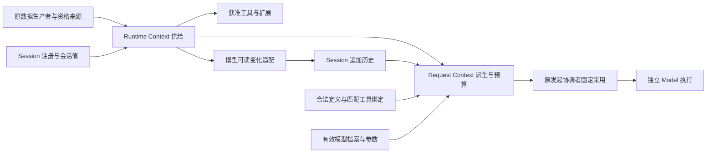

# Context 组工程关系

本页在正式位置维护待审细化，只有文档目标，没有真实包、公开形状或实际运行验证。产品既定规则保持原确认范围，阶段支持仍待用户选择。

## 1. 两个成员承担不同责任

`context/runtime-context` 承担注册关系的供给、按消费者资格读取当前块、变化供给及恢复协作。Session 拥有本会话的注册选择和自有值，原生产者拥有块的内容与读取规则。`context/request-context` 承担派生请求、模态表示、完整预算及压缩计算。最终发起协调者负责固定一致采用及发出前复核。

箭头表示公开协作，不表示进程、数据库或 Cordis 生命周期包含。三个 runtime 独立；Session 治理其业务关联，Agent 退出不自动取消 Model 或 Tool。

## 7. 验证责任与未覆盖

[RC-F04](../request-context/docs/key-flows.md#rc-f04)定位同源历史与中断投影，[RC-F09](key-flows.md#rc-f09)定位诊断、缓存与成本边界。旅程验证场景在两个成员 SPEC 的持续验证小节维护，图的存在不表示真实行为通过。

两成员分别维护 [Runtime Context SPEC](../runtime-context/SPEC.md) 和 [Request Context SPEC](../request-context/SPEC.md)。共同验证由最终发起及消费协调者承担，不以单成员检查代替整体授权、一致采用和耐久交接。

必要组合场景包括运行中撤权、空闲期间多次变化、移除后故障恢复、首次目录访问、压缩后完整供给、扩展改参后复核、超限保留历史、后台结果在原 Run 终态后转换失败，以及消费者更换后的原压缩调用接续。

公开操作、注册提交、一致读取、通知补查、转换接续、缓存协议、计量方法及在途耐久兑现尚未采用。已展示内容不能默认丢失，也不声称逐片同步耐久。模式修改主体及自动归档默认沿用户决定，租户配置、已有空闲计时及仅主会话常驻沿最新用户决定，精确授权与配置、计时机制由原拥有者细化。候选没有运行真实模型、工具、存储、并发、故障或性能验证。

## 协作导航

两成员供给与派生经公开契约交接，组维护双成员恢复与诊断的[组合流程](key-flows.md)。单成员精确流程分别由[runtime-context](../runtime-context/docs/key-flows.md)和[request-context](../request-context/docs/key-flows.md)拥有。共同提交与一致采用由实际协调者承担，组根不建统一SPEC。
