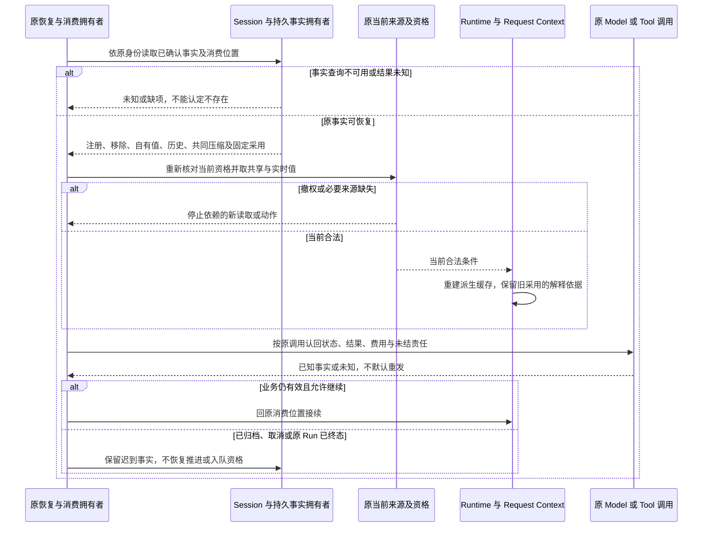
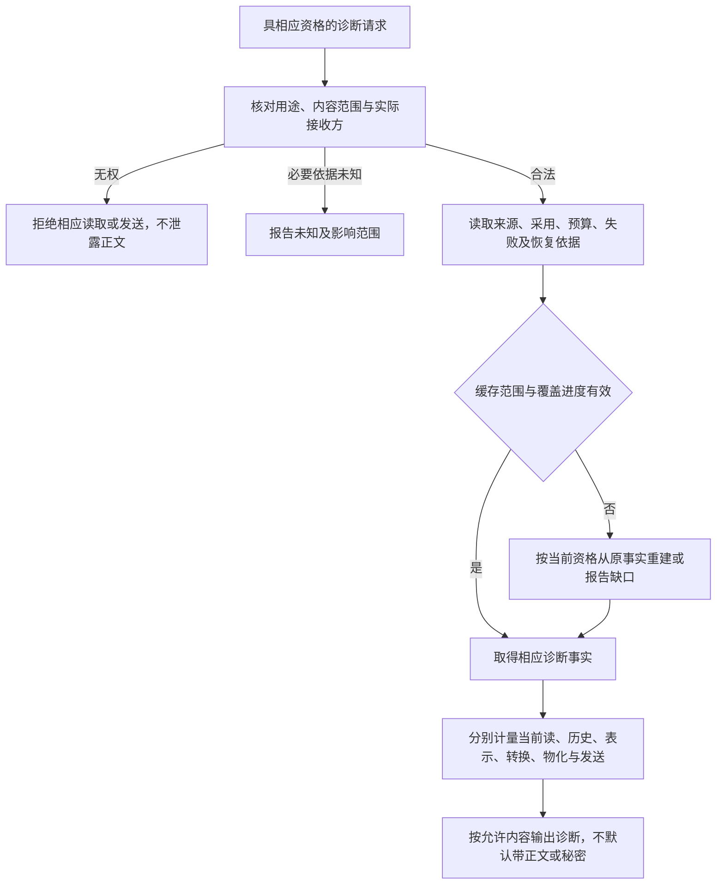

# Context 组恢复与诊断协作

本页在正式位置维护待审细化，只有文档目标，没有真实包、公开形状或实际运行验证。产品既定规则保持原确认范围，阶段支持仍待用户选择。

## 参与者与唯一机制源

| 参与者 | 本页使用的责任 | 唯一正文 |
| --- | --- | --- |
| Session | 会话注册、模式事实、自有值、可靠历史及 Run 业务状态 | [Session 架构](../../../docs/domains/sessions-and-work/architecture.md) |
| 原生产者与授权拥有者 | 原块、当前合法来源、读取及外传资格 | [本域事实归属](../../../docs/domains/runtime-context/architecture.md#2-事实拥有者与派生范围)、[身份架构](../../../docs/domains/identity-and-authorization/architecture.md) |
| Runtime Context | 注册供给、当前读取及变化协作 | [RC-02 至 RC-07](../runtime-context/SPEC.md#rc-02-原块与注册的必要条件) |
| Request Context | 明确输入的合法投影、实际表示、全预算及压缩计算 | [RQ-02 至 RQ-09](../request-context/SPEC.md#rq-02-组装的前置输入) |
| Agent 及其扩展 | 执行开始或挂接建立时拉取、模型前扩展、原推进位置与消息否决处置 | [Agent 架构](../../../docs/domains/agent-progression/architecture.md) |
| Model、Tool | 各自调用身份、真实执行、结果及费用 | [Model 架构](../../../docs/domains/model-invocation/architecture.md)、[Tool 架构](../../../docs/domains/tool-execution/architecture.md) |
| 消息接纳与原合法消费者 | 按来源处理消息准入，可靠保管原结果及原消费位置 | [RQ-08](../request-context/SPEC.md#rq-08-失败否决与消费位置)及 Session、Agent、Tool 的原消费契约 |
| 转换件装配与 Model 共同契约 | 转换键选择、输出形状、接纳前固定及本地转换范围 | [转换件的共同契约](../../model/model-contract/SPEC.md#转换件的共同契约) |
| 最终发起协调者 | 一致合法输入、发出前复核、固定实际采用和未知对账 | 主流程由 Agent 原推进路径承接；压缩、扩展和独立调用由各自原发起者承接，见 [RQ-01](../request-context/SPEC.md#rq-01-调用方与计算边界) |
| 交付面与诊断消费者 | 人侧读取、展示及按资格诊断 | [RQ-03](../request-context/SPEC.md#rq-03-历史与块投影)、[RQ-10](../request-context/SPEC.md#rq-10-性能缓存与观测) |

“原协调者”不是新增全局服务。每条路径须保留具名的原身份、用途与消费位置，未有 Session 的独立路径不造 Session 或 Run。图中的成功只指当前步骤，计算完成不等于已发出，已发出不等于真实收场，通知或展示不等于可靠承接。

## RC-F08 恢复原事实并重新取得当前条件

承接 [RC-J08](../../../.meta_harness/design/product/runtime-context/design.md#rc-j08)，能力 CAP-RC02、03、10。恢复不创建替代调用，不将旧快照变成当前许可。

模式创建默认不重套，主动移除不复活，撤销归档只按 Session 状态机回到休眠及其新工作入口。该状态机由 [Session 状态转移](../../session/session/docs/session-state-transitions.md)唯一维护，此处不复制第二状态机。归档取消控制可先于独立执行物理停止，迟到结果与费用仍保留原关联。

普通已确认事实须跨进程崩溃、OS 崩溃及断电保留。介质损毁与开放资格仍未代定。恢复协议见 [CONTEXT-M01](../../../.meta_harness/design/product/runtime-context/design.md#context-m01)及 [CONTEXT-M02](../../../.meta_harness/design/product/runtime-context/design.md#context-m02)，已展示在途内容见 [CONTEXT-M03](../../../.meta_harness/design/product/runtime-context/design.md#context-m03)。持续验证见 [RC-VJ08](../runtime-context/SPEC.md#rc-vj08)、[RQ-VJ08](../request-context/SPEC.md#rq-vj08)。

## RC-F09 诊断采用依据与长会话成本

承接 [RC-J09](../../../.meta_harness/design/product/runtime-context/design.md#rc-j09)，能力 CAP-RC01、08、10。读面的可重建缓存不能成为第二权威，诊断资格不授予正文或外传资格。

取消诊断只结束该读取。当前点查询不重扫全历史；列表、全文和实际物化仍计输出量。恢复后以历史采用解释原请求，以当前来源重建缓存。缓存容量、失效、覆盖、计量方法和资源规模见 [CONTEXT-M01](../../../.meta_harness/design/product/runtime-context/design.md#context-m01)、[CONTEXT-M02](../../../.meta_harness/design/product/runtime-context/design.md#context-m02)。持续验证见 [RC-VJ09](../runtime-context/SPEC.md#rc-vj09)、[RQ-VJ09](../request-context/SPEC.md#rq-vj09)，此图不提供性能通过证据。

## 单成员流程入口

| 流程 | 唯一位置 |
| --- | --- |
| RC-F01 | [成员流程](../runtime-context/docs/key-flows.md#rc-f01) |
| RC-F02 | [成员流程](../runtime-context/docs/key-flows.md#rc-f02) |
| RC-F03 | [成员流程](../runtime-context/docs/key-flows.md#rc-f03) |
| RC-F04 | [成员流程](../request-context/docs/key-flows.md#rc-f04) |
| RC-F05 | [成员流程](../request-context/docs/key-flows.md#rc-f05) |
| RC-F06 | [成员流程](../request-context/docs/key-flows.md#rc-f06) |
| RC-F07 | [成员流程](../request-context/docs/key-flows.md#rc-f07) |
