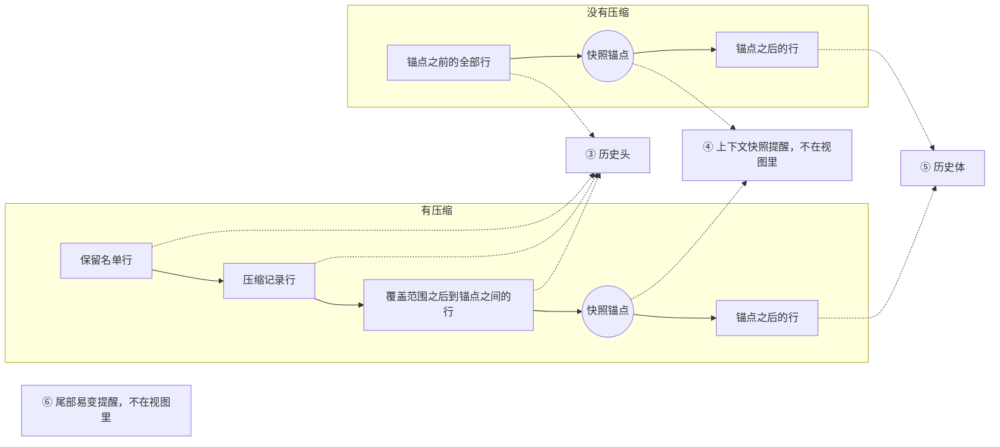

# @omne-harness/request-context-contract 行为规格

状态：契约成员，`draft`。请求组装的输入输出、独立与托管读取边界、候选重算、固定采用认回及失败处置由[技术接受](https://github.com/nemori-ai/omne-harness-lite/issues/262#issuecomment-6186972289)采用，本页在 RQ-01 至 RQ-09 保留它们的原意；改写处逐条标「取代」并给依据。组装输入的七组、装入裁定的四种、压缩计划归本域而调用归协调者、保留名单语义、六层装载布局与快照锚点、历史源读口与 epoch 视图，依据产品正文 [运行感知与一次模型请求](../../../.meta_harness/design/product/runtime-context/design.md) 第 4 版 §5 至 §7 写入，修订处注明依据。第 4 版是候选、待确认，按它写入的条款随它的确认生效；系统页 [Request Context](../../../docs/architecture/runtime/request-context.md) 依据第 4 版扩充的节是候选，状态行逐节列出。本页只拥有公开类型以外的必要行为。公开形状归 `src/`，导出导航归 [docs/public-api.md](docs/public-api.md)，对象的身份与生灭归 [docs/object-model.md](docs/object-model.md)。

本成员没有运行实现。提供者、存储、压缩算法与数值都不在这里定。设计接受不表示生产实现或运行验证已完成。

## 范围与依据

Request Context 是一次模型请求输入的派生计算与装入保证。它读取的全是别人拥有的事实：历史、runtime context 的读取结果、工具定义与绑定、模型档案与限制、提示词贡献和当前条件。它给出请求候选、覆盖证据、装入裁定、表示决定，以及需要时的压缩计划。它不拥有事实，不发请求，不固定采用，不写历史。

本页只用通用角色：协调者（为作用域发起模型请求与工具调用、固定最终请求的一方）、历史持有者（保存历史与压缩记录、给出未结工作的一方）、集成方、贡献者、调用方。本成员不认识上层工作流的具体类型。一次执行、持有者的一步、一次调用只以不透明引用出现。本页单说「步」时，指压缩计划里的步（修剪步或摘要步）。

依据的上层正文：

- 产品：[§5 当前值与变化感知](../../../.meta_harness/design/product/runtime-context/design.md#5-当前值与变化感知)、[§6 一次模型请求采用合法完整输入](../../../.meta_harness/design/product/runtime-context/design.md#6-一次模型请求采用合法完整输入)、[§6.1 Request Context 的派生计算](../../../.meta_harness/design/product/runtime-context/design.md#61-request-context-的派生计算)、[§7 压缩保留历史与未完工作](../../../.meta_harness/design/product/runtime-context/design.md#7-压缩保留历史与未完工作)、[§7.1 压缩计划与步骤](../../../.meta_harness/design/product/runtime-context/design.md#71-压缩计划与步骤)，第 4 版。
- 系统：[Request Context](../../../docs/architecture/runtime/request-context.md)、[装配与变化](../../../docs/architecture/runtime/assembly-and-change.md#比对代替求值)。
- 邻域契约：[Runtime Context 读取结果](../runtime-context-contract/SPEC.md#rc-04-读取时点观察与变化材料)、[Model 档案与请求准备协议](../../model/model-contract/SPEC.md#档案与请求准备协议)、[Model 分词与完整请求计量](../../model/model-contract/SPEC.md#分词与完整请求计量)、[Tool 可编程调用许可](../../tool/tool-contract/SPEC.md#可编程调用的定义与准入)、[压缩记录的形状与模型视图](../../common/message/SPEC.md#模型视图)。

压缩记录（`CompactionMessage`）的形状、模型视图规则 CM-01 至 CM-06 与两层判定归 `packages/common/message`。本页只引用编号，不重述形状。本成员依赖该页先于本页生效。

本成员的根入口与 Cordis 无关。提示词贡献的登记面归 [request-context-cordis-contract](../request-context-cordis-contract/SPEC.md)，缓存与默认策略归 [request-context](../request-context/SPEC.md)，isolate 绑定归 [request-context-cordis](../request-context-cordis/SPEC.md)。

## 结果与不变量

### RQ-01 调用方与计算边界

主流程、压缩、扩展及独立调用都可以消费本能力。每次调用给出明确用途、合法输入范围与原消费位置。托管路径保留适用租户、作用域与原调用的不透明引用；独立消费不创建任何上层对象。

本能力派生候选请求，不修改原历史、原块、注册或当前权限，不拥有模型执行的寿命与外部效果。最终发起的协调者负责一致读取、发出前资格、接收方、实际绑定与固定采用。本能力成功只表示按明确输入完成计算，不表示请求已发出、结果已承接或动作已获准。

一次请求的固定采用写在协调者的调用记录上，不另建一条上下文事实。系统提示词每次求值，不进历史。压缩只追加压缩记录，不改原历史。发出之后的寿命归模型调用。

本能力的全部操作是纯函数：同一组输入得同一结果；同一个计划、进度与步结果得同一步结局。缓存是实现的性能手段，不改变任何结果。同输入返回已有候选是本条的要求，不是缓存的许可。

纯计算可以只处理调用方提供的数据。读取系统托管历史、引用、模型档案或其他资源时，集成方按原来源契约兑现身份、资格及保留责任，不因未运行 Cordis 而绕过。独立入口的字节编码未定。

### RQ-02 组装的前置输入

一次组装接受七组输入。每组由谁给、缺了怎样、变了是否成为另一次候选，如下表。「缺了」列的结果按[组装的结果](#组装的结果)落位。「另一次候选」的含义是：尚未固定时输入有合法变化就重算，不返回变化前的候选。依据：产品 [§6.1](../../../.meta_harness/design/product/runtime-context/design.md#61-request-context-的派生计算)。

| 组 | 内容 | 谁给 | 缺了 | 变了 |
| --- | --- | --- | --- | --- |
| 调用身份与用途 | 访问身份、用途（主请求或扩展用途）、消费位置、候选身份 | 调用方 | 无效（缺必要输入）。托管读取必须带访问身份，纯计算可无访问身份 | 另一次候选；新候选身份即新准备 |
| 历史与新输入 | 历史依据（epoch、上界、作用域引用与访问身份，见 [历史源读口](#历史源读口与-epoch-视图)）、已可靠保存的新输入批 | 历史持有者的可信读取适配器；调用方 | 不可用（来源不可用）；新输入未保存为无效（缺必要输入） | 另一次候选 |
| runtime context 读取结果 | 完整或增量、来源与覆盖证据（含读取所用的资格身份）、④ 层的块材料（经模型资格过滤的当前值与前值，块带变化频率）；每次读取另带的逐请求块当前值（[RC-04](../runtime-context-contract/SPEC.md#rc-04-读取时点观察与变化材料)），⑥ 层取这一部分；上一次已采用的覆盖；压缩转换依据。块材料在完整读取时是本次读到的；增量读取时，调用方同时交入最近一次完整读取的块材料（按资格过滤后的值） | 调用方以模型类资格读取后传入，并跨请求保存最近一次完整读取的块材料。本能力不读 Runtime Context，也不保存块材料 | 不可用（来源不可用）；增量读取而缺最近一次完整读取的块材料为无效（缺必要输入） | 另一次候选 |
| 系统提示词 | 当前有效的提示词贡献集合（有序段、变量两类，各带来源与修订）；组装上下文（作用域引用、定义采用、工作区选择等不透明键） | 贡献集合：Cordis 路径上由 `assembly(scope, ports)` 交出的操作组在每次调用时从登记面现取，独立路径上由调用方传入；组装上下文：调用方 | 没有贡献即空提示词，不是错误；缺组装上下文为无效（缺必要输入） | 另一次候选 |
| 模型侧 | 选定模型（实际收件模型、已解析档案、输入模态、窗口与各限制、工具证据）、参数（含整体关闭回放，见 [RQ-04](#rq-04-模态与可追溯表示)） | 调用方经模型选择端口 | 无效（缺必要输入） | 另一次候选；收件模型变化还要求调用方重新读 runtime context |
| 工具侧 | 本次合法可用的完整工具定义、各自绑定采用、可编程许可 | 调用方经装配求值 | 空集合合法 | 另一次候选 |
| 当前条件与本次经过 | 条件证据的投影；上一次准备；扩展改写依据；调模型之前位置的经过 | 调用方 | 条件缺为无效（缺必要输入）；其余可空 | 条件变化只使未固定候选重算；同一经过不重复触发该位置 |

有效压缩记录从历史派生，不单独传入。历史里的块按模型可见标注与压缩记录筛（见 [RQ-03](#rq-03-历史与块投影)）。块材料是材料不是引用：组装要渲染提醒正文，所以需要值。私有块与权限输入不在模型侧读取结果里，组装永远看不到。

系统提示词每请求求值，单独计量，候选只含文本，不保存为历史消息，也不靠压缩删除固定要求。技能取用和命令展开沿自己的原路径进入历史，不偷换为长期系统设定。日期、当前目录、模型名、窗口占用这类会变的运行事实不走提示词贡献，只走 runtime context 块。带逐请求变化变量的提示词段被拒绝。依据：产品 [§6.1](../../../.meta_harness/design/product/runtime-context/design.md#61-request-context-的派生计算)。

本成员是下面两条 runtime context 块的语义拥有者。它在根入口导出这两条块声明，并用 `declare module` 增补 `ContextBlocks`（[RC-02](../runtime-context-contract/SPEC.md#rc-02-块声明注册与参数)）。依据：产品 [§2.2](../../../.meta_harness/design/product/runtime-context/design.md#22-块声明归语义拥有者)。

| 块键 | 种类 | 允许的消费者类 | 变化频率 | 恢复方式 | 值 |
| --- | --- | --- | --- | --- | --- |
| `context.compaction-settings` | 供给块 | `model` | `stable` | `reread` | 当前压缩策略的保留预算（保留比例或保留 token 数）与保留偏好 |
| `context.window-usage` | 供给块 | `model` | `per-request` | `recompute` | 该作用域最近一次固定请求的占用与窗口上限的比例 |

两块的生产者是本成员的装配提供者，它经 Runtime Context 的生产者面（[RC-07](../runtime-context-contract/SPEC.md#rc-07-生产者句柄并发撤除与恢复)）登记供值。本成员的纯操作不读 Runtime Context，也不登记生产者。值的精确形状随实现进入 `src/`。

`context.window-usage` 的值是该作用域最近一次固定请求的占用比例。读取先于组装，读取时本次请求的占用还不存在，所以这一块不给本次请求的占用。[request-context](../request-context/SPEC.md) 从输入「已采用」得知一次请求已经固定，记下这次请求的占用比例，经生产者供值。进程重启之后、下一次固定请求之前，这一块读到缺项。

本次要承接的普通新输入与相关历史消息先完成可靠保存，再组装。确认持久边界含进程崩溃、操作系统崩溃和断电。只在内存队列到达或读到未确认消息不满足前提。

工具声明与实际合法绑定一致，并保留工具的可编程调用许可及原定义采用。直接模型工具集合与脚本可调用集合分别投影，未声明许可的工具不能出现在后者。本成员不把声明投影当作执行授权。模型档案及参数属于明确有效采用范围。来源并发更新时不能拼旧档案、新 schema、旧实现成从未合法成立的请求。需要共同版本边界的部分由协调者保护。

依赖未满足的几种情形分别落位，名称以[组装的结果](#组装的结果)表为准：来源不可用归失败「不可用」；runtime context 读取结果为缺项，也归失败「不可用」（来源不可用）；无权归失败「无权」；格式不受支持归失败「无效」；来源读取未知或提交未知归「未知」。依赖未满足时不生成冒充完整合法输入的空白成功，不为方便改用其他租户内容或秘密。

组装的最小对接如下。得到结局只表示计算完成。

| 项 | 规则 |
| --- | --- |
| 关联身份 | 候选身份。已经固定的采用写在协调者的调用记录上 |
| 必要参数 | 七组输入。托管读取再带租户 |
| 结局 | 四种结局之一，见[组装的结果](#组装的结果)。候选成立时返回请求候选、覆盖证据、装入裁定、表示决定 |
| 失败 | 无权、无效、不可用三类，见[组装的结果](#组装的结果) |
| 未知 | 来源读取未知或提交结果未知。不改用其他租户的内容 |
| 同身份重试 | 尚未固定时，输入有合法变化就重新计算；七组逐项相同（上一次准备不参与比较）才返回已有候选。固定采用只经输入「已采用」进来，本能力不保存它：输入带已采用且七组逐项相同时返回原采用 |
| 参数冲突 | 档案、绑定和实现不能同时合法则返回无效。已经固定后，带矛盾输入的重试返回无效，另一组采用不能改写这次输入 |

覆盖证据逐项记录这次用了哪些输入及其修订：历史范围与 epoch、有效压缩记录、新输入批身份、快照修订与快照锚点、提示词各段来源与修订、档案与参数（含是否整体关闭回放）、工具声明摘要（两集合）、条件证据、改写依据、表示决定摘要、预算报告摘要（含待加载媒体与限额未知）、前缀变化原因。它回答三个问题：模型这次看到了什么，和上一次相比什么变了，请求开头为什么变了。协调者把它随最终请求记录保存，下一次经「已采用」传回。

#### 组装的结果

一次 `assemble` 或 `resume` 的结果只落在下表的一行。表是封闭的，没有其他结果。计划操作的结果见表后的[计划操作的结果](#计划操作的结果)。依据：产品 [§6.1](../../../.meta_harness/design/product/runtime-context/design.md#61-request-context-的派生计算)「限额未知不是失败」与 [CONTEXT-M02](../../../.meta_harness/design/product/runtime-context/design.md#context-m02)。这张表取代已接受旧 RQ-02 的「成功／拒绝／未知」三分：旧「成功」对应四种结局，旧「拒绝」拆成三类失败，「未知」保留；固定部分超限不再是拒绝，归结局「装不下」。

| 类 | 取值 | 落入的情形 |
| --- | --- | --- |
| 结局 | 候选成立待扩展 | 装得下或限额未知，尚未经过调模型之前的扩展位置 |
| 结局 | 候选成立可固定 | 装得下或限额未知，已经过该位置 |
| 结局 | 需要压缩 | 预算不通过，非固定部分可压，本次准备尚未进入压缩计划 |
| 结局 | 装不下 | 固定部分超限；本次准备已进入过压缩计划仍不通过；`resume` 补入完整快照后仍超限 |
| 失败 | 无权 | 身份或资格不足，含历史源读口按访问身份核对后返回无资格 |
| 失败 | 无效 | 缺必要输入，含托管读取缺访问身份或作用域；输入不合形状或越出范围，含格式不受支持、对压缩步请求调组装、带逐请求变化变量的提示词段、档案与绑定不能同时合法、`resume` 带转换依据而读取结果不是完整快照、操作组的作用域与组装上下文或历史依据的作用域引用不一致；已经固定后带矛盾输入重试 |
| 失败 | 不可用 | 没有可用表示（带原结果）；来源不可用，含历史源、计量端口、转换件结果端口不可读或缺席，以及 runtime context 读取结果为缺项；实例已关闭或服务已卸载 |
| 未知 | 未知 | 来源读取未知；提交结果未知 |

装不下是结局，不是失败。托管路径上，协调者收到装不下后按 [RQ-08](#rq-08-失败否决与消费位置) 明确失败。

#### 计划操作的结果

`planCompaction` 与 `deriveStep` 的结果如下，也是封闭的。两者的失败用上表同一套三类（无权、无效、不可用），未知同上表。

| 操作 | 正常产出 | 装不下 | 归无效的情形 |
| --- | --- | --- | --- |
| `planCompaction` | 压缩计划（计划身份、步数上界、第一步） | 未结工作的下界集合本身超出保留预算 | 同上表的无效情形 |
| `deriveStep` | 下一步，或压缩转换 | 计划用完仍没有合法摘要；某一步被否决 | 同上表的无效情形；计划身份核对失败；已完成步数核对失败；计划记录的策略身份或参数摘要与当前策略不符 |

### RQ-03 历史与块投影

模型侧只取明确标为模型可读且满足当前资格的块，再按有效压缩记录计算模型视图。人侧与模型侧标注独立，常态消息类型表不代替实际块标注。缺失或不明确标注不进入模型请求。保留名单不绕过块标注：视图内每条消息仍按块级模型可见标注过滤。

`ToolInternalMessage` 始终在模型请求前排除，不提供配置绕过。未收齐工具参数不解析执行，残缺调用可按原规则留历史备查，但派生请求剔除该调用，不改原件或原消息。

用户叫停且已有交付内容，按原消息形成规则保留标为中断的消息，模型侧剔除不完整调用。无内容不造空回复。出错已交付内容沿原调用记录可查，不冒充完整回复。中断原因提醒由原消费路径追加，不能凭缺少回复让模型猜原因或重做效果。

消息来源不用正文标记解析。状态和事件提醒均追加且保留实际感知链。未经过合法压缩，不能先按「同一块只取最新提醒」再筛一道。首次及压缩后纳入当前合法完整快照，工具或扩展私有块不因补全路径进入模型。

人侧投影由纯函数 `projectForHuman` 给出，与模型侧投影 `project` 共用同一套块标注规则。它供历史持有者与交付面调用，不分页，不写回。最近一段、向前追加与接新内容分别可辨，读者加载进度不写回历史。模型预算不删人侧原件。本成员不新增分页公开操作。这一条取代已接受条款里人侧历史查询的分页归属：人侧投影的分页与交付归交付面。依据：产品 [§6.1](../../../.meta_harness/design/product/runtime-context/design.md#61-request-context-的派生计算)。

### RQ-04 模态与可追溯表示

文字、图片和语音为当前明确支持目标，不要求每个模型支持全部。实际媒体类型决定内容模态，文件块是引用载体，不自动代表模型可读的文本。图片、语音、附件及派生表示全部按真实发送内容处理。

选用有效模型可接纳的原件、派生表示或 transcript。多种表示都可用时消费明确的表示策略，不静默丢弃不相容内容。表示策略是可替换实现，默认实现只是初值。转换件保留原块关联与来源，不覆盖原始内容或原可见性，也不绕过原权限。模型未提供的内部推理不能补造。

工具结果采用独立分流。附件区只成为地址文本，不进入媒体读取或模态约束。消息内容中的模型可见引用保留原引用，标为待加载，在模型真正请求时才加载二进制及完成必要转换。消息准入、历史投影和请求组装不得为了产生 transcript 提前读取这些字节。其他消息来源继续使用接纳前转换规则。

非工具引用路径中，必要转换的缺少能力、执行失败与表示不存在分别报告。消息准入失败不删除原结果，不能用空文本或猜测的 transcript 当成功。带模型读取标注的非文本块或文件参与转换，包括同时供人和模型读取的内容。纯文本及只供人读取的块不受不适用转换件否决。适用转换在消息准入前完成，不因当前模型能读原件而跳过。准入后派生表示及 transcript 固定，不随转换件更换改写。请求只消费这些表示。

转换件的选择键、媒体类型优先、合法输出、原块关联及本地转换范围消费 [Model 转换件共同契约](../../model/model-contract/SPEC.md#转换件的共同契约)。本规格不另定转换件协议。接纳路径依该契约区分未登记与已登记但失败，并保存接纳时固定的表示及来源。本成员只读取其合约结果。未登记而准入的无 transcript 原块仍参与相应历史模态约束。

转换不承诺无损。交付面须能说明本次模型读取的是哪份表示。实际模型不支持必要表示时按真实能力判断，不能从 transcript 存在推出所有在册档案都可选。

历史模态约束只纳入模型可见且无 transcript 的相关历史块。约束在固定候选及能力条件下只收紧。压缩不改原可见性，也不据此声称历史模态约束消失。Model 拥有合法候选与切换判断，本成员消费其有效档案并检查实际可读输入。

工具内容引用的元数据参与实际模型可读性检查，附件地址文本不增加相应媒体模态。本成员从完整工具定义形成 Model 的工具声明，并保管原工具与命令路由。Model 适配器仅接收模型请求值，不消费工具定义或注册表。

assistant 消息里的推理续接状态部件与其他块一样进入历史投影，只按块的模型可读标记筛选（[RQ-03](#rq-03-历史与块投影)）。本成员不按目标模型挑选这些部件，也不按目标模型改写或删除 `thinking` 块。原因是一次档案调用可能回退到另一个供应商，实际供应商只有每次发出时才知道。每次发出带哪些推理状态、外来可见推理怎样处理，由 Model 按这次供应商的回放声明决定。

投影去掉一条 assistant 消息里的块时，本成员按消息成员的 RS-04 重写这条消息回放描述里的位置索引 `replay.at`，并删去悬空的配对引用，使交给 Model 的消息仍然合法。

调用方可以按原消费者的要求为一次请求整体关闭回放。这项选择属于组五的参数（[RQ-02](#rq-02-组装的前置输入)），本成员把它原样带进候选并记入覆盖证据，它变化即另一次候选。这是本成员影响推理状态的唯一手段，用于推理状态被持续拒绝时让作用域继续前进。压缩记录的摘要不含推理续接状态，保留名单里的消息原样保留它（[RQ-06](#rq-06-压缩共同结果与保护边界)）。

这三段的依据：推理续接状态与位置索引重写归消息成员的[推理续接状态](../../common/message/SPEC.md#推理续接状态)与 [RS-04](../../common/message/SPEC.md#rs-04)，回放声明与整体关闭回放归 Model 契约的[推理回放](../../model/model-contract/SPEC.md#推理回放)。

### RQ-05 完整预算与候选完成

预算计入全部系统提示词、适用历史、提醒、投影后的工具声明和最终选择的实际模态内容，含完整快照提醒、尾部易变提醒及实际提供者映射的必要表示。不能只计最新用户文本或忽略工具 schema。

模型档案提供已知有效上下限。字节、图片数等精确约束实际检查，token 使用适用计量与明确余量估计。计量归 Model 的计量端口，阈值比较与取整归本成员。未知上游限制报告未知，不伪造数值。实际物化、模态读取和转换成本不能因缓存命中而从资源计量消失。

装入裁定四选一：装得下、固定部分超限、需要压缩、限额未知。限额未知不是失败：候选照常成立，覆盖证据标明限制未知，发出与否由 Model 发送期按真实能力裁定。依据：产品 [§6.1](../../../.meta_harness/design/product/runtime-context/design.md#61-request-context-的派生计算)。

一次组装只得到四种结局之一，或三类失败之一，或未知，逐项见[组装的结果](#组装的结果)。装得下与限额未知给出候选；需要压缩时由 `planCompaction` 给出压缩计划；固定部分超限直接装不下；计划用完仍没有合法摘要按压缩后仍装不下处理（[RQ-06](#rq-06-压缩共同结果与保护边界)）。没有第五种结局。表示不可用是失败「不可用」的一种，带原结果，不是第四类失败。

候选交回时，所有可取得事实须已通过目标模型限制检查，或明确失败并解释原因。工具内容引用尚未加载时，按 [Model 准备协议](../../model/model-contract/SPEC.md#档案与请求准备协议)明确保留待加载媒体及待核验引用，不声称完整预算已通过。Model 实际发送前物化并重计全部限制，未通过不得发出。

### RQ-06 压缩共同结果与保护边界

是否压缩、怎样压缩及能否装入窗口由本成员承接。协调者消费装得下或明确失败，不另拥有预算策略。硬限额先满足，再兼顾前缀一致、信息保留与长度。前缀一致是优化目标，不是任意变化后逐字不变的保证。

压缩只处理历史持有者的历史中允许压缩的内容。一次压缩确定压缩覆盖范围：从历史起点开始，到压缩点之前的某一处结束，并包含上一条压缩记录。它为这段范围生成摘要，并点名范围内仍要原样交给模型的消息。这份点名就是保留名单。保留名单取代已接受条款里的「排除名单」，依据是[压缩记录的模型视图规则](../../common/message/SPEC.md#模型视图)。摘要、覆盖范围和保留名单共同形成追加的压缩记录，不改原块、不改人侧或模型侧原标注、不删任何原历史。摘要与名单不能分别提交成无法解释的半份压缩事实。形状与模型视图规则 CM-01 至 CM-06 归 [压缩记录](../../common/message/SPEC.md#模型视图)。依据：产品 [§7](../../../.meta_harness/design/product/runtime-context/design.md#7-压缩保留历史与未完工作)。

压缩之后模型看到的历史，顺序见[epoch 视图到六层的映射](#epoch-视图到六层的映射)的「有压缩」一栏。覆盖范围可以在压缩点之前结束，范围之后、压缩点之前的消息照常出现。再次压缩时，新的覆盖范围包含上一条压缩记录和它的保留项。

压缩计划先定覆盖范围，再在保留预算内选保留名单。范围终点不能把一次工具调用和它的结果分在两侧，除非调用一侧进了保留名单。调用与结果都在覆盖范围内时，两者一起保留或一起摘要。依据：产品 [§7](../../../.meta_harness/design/product/runtime-context/design.md#7-压缩保留历史与未完工作)。保留名单尽量取范围较新一端或被引用多的消息，使模型视图的前缀尽量稳定。保留名单在压缩时固定，之后不变。

上次模型请求之后尚未让模型读取的新输入不压。未答等待和未结后台执行的占位不压。这些未结工作要么进保留名单，要么留在覆盖范围之后。什么属于未结工作由历史持有者与原执行拥有者判断，并以条目引用集合交给本成员作为下界；下界包括最近一次模型调用固定输入之后写入、模型尚未读取的输入。本成员不能凭界面不可达或查询失败认定已经结束。下界集合本身超出保留预算时，`planCompaction` 返回结局「装不下」：不为装下它而缩短覆盖范围，也不突破保留预算。

计划归本成员，调用归协调者。需要压缩时，由 `planCompaction` 给出压缩计划：计划身份、步数上界、每步的类型与请求。依据：产品 [§7.1](../../../.meta_harness/design/product/runtime-context/design.md#71-压缩计划与步骤)。

步只有两种，修剪步排在摘要步之前。修剪步不调用模型，只缩短交给摘要步的材料中过大的工具结果与媒体占位，不改原记录。它在 `deriveStep` 内由本成员完成，是纯计算：输入是计划、进度与材料，输出是修剪后的材料与下一步。协调者不为它发模型调用，但它仍记一步进度。修剪步之后必有摘要步。修剪不改变装入裁定，也不改模型视图。

摘要步是一次内部模型调用。本成员给步请求，协调者执行并把结果交回，本成员推导下一步。步请求不经组装，不递归。摘要调用的身份、费用、取消与恢复由发起它的协调者记录，结果不直接形成主流程的助手消息。

这一条取代已接受条款里「压缩内部模型调用有独立原调用身份」中由谁分配和记录的部分：摘要调用仍有自己的身份，由发起它的协调者分配并记录，不由本成员分配。

计划在给出时定下步数上界，之后不变。计划同时记录给出它的压缩策略的身份与参数摘要。每完成一步，计划进度恰好加一，由协调者可靠保存，中断后从已完成的步接续。同一次请求准备至多进入一次压缩计划。步数用完仍没有合法摘要，或某一步被否决，`deriveStep` 按压缩后仍装不下返回结局「装不下」，不在相同条件下重开计划。`deriveStep` 核计划身份、已完成步数、策略身份与参数摘要，任一项核不过返回无效。

压缩策略可替换。它的触发界线、保留预算（保留比例或保留 token 数，作用于保留名单）、保留偏好（较新优先或被引用多优先，默认较新优先）、修剪优先与步数上界是配置项，默认值只是初值，具体数值归 [request-context](../request-context/SPEC.md)。

摘要步产出合法摘要且装得下时，本成员给出压缩转换：压缩记录、摘要与保留名单及覆盖范围一致的证明、以及绑定原准备身份与每步消费依据的承诺。同一承诺只配一条压缩记录。转换由历史持有者（保存记录与范围转换）与协调者（接续位置）在一次权威提交中完成。提交未知按原操作查询，不用未提交的派生冒充已压缩。

压缩提交后补入完整合法快照，再计全部输入限制。持有者在提交压缩之后、为模型类读者重签读取资格之前崩溃时，恢复由持有者收口：它先重签模型类读者的资格，再接续。`resume` 拿到转换依据而 runtime context 读取结果不是完整快照时，返回无效；协调者据此重新完整读取，再调 `resume`。当前数据不是可删旧历史提醒的替代源。补入后仍超限，返回结局「装不下」，协调者据此明确失败；不能只检查摘要长度就声称成功。

### RQ-07 扩展修改、发起与固定采用

调模型之前位置的扩展作用于尚未发出的候选。改内容、参数或日志后，必要时重组装或重新校验预算、合法绑定、资格及实际接收方。同一次经过不再次触发这个扩展位置。只追加到历史体尾部的改写不改变前缀；触及已有层的改写在覆盖证据记「扩展改写」为前缀变化原因。

一次请求准备对应一个候选身份。换候选身份即开始新的准备，计划次数随之重置。纯函数从输入「上一次准备」得知本次准备是否已进入过压缩计划。重组装后仍装不下，而本次准备尚未进入压缩计划时，可以进入一次压缩计划，之后再复核。本次准备已经进入过计划的，返回结局「装不下」（压缩后仍超限）。

协调者固定实际模型、参数、历史范围、快照与锚点、工具声明与绑定及足以解释输入的采用依据，发出前确认当前发起条件。发出之后的定义、权限或 runtime context 变化不回写该请求。未来动作独立判断当前资格。

派生完成不等于发出成功。发出或提交未知回协调者与模型调用身份对账，查询不可用不证明原执行丢失。本成员不自动重发、不新建相同调用、不因恢复重记原费用。

### 装载布局与前缀

一次请求的内容自上而下分六层排列。越稳定的内容越靠前，变化只发生在尾部。这是契约常量，改它是契约变更。依据：产品 [§6.1](../../../.meta_harness/design/product/runtime-context/design.md#61-request-context-的派生计算)、[§5.1](../../../.meta_harness/design/product/runtime-context/design.md#51-首次注入锚定快照与追加提醒)。

| 层 | 内容 | 什么时候变 |
| --- | --- | --- |
| ① 系统提示词 | 有序段与变量渲染的纯文本 | 贡献变化 |
| ② 工具声明 | 本作用域合法工具的完整集合，直接集合与脚本可调用集合 | 工具采用集合变化；不按步裁剪可用性 |
| ③ 历史头 | 快照锚点之前的全部模型可读历史。有压缩与没有压缩时的构成见 [epoch 视图到六层的映射](#epoch-视图到六层的映射) | 压缩；新的完整读取移动锚点 |
| ④ 上下文快照提醒 | 当前允许模型读的全部稳定块的完整值，位于快照锚点 | 新的完整读取 |
| ⑤ 历史体 | 锚点之后的全部模型可读消息，按原顺序，包括变化提醒、事件提醒和本次新输入 | 每次追加 |
| ⑥ 尾部易变提醒 | 逐请求变化的块的当前值，位于请求最末 | 每次请求 |

压缩记录不单列一层，它在历史头里。模型视图只按最近一条压缩记录计算，视图里起压缩记录作用的只有这一条。较早的压缩记录落在最近一次压缩的覆盖范围内，被摘要取代；新压缩把它列入保留名单时，它只作为一条保留消息出现（[RQ-06](#rq-06-压缩共同结果与保护边界)）。

布局规则：

| 编号 | 规则 |
| --- | --- |
| R1 | 系统提示词只放慢变内容；日期、当前目录、模型名、占用比例不进系统提示词 |
| R2 | 动态运行事实只走 runtime context 块；提示词贡献只有有序段与变量两类 |
| R3 | 工具声明按合法工具的完整集合投影；可用性变化在发起时由工具侧再核 |
| R4 | 上下文快照提醒锚定在本次完整读取发生时的模型可见历史尾部，不含本次请求承接的新输入；在下一次完整读取之前，每次请求都把它放在同一锚点；锚点记在覆盖证据里，经「已采用」传回下一次组装；④ 的块材料每次都由调用方交入：完整读取时是本次读到的，增量读取时是最近一次完整读取的，本能力不保存它；压缩之后重给的快照锚在当时的历史尾部；覆盖范围延伸到压缩点时，这个尾部就是压缩记录之后 |
| R5 | 块变化、工具转后台、后台结果到达、外部捎话一律以提醒追加进历史，不改快照、不改早先消息 |
| R6 | 逐请求变化的块只进尾部易变提醒，不进快照，不产生变化提醒 |
| R7 | 压缩的保留名单尽量取范围较新一端或被引用多的消息，使视图前缀尽量稳定 |
| R8 | 扩展改写触及①至④已有内容时，覆盖证据记「扩展改写」；只追加到⑤尾部的不算 |
| R9 | 系统提示词或工具集合需要变化时立即变化，不为保住已缓存的开头而推迟；覆盖证据记原因 |

前缀变化原因（覆盖证据的 `prefixBreak`）只取以下值：新的完整读取换了快照、系统提示词变了、工具集合变了、发生了压缩、扩展改写了已有内容、换了模型、无变化。

### 历史源读口与 epoch 视图

历史持有者把模型可见历史物化为 epoch 视图：一个 epoch 是两次压缩之间的模型可见序列，每次压缩开新 epoch，首行序列为保留名单、压缩记录、保留尾。每行有序号、持有者条目位置、字节数与前缀摘要（上一行摘要与本行摘要的链式散列）。本成员不知道物化方式，只消费读口 `HistorySource.read`。它的输入是：历史依据（epoch、上界与作用域引用）、访问身份（主体与租户）、游标与字节预算。它返回一页、epoch 已变、无资格、无效或不可用。缺作用域引用或访问身份时返回无效，不用构造时的身份代替。「无资格」由读口按这次传入的访问身份核对。

| 规则 | 内容 |
| --- | --- |
| H1 | 同一次组装（同一候选身份）内所有页用同一历史依据，满足 [RQ-02](#rq-02-组装的前置输入) 的共同版本边界 |
| H2 | 读到「epoch 已变」表示持有者在本次组装期间提交了压缩；本成员用返回的当前依据重取并重算候选，不拼接两个 epoch 的页 |
| H3 | 本成员在覆盖证据记每层锚点处的序号与前缀摘要；下一次组装读到同一序号时比较摘要，相等即前缀未变，不等的唯一原因是 epoch 变化。判断是常数时间，不逐条比对 |
| H4 | 层映射：历史头是 epoch 中在快照锚点之前的行。有压缩记录行时，其中序号不大于压缩记录行的是保留名单与压缩记录，其后到锚点之间的是覆盖范围之后的消息；没有压缩记录行时，是锚点之前的全部行。历史体是锚点之后的行。快照提醒与尾部易变提醒不在视图里。图示见 [epoch 视图到六层的映射](#epoch-视图到六层的映射) |
| H5 | 页按字节预算截断；计量仍由 Model 的计量端口做，字节数只用于分页预算 |

覆盖证据的历史部分记 epoch、上界与各层锚点的序号与前缀摘要。「已采用」回传时持有者据此知道哪个 epoch 的哪个位置被固定过。

#### epoch 视图到六层的映射

下图是 H4 的图示，分没有压缩与有压缩两栏。视图里的行按序号自上而下。快照锚点是视图里的一个位置，不是一行。④ 放在锚点处，⑥ 放在请求最末，两者都不在视图里。

有压缩时，保留名单行按原顺序排列，序号都小于压缩记录行。覆盖范围可以在压缩点之前结束，这时范围之后、压缩点之前的消息落在「覆盖范围之后到锚点之间的行」。

## 所有权、失败与生命周期

### RQ-08 失败、否决与消费位置

固定部分超限或合法压缩后仍超限，返回结局「装不下」及原因与原采用范围，协调者据此明确失败。托管路径按消费契约指定的仍有效未终态工作失败并上交，保留作用域、历史、设置和已有结果。原工作已终态时不能反转，条件不变不无限新建工作重做。

独立计算或调用向其调用方返回失败，不暗造任何上层对象。不默认分叉、删历史或换模型。合法条件后来改变时，新工作沿现有入口判断，不复活失败的原工作。

外部输入准入或转换否决告知发送方，不形成该作用域的消息。模型回复否决保留真实收场及否决原因，不交模型故障重试策略；仍有效的原工作按适用退避继续。连续否决不设次数上限，不因此使原工作失败。具体设置与推进由协调者拥有。不能以此修改终态或取消后的工作资格。

工具结果准入或转换否决前，工具侧与原合法消费方可靠保管原结果及消费关联。否决使明确消费契约指定的仍有效未终态工作失败。后台、工作外和原工作已终态时，不能改旧终态、挂无关后继、造新工作或恢复取消后的入队资格。旁路具体后果缺项交原拥有者，不填默认。

原结果保留后，重试派生或转换不等于重跑外部工具。已有扩展判断、模型调用及副作用按原身份接续。合法消费者失去资格后停止新交付，保管与未结责任仍由原生产方或获准接手者承担。

### RQ-09 取消、恢复与迟到

取消组装结束其待处理计算，不证明压缩内部模型调用已经物理停止，不撤销已提交摘要或外部效果。业务取消沿原工作或独立调用的控制协议传播；释放本地资源不等于取消原执行。

作用域结束时，业务取消归协调者，本成员只认回迟到结果。这一条取代已接受条款里「作用域结束使业务取消生效并解除等待」的写法，依据同 [RC-07](../runtime-context-contract/SPEC.md#rc-07-生产者句柄并发撤除与恢复)。原独立执行仍可能收场与收费，迟到结果回原身份及消费位置，不恢复入队或推进。成本未知保留未结责任，不编零。

已确认保存的普通事实、压缩转换、固定采用、计划进度及承接位置跨进程崩溃、操作系统崩溃和断电保留，保存归协调者与历史持有者。恢复区分原采用、当前条件与派生缓存：缓存失效可重建，但不能用最新值假装原请求，也不能照搬旧允许。中断的压缩计划从已完成的步接续，不重开计划。

已展示在途内容的故障保留机制仍缺项，归产品 [CONTEXT-M03](../../../.meta_harness/design/product/runtime-context/design.md#context-m03)。本规格不授权丢失，也不要求未经决定的逐片同步落盘。

## 组合与验证

### RQ-10 性能、缓存与观测

派生可读集合、历史索引、稳定前缀、提示词各段渲染结果与工具声明投影可以缓存。缓存只存候选内容与各层的渲染结果，不存组装结局；结局每次按本次输入（含「上一次准备」）计算。⑥ 尾部易变提醒与装入裁定每次重算，不进缓存。每份缓存的键是七组输入各自的修订摘要，按组失效，失效来源是输入携带的修订或计数，不是时间，不是文件时间或内容重哈希。输入的来源拥有者按[比对代替求值](../../../docs/architecture/runtime/assembly-and-change.md#比对代替求值)维护变更计数。相同规则与输入的派生结果一致，有缓存与无缓存同输入结果相同。缓存键的组成与预计算派生物归 [request-context](../request-context/SPEC.md)。

超长历史不能让每次准备重扫全部历史。冷加载、连续追加、压缩、runtime context 变化与模型切换分别度量，不编规模、延迟或算法。

诊断可追踪来源、采用范围、保留名单、表示选择、实际预算、失败位置及恢复责任。遥测不默认发送原正文、秘密、图或附件地址。实际接收方、目的和外传资格单独核对。

### RQ-11 持续验证与未覆盖

后续成员和真实组合至少持续验证以下行为。这是义务，不是本次已执行的测试。

| 场景 | 必须检查的结果 | 条款 |
| --- | --- | --- |
| 新输入可靠保存后组装 | 采用范围能恢复，未保存内容不提前发模型 | RQ-02 |
| 七组逐项相同 | 返回已有候选，不重算；任一组变化即重算 | RQ-01、RQ-02 |
| 组装期间来源并发更新 | 不把旧档案、新 schema、旧实现拼成从未合法成立的请求 | RQ-02 |
| 组装的结果 | 每种情形只落入[组装的结果](#组装的结果)表的一行，不出现表外结果；固定部分超限是结局「装不下」，不是失败；实例关闭或服务卸载后的组装返回不可用 | RQ-02、RQ-05 |
| 计划操作的结果 | `planCompaction` 只给计划或装不下，`deriveStep` 只给下一步、压缩转换或装不下；计划身份或进度核对失败返回无效 | RQ-06 |
| 混合标注与 `ToolInternalMessage` | 私有、未标注及过程内容不外发；保留名单不绕过块标注 | RQ-03 |
| 混合模态及不同模型 | 原件、派生与 transcript 选择可追溯，全预算含实际内容 | RQ-04、RQ-05 |
| 推理续接状态与模型切换 | 同一历史换目标模型，投影出的推理续接状态部件与 `thinking` 块不变；去块后 `replay.at` 与配对引用仍合法；整体关闭回放原样进候选并记入覆盖证据，变化即重算 | RQ-02、RQ-04 |
| 限额未知 | 候选成立且覆盖证据标明，不作失败 | RQ-05 |
| 覆盖范围与配对 | 范围从起点开始；调用与结果不被分在两侧，除非调用进保留名单；两者都在范围内时一起保留或一起摘要 | RQ-06 |
| 未读输入、未结等待与后台占位 | 下界集合里落在范围内的条目都在保留名单；下界集合本身超出保留预算时为装不下，不缩短覆盖范围、不突破预算 | RQ-06 |
| 保留名单选择 | 按保留偏好取范围较新一端或被引用多的消息；保留名单在压缩时固定，之后不变 | RQ-06、R7 |
| 修剪步与摘要步 | 修剪步在 `deriveStep` 内完成，不调模型，不改原记录，不改变装入裁定，之后必有摘要步；摘要步不经组装、不递归 | RQ-06 |
| 压缩提交后复计 | 补入完整合法快照后再计全部输入限制；仍超限即装不下，不只检查摘要长度 | RQ-06 |
| 压缩后重签前崩溃 | 持有者恢复时先重签模型类读者资格再接续；`resume` 拿到转换依据而读取结果不是完整快照时返回无效 | RQ-06 |
| 计划进度 | 每步恰加一；至多一次计划；用完即压缩后仍装不下 | RQ-06、RQ-07 |
| 计划与策略 | 计划记录策略身份与参数摘要；换策略或改参数之后 `deriveStep` 返回无效 | RQ-06 |
| 快照锚点 | 同一完整读取代内每次请求锚点相同；压缩后锚点在当时的历史尾部，覆盖范围到压缩点时即压缩记录之后 | R4 |
| 增量读取时的快照提醒 | 调用方交入最近一次完整读取的块材料，④ 与完整读取时逐字相同；缺这份材料时返回无效；本能力不保存它，缓存缺失时从输入重算得同一结果 | RQ-02、R4 |
| 结局不进缓存 | 同一组七组输入、不同「上一次准备」时，候选内容相同，结局按「上一次准备」分别得出；有缓存与无缓存结局相同 | RQ-10 |
| 窗口占用块 | 值是该作用域最近一次固定请求的占用比例；进程重启后到下一次固定请求之前读到缺项 | RQ-02 |
| 系统提示词与工具声明 | 日期、当前目录、模型名、占用比例不进系统提示词；提示词贡献只有有序段与变量两类；工具声明按合法工具的完整集合投影，不按步裁剪 | R1、R2、R3 |
| 块变化与事件 | 以提醒追加进历史，不改快照，不改早先消息 | R5 |
| 逐请求变化的块 | 只在尾部易变提醒，不进快照，不产生变化提醒 | R6 |
| 系统提示词或工具集合变化 | 立即变化，不为保住已缓存的开头而推迟；覆盖证据记原因 | R9 |
| 同一次组装分页 | 同一候选身份内的全部页用同一历史依据 | H1 |
| 层映射 | 历史头与历史体按 H4 从 epoch 视图切出，与六层布局一致；快照提醒与尾部易变提醒不在视图里 | H4 |
| 字节预算分页 | 页按字节预算截断；token 计量仍由 Model 的计量端口做 | H5 |
| 读口缺身份 | 历史依据缺作用域引用或缺访问身份时读口返回无效；无资格按传入的访问身份核对 | 历史源读口 |
| epoch 变化 | 组装期间 epoch 变化即重取重算，不拼接两页；前缀摘要比较为常数时间 | H2、H3 |
| 调模型之前位置改写 | 重组装或复核，同次位置只触发一次，前缀变化原因可见 | RQ-07、R8 |
| 固定部分或压缩后仍超限 | 原因分别可查，历史保留，不换模型不造工作 | RQ-08 |
| 后台或工作外的结果被否决 | 原结果仍保管；不改旧终态，不挂无关后继，不造新工作，不恢复取消后的入队资格 | RQ-08 |
| 发出或提交未知 | 回协调者与模型调用身份对账；不自动重发，不新建相同调用，不因恢复重记原费用 | RQ-07 |
| 取消组装与迟到结果 | 取消只结束待处理计算，不证明压缩内部调用已停止；迟到结果回原身份及消费位置，不恢复入队或推进 | RQ-09 |
| 压缩转换交接与接续 | 原消费位置接续，中断的计划从已完成的步接续 | RQ-06、RQ-09 |
| 普通故障与超长历史 | 持久声明有相称故障证据；缓存与无缓存同输入一致；实际成本可测 | RQ-09、RQ-10 |
| 诊断与遥测 | 诊断可追踪来源、采用范围、保留名单、表示选择、实际预算、失败位置与恢复责任；遥测不默认发送原正文、秘密、图或附件地址 | RQ-10 |

明确缺项：派生请求、表示、预算与最终采用的精确协议归产品 [CONTEXT-M02](../../../.meta_harness/design/product/runtime-context/design.md#context-m02)；已展示在途内容的恢复兑现归 [CONTEXT-M03](../../../.meta_harness/design/product/runtime-context/design.md#context-m03)；压缩设置的调整范围归 [U04](../../../.meta_harness/design/product/runtime-context/design.md#u04)；压缩记录形状与来源拥有者的变更计数义务归 `packages/common/message` 及各来源拥有者；登记时怎样识别「逐请求变化的变量」（贡献怎样声明一个变量逐请求变化）没有定，随登记面的实现由本成员与 [request-context-cordis-contract](../request-context-cordis-contract/SPEC.md) 一起写定。本成员的 `src/` 现在为空，类型与纯操作随实现进入，形状以本页和 [docs/object-model.md](docs/object-model.md) 为准。

本规格没有运行实现或性能测试，不证明真实接口、隔离、断电耐久、模型兼容或外传正确。候选、自检、独立审阅和实施接受分别判断。
