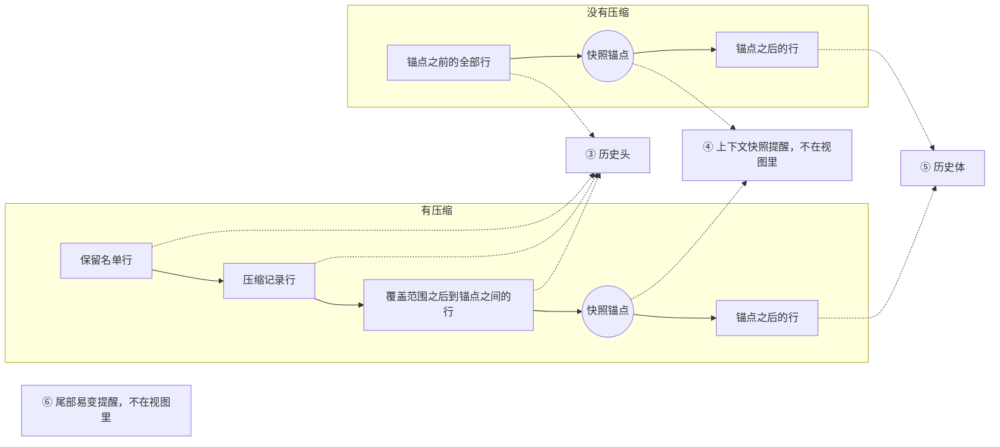

# @omne-harness/request-context-contract 行为规格

状态：契约成员，`draft`。请求组装的输入输出、独立与托管读取边界、候选重算、固定采用认回及失败处置由[技术接受](https://github.com/nemori-ai/omne-harness-lite/issues/262#issuecomment-6186972289)采用，本页在 RQ-01 至 RQ-09 保留它们的原意；改写处逐条标「取代」并给依据。组装输入的七组、装入裁定的四种、压缩计划归本域而调用归协调者、保留名单语义、六层装载布局与快照锚点、历史源读口与 epoch 视图，依据产品正文 [运行感知与一次模型请求](../../../.meta_harness/design/product/runtime-context/design.md) 第 4 版 §5 至 §7 写入，修订处注明依据。第 4 版是候选、待确认，按它写入的条款随它的确认生效；系统页 [Request Context](../../../docs/architecture/runtime/request-context.md) 依据第 4 版扩充的节是候选，状态行逐节列出。来源集合与登记（RQ-12）、七组的稳定读取（RQ-13）、窗口占用与账目收到（RQ-14）、普通访问与系统恢复（RQ-15）、十进制历史序位、增量压缩判断、修剪并入首个摘要步、完整计量与来源调用，依据任务卡 [#676](https://github.com/nemori-ai/omne-harness-lite/issues/676) 的 J12、J13、J14、J15、J28、J41、J48 与本域决定 [RQ-D02](https://github.com/nemori-ai/omne-harness-lite/issues/676#issuecomment-6371278636) 写入，已通过独立表达评审（记录在[任务卡 #676](https://github.com/nemori-ai/omne-harness-lite/issues/676)），评审裁定已写入。本页只拥有公开类型以外的必要行为。公开形状归 `src/`，导出导航归 [docs/public-api.md](docs/public-api.md)，对象的身份与生灭归 [docs/object-model.md](docs/object-model.md)。

本成员实现无状态的操作组与契约验证资源。有状态的机制（来源登记表、账目投影与恢复）归实现成员 [request-context](../request-context/SPEC.md)。提供者、存储、压缩算法与数值都不在这里定。设计接受不表示生产实现或运行验证已完成。

## 范围与依据

Request Context 是一次模型请求输入的派生计算与装入保证。它读取的全是别人拥有的事实：历史、runtime context 的读取结果、工具定义与绑定、模型档案与限制、提示词贡献和当前条件。它给出请求候选、覆盖证据、装入裁定、表示决定，以及需要时的压缩计划。它不拥有事实，不发请求，不固定采用，不写历史。

本页只用通用角色：协调者（为作用域发起模型请求与工具调用、固定最终请求的一方）、历史持有者（保存历史与压缩记录、给出未结工作的一方）、集成方、贡献者、调用方。本成员不认识上层工作流的具体类型。一次执行、持有者的一步、一次调用只以不透明引用出现。本页单说「步」时，指压缩计划里的步。步只有摘要步一种，修剪在首个摘要步之内完成（[RQ-06](#rq-06-压缩共同结果与保护边界)）。本页说「结果接收方」时，指在原账目提交之后把它交给本能力的一方；它经自己的出站端口交付，本能力不认识它的类型。

依据的上层正文：

- 产品：[§5 当前值与变化感知](../../../.meta_harness/design/product/runtime-context/design.md#5-当前值与变化感知)、[§6 一次模型请求采用合法完整输入](../../../.meta_harness/design/product/runtime-context/design.md#6-一次模型请求采用合法完整输入)、[§6.1 Request Context 的派生计算](../../../.meta_harness/design/product/runtime-context/design.md#61-request-context-的派生计算)、[§7 压缩保留历史与未完工作](../../../.meta_harness/design/product/runtime-context/design.md#7-压缩保留历史与未完工作)、[§7.1 压缩计划与步骤](../../../.meta_harness/design/product/runtime-context/design.md#71-压缩计划与步骤)，第 4 版。
- 系统：[Request Context](../../../docs/architecture/runtime/request-context.md)、[装配与变化](../../../docs/architecture/runtime/assembly-and-change.md#比对代替求值)。
- 邻域契约：[Runtime Context 读取结果](../runtime-context-contract/SPEC.md#rc-04-读取时点观察与变化材料)、[Model 档案与请求准备协议](../../model/model-contract/SPEC.md#档案与请求准备协议)、[Model 分词与完整请求计量](../../model/model-contract/SPEC.md#分词与完整请求计量)、[Tool 可编程调用许可](../../tool/tool-contract/SPEC.md#可编程调用的定义与准入)、[压缩记录的形状与模型视图](../../common/message/SPEC.md#模型视图)。

压缩记录（`CompactionMessage`）的形状、模型视图规则 CM-01 至 CM-06 与两层判定归 `packages/common/message`。本页只引用编号，不重述形状。本成员依赖该页先于本页生效。

本成员的根入口与 Cordis 无关。提示词贡献的登记面与来源登记表的 Cordis 投影归 [request-context-cordis-contract](../request-context-cordis-contract/SPEC.md)；来源登记表、账目投影与恢复、缓存与默认策略的实现归 [request-context](../request-context/SPEC.md)；isolate 绑定归 [request-context-cordis](../request-context-cordis/SPEC.md)。

## 结果与不变量

### RQ-01 调用方与计算边界

主流程、压缩、扩展及独立调用都可以消费本能力。每次调用给出明确用途、合法输入范围与原消费位置。托管路径保留适用租户、作用域与原调用的不透明引用；独立消费不创建任何上层对象。

本能力派生候选请求，不修改原历史、原块、注册或当前权限，不拥有模型执行的寿命与外部效果。最终发起的协调者负责一致读取、发出前资格、接收方、实际绑定与固定采用。本能力成功只表示按明确输入完成计算，不表示请求已发出、结果已承接或动作已获准。

一次请求的固定采用写在协调者的调用记录上，不另建一条上下文事实。系统提示词每次求值，不进历史。压缩只追加压缩记录，不改原历史。发出之后的寿命归模型调用。

本能力的操作分两类。派生计算是纯函数：从已稳定读取的材料到候选内容、压缩消息、下一步进度，同一组材料得同一结果；同一个计划、进度与步结果得同一步结局。效果操作读取来源（RQ-13）、取得并交还 Model 准备租约（RQ-05）、维护账目投影（RQ-14），它们按各自协议执行，不是纯函数。同一份稳定材料上的两次计量可以给出不同结论，本次采用本次的结论。缓存是实现的性能手段，不改变任何结果。同输入返回已有候选是本条的要求，不是缓存的许可。这一段取代已接受条款里「全部操作是纯函数」的写法，依据 [RQ-D02](https://github.com/nemori-ai/omne-harness-lite/issues/676#issuecomment-6371278636) 采用的 J14。

公开的组装入口是操作组 `AssemblyOperations`。它只接受本次调用身份与用途 `AssemblyCall`，七组材料由它从来源集合稳定读取（RQ-12、RQ-13）。本成员不再导出直接接受七组材料的组装函数，也不保留逐次注入历史源、计量端口、转换件结果端口与序列化端口的旧入口。已检数据上的纯函数 `project`、`projectForHuman`、`declareTools`、`chooseRepresentations`、`assembleSystemPrompt`、`placeContext`、`judgeBudget` 继续公开，它们不承诺完成来源读取、资格核对或最终完整计量，结果不能冒作可固定的候选。

读取系统托管历史、引用、模型档案或其他资源时，集成方按原来源契约兑现身份、资格及保留责任，不因未运行 Cordis 而绕过。独立入口的字节编码未定。

### RQ-02 组装的前置输入

一次组装消费七组输入。组一来自本次调用 `AssemblyCall`，其余六组由来源集合的组读口给出，读取协议见 [RQ-13](#rq-13-七组的稳定读取)。每组由谁给、缺了怎样、变了是否成为另一次候选，如下表。「缺了」列的结果按[组装的结果](#组装的结果)落位。「另一次候选」的含义是：尚未固定时输入有合法变化就重算，不返回变化前的候选。依据：产品 [§6.1](../../../.meta_harness/design/product/runtime-context/design.md#61-request-context-的派生计算)。

| 组 | 内容 | 谁给 | 缺了 | 变了 |
| --- | --- | --- | --- | --- |
| 调用身份与用途 | 访问身份、用途（主请求或扩展用途）、消费位置、候选身份 | 调用方，作为 `AssemblyCall` | 无效（缺必要输入）。独立与托管组装都必须带访问身份 | 另一次候选；新候选身份即新准备 |
| 历史与新输入 | 历史依据（目标、epoch 与上界，见 [历史源读口](#历史源读口与-epoch-视图)）、按该依据读出的全部页、已可靠保存的新输入批 | 历史持有者的可信读取适配器，经组读口与历史源读口 | 不可用（来源不可用）；新输入未保存为无效（缺必要输入） | 另一次候选 |
| runtime context 读取结果 | 完整或增量、来源与覆盖证据（含读取所用的资格身份）、④ 层的块材料（经模型资格过滤的当前值与前值，块带变化频率）；每次读取另带的逐请求块当前值（[RC-04](../runtime-context-contract/SPEC.md#rc-04-读取时点观察与变化材料)），⑥ 层取这一部分；当前已采用的固定事实 `AdoptedRequestFact`；压缩转换依据。块材料在完整读取时是本次读到的；增量读取时，适配器同时交出最近一次完整读取的块材料（按资格过滤后的值） | 调用方的 runtime context 读取适配器以模型类资格读取，并跨请求保存最近一次完整读取的块材料；已采用事实来自窄采用来源 `AdoptedRequestSource`（[RQ-14](#rq-14-窗口占用与账目收到)）。本能力不读 Runtime Context，也不保存块材料 | 不可用（来源不可用）；增量读取而缺最近一次完整读取的块材料为无效（缺必要输入） | 另一次候选 |
| 系统提示词 | 当前有效的提示词贡献集合（有序段、变量两类，各带来源与修订）；组装上下文（作用域引用、定义采用、工作区选择等不透明键）。`workspace` 键的文本是 legal-identity 第六族 `WorkspaceId` 的线上文本（`wsp_` 前缀）。实例与版本不在此键，放执行环境那一组键 | 组读口。Cordis 路径上贡献集合由服务从登记面现取，见 [request-context-cordis-contract](../request-context-cordis-contract/SPEC.md) | 没有贡献即空提示词，不是错误；缺组装上下文为无效（缺必要输入） | 另一次候选 |
| 模型侧 | 选定模型（实际收件模型、已解析档案、输入模态、窗口与各限制、工具证据）、参数（含整体关闭回放，见 [RQ-04](#rq-04-模态与可追溯表示)） | 模型选择适配器，经组读口 | 无效（缺必要输入） | 另一次候选；收件模型变化还要求适配器重新读 runtime context |
| 工具侧 | 会话常驻工具的完整定义（可用或 known-unavailable）、各自绑定采用、可编程许可；非常驻工具只作为 Tools 元工具可访问的动态数据 | 工具装配求值适配器，经组读口 | 空集合合法 | 另一次候选 |
| 当前条件与本次经过 | 条件证据的投影；上一次准备；扩展改写依据；调模型之前位置的经过 | 协调者，经组读口 | 条件缺为无效（缺必要输入）；其余可空 | 条件变化只使未固定候选重算；同一经过不重复触发该位置 |

有效压缩记录从历史派生，不单独传入。历史里的块按模型可见标注与压缩记录筛（见 [RQ-03](#rq-03-历史与块投影)）。块材料是材料不是引用：组装要渲染提醒正文，所以需要值。私有块与权限输入不在模型侧读取结果里，组装永远看不到。

系统提示词每请求求值，单独计量，候选只含文本，不保存为历史消息，也不靠压缩删除固定要求。技能取用和命令展开沿自己的原路径进入历史，不偷换为长期系统设定。日期、当前目录、模型名、窗口占用这类会变的运行事实不走提示词贡献，只走 runtime context 块。带逐请求变化变量的提示词段被拒绝。依据：产品 [§6.1](../../../.meta_harness/design/product/runtime-context/design.md#61-request-context-的派生计算)。

本成员是下面两条 runtime context 块的语义拥有者。它在根入口导出这两条块声明，并用 `declare module` 增补 `ContextBlocks`（[RC-02](../runtime-context-contract/SPEC.md#rc-02-块声明注册与参数)）。依据：产品 [§2.2](../../../.meta_harness/design/product/runtime-context/design.md#22-块声明归语义拥有者)。

| 块键 | 种类 | 允许的消费者类 | 变化频率 | 恢复方式 | 值 |
| --- | --- | --- | --- | --- | --- |
| `context.compaction-settings` | 供给块 | `model` | `stable` | `reread` | 当前压缩策略的保留预算（保留比例或保留 token 数）与保留偏好 |
| `context.window-usage` | 供给块 | `model` | `per-request` | `recompute` | 该目标当前固定请求的窗口占用，四种状态之一：尚无固定请求、固定请求暂无可用占用量、实际、估算 |

两块的生产者是本成员的装配提供者，它经 Runtime Context 的生产者面（[RC-07](../runtime-context-contract/SPEC.md#rc-07-生产者句柄并发撤除与恢复)）登记供值。本成员的操作组不读 Runtime Context，也不登记生产者。值的精确形状归 `src/blocks.ts`，两块都声明 `required: true`。

`context.window-usage` 的值来自账目投影的 `usage({ access, target })`（[RQ-14](#rq-14-窗口占用与账目收到)）。读取先于组装，读取时本次请求的占用还不存在，所以这一块不给本次请求的占用。值是四个分支之一，形状归 `WindowUsageValue`：

| 当前可信事实 | 值 | 不允许的推断 |
| --- | --- | --- |
| 窄采用来源稳定确认当前没有固定请求，目标的账目投影已完成授权初始化并就绪 | `not-fixed`，不带候选、窗口、用量或比例 | 不表示实际用量为零，也不表示新候选已装下 |
| 当前固定请求明确，窗口来自该固定依据；投影就绪，但没有可用的实际值或估算 | `unmeasured`，带原候选与窗口，不带用量或比例 | 不表示生产者没有费用，不把当前档案的窗口补成旧请求的窗口 |
| 唯一原发出的完整已知、非暂定账目已收到，口径与单位有效 | `actual` | 不从「只收到一份账」推出唯一，不把多次发出相加 |
| 没有可用实际值，但当前固定请求的预测合法可用 | `estimate` | Model 的 exact 预测仍是估算，准确锚点加新增估算也不是实际 |

`not-fixed` 与 `unmeasured` 是有效的必需事实值，不是 Runtime Context 的缺项，也不是读取未知。来源未知或不可用、权限失败、投影未就绪、重建未完成或事实格式非法，各自返回原失败，不转成这两个值。生产者把四个分支都作为值供出，不把任何分支译成缺项。非数值分支不进入比例计算、压缩阈值或预算判断，不默认转成零；本次装入裁定仍由本次完整计量决定（RQ-05）。渲染时分别写明「尚无固定请求」或「该固定请求暂无可用占用量」，不伪装成比例。

数值分支的 `usedTokens` 与全部 `windowTokens` 是规范非负十进制整数字符串，`windowTokens` 大于零。`ratio` 只在 `actual` 与 `estimate` 出现，等于 `usedTokens/windowTokens` 向上舍入到六位小数并去掉尾零，可以大于 1。解码器按 `kind` 判别，拒绝无标记的旧值，也拒绝某一分支不应带的数值或身份字段。新目标的正常路径是：宿主从可信的完整空快照重建投影，投影就绪；窄采用来源确认没有固定请求；供块交出 `not-fixed`；Runtime Context 正常交值；本能力对本次完整候选实际计量；协调者形成首个固定请求。此后读取可以是 `estimate`、`actual` 或 `unmeasured`。这里没有首次豁免，也没有先固定再组装的循环。依据 RQ-D02 的冷启动值域。

本次要承接的普通新输入与相关历史消息先完成可靠保存，再组装。确认持久边界含进程崩溃、操作系统崩溃和断电。只在内存队列到达或读到未确认消息不满足前提。

工具声明与实际合法绑定一致，并保留工具的可编程调用许可及原定义采用。直接模型工具集合与脚本可调用集合分别投影，未声明许可的工具不能出现在后者。本成员不把声明投影当作执行授权。模型档案及参数属于明确有效采用范围。来源并发更新时不能拼旧档案、新 schema、旧实现成从未合法成立的请求。需要共同版本边界的部分由协调者保护。RFC-0012 的 R1 只约束会话常驻工具：会话内名称和参数形状不变，刷新改变可用性与实现；常驻工具 known-unavailable 时按原 definition 声明，不算工具集合变化。非常驻工具与模型档案仍遵守本段的一致读取要求。

依赖未满足的几种情形分别落位，名称以[组装的结果](#组装的结果)表为准：来源不可用归失败「不可用」；runtime context 读取结果为缺项，也归失败「不可用」（来源不可用）；无权归失败「无权」；格式不受支持归失败「无效」；来源读取未知或提交未知归「未知」。依赖未满足时不生成冒充完整合法输入的空白成功，不为方便改用其他租户内容或秘密。

组装的最小对接如下。得到结局只表示计算完成。

| 项 | 规则 |
| --- | --- |
| 关联身份 | 候选身份。已经固定的采用写在协调者的调用记录上 |
| 必要参数 | `AssemblyCall`（访问身份、候选身份、消费位置、用途）。其余六组由来源集合读出，目标 `ContextTarget` 带租户与作用域 |
| 结局 | 四种结局之一，见[组装的结果](#组装的结果)。候选成立时返回请求候选、覆盖证据、装入裁定、表示决定 |
| 失败 | 无权、无效、不可用三类，见[组装的结果](#组装的结果) |
| 未知 | 来源读取未知或提交结果未知。不改用其他租户的内容 |
| 同身份重试 | 尚未固定时，输入有合法变化就重新计算；复用键与 `PreparedInputKey`（RQ-13）相同（上一次准备的派生内容不参与比较）才复用已有候选的稳定层。固定采用只经第三组的「已采用」进来，本能力不保存它：已采用且七组令牌逐组相同时返回原采用 |
| 参数冲突 | 档案、绑定和实现不能同时合法则返回无效。已经固定后，带矛盾输入的重试返回无效，另一组采用不能改写这次输入 |

覆盖证据逐项记录这次用了哪些输入及其修订：历史范围与 epoch、有效压缩记录、新输入批身份、快照修订与快照锚点、提示词各段来源与修订、档案与参数（含是否整体关闭回放）、工具声明摘要（两集合）、条件证据、改写依据、表示决定摘要、预算报告摘要（含待加载媒体与限额未知）、前缀变化原因。它回答三个问题：模型这次看到了什么，和上一次相比什么变了，请求开头为什么变了。协调者把它随最终请求记录保存，下一次经「已采用」传回。

#### 组装的结果

一次 `assemble` 或 `resume` 的结果只落在下表的一行。表是封闭的，没有其他结果。计划操作的结果见表后的[计划操作的结果](#计划操作的结果)。依据：产品 [§6.1](../../../.meta_harness/design/product/runtime-context/design.md#61-request-context-的派生计算)「限额未知不是失败」与 [CONTEXT-M02](../../../.meta_harness/design/product/runtime-context/design.md#context-m02)。这张表取代已接受旧 RQ-02 的「成功／拒绝／未知」三分：旧「成功」对应四种结局，旧「拒绝」拆成三类失败，「未知」保留；固定部分超限不再是拒绝，归结局「装不下」。

| 类 | 取值 | 落入的情形 |
| --- | --- | --- |
| 结局 | 候选成立待扩展 | 装得下或限额未知，尚未经过调模型之前的扩展位置 |
| 结局 | 候选成立可固定 | 装得下或限额未知，已经过该位置 |
| 结局 | 需要压缩 | 预算不通过，非固定部分可压，本次准备尚未进入压缩计划 |
| 结局 | 装不下 | 固定部分超限；本次准备已进入过压缩计划仍不通过；`resume` 补入完整快照后仍超限 |
| 失败 | 无权 | 身份或资格不足，含读取资格桥、组读口、历史源读口或转换件结果读口按访问身份核对后返回无资格；访问身份的租户与目标租户不符 |
| 失败 | 无效 | 缺必要输入，含缺访问身份；输入不合形状或越出范围，含格式不受支持、对压缩步请求调组装、带逐请求变化变量的提示词段、档案与绑定不能同时合法、`resume` 带转换依据而读取结果不是完整快照、目标与组装上下文或历史依据的作用域引用不一致、输入内部的租户与目标租户矛盾、epoch 无法识别、上界越界、游标属于另一份历史依据、来源证据互相矛盾；已经固定后带矛盾输入重试 |
| 失败 | 不可用 | 没有可用表示（带原结果）；来源不可用，含组读口、历史源、Model 准备资源、转换件结果端口不可读或缺席，以及 runtime context 读取结果为缺项；某组两次读取仍不稳定；登记代际已撤除或替换；Model 租约未能交还；实例已关闭或服务已卸载 |
| 未知 | 未知 | 来源读取未知；提交结果未知 |

装不下是结局，不是失败。托管路径上，协调者收到装不下后按 [RQ-08](#rq-08-失败否决与消费位置) 明确失败。

失败的具体取值如下，形状归 `src/values.ts`。所有来源读口、登记、账目接收、历史读口、转换件结果读口与恢复的无效结果都用同一形状 `{ kind: 'invalid', field, reason }`，`reason` 取公开的 `InvalidReason`，`field` 指出实际的输入路径，不带其他租户的数据；没有开放的「其他失败」分支。

| 触发 | 端口或入口的结果 | 操作组的结果 |
| --- | --- | --- |
| 缺访问身份 | 无效，`field` 为 `access`，`reason` 为 `missing-access` | 同一无效，不调用依赖，也不观察账目索引 |
| 输入本身不合法，如十进制序位、游标形状、必需计划字段缺失 | 无效，`unsupported-format` 或已有的具体理由 | 保留原 `field` 与 `reason`，不改成未知 |
| 访问身份的租户与目标不符 | 无权 | 无权，不查询目标是否存在；输入内部的调用租户与目标租户矛盾为无效 `tenant-mismatch`，但不能先于访问身份的租户拒绝透露来源事实 |
| epoch 无法识别、上界越界、游标属于另一份依据 | 无效，`unknown-epoch`、`upper-out-of-range`、`cursor-invalidated` | 已知 epoch 在读取中变化单独返回 epoch 已变，计入第二组的重读预算 |
| runtime context 读取结果是拒绝或未知（[RC-03](../runtime-context-contract/SPEC.md#rc-03-当前读取资格与缺项) 的读取结果） | 拒绝 `unauthorized`；其余拒绝原因，含 `no-registration`、`closed`、`scope-ended` 与 `replay-incomplete`；未知，含 `scope-binding-unknown` 与 `replay-unknown` | 拒绝 `unauthorized` 为无权（组装）。其余拒绝为不可用，`owner` 为 runtime context，诊断带原拒绝原因；作用域已结束与恢复未完成不当作无权。未知为未知，诊断带原因 |
| 压缩判断的窗口来源关系缺失、重复或矛盾 | `judgeCompaction` 返回 `source-evidence` | 无效，`field` 为 `compaction.context`，`reason` 为 `source-evidence-conflict` |
| 新摘要本身违反消息、范围、保留、配对或未结工作规则 | `judgeCompaction` 的原拒绝值 | 计划阶段拒绝计划为无效；`deriveStep` 按已消费一步的规则返回装不下或下一步 |

无权带被拒绝的操作 `action`：读历史、读转换件结果、组装、读输入、读账目。不可用带实际失败的拥有者 `owner`：历史源、计量、转换件结果、runtime context、表示、压缩策略、实例、来源登记、组读口、主体绑定、读取资格、Model 准备、账目。收件口与恢复口的无权分别是对收账（`receive`）与重建（`rebuildAccounts`）本身的拒绝；它们的不可用以诊断指出实际拥有者：来源核验、恢复授权、窄采用来源、读取资格或账目投影（未初始化、重建中、容量）。重读预算耗尽、登记失效、重建中与容量不足都是带各自诊断的不可用，不新增成功分支。

#### 计划操作的结果

`planCompaction` 与 `deriveStep` 的结果如下，也是封闭的。两者的失败用上表同一套三类（无权、无效、不可用），未知同上表。

| 操作 | 正常产出 | 装不下 | 归无效的情形 |
| --- | --- | --- | --- |
| `planCompaction` | 压缩计划（计划身份、步数上界、压缩依据、第一个摘要步） | 未结工作的下界集合本身超出保留预算 | 同上表的无效情形 |
| `deriveStep` | 下一个摘要步，或压缩转换 | 计划用完仍没有合法摘要；某一步被否决 | 同上表的无效情形；计划身份核对失败；已完成步数或步序号核对失败；计划记录的策略身份或参数摘要与当前策略不符；压缩依据的摘要、目标或租户与计划不符；当前模型选择与依据里的选择不同 |

### RQ-03 历史与块投影

模型侧只取明确标为模型可读且满足当前资格的块，再按有效压缩记录计算模型视图。人侧与模型侧标注独立，常态消息类型表不代替实际块标注。缺失或不明确标注不进入模型请求。保留名单不绕过块标注：视图内每条消息仍按块级模型可见标注过滤。

`ToolInternalMessage` 始终在模型请求前排除，不提供配置绕过。未收齐工具参数不解析执行，残缺调用可按原规则留历史备查，但派生请求剔除该调用，不改原件或原消息。

用户叫停且已有交付内容，按原消息形成规则保留标为中断的消息，模型侧剔除不完整调用。无内容不造空回复。出错已交付内容沿原调用记录可查，不冒充完整回复。中断原因提醒由原消费路径追加，不能凭缺少回复让模型猜原因或重做效果。

消息来源不用正文标记解析。状态和事件提醒均追加且保留实际感知链。未经过合法压缩，不能先按「同一块只取最新提醒」再筛一道。首次及压缩后纳入当前合法完整快照，工具或扩展私有块不因补全路径进入模型。

人侧投影由纯函数 `projectForHuman` 给出，与模型侧投影 `project` 共用同一套块标注规则。它供历史持有者与交付面调用，不分页，不写回。最近一段、向前追加与接新内容分别可辨，读者加载进度不写回历史。模型预算不删人侧原件。本成员不新增分页公开操作。这一条取代已接受条款里人侧历史查询的分页归属：人侧投影的分页与交付归交付面。依据：产品 [§6.1](../../../.meta_harness/design/product/runtime-context/design.md#61-request-context-的派生计算)。

### RQ-04 模态与可追溯表示

文字、图片和语音为当前明确支持目标，不要求每个模型支持全部。实际媒体类型决定内容模态，文件块是引用载体，不自动代表模型可读的文本。图片、语音、附件及派生表示全部按真实发送内容处理。

选用有效模型可接纳的原件、派生表示或 transcript。多种表示都可用时消费明确的表示策略，不静默丢弃不相容内容。表示策略是可替换实现，默认实现只是初值。转换件保留原块关联与来源，不覆盖原始内容或原可见性，也不绕过原权限。模型未提供的内部推理不能补造。

工具结果采用独立分流。附件区只成为地址文本，不进入媒体读取或模态约束。消息内容中的模型可见引用保留原引用，标为待加载，在模型真正请求时才加载二进制及完成必要转换。消息准入、历史投影和请求组装不得为了产生 transcript 提前读取这些字节。其他消息来源继续使用接纳前转换规则。

非工具引用路径中，必要转换的缺少能力、执行失败与表示不存在分别报告。消息准入失败不删除原结果，不能用空文本或猜测的 transcript 当成功。带模型读取标注的非文本块或文件参与转换，包括同时供人和模型读取的内容。纯文本及只供人读取的块不受不适用转换件否决。适用转换在消息准入前完成，不因当前模型能读原件而跳过。准入后派生表示及 transcript 固定，不随转换件更换改写。请求只消费这些表示。

转换件的选择键、媒体类型优先、合法输出、原块关联及本地转换范围消费 [Model 转换件共同契约](../../model/model-contract/SPEC.md#转换件的共同契约)。本规格不另定转换件协议。接纳路径依该契约区分未登记与已登记但失败，并保存接纳时固定的表示及来源。本成员只读取其合约结果。未登记而准入的无 transcript 原块仍参与相应历史模态约束。

转换不承诺无损。交付面须能说明本次模型读取的是哪份表示。实际模型不支持必要表示时按真实能力判断，不能从 transcript 存在推出所有在册档案都可选。

历史模态约束只纳入模型可见且无 transcript 的相关历史块。约束在固定候选及能力条件下只收紧。压缩不改原可见性，也不据此声称历史模态约束消失。Model 拥有合法候选与切换判断，本成员消费其有效档案并检查实际可读输入。

工具内容引用的元数据参与实际模型可读性检查，附件地址文本不增加相应媒体模态。本成员从完整工具定义形成 Model 的工具声明，并保管原工具与命令路由。Model 适配器仅接收模型请求值，不消费工具定义或注册表。

assistant 消息里的推理续接状态部件与其他块一样进入历史投影，只按块的模型可读标记筛选（[RQ-03](#rq-03-历史与块投影)）。本成员不按目标模型挑选这些部件，也不按目标模型改写或删除 `thinking` 块。原因是一次档案调用可能回退到另一个供应商，实际供应商只有每次发出时才知道。每次发出带哪些推理状态、外来可见推理怎样处理，由 Model 按这次供应商的回放声明决定。

投影去掉一条 assistant 消息里的块时，本成员按消息成员的 RS-04 重写这条消息回放描述里的位置索引 `replay.at`，并删去悬空的配对引用，使交给 Model 的消息仍然合法。

调用方可以按原消费者的要求为一次请求整体关闭回放。这项选择属于组五的参数（[RQ-02](#rq-02-组装的前置输入)），本成员把它原样带进候选并记入覆盖证据，它变化即另一次候选。这是本成员影响推理状态的唯一手段，用于推理状态被持续拒绝时让作用域继续前进。压缩记录的摘要不含推理续接状态，保留名单里的消息原样保留它（[RQ-06](#rq-06-压缩共同结果与保护边界)）。

这三段的依据：推理续接状态与位置索引重写归消息成员的[推理续接状态](../../common/message/SPEC.md#推理续接状态)与 [RS-04](../../common/message/SPEC.md#rs-04)，回放声明与整体关闭回放归 Model 契约的[推理回放](../../model/model-contract/SPEC.md#推理回放)。

### RQ-05 完整预算与候选完成

预算计入全部系统提示词、适用历史、提醒、投影后的工具声明和最终选择的实际模态内容，含完整快照提醒、尾部易变提醒及实际提供者映射的必要表示。不能只计最新用户文本或忽略工具 schema。

模型档案提供已知有效上下限。字节、图片数等精确约束实际检查，token 使用适用计量与明确余量估计。计量归 Model 的计量端口，阈值比较与取整归本成员。未知上游限制报告未知，不伪造数值。实际物化、模态读取和转换成本不能因缓存命中而从资源计量消失。

每一份完整候选按下面的顺序计量，Model 侧的接口都是已有的 [档案与请求准备协议](../../model/model-contract/SPEC.md#档案与请求准备协议)，本成员不新增 Model 字段或公共辅助函数：

1. 以本次访问身份、选定档案和本候选的来源声明 `lineage` 调用来源集合里的 `ModelPreparationResources.acquire`。一个租约只服务一个访问身份和一份候选内容。
2. 对租约里每个供应商的绑定调用 `rules.plan({ profile, supplier, assembled })`，保留它返回的参数采用与表示。
3. 把该供应商自己的表示、参数采用、档案的上下文与限制及完整组装输入交给同一个绑定的 `meter.measure`。没有一份表示交所有供应商的路径。
4. 按每份计量结果检查各自的限制。请求字节只取 `rules.plan` 返回的物化表示的 `requestBytes`；待加载媒体保留为 `pending-media`，不编造完整字节。
5. 交还租约，再交回候选或原失败。

取得租约之前失败，没有租约要交还。取得之后，任何路径都尝试交还。主操作失败与交还失败都保留，后者不覆盖前者。主操作成功而交还失败时，操作返回不可用并说明资源未交还，不把候选作为可固定的成功交出。Model 对部分供应商取得失败的清理归 Model，本成员不截掉失败的供应商。主操作已失败时，操作交回主失败，交还失败留在租约的拥有者处：托管路径上登记表包装 `acquire`，按代际记下每个租约的交还结果（RQ-12）；独立路径上由准备资源的拥有者观察。各供应商的计量报告合并成一份预算：全部检查与计数依据都保留，延后媒体取并集，不只保留第一个供应商。

计量结论不缓存，也不复用：每份内容、系统提示词、工具、参数、投影或可见性不同的候选都重新取得租约、重新计划、重新计量。保留集合预算的探测、摘要请求、摘要之后的窗口检查与最终六层请求是四份不同的候选，各自形成完整的计量输入。不把单条消息的计量值相加，代替整个集合的计量。依据 J13 与 J14：请求字节取自 `rules.plan` 的物化表示，计量输入取各供应商自己的表示，计量器以本次访问身份取得。

四份候选从本成员的选定模型到 Model 组装输入的转换只有一处：请求参数只放每项参数采用的实际值 `applied`，整体关闭回放时显式写 `replay: 'off'`，开启时省略这一项。参数采用记录留在选择与供应商计量路径上，`meter.measure` 收到的仍是 `rules.plan` 返回的原采用记录。各候选自己形成系统提示词、消息、工具、工具选择、表示与来源；保留探测、摘要请求与摘要之后的检查使用空系统提示词、空工具与 `auto` 工具选择。

`lineage.sources` 只列实际进入该候选的 assistant 消息的来源调用，每条消息一次，按候选里的消息顺序排列；来源为空合法。本成员先核来源调用的租户等于本次访问身份的租户，再去掉租户包装交给 Model。`lineage.continues` 只在[被延续调用](#来源调用与被延续调用)的全部前提对该候选成立时给出，任一前提不成立就省略，省略是保守的完整计量路径，不是失败。

装入裁定四选一：装得下、固定部分超限、需要压缩、限额未知。限额未知不是失败：候选照常成立，覆盖证据标明限制未知，发出与否由 Model 发送期按真实能力裁定。依据：产品 [§6.1](../../../.meta_harness/design/product/runtime-context/design.md#61-request-context-的派生计算)。

一次组装只得到四种结局之一，或三类失败之一，或未知，逐项见[组装的结果](#组装的结果)。装得下与限额未知给出候选；需要压缩时由 `planCompaction` 给出压缩计划；固定部分超限直接装不下；计划用完仍没有合法摘要按压缩后仍装不下处理（[RQ-06](#rq-06-压缩共同结果与保护边界)）。没有第五种结局。表示不可用是失败「不可用」的一种，带原结果，不是第四类失败。

候选交回时，所有可取得事实须已通过目标模型限制检查，或明确失败并解释原因。工具内容引用尚未加载时，按 [Model 准备协议](../../model/model-contract/SPEC.md#档案与请求准备协议)明确保留待加载媒体及待核验引用，不声称完整预算已通过。Model 实际发送前物化并重计全部限制，未通过不得发出。

### RQ-06 压缩共同结果与保护边界

是否压缩、怎样压缩及能否装入窗口由本成员承接。协调者消费装得下或明确失败，不另拥有预算策略。硬限额先满足，再兼顾前缀一致、信息保留与长度。前缀一致是优化目标，不是任意变化后逐字不变的保证。

压缩只处理历史持有者的历史中允许压缩的内容。一次压缩确定压缩覆盖范围：从历史起点开始，到压缩点之前的某一处结束，并包含上一条压缩记录。它为这段范围生成摘要，并点名范围内仍要原样交给模型的消息。这份点名就是保留名单。保留名单取代已接受条款里的「排除名单」，依据是[压缩记录的模型视图规则](../../common/message/SPEC.md#模型视图)。摘要、覆盖范围和保留名单共同形成追加的压缩记录，不改原块、不改人侧或模型侧原标注、不删任何原历史。摘要与名单不能分别提交成无法解释的半份压缩事实。形状与模型视图规则 CM-01 至 CM-06 归 [压缩记录](../../common/message/SPEC.md#模型视图)。依据：产品 [§7](../../../.meta_harness/design/product/runtime-context/design.md#7-压缩保留历史与未完工作)。

压缩之后模型看到的历史，顺序见[epoch 视图到六层的映射](#epoch-视图到六层的映射)的「有压缩」一栏。覆盖范围可以在压缩点之前结束，范围之后、压缩点之前的消息照常出现。再次压缩时，新的覆盖范围包含上一条压缩记录和它的保留项。

压缩计划先定覆盖范围，再在保留预算内选保留名单。范围终点不能把一次工具调用和它的结果分在两侧，除非调用一侧进了保留名单。调用与结果都在覆盖范围内时，两者一起保留或一起摘要。依据：产品 [§7](../../../.meta_harness/design/product/runtime-context/design.md#7-压缩保留历史与未完工作)。保留名单尽量取范围较新一端或被引用多的消息，使模型视图的前缀尽量稳定。保留名单在压缩时固定，之后不变。压缩策略给出的草案终点不在判断窗口里、保留集合超出保留预算，或草案本身不是合法压缩，都是该策略的违约：返回不可用（`owner` 为压缩策略），不当作调用方输入无效。窗口本身违反来源关系仍是无效（`source-evidence-conflict`）。

上次模型请求之后尚未让模型读取的新输入不压。未答等待和未结后台执行的占位不压。这些未结工作要么进保留名单，要么留在覆盖范围之后。什么属于未结工作由历史持有者与原执行拥有者判断，并以条目引用集合交给本成员作为下界；下界包括最近一次模型调用固定输入之后写入、模型尚未读取的输入。本成员不能凭界面不可达或查询失败认定已经结束。下界集合本身超出保留预算时，`planCompaction` 返回结局「装不下」：不为装下它而缩短覆盖范围，也不突破保留预算。

计划归本成员，调用归协调者。需要压缩时，由 `planCompaction` 给出压缩计划：计划身份、步数上界、形状、压缩依据与第一个摘要步。依据：产品 [§7.1](../../../.meta_harness/design/product/runtime-context/design.md#71-压缩计划与步骤)。

步只有摘要步一种。计划的形状是 `{ kind: 'summarize', trimFirst }`，步数上界不小于 1。`trimFirst` 为真时，`planCompaction` 在给出序号为 0 的摘要步之前，用压缩策略的修剪器对摘要材料确定性地修剪一次：只缩短过大的工具结果与媒体占位，保留原消息身份与占位引用，不改原记录，不改模型视图，也不改装入裁定。第一步携带修剪后的材料与修剪依据。修剪不是一步，不记进度；后续步骤消费同一份材料，不再修剪。步数上界为 1 时，先修剪再完成一个摘要步是合法路径。依据 J12：修剪不算一步压缩进度。

摘要步是一次内部模型调用。本成员给步请求，协调者执行并把结果交回，本成员推导下一步。步请求不经组装，不递归。摘要调用的身份、费用、取消与恢复由发起它的协调者记录，结果不直接形成主流程的助手消息。

这一条取代已接受条款里「压缩内部模型调用有独立原调用身份」中由谁分配和记录的部分：摘要调用仍有自己的身份，由发起它的协调者分配并记录，不由本成员分配。

计划在给出时定下步数上界，之后不变。计划同时记录给出它的压缩策略的身份与参数摘要。步结果（摘要或否决）显式带序号，序号必须等于已完成步数。`deriveStep` 收到当前序号的结果后纯推导一次，进度恰好加一；同一计划、同一旧进度与同一结果重试得到同一推导值。协调者以条件提交保存新进度，重复序号认回原消费依据，不重复加步；同一序号、不同消费依据在该提交边界判冲突。本成员没有持久的步骤账，不靠本地消费列表声称外部调用只执行一次。中断后从已完成的步接续。同一次请求准备至多进入一次压缩计划。步数用完仍没有合法摘要，或某一步被否决，`deriveStep` 按压缩后仍装不下返回结局「装不下」，不在相同条件下重开计划。`deriveStep` 核计划身份、已完成步数、步序号、策略身份与参数摘要，任一项核不过返回无效，不生成新进度。

#### 压缩依据

`planCompaction` 在七组稳定读取、投影与计划判定完成后，把后续步骤需要的值冻结在计划的压缩依据 `basis` 里。依据是可保存的数据值，不带读口、Promise、租约或登记句柄。它包含：目标、历史依据、本次固定依据下的原始增量判断窗口（`CompactionContext`，见下一节）、该窗口的投影消息（每项保留原条目、消息身份、序位、前缀摘要、被去掉的块与合法来源调用）、计划时的完整模型选择、表示策略采用、可信的原延续依据或 `null`、当时的保留预算，以及摘要 `digest`。`digest` 由除它之外的全部规范值计算，计划身份同时绑定候选身份、策略、覆盖范围、保留名单、步数上界、形状与依据摘要。摘要只用于认回与发现损坏，不证明资格或来源真实。

协调者可靠保存整份计划、进度、首步材料与每步原消费依据，按原保存协议恢复；只保存计划身份或摘要不够。缺依据的旧计划值为无效（格式不受支持），本成员不补读旧历史。

摘要材料从依据里覆盖范围内的模型可见投影消息形成。修剪只作用于这份材料，不改依据里的判断窗口、投影消息或配对见证。`deriveStep` 先核计划、进度与调用的身份，依据的目标与租户、依据与计划的关联，以及当前读取资格；再稳定读取模型选择组。当前档案、定义、参数采用、回放开关或工具证据与依据里的选择不同，返回无效（`plan-mismatch`）；表示策略采用不符返回无效（`policy-mismatch`）。之后的合法性判断直接消费依据里的判断窗口。摘要之后的窗口检查把原保留项的投影消息、新压缩消息与依据窗口里范围之后的全部投影消息作为一个完整集合计量。

压缩转换仍是待提交的候选，依据不是提交资格。权威历史提交方核期望 epoch、原依据与当前合法历史的关联后原子接纳；历史已经演进、不能接纳时拒绝原提交，`deriveStep` 不重新读取无关历史把同一计划换义。

#### 增量判断窗口

压缩判断的输入是增量窗口，不是被旧摘要替代的全部原条目。历史持有者经 `compactionContext` 给出 `CompactionContext`：历史原点的条目引用；首次压缩时的完整覆盖条目，或再次压缩时的上一条压缩记录 C 与配对见证；覆盖条目、范围之后的条目与未结工作下界。窗口按原历史顺序由 C 的保留原件、旧 `C.covers.to` 之后全部未被 C 覆盖的尾项、C 本身，以及 C 之后的条目组成（与 message 的 CM-02 相同），不只取 C 插入位置之后的条目。窗口内的工具结果可以带原历史里最近更早、可回答的调用引用，或 `null`；它是关系元数据，不读取已摘要的正文。判定规则 CM-02 至 CM-05 归 [压缩记录](../../common/message/SPEC.md#cm-02)。

增量判定只读上一条压缩记录、它的保留项与其后条目，扫描规模取决于上次保留项与未覆盖尾项，不取决于已被摘要的总前缀。这个上界只约束判定，不延伸到 token 计量：完整计量仍按 RQ-05 对每份完整候选执行。历史持有者负责窗口完整：C 是本依据内最新的合法压缩，旧保留项与未覆盖尾项齐全，未结工作覆盖同一依据范围，配对见证来自消息接纳时保存的关联或等价可证明的查询。引用本身不证明这些前提。压缩计划依赖 Model 的完整计量与租约行为（[Model 分词与完整请求计量](../../model/model-contract/SPEC.md#分词与完整请求计量)）。

#### 策略、转换与提交

压缩策略可替换。它的触发界线、保留预算（保留比例或保留 token 数，作用于保留名单）、保留偏好（较新优先或被引用多优先，默认较新优先）、修剪优先与步数上界是配置项，默认值只是初值，具体数值归 [request-context](../request-context/SPEC.md)。

摘要步产出合法摘要且装得下时，本成员给出压缩转换：压缩记录、摘要与保留名单及覆盖范围一致的证明、以及绑定原准备身份与每步消费依据的承诺。同一承诺只配一条压缩记录。转换由历史持有者（保存记录与范围转换）与协调者（接续位置）在一次权威提交中完成。提交未知按原操作查询，不用未提交的派生冒充已压缩。

压缩提交后补入完整合法快照，再计全部输入限制。持有者在提交压缩之后、为模型类读者重签读取资格之前崩溃时，恢复由持有者收口：它先重签模型类读者的资格，再接续。`resume` 拿到转换依据而 runtime context 读取结果不是完整快照时，返回无效；协调者据此重新完整读取，再调 `resume`。当前数据不是可删旧历史提醒的替代源。补入后仍超限，返回结局「装不下」，协调者据此明确失败；不能只检查摘要长度就声称成功。

提交前后的顺序有下面四条。它们是本成员自己的规则，只用本页已有的输入表达，不依赖协调者的具体类型：

1. 原材料完整：计划、步骤与转换只消费压缩依据里冻结的原材料。缺材料返回无效，不补空值，不从当前历史补读。
2. 准备与已提交分开：压缩转换与 `deriveStep` 的产出是待提交的候选。只有带已提交证据的转换依据（第三组）进入 `resume`。
3. 验证失败不接续：转换依据缺失、核对失败或提交结果未知时，`resume` 不把它当作已压缩，返回原失败或未知。
4. 提交后重签再重读：压缩提交成功后，持有者先为模型类读者重签读取资格，调用方再以当前访问身份调用 `resume`，由操作组按 RQ-13 重新读取七组。

#### 不适用，待 #558 写回后重验

协调者一侧已采用、尚未入轨的两项目标（[C3E-FM](https://github.com/nemori-ai/omne-harness-lite/issues/676#issuecomment-6374331838) 与 [P5E](https://github.com/nemori-ai/omne-harness-lite/issues/676#issuecomment-6376272188)）要求准备、准入、应用与保管身份分开，并在同一次提交里保存压缩证明与接续。本页不引入这些类型或字段。下列对齐要依赖它们的形状，现在不适用，由 [#558](https://github.com/nemori-ai/omne-harness-lite/issues/558) 写回后在该卡重验：已提交压缩证明与原应用提交的精确对应；原输入认回与历史授权依据；解码器对协调者固定根与来源保留的映射。上面四条只用本页的输入，不受此限。

### RQ-07 扩展修改、发起与固定采用

调模型之前位置的扩展作用于尚未发出的候选。改内容、参数或日志后，必要时重组装或重新校验预算、合法绑定、资格及实际接收方。同一次经过不再次触发这个扩展位置。只追加到历史体尾部的改写不改变前缀；触及已有层的改写在覆盖证据记「扩展改写」为前缀变化原因。

一次请求准备对应一个候选身份。换候选身份即开始新的准备，计划次数随之重置。操作组从第七组的「上一次准备」得知本次准备是否已进入过压缩计划。协调者可经该输入的 `carried` 交回已有候选；复用键与 `PreparedInputKey`（RQ-13）相同时复用稳定层，尾部提醒、表示、预算与本次结局仍重新计算，不保存组装结局。计划进度还携带各步消费依据，压缩转换的承诺涵盖全部已完成步。重组装后仍装不下，而本次准备尚未进入压缩计划时，可以进入一次压缩计划，之后再复核。本次准备已经进入过计划的，返回结局「装不下」（压缩后仍超限）。

协调者固定实际模型、参数、历史范围、快照与锚点、工具声明与绑定及足以解释输入的采用依据，发出前确认当前发起条件。发出之后的定义、权限或 runtime context 变化不回写该请求。未来动作独立判断当前资格。

派生完成不等于发出成功。发出或提交未知回协调者与模型调用身份对账，查询不可用不证明原执行丢失。本成员不自动重发、不新建相同调用、不因恢复重记原费用。

### RQ-12 来源集合与登记面

一次组装需要的历史源、历史依据、转换件结果与读取资格不再由调用方逐次注入。它们和其余组读口、窄采用来源、Model 准备资源一起组成一个来源集合 `ContextSources`，按目标 `ContextTarget`（租户与作用域）发布。依据 J13：Context 侧登记面。

| 成员 | 内容 |
| --- | --- |
| `groups` | 第二组至第七组的组读口，读取协议见 RQ-13 |
| `adopted` | 窄采用来源 `AdoptedRequestSource`，见 RQ-14 |
| `history` | 历史源读口 `HistorySource`，按第二组的历史依据分页 |
| `conversions` | 转换件结果读口 `ConversionResultSource` |
| `eligibility` | 读取资格桥 `ContextReadEligibility`，核主体、目标作用域的真实租户归属与本次操作的当前权限 |
| `preparation` | Model 的 `ModelPreparationResources`，本成员经它取得每份候选的计量租约 |

操作组有两种得到方式，它们执行同一读取协议，结局与失败集合相同：

1. 独立路径：`createAssemblyOperations({ target, sources, principalBinding, policies })` 直接绑定调用方自己的来源集合，不需要 Cordis、全局登记表或生产存储。它由本成员导出。
2. 托管路径：来源登记表 `ContextSourceRegistry` 的 `assembly(target)` 交出操作组。登记表由 [request-context](../request-context/SPEC.md) 实现，Cordis 投影归 [request-context-cordis-contract](../request-context-cordis-contract/SPEC.md)。

`principalBinding` 给经本次身份核验的稳定主体键 `PrincipalKey`，同一键只指同一主体与行事租户。它不是对泛型主体的 JSON 散列。资格体系给不出这份关联时，依赖复用的操作返回不可用；独立消费者可以按自己的身份协议实现它，不能用常量绕过。

登记表的规则如下：

| 项 | 规则 |
| --- | --- |
| 登记键 | `(tenant, scope)`。一个键同时只有一个有效集合。同键第二次 `register` 返回冲突，不遮蔽、不替换 |
| 登记授权 | 构造时注入的 `SourceRegistrationAuthority` 核调用者、目标租户与可登记的负责采用 `owner`。集合里的读取资格桥只守读数据的权限，不能自授登记权 |
| 替换 | `replace` 以旧 `RegistrationRef` 做条件更新。发布新集合与使旧集合失效在登记拥有者的一个本地原子动作内完成，没有部分替换的中间态。旧句柄晚到的撤除只撤自己的代际，不删后继集合 |
| 借用 | 每次 `assemble`、`planCompaction`、`deriveStep` 与 `resume` 借用一个集合代际。借用计数只保护读口对象可访问，不授予业务权限 |
| 发布 | 先完成来源读取与 Model 工作并交还所持租约，再取得本次最终读取判断，最后在登记拥有者的一次同步本地动作里核代际仍有效、发布结果、结束借用。最后核代际与发布之间不再等待异步结果 |
| 撤除 | `withdraw()` 同步返回同一个撤除结果，重复调用认回。它的线性化点是禁止新借用，并使旧借用不能发布成功。`settled` 等待本集合全部操作结束与已取得的 Model 租约交还；它不关闭外部来源，不停止 Model 调用，不撤销已提交的事实。来源持有者等 `settled` 之后才可关闭自己借出的读口。交还失败保留在 `outstanding` 里，不回成功；挂起的读口使 `settled` 一直待定 |
| 关闭 | `close()` 禁止新登记与新借用，等待全部集合结算，返回 `SourceSettlement` |

先撤除，旧操作不能成功；先发布，撤除不撤回已交出的值。读取资格只有其来源契约承诺的观察时点，不能把它与本地代际检查说成跨拥有者的原子撤权。代际已撤除或替换时，本次不返回旧候选，返回不可用（来源登记），不从另一集合补读；调用方可以用原候选身份重试，取得新输入。集合是可用读口的发布单位，不是来源数据的共同事务，集合内不同来源可以有不同寿命。

来源读口、资格桥与 Model 的预期失败走各自的具名结果。程序缺陷抛出的异常先让已取得的资源进入清理路径，再向调用方传播，不改写为空成功或普通不可用。原失败与清理失败分别记录。取消只结束本次计算的等待，不证明已发出的外部 Model 调用已停止。

### RQ-13 七组的稳定读取

组一来自不可变的 `AssemblyCall`。其余六组各有一个组读口 `GroupSource`，提供 `readCount(call)` 与 `readSource(call)`，返回封闭的 `SourceRead`：值、无权、无效、未知或不可用。依据 J14：读计数、读来源、再读计数，每组一个修订令牌 `GroupToken`。组一的令牌由 `PrincipalKey`、候选身份、消费位置与用途的规范值组成。

一组的读取按固定次序执行：

1. 读取前计数。失败立即映射原失败，不继续读来源。
2. 读取组值，并执行这一组依赖的读取。第二组包括同一历史依据的全部页；`planCompaction` 另读同一依据的压缩判断窗口。第三组包括窄采用来源的稳定读取。
3. 读取后计数。失败丢弃本次材料。前后计数相等时，记下令牌与材料。
4. 前后不等时，丢弃整组及依赖这一组的派生物，再读一次。第二次仍变化，返回不可用，诊断为 `unstable-input:<组名>`。不忙等，不交半组。epoch 已变走同一份重读预算，重读从新的历史依据开始，不沿用旧页。

第三组的有效令牌由组读口的计数与窄采用来源的计数共同组成。本成员先读两个前计数，再读读取结果、转换依据与窄采用来源，最后读两个后计数；任一变化都丢弃整个第三组，使用同一份两次预算。第三组的组读口不重复返回已采用事实，组值里的已采用事实由本成员填入窄来源的稳定结果。

令牌的规则：

| 项 | 规则 |
| --- | --- |
| 覆盖 | 令牌相等只表示这一组的完整读取语义未变。多来源组成一组时，`readCount` 同时覆盖全部子计数，`readSource` 给出这些计数所指的合法组合。第四组覆盖贡献集合与组装上下文；第五组的档案修订覆盖回放声明（[PM-02](../../model/model-contract/SPEC.md#推理回放) 的 produces、accepts、foreignThinking 与默认回放来源）、表示与计量采用，计数覆盖完整定义，不只比较修订文本 |
| 不复用 | 令牌绑定来源实例的代际。来源重启、登记替换、计数回绕或恢复旧存储都必须换代，禁止 ABA。令牌不能是墙钟、文件时间或内容重散列的替代物。来源证明不了这一承诺时返回不可用，不能返回常量计数 |
| 不进令牌 | 计量结论不进令牌、不参与相等比较、不缓存。即使两份候选材料相同，第二次计量给出不同结论时，本次采用第二次的结论 |
| 准备键 | `PreparedInputKey` 只由来源代际（独立操作组为 `null`）、组一（主体键与候选身份、消费位置、用途）、其余六组的令牌与固定派生规则的采用组成。尾部提醒、Model 表示、全部预算与本次结局每次重新计算 |

七组之间没有一个整体快照时刻。本成员记下七个令牌，另核跨组关系：模型接收者与 runtime context 读取的资格一致；组装上下文的作用域、历史依据的目标与登记目标一致；输入批落在历史依据范围内；转换依据对应恢复后的新 epoch；已采用事实的目标与租户与本次目标一致。关系不成立时返回无效，不用「每组稳定」掩盖组合不合法。收件模型变化后，旧 runtime context 材料不能被静默消费。

`assemble`、`planCompaction` 与 `resume` 读取七组。`resume` 要求第三组带已提交的转换依据与完整快照。`deriveStep` 消费调用方传回的计划、进度、步结果与材料，只读本次资格与模型选择组，完整固定依据由计划的压缩依据携带；它不递归组装，也不重新读取一份未绑定计划的历史。每个操作开始时与发布前各核一次读取资格（`operation: 'assembly'`），资格不允许时丢弃结果。

### RQ-14 窗口占用与账目收到

`context.window-usage` 的值由账目投影派生。账目的耐久事实只在协调者一侧的日志里；本成员的账目索引是可重建的派生状态，不是第二个事实账本。依据 J28：某次固定请求的账目已收到，由结果接收方在原账目条目提交之后，经它自有的出站端口交给本成员；恢复时从日志重放，幂等。不经第三方转交，本成员也不直接读 Model。端口与交接元组都带访问身份，本成员核对租户。

账目机制由 [request-context](../request-context/SPEC.md) 的 `createContextAccounting(options)` 实现，交出收件口 `ContextAccountingInbox` 与恢复口 `ContextRecovery`。构造选项 `AccountingOptions` 显式注入：来源核验 `sourceAuthority`、读取资格桥 `readEligibility`、窄采用来源 `adoptedSource`、恢复授权 `recoveryAuthority` 与容量上限 `limits`。

#### 收到账目

`receive({ access, input })` 接收一条已提交的原账目事实 `ReceivedAccountFact`。

| 项 | 规则 |
| --- | --- |
| 来源 | `origin` 是来源与交接关联，不进入幂等键。`producer` 只能是 `model`；`sender` 是实际出站适配者的采用；`resultVersion` 只在原账目确有该关联时保留，不从账目修订推造 |
| 顺序 | 形状 → `access.tenant` 与 `target.tenant`（无权）→ `call.tenant`（无效 `tenant-mismatch`）→ `sourceAuthority` → 账目合法性 → 目标状态与代际 → 幂等比对 → 容量 → 写入。第一项不满足即返回，后面的步骤不执行 |
| 核验 | 先核形状与租户一致：`call.tenant`、`target.tenant` 与 `access.tenant` 相同，否则无权（外部租户）或无效（`tenant-mismatch`）。再调用 `sourceAuthority.check`：它核调用方是获准的出站适配者，原账目、调用、发出与提交证据属于同一已提交的日志事实，并核目标作用域的真实租户。只检查形状不算通过。拒绝、未知与不可用原样返回，不查询索引，不改成已收到 |
| 账目 | `account` 沿 `@omne-harness/call-account` 的 `CallAccount`，只接受 `model_call`，`account.subject.id` 等于 `call.call`。不合法为无效（`invalid-account`） |
| 键 | `(tenant, call, dispatch, account.revision)`。同一调用可以多次发出，不能用调用或结果版本代替发出 |
| 幂等 | 同键同值返回已收到 `duplicate`；同键异值返回冲突，不覆盖。不同日志条目或不同交付键转交同一原账目，仍是 `duplicate`。同一发出的较高修订取代较低修订成为当前投影；较低修订乱序到达返回已收到 `superseded`，不倒退。已收修订的规范内容指纹至少在本代际内保留，用于发现迟到的同修订冲突 |
| 未知 | 核验返回未知时 `receive` 返回未知；调用方收不到应答时按未知处理，以同一原账目身份重试。调用方保持原待办。未知不转成零用量，不触发新的 Model 调用 |
| 结果 | `received` 只确认当前 `AccountingGeneration` 的索引已应用，不是原日志的清理依据。投递确认丢失时幂等重投；进程重启后旧代际失效 |

#### 读取窗口占用

`usage({ access, target })` 返回 `SourceRead<WindowUsageValue>`，不接受调用方附带的已采用值，成功值不为空。它按下面的次序执行：

1. 核访问身份与目标的形状及租户一致，再调用 `readEligibility.check({ access, target, operation: 'accounts' })`。只有允许才观察索引；无权、未知、不可用原样映射，不返回值、是否存在或旧数据。读到「没有固定请求」之前也先完成这一步。
2. 对窄采用来源按前计数、来源、后计数读取；变化时丢弃再读一次，第二次仍变化返回不可用（`unstable-input:adopted`）；第 4 步重试重新执行第 1 至 3 步，整个 `usage` 最多两次完整尝试。三个窄读调用都带同一访问身份与目标。取得稳定值后核它的目标与调用租户与本次输入一致，矛盾为无效（`source-evidence-conflict`）。
3. 目标投影未就绪时一律返回不可用，不论是否有固定请求。投影就绪且没有固定请求时，值为 `not-fixed`。有固定请求时只查该固定请求指定的 `(tenant, call)`：`accounting` 为 `unique` 且该发出的完整已知账目已收到时给 `actual`，采用 Model 的 `input + cache-read + cache-write` 口径；否则有合法预测时给 `estimate`，没有时给 `unmeasured`。缺一项、暂定或未知、单位不是 token、口径不明或账目未到，都不算 `actual`。费用与 output 不进入输入窗口。多次发出不相加，不按最后到达选一个。
4. 取得值后再核一次读取资格，并在发布前最后读一次窄来源计数，必须与稳定读取的令牌相同且来源仍有效；变化时丢弃整个尝试，连同第一次最多两次完整尝试，耗尽返回不可用。最后一次成功观察之后，在同一个同步本地动作里核账目代际与就绪状态并发布值，中间不等待异步结果。代际改变或正在重建返回不可用，不自动改查新代际。

账目到达不改变已采用的选择。反例：X 已固定而账目未到，旧 Y 的账目迟到；只要本次已采用的是 X，本成员给 X 的估算或 `unmeasured`，不返回 Y 的实际值。账目可以先于已采用事实到达，它按原键进入索引，暂时不产生窗口值。重建投影之后仍从原采用来源读取已采用事实，不按重放中最后一条账目猜选择。

#### 已采用事实与窄采用来源

`AdoptedRequestFact` 保留原覆盖证据，并补充协调者已经保存的固定调用关联：目标、调用（带租户）、候选身份、提交顺序 `CommitOrder`、提交证据、窗口 token 数、账目依据（`unique` 带发出，或 `unsettled`、`multiple`）与预测（`estimate` 带用量，或 `null`），以及可选的原延续依据 `continuation`（`ContinuationBasis` 或 `null`）；为 `null` 时省略 `lineage.continues`。本成员不创建固定事实，也不铸造提交顺序。

| 项 | 规则 |
| --- | --- |
| 固定身份 | `(tenant, scope, call)`。候选身份、提交顺序、窗口与提交证据认回同一采用。提交顺序是该作用域内已固定采用的权威顺序，采用规范非负十进制文本。相同顺序、不同调用为来源证据冲突（`source-evidence-conflict`）。不同顺序只用于新鲜度与冲突检查，不由账目到达次序推出 |
| 窄来源 | `AdoptedRequestSource` 按 `{ access, target }` 可以独立调用，不需要候选、消费位置或用途，不读 Runtime Context 整组。它不能回调组装、第三组或 Runtime Context 来计算已采用事实或预测，只返回已有的固定事实；未知或不可用不是 `null` |
| 权威 | `authority` 标识该目标当前固定采用的来源采用，令牌覆盖它的活跃代次与事实修订。组装与供块两个消费端绑定同一权威含义。来源拥有者在权威退役后让旧读口的计数与来源返回不可用，覆盖换代、不 ABA 与资源寿命 |
| 读取时点 | 来源保证已采用事实是读取时点当前的固定采用。组装与供块各自取得自己的观察，不声称同一事务快照。读取成功后发生的新固定属于下一次读取。尚未把 X 的固定写入来源时，来源不能把 X 说成已采用 |
| 资源 | 来源资源归来源适配者，关闭要覆盖组装与账目两侧全部在途读取；本成员不关闭外部来源 |
| `accounting` | 是日志事实的只读投影，表示该固定调用当前能否认回一个完整的实际发出。`unique` 必须有调用收场与完整发出关联的依据，不能从「只收到一条账」推出 |

窄来源适配器负责把原覆盖证据关联到候选、调用、提交顺序、窗口与账目依据。没有这些事实时，独立协议可以验证，真实的 `actual` 供块不能声明完成。

#### 恢复与容量

`ContextRecovery.rebuildAccounts({ access, target, replay })` 只接受系统作用域的访问身份（RQ-15）。`replay` 是结果接收方的适配器给出的固定日志快照：`snapshot` 是快照证据，`facts` 是快照下应由本成员消费的原账目修订及原发出关联。`facts` 正常结束表示快照已完整消费，读取异常不能伪造正常结束。

| 项 | 规则 |
| --- | --- |
| 授权 | `recoveryAuthority.check` 在开始迭代之前与发布之前各核一次授权与固定快照；`checkFact` 逐项核该事实确属该快照与获准的适配器，并绑定目标、原调用、发出、账目与提交证据。`checkFact` 允许之前，事实不进入暂存索引 |
| 暂存 | 在单目标的暂存索引上应用与 `receive` 相同的解码与冲突规则，全部完成并复核授权后才替换当前投影。已知错误为无效，同键异值为冲突，来源事实无法核实为未知或不可用；任何失败都不发布半份投影，也不跳过坏项后报告重建完成 |
| 状态 | 每个目标在 `uninitialized → rebuilding → ready` 之间变化，已就绪的目标也可以再进入重建。新目标初始未初始化；首个普通 `receive` 不能把它悄悄变成就绪，返回不可用（`uninitialized`），结果接收方保留待办。宿主先完成授权重建（新目标可以用经来源证明的完整空快照），再接纳普通投递。同一目标同时最多一个重建；重建期间普通 `receive` 返回不可用（`rebuilding`），`usage` 返回不可用。`receive` 通过异步核验之后、实际更新索引之前再核目标代际与状态 |
| 追赶 | 切换之后，结果接收方的适配器补投快照之后的全部事实，不能只订阅未来事件。本成员不凭遍历结束声称全系统没有新事实 |
| 失败 | 保留旧的完整投影，但恢复未就绪的状态不向新资格提供旧数据。没有旧完整投影时保持不可用，不转成 `not-fixed` 或 `unmeasured`。暂存丢失后重新从日志重放，账目本身不重记 |
| 容量 | `limits` 构造时必填，没有默认值；`maxTargets`、`maxFactsPerTarget`、`maxRevisionsPerDispatch` 都是正的安全整数，构造时拒绝缺项与非法配置。目标已满或达到上限时，新 `receive` 在写入之前返回不可用（`capacity`），不确认收到，不丢冲突指纹；已存在的同值重试仍是 `duplicate`。重建不回收容量。达到上限时宿主须给足容量、重新构造实例并完成授权重建；额度不变时允许持续不可用，不能用换代、重启或过期淘汰声称恢复进展 |

### RQ-15 普通访问与系统恢复

所有普通端口都要求访问身份 `Access`：历史源读口、压缩判断窗口、转换件结果读口、组读口、窄采用来源、读取资格桥、`receive`、`usage` 与操作组。`Access | null` 全部删除；解析边界把缺身份判为无效，类型层不能构造 `null`。作用域不是权限，调用者主体也不是数据租户。依据 J41：端口收窄为 `Access`，恢复路径另给系统作用域的变体。

系统恢复只经 `ContextRecovery`。它的访问身份是 `SystemRecoveryAccess`：`scope: 'system'`、主体与恢复授权引用 `RecoveryGrantRef`。恢复主体本身不带租户，`target.tenant` 是被读写数据的租户。真实的授予与核验由宿主的授权拥有者负责，核验输入包含主体、操作、目标租户、目标作用域、日志快照与授权的当前修订；只声称 `scope: 'system'` 不能通过。需要恢复多个租户时分别调用、分别授权，不提供全租户通配。

系统恢复不取得组装、发 Model 调用、读任意历史或转换件全文的能力。普通端口不接受系统访问身份，恢复授权也不能塞进普通访问身份。压缩的 `resume` 仍是普通操作：持有者恢复 epoch、重签模型读取资格之后，调用方以当前访问身份与完整快照调用它。

### 装载布局与前缀

一次请求的内容自上而下分六层排列。越稳定的内容越靠前，变化只发生在尾部。这是契约常量，改它是契约变更。依据：产品 [§6.1](../../../.meta_harness/design/product/runtime-context/design.md#61-request-context-的派生计算)、[§5.1](../../../.meta_harness/design/product/runtime-context/design.md#51-首次注入锚定快照与追加提醒)。

| 层 | 内容 | 什么时候变 |
| --- | --- | --- |
| ① 系统提示词 | 有序段与变量渲染的纯文本 | 贡献变化 |
| ② 工具声明 | 本作用域合法工具的完整集合，直接集合与脚本可调用集合 | 工具采用集合变化；不按步裁剪可用性 |
| ③ 历史头 | 快照锚点之前的全部模型可读历史。有压缩与没有压缩时的构成见 [epoch 视图到六层的映射](#epoch-视图到六层的映射) | 压缩；新的完整读取移动锚点 |
| ④ 上下文快照提醒 | 当前允许模型读的全部稳定块的完整值，位于快照锚点 | 新的完整读取 |
| ⑤ 历史体 | 锚点之后的全部模型可读消息，按原顺序，包括变化提醒、事件提醒和本次新输入 | 每次追加 |
| ⑥ 尾部易变提醒 | 逐请求变化的块的当前值，位于请求最末 | 每次请求 |

压缩记录不单列一层，它在历史头里。模型视图只按最近一条压缩记录计算，视图里起压缩记录作用的只有这一条。较早的压缩记录落在最近一次压缩的覆盖范围内，被摘要取代；新压缩把它列入保留名单时，它只作为一条保留消息出现（[RQ-06](#rq-06-压缩共同结果与保护边界)）。

① 段按 `order` 再按 `name` 排序，以 `{{name}}` 引用变量，段之间用换行连接。④ 与⑥各渲染一条 `system_reminder`，正文是按块键排序、对象键递归排序的规范 JSON 列表 `[{ key, revision, value }]`。④仅在声明允许且调用者材料提供时另带 `previous`，⑥不带。提醒和压缩记录的消息身份由作用域、资格、修订、锚点或计划步身份确定性派生。

布局规则：

| 编号 | 规则 |
| --- | --- |
| R1 | 系统提示词只放慢变内容；日期、当前目录、模型名、占用比例不进系统提示词 |
| R2 | 动态运行事实只走 runtime context 块；提示词贡献只有有序段与变量两类 |
| R3 | 工具声明按合法工具的完整集合投影；可用性变化在发起时由工具侧再核 |
| R4 | 上下文快照提醒锚定在本次完整读取发生时的模型可见历史尾部，不含本次请求承接的新输入；在下一次完整读取之前，每次请求都把它放在同一锚点；锚点记在覆盖证据里，经「已采用」传回下一次组装；④ 的块材料每次都由调用方交入：完整读取时是本次读到的，增量读取时是最近一次完整读取的，本能力不保存它；压缩之后重给的快照锚在当时的历史尾部；覆盖范围延伸到压缩点时，这个尾部就是压缩记录之后 |
| R5 | 块变化、工具转后台、后台结果到达、外部捎话一律以提醒追加进历史，不改快照、不改早先消息 |
| R6 | 逐请求变化的块只进尾部易变提醒，不进快照，不产生变化提醒 |
| R7 | 压缩的保留名单尽量取范围较新一端或被引用多的消息，使视图前缀尽量稳定 |
| R8 | 扩展改写触及①至④已有内容时，覆盖证据记「扩展改写」；只追加到⑤尾部的不算 |
| R9 | 系统提示词或工具集合需要变化时立即变化，不为保住已缓存的开头而推迟；覆盖证据记原因 |

前缀变化原因（覆盖证据的 `prefixBreak`）只取以下值：新的完整读取换了快照、系统提示词变了、工具集合变了、发生了压缩、扩展改写了已有内容、换了模型、无变化。

### 历史源读口与 epoch 视图

历史持有者把模型可见历史物化为 epoch 视图：一个 epoch 是两次压缩之间的模型可见序列，每次压缩开新 epoch，首行序列为保留名单、压缩记录、保留尾。每行有序号、持有者条目位置、字节数与前缀摘要（上一行摘要与本行摘要的链式散列）。本成员不知道物化方式，只消费读口 `HistorySource.read({ access, evidence, cursor, budgetBytes })`。历史依据 `HistoryEvidence` 是目标（租户与作用域）、epoch 与上界。它返回一页、epoch 已变、无资格、无效、不可用或未知。`compactionContext({ access, evidence, coverTo })` 由同一历史持有者按同一依据给出增量判断窗口（[增量判断窗口](#增量判断窗口)），成功值带当时的历史依据，包含没有消息的条目。缺访问身份时返回无效，不用构造时的身份代替。「无资格」由读口按这次传入的访问身份核对，每页访问都重新核访问身份与目标。

序号 `HistorySequence` 的唯一文本语法是 `0|[1-9][0-9]*`，没有符号、空白、小数、指数或前导零。比较按任意精度整数进行，不转成浮点数。epoch 内从 `0` 开始连续分配模型视图行号，不要求底层日志位置连续。上界 `HistoryUpper` 是空（`empty`）或某一行（`entry`）；空历史没有任何合法行，不借用 `-1`，游标起点为 `null`。游标 `HistoryCursor` 带它所属的历史依据与已读到的序号；它必须完整匹配本次依据，且序号在同一 epoch 的 `[0, upper]` 内。非末页的 `next` 等于已返回的末行序号，下一页从其后开始，不重行、不漏行。空页只能是空历史或已经读到上界。字节预算容不下单行时，允许单行超出预算并返回该行，避免永久空页；超出来源单行最大字节限制时返回不可用，不无限分配。同一 epoch 只追加，固定上界之外的新行不进入本次页。相同 epoch、相同序号、不同前缀摘要是来源违约，返回无效。依据 RQ-D02 采用的十进制历史。

#### 来源调用与被延续调用

历史行与投影消息用角色区分可选的来源调用 `sourceCall`：只有 assistant 消息可以带，它是编入租户的模型调用引用 `TenantModelCall`；其他角色不带。依据 J48：历史持有者的适配器在历史源读口给每条 assistant 消息加可选的来源调用。它是历史读口的关联元数据，不放进消息正文。没有来源调用的 assistant 消息合法。有来源时，持有者从真实日志关联给值；投影保留这一关联，被完全过滤的消息不产生来源。相同消息身份带不同来源为无效，跨租户的来源在本成员边界拒绝。可见性过滤与工具内部消息剔除不能被来源调用绕过。

本成员据此给出每份候选的 `lineage.sources`（RQ-05）。前缀没有变化时，本成员再给出被延续调用 `lineage.continues`。依据是协调者随已采用事实保存并传回的 `ContinuationBasis`：原固定调用、提交证据、历史依据、前缀消息身份序列，以及投影、系统提示词、工具、参数、回放与可见性各自的证据。下列前提全部成立时才给出被延续调用：

1. 调用属于本次租户，提交证据是已提交的原采用，候选消息以原固定请求的消息序列开头且同序。
2. 前缀消息在同一 epoch、同一有效投影与不可变前缀证据下内容未变。改正文、来源调用、去块或换 epoch 都不能延续。
3. 系统提示词的实际内容、工具声明的实际集合与最终参数采用都未变。
4. 回放声明与默认展开、外来可见推理、整体回放开关与可见性设置都未变。
5. 投影采用不变，新变化只在前缀之后。新的快照提醒、尾部事实重写或扩展改写已有层都破坏前缀。

任一证据缺失或不成立时，只省略被延续调用，保留合法的来源。不能把「上一条 assistant 带来源调用」当作被延续调用。被延续调用的账目读取故障按 Model 的锚点回退处理；来源调用读取故障是来源不可用，锚点回退不能吞掉它。

| 规则 | 内容 |
| --- | --- |
| H1 | 同一次组装（同一候选身份）内所有页用同一历史依据，满足 [RQ-02](#rq-02-组装的前置输入) 的共同版本边界 |
| H2 | 读到「epoch 已变」表示持有者在本次组装期间提交了压缩；本成员用返回的当前依据重取并重算候选，不拼接两个 epoch 的页 |
| H3 | 本成员在覆盖证据记每层锚点处的序号与前缀摘要；下一次组装读到同一序号时比较摘要，相等即前缀未变，不等的唯一原因是 epoch 变化。判断是常数时间，不逐条比对 |
| H4 | 层映射：历史头是 epoch 中在快照锚点之前的行。有压缩记录行时，其中序号不大于压缩记录行的是保留名单与压缩记录，其后到锚点之间的是覆盖范围之后的消息；没有压缩记录行时，是锚点之前的全部行。历史体是锚点之后的行。快照提醒与尾部易变提醒不在视图里。图示见 [epoch 视图到六层的映射](#epoch-视图到六层的映射) |
| H5 | 页按字节预算截断；计量仍由 Model 的计量端口做，字节数只用于分页预算 |

覆盖证据的历史部分记 epoch、上界与各层锚点的序号与前缀摘要。快照锚点记 epoch、位置（空或某一行）与前缀摘要；位置为空时前缀摘要为 `null`，位置为某一行时带该行的前缀摘要。「已采用」回传时持有者据此知道哪个 epoch 的哪个位置被固定过。

#### epoch 视图到六层的映射

下图是 H4 的图示，分没有压缩与有压缩两栏。视图里的行按序号自上而下。快照锚点是视图里的一个位置，不是一行。④ 放在锚点处，⑥ 放在请求最末，两者都不在视图里。

有压缩时，保留名单行按原顺序排列，序号都小于压缩记录行。覆盖范围可以在压缩点之前结束，这时范围之后、压缩点之前的消息落在「覆盖范围之后到锚点之间的行」。

## 所有权、失败与生命周期

### RQ-08 失败、否决与消费位置

固定部分超限或合法压缩后仍超限，返回结局「装不下」及原因与原采用范围，协调者据此明确失败。托管路径按消费契约指定的仍有效未终态工作失败并上交，保留作用域、历史、设置和已有结果。原工作已终态时不能反转，条件不变不无限新建工作重做。

独立计算或调用向其调用方返回失败，不暗造任何上层对象。不默认分叉、删历史或换模型。合法条件后来改变时，新工作沿现有入口判断，不复活失败的原工作。

外部输入准入或转换否决告知发送方，不形成该作用域的消息。模型回复否决保留真实收场及否决原因，不交模型故障重试策略；仍有效的原工作按适用退避继续。连续否决不设次数上限，不因此使原工作失败。具体设置与推进由协调者拥有。不能以此修改终态或取消后的工作资格。

工具结果准入或转换否决前，工具侧与原合法消费方可靠保管原结果及消费关联。否决使明确消费契约指定的仍有效未终态工作失败。后台、工作外和原工作已终态时，不能改旧终态、挂无关后继、造新工作或恢复取消后的入队资格。旁路具体后果缺项交原拥有者，不填默认。

原结果保留后，重试派生或转换不等于重跑外部工具。已有扩展判断、模型调用及副作用按原身份接续。合法消费者失去资格后停止新交付，保管与未结责任仍由原生产方或获准接手者承担。

### RQ-09 取消、恢复与迟到

取消组装结束其待处理计算，不证明压缩内部模型调用已经物理停止，不撤销已提交摘要或外部效果。业务取消沿原工作或独立调用的控制协议传播；释放本地资源不等于取消原执行。

作用域结束时，业务取消归协调者，本成员只认回迟到结果。这一条取代已接受条款里「作用域结束使业务取消生效并解除等待」的写法，依据同 [RC-07](../runtime-context-contract/SPEC.md#rc-07-生产者句柄并发撤除与恢复)。原独立执行仍可能收场与收费，迟到结果回原身份及消费位置，不恢复入队或推进。成本未知保留未结责任，不编零。

已确认保存的普通事实、压缩转换、固定采用、计划进度及承接位置跨进程崩溃、操作系统崩溃和断电保留，保存归协调者与历史持有者。恢复区分原采用、当前条件与派生缓存：缓存失效可重建，但不能用最新值假装原请求，也不能照搬旧允许。中断的压缩计划从已完成的步接续，不重开计划。

已展示在途内容的故障保留机制仍缺项，归产品 [CONTEXT-M03](../../../.meta_harness/design/product/runtime-context/design.md#context-m03)。本规格不授权丢失，也不要求未经决定的逐片同步落盘。

## 组合与验证

### RQ-10 性能、缓存与观测

派生可读集合、历史索引、稳定前缀、提示词各段渲染结果与工具声明投影可以缓存。缓存只存候选内容与各层的渲染结果，不存组装结局；结局每次按本次输入（含「上一次准备」）计算。⑥ 尾部易变提醒与装入裁定每次重算，不进缓存。每份缓存的键与 `PreparedInputKey`（RQ-13）相同，按组失效，失效来源是输入携带的修订或计数，不是时间，不是文件时间或内容重哈希。输入的来源拥有者按[比对代替求值](../../../docs/architecture/runtime/assembly-and-change.md#比对代替求值)维护变更计数。相同规则与输入的派生结果一致，有缓存与无缓存同输入结果相同。缓存键的组成与预计算派生物归 [request-context](../request-context/SPEC.md)。

超长历史不能让每次准备重扫全部历史。冷加载、连续追加、压缩、runtime context 变化与模型切换分别度量，不编规模、延迟或算法。

诊断可追踪来源、采用范围、保留名单、表示选择、实际预算、失败位置及恢复责任。遥测不默认发送原正文、秘密、图或附件地址。实际接收方、目的和外传资格单独核对。

### RQ-11 持续验证与未覆盖

后续成员和真实组合至少持续验证以下行为。这是义务，不是本次已执行的测试。

| 场景 | 必须检查的结果 | 条款 |
| --- | --- | --- |
| 新输入可靠保存后组装 | 采用范围能恢复，未保存内容不提前发模型 | RQ-02 |
| 七组令牌相同 | 复用已有候选的稳定层；任一组令牌变化即重算 | RQ-01、RQ-02、RQ-13 |
| 每组稳定读取 | 每组前后计数相同才采用材料；读取中途变化时丢弃再读，第二次仍变化返回不可用；任一组拒绝、未知或不可用不产生空成功；令牌换代不 ABA；第四组漏计组装上下文、第五组只变回放声明都使令牌变化 | RQ-13 |
| 计量新鲜 | 每份候选重新取得租约、按供应商计划并计量；同一令牌两次计量不同时采用本次结论；两条消息各计 10 不等于整体计量 15；供应商 A 与 B 的表示不同；请求字节取物化表示的 `requestBytes` | RQ-05 |
| 租约交还 | 取得前失败无须交还；取得后任何路径都交还；交还失败时不交出可固定的成功，主失败不被覆盖 | RQ-05 |
| 登记不混代 | 分页途中替换来源，旧操作不发布；旧句柄的撤除不删后继；同键第二次登记为冲突；撤除不声称外部调用已取消；`settled` 等待在途操作与租约交还 | RQ-12 |
| 账目认回 | 同一原账目经不同交付键转交为 `duplicate`；同键异值为冲突；较低修订乱序到达为 `superseded`；未核验的来源与跨租户事实被拒绝，不透露索引 | RQ-14 |
| 窗口占用四状态 | 就绪且无固定请求为 `not-fixed`；有固定请求而无量为 `unmeasured`；唯一发出的完整已知账目为 `actual`；其余合法预测为 `estimate`；未就绪、重建中或来源故障返回原失败；旧调用的迟到账目不替代当前固定请求；比例可以大于 1；解码器拒绝无标记值与分支外字段 | RQ-02、RQ-14 |
| 账目恢复 | 新目标先授权重建再收账；重建中收账与读取都不可用；重建失败不发布半份投影；快照之后的事实补投后可见；系统访问身份不能用于普通端口 | RQ-14、RQ-15 |
| 普通访问 | 普通端口缺访问身份为无效；同作用域不同租户被拒绝；资格未知或不可用时不观察索引 | RQ-15 |
| 组装期间来源并发更新 | 不把旧档案、新 schema、旧实现拼成从未合法成立的请求 | RQ-02 |
| 组装的结果 | 每种情形只落入[组装的结果](#组装的结果)表的一行，不出现表外结果；固定部分超限是结局「装不下」，不是失败；实例关闭或服务卸载后的组装返回不可用 | RQ-02、RQ-05 |
| 计划操作的结果 | `planCompaction` 只给计划或装不下，`deriveStep` 只给下一步、压缩转换或装不下；计划身份或进度核对失败返回无效 | RQ-06 |
| 混合标注与 `ToolInternalMessage` | 私有、未标注及过程内容不外发；保留名单不绕过块标注 | RQ-03 |
| 混合模态及不同模型 | 原件、派生与 transcript 选择可追溯，全预算含实际内容 | RQ-04、RQ-05 |
| 推理续接状态与模型切换 | 同一历史换目标模型，投影出的推理续接状态部件与 `thinking` 块不变；去块后 `replay.at` 与配对引用仍合法；整体关闭回放原样进候选并记入覆盖证据，变化即重算 | RQ-02、RQ-04 |
| 限额未知 | 候选成立且覆盖证据标明，不作失败 | RQ-05 |
| 覆盖范围与配对 | 范围从起点开始；调用与结果不被分在两侧，除非调用进保留名单；两者都在范围内时一起保留或一起摘要 | RQ-06 |
| 未读输入、未结等待与后台占位 | 下界集合里落在范围内的条目都在保留名单；下界集合本身超出保留预算时为装不下，不缩短覆盖范围、不突破预算 | RQ-06 |
| 保留名单选择 | 按保留偏好取范围较新一端或被引用多的消息；保留名单在压缩时固定，之后不变 | RQ-06、R7 |
| 修剪并入首个摘要步 | 修剪在第一个摘要步之前完成，不调模型，不改原记录，不改变装入裁定，不记进度；步数上界为 1 时先修剪再摘要可以完成；摘要步不经组装、不递归 | RQ-06 |
| 增量判断窗口 | 旧摘要的总前缀不进入判断；旧 `covers.to` 与上一条压缩记录之间的尾项不丢；已被摘要且未保留的条目不能复活；隐藏调用的迟到结果不能单独保留 | RQ-06 |
| 压缩依据 | 计划带完整依据；缺依据为无效；依据摘要、目标或模型选择不符为无效，不生成新进度 | RQ-06 |
| 压缩提交后复计 | 补入完整合法快照后再计全部输入限制；仍超限即装不下，不只检查摘要长度 | RQ-06 |
| 压缩后重签前崩溃 | 持有者恢复时先重签模型类读者资格再接续；`resume` 拿到转换依据而读取结果不是完整快照时返回无效 | RQ-06 |
| 计划进度 | 每个摘要步恰加一；步结果序号必须等于已完成步数；同一结果重试得同一推导值；至多一次计划；用完即压缩后仍装不下 | RQ-06、RQ-07 |
| 计划与策略 | 计划记录策略身份与参数摘要；换策略或改参数之后 `deriveStep` 返回无效 | RQ-06 |
| 快照锚点 | 同一完整读取代内每次请求锚点相同；压缩后锚点在当时的历史尾部，覆盖范围到压缩点时即压缩记录之后 | R4 |
| 增量读取时的快照提醒 | 调用方交入最近一次完整读取的块材料，④ 与完整读取时逐字相同；缺这份材料时返回无效；本能力不保存它，缓存缺失时从输入重算得同一结果 | RQ-02、R4 |
| 结局不进缓存 | 同一组七组输入、不同「上一次准备」时，候选内容相同，结局按「上一次准备」分别得出；有缓存与无缓存结局相同 | RQ-10 |
| 系统提示词与工具声明 | 日期、当前目录、模型名、占用比例不进系统提示词；提示词贡献只有有序段与变量两类；工具声明按合法工具的完整集合投影，不按步裁剪 | R1、R2、R3 |
| 块变化与事件 | 以提醒追加进历史，不改快照，不改早先消息 | R5 |
| 逐请求变化的块 | 只在尾部易变提醒，不进快照，不产生变化提醒 | R6 |
| 系统提示词或工具集合变化 | 立即变化，不为保住已缓存的开头而推迟；覆盖证据记原因 | R9 |
| 同一次组装分页 | 同一候选身份内的全部页用同一历史依据 | H1 |
| 层映射 | 历史头与历史体按 H4 从 epoch 视图切出，与六层布局一致；快照提醒与尾部易变提醒不在视图里 | H4 |
| 字节预算分页 | 页按字节预算截断；token 计量仍由 Model 的计量端口做 | H5 |
| 读口缺身份 | 缺访问身份时读口返回无效；无资格按传入的访问身份核对 | 历史源读口 |
| 十进制序位 | `9` 小于 `10`；`9007199254740992` 与 `9007199254740993` 可区分；非法文本为无效；空历史没有行、游标起点为 `null`；另一份依据的游标为无效 | 历史源读口 |
| 来源调用 | 来源调用只出现在 assistant 行，投影保留它；跨租户来源被拒绝；分别改系统提示词、工具、参数、回放、可见性或来源调用时省略被延续调用，来源仍给出 | 来源调用与被延续调用 |
| epoch 变化 | 组装期间 epoch 变化即重取重算，不拼接两页；前缀摘要比较为常数时间 | H2、H3 |
| 调模型之前位置改写 | 重组装或复核，同次位置只触发一次，前缀变化原因可见 | RQ-07、R8 |
| 固定部分或压缩后仍超限 | 原因分别可查，历史保留，不换模型不造工作 | RQ-08 |
| 后台或工作外的结果被否决 | 原结果仍保管；不改旧终态，不挂无关后继，不造新工作，不恢复取消后的入队资格 | RQ-08 |
| 发出或提交未知 | 回协调者与模型调用身份对账；不自动重发，不新建相同调用，不因恢复重记原费用 | RQ-07 |
| 取消组装与迟到结果 | 取消只结束待处理计算，不证明压缩内部调用已停止；迟到结果回原身份及消费位置，不恢复入队或推进 | RQ-09 |
| 压缩转换交接与接续 | 原消费位置接续，中断的计划从已完成的步接续 | RQ-06、RQ-09 |
| 普通故障与超长历史 | 持久声明有相称故障证据；缓存与无缓存同输入一致；实际成本可测 | RQ-09、RQ-10 |
| 诊断与遥测 | 诊断可追踪来源、采用范围、保留名单、表示选择、实际预算、失败位置与恢复责任；遥测不默认发送原正文、秘密、图或附件地址 | RQ-10 |

明确缺项：派生请求、表示、预算与最终采用的精确协议归产品 [CONTEXT-M02](../../../.meta_harness/design/product/runtime-context/design.md#context-m02)；已展示在途内容的恢复兑现归 [CONTEXT-M03](../../../.meta_harness/design/product/runtime-context/design.md#context-m03)；压缩设置的调整范围归 [U04](../../../.meta_harness/design/product/runtime-context/design.md#u04)；压缩记录形状与来源拥有者的变更计数义务归 `packages/common/message` 及各来源拥有者；提示词变量通过 `volatility` 显式声明频率，段引用逐请求变量时拒绝；登记面三操作归 `PromptContributionRegistry`。真实的组读口、窄采用来源、日志重放与原账目来源核验由各来源拥有者的适配器兑现；本成员的替身只证明协议，不证明真实日志耐久、生产授权桥、真实撤权或 Runtime Context 生产者的组合。类型与操作组归 `src/`，本页不复制签名。

操作组与进程内契约测试不等于生产集成或性能测试，不证明真实接口、隔离、断电耐久、模型兼容或外传正确。候选、自检、独立审阅和实施接受分别判断。
