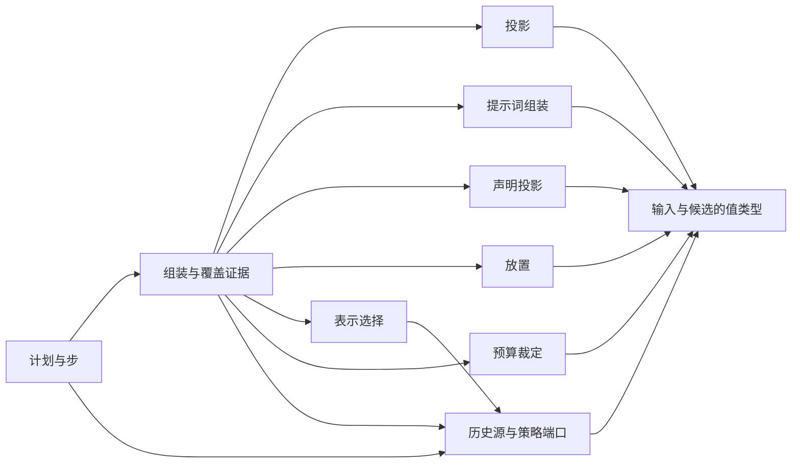

# Request Context 纯契约的内部架构

本页说明本成员怎样组织根入口与依赖，来兑现 [SPEC](../SPEC.md)。对象的身份、状态与生灭归[对象模型](object-model.md)。组内八个成员的分解与依赖方向归[组架构](../../docs/architecture.md)。本页不另立公共规则。

本成员没有运行实现，不持有状态，也不持有资源。候选缓存、历史索引、默认压缩策略、默认表示策略与修剪器归 [request-context](../../request-context/README.md)。提示词贡献的登记面归 [request-context-cordis-contract](../../request-context-cordis-contract/README.md)。最终请求的固定与记录归协调者，历史与压缩记录的保存归历史持有者。

## 模块与依赖

根入口 `src/index.ts` 是唯一公开入口。它按下表分成十个模块，每个模块一个源文件，`index.ts` 只做再导出。文件名由实现确定。`src/index.ts` 现在是空导出，下表的全部内容随实现进入，形状以 SPEC 和对象模型为准。

| 模块 | 承载 | 条款 |
| --- | --- | --- |
| 输入与候选的值类型 | `AssemblyInput` 的七组、`RequestCandidate`、四种组装结果、三类失败 | [RQ-01](../SPEC.md#rq-01-调用方与计算边界)、[RQ-02](../SPEC.md#rq-02-组装的前置输入)、[RQ-05](../SPEC.md#rq-05-完整预算与候选完成) |
| 投影 | `project`（模型侧）、`projectForHuman`（人侧），两者共用同一套块标注规则 | [RQ-03](../SPEC.md#rq-03-历史与块投影) |
| 提示词组装 | `PromptContribution`、`assembleSystemPrompt` | [RQ-02](../SPEC.md#rq-02-组装的前置输入) |
| 声明投影 | `declareTools`：从完整工具定义形成直接集合与脚本可调用集合 | [RQ-02](../SPEC.md#rq-02-组装的前置输入)、[RQ-04](../SPEC.md#rq-04-模态与可追溯表示) |
| 放置 | `placeContext`、`SnapshotReminder`、`TailFacts` | [装载布局与前缀](../SPEC.md#装载布局与前缀)的 R4、R5、R6 |
| 表示选择 | `chooseRepresentations`、`RepresentationChoice` | [RQ-04](../SPEC.md#rq-04-模态与可追溯表示) |
| 预算裁定 | `judgeBudget`、`FitVerdict` | [RQ-05](../SPEC.md#rq-05-完整预算与候选完成) |
| 组装与覆盖证据 | `assemble`、`Coverage`，以及契约常量：六层顺序、快照锚点规则、前缀变化原因的取值 | [RQ-02](../SPEC.md#rq-02-组装的前置输入)、[装载布局与前缀](../SPEC.md#装载布局与前缀) |
| 计划与步 | `planCompaction`、`deriveStep`、`resume`、`CompactionPlan`、`PlanProgress`、`StepRequest`、`ContextTransition` | [RQ-06](../SPEC.md#rq-06-压缩共同结果与保护边界)、[RQ-07](../SPEC.md#rq-07-扩展修改发起与固定采用)、[RQ-09](../SPEC.md#rq-09-取消恢复与迟到) |
| 历史源与策略端口 | `HistorySource`、`HistoryEvidence`、压缩策略端口、表示策略端口 | [历史源读口与 epoch 视图](../SPEC.md#历史源读口与-epoch-视图)、[RQ-04](../SPEC.md#rq-04-模态与可追溯表示)、[RQ-06](../SPEC.md#rq-06-压缩共同结果与保护边界) |

模块之间只有单向依赖。端口模块与各计算模块读取值类型模块，表示选择、组装与计划还读取端口模块。组装模块调用投影、提示词组装、声明投影、放置、表示选择与预算裁定六个模块。计划与步模块读取组装模块的结果类型，组装模块不导入计划与步模块。

### 包外依赖

本成员依赖下列包的公开值与类型。它们都随实现进入 `package.json`，现在 `package.json` 没有运行依赖。

| 包 | 用来表达什么 |
| --- | --- |
| [model-contract](../../../model/model-contract/README.md) | 模型档案、输入模态、窗口与限制、计量端口与预算报告、转换件结果、工具声明、组装输入 |
| [tool-contract](../../../tool/tool-contract/README.md) | 完整工具定义、绑定采用、可编程调用许可 |
| [content-block](../../../common/content-block/README.md) | 内容块与块的人侧、模型侧可见标注 |
| [message](../../../common/message/README.md) | 消息、提醒角色、`ToolInternalMessage`、压缩记录 `CompactionMessage` 与模型视图规则 |
| [runtime-context-contract](../../runtime-context-contract/README.md) | 模型侧读取结果的类型与块声明的 `volatility` |

本成员不导入 `@deepseek-ai/cordis`，见 [Cordis 说明](cordis.md)。本成员不导入任何协调者或历史持有者的契约。它们依赖本成员，反方向不成立。现在没有包依赖本成员，见[使用与定位](context.md#现在的真实消费者)。

## 关键机制与理由

### 为什么输入分七组

七组按「谁给、什么时候变」切分（[RQ-02](../SPEC.md#rq-02-组装的前置输入)）。每组有一个给出方和一个修订来源，所以每组可以单独判断缺项、单独比较是否变化、单独作缓存键的一部分（[RQ-10](../SPEC.md#rq-10-性能缓存与观测)）。如果把输入合成一个对象，任一来源变化都要重比整个对象，缓存只能整体失效，缺项也无法定位到给出方。

代价：调用方要分别给出七组，没有一个便捷的整体参数。上一次准备放在第七组，但不参与「同输入」比较。理由是上一次准备只说明本次处在哪个经过之后，不改变候选应有的内容。

### 为什么候选是纯函数

全部操作是纯函数：同一组输入得同一结果，同一个计划、进度与步结果得同一步结局（[RQ-01](../SPEC.md#rq-01-调用方与计算边界)）。理由有三条：

1. 协调者在固定前可能多次重算。纯函数保证重算不改变已有判断，也不产生外部效果。
2. 恢复时可以从已保存的输入与进度重新求得候选和下一步，不需要本成员保存任何调用记录。
3. 独立调用方不需要建协调者或持有者，就能直接使用全部操作。

缓存只是实现的性能手段。有缓存与无缓存，同一输入必须得同一结果。代价是本成员需要的一切都要作为输入或构造依赖交进来，历史只能经 `HistorySource` 读口取得。

### 为什么限额未知不是失败

模型档案可能不知道某个上游限制（[RQ-05](../SPEC.md#rq-05-完整预算与候选完成)）。本成员不能伪造数值，也不能替 Model 判断能否发出。所以限额未知时候选照常成立，覆盖证据标明哪项限制未知，发出与否由 Model 发送期按真实能力裁定。如果把限额未知当失败，一个合法、可能装得下的请求会被拒绝，调用方也无法区分「确实装不下」和「不知道装不装得下」。

代价：候选成立不等于一定能发出。协调者要处理 Model 发送期的拒绝，见 [Model 档案与请求准备协议](../../../model/model-contract/SPEC.md#档案与请求准备协议)。

### 为什么计划归本域，调用归协调者

是否压缩、怎样压缩、压缩后能否装下，都依赖预算与保留规则，这些归本成员（[RQ-06](../SPEC.md#rq-06-压缩共同结果与保护边界)）。摘要步是一次真实的模型调用，它有身份、费用、取消与恢复，这些归发起调用的协调者。所以本成员给计划与步请求，协调者执行步并保存进度，本成员再按步结果推导下一步。

这样分有两个效果：

- 本成员保持纯函数，不持有模型调用的寿命与外部效果。
- 协调者不需要理解预算与保留规则，只执行步并保存进度。

代价：协调者要可靠保存计划进度，中断后从已完成的步接续。步请求不经组装，也不递归，所以压缩不会引发新的压缩。

### 为什么快照锚点取历史尾部

上下文快照提醒锚定在完整读取发生时的模型可见历史尾部（[装载布局与前缀](../SPEC.md#装载布局与前缀)的 R4）。在下一次完整读取之前，每次请求都把它放在同一锚点，变化只以提醒追加到锚点之后。这样快照之前的内容逐字不变，请求开头可以保持稳定，供应商的前缀缓存能够命中。

锚点不含本次请求承接的新输入。理由是新输入属于历史体，如果锚点放在新输入之后，下一次请求的新输入会落在快照之前，开头就会变化。锚点记在覆盖证据里，经「已采用」回到下一次组装，所以本成员不需要记住上一次调用。

### 为什么 epoch 比较是常数时间

历史持有者把模型可见历史物化为 epoch 视图，每行带前缀摘要，即上一行摘要与本行摘要的链式散列（[历史源读口与 epoch 视图](../SPEC.md#历史源读口与-epoch-视图)的 H3）。覆盖证据记每层锚点处的序号与前缀摘要。下一次组装读到同一序号时只比较一个摘要：相等即前缀未变，不等的唯一原因是 epoch 变化。

链式散列使一个摘要代表它之前的全部内容，所以判断不随历史长度增长，不需要逐条比对。这是 [RQ-10](../SPEC.md#rq-10-性能缓存与观测) 「超长历史不能让每次准备重扫全部历史」在前缀判断上的兑现。代价是历史持有者要在追加时维护前缀摘要，这项义务在持有者一侧。

## SOLID 与扩展边界

本节讲模块层的选择。对象层的选择见对象模型的 [SOLID 与扩展边界](object-model.md#solid-与扩展边界)。

| 原则 | 本成员的具体选择 | 必须防止的反例 |
| --- | --- | --- |
| 单一职责 | 每个模块只因一类变化而改：投影随块标注规则改，表示选择随模态规则改，预算裁定随限制比较规则改，计划与步随压缩规则改 | 组装模块自己读字节、自己计量，或保存候选与进度 |
| 开闭 | 新的压缩策略与表示策略是策略端口的新实现，计算模块不变。新的提示词贡献者只在登记面登记 | 为某个策略或某个协调者在组装模块里加特例分支 |
| 里氏替换 | `HistorySource` 与两个策略端口的实现可以互换，调用方得到的结果集合不变 | 某个实现返回契约没有的结果，或把「epoch 已变」当成不可用 |
| 接口隔离 | 协调者使用组装与计划两组操作。历史持有者与交付面只使用 `projectForHuman`。独立调用方按需导入单个操作 | 一个聚合对象同时暴露组装、计划与人侧投影 |
| 依赖倒置 | 本成员只依赖邻域契约的公开值。历史与策略经端口注入，计量与转换件结果经 Model 的端口注入 | 导入 Cordis、协调者或持有者的契约。计算模块直接调用存储或服务 |

## 验证与维护

保证与持续验证资源的对应如下：

| 保证 | 现在的验证 | 后续义务 |
| --- | --- | --- |
| 根入口没有运行导出 | [public-entry.spec.ts](../tests/public-entry.spec.ts) 断言根入口的运行导出为空 | 第一个操作进入后，改为核对导出集合 |
| SPEC 的行为条款 | 没有 | SPEC 的[持续验证义务](../SPEC.md#rq-11-持续验证与未覆盖)，随纯操作与实现成员进入 |
| 有缓存与无缓存同输入同结果 | 没有 | 由 [request-context](../../request-context/README.md) 的实现与测试承担 |

维护规则：

1. 新增或改名导出时，同步[公开接口页](public-api.md)、[src 索引](../src/index.md)与导出测试。
2. 改变七组输入、四种结果、三类失败、六层顺序或前缀变化原因的取值时，同步依赖方：request-context-cordis-contract、request-context、request-context-cordis，以及协调者一侧的适配器，见[字段对应](context.md#字段对应)。
3. 以下情形出现时，重新判断本页的模块切分：步出现第三种类型，出现第二种历史源读口，或独立入口的字节编码确定。
