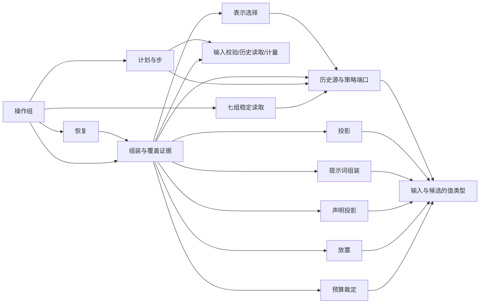

# Request Context 纯契约的内部架构

本页说明本成员怎样组织根入口与依赖，来兑现 [SPEC](../SPEC.md)。对象的身份、状态与生灭归[对象模型](object-model.md)。组内八个成员的分解与依赖方向归[组架构](../../docs/architecture.md)。本页不另立公共规则。

本成员提供无状态的操作组与纯函数，不提供生产运行时，不持有状态，也不持有资源；操作组只在一次调用内借用 Model 准备租约并在全部路径上归还。来源登记表、账目投影、候选缓存、历史索引、默认压缩策略、默认表示策略与修剪器归 [request-context](../../request-context/README.md)。提示词贡献的登记面归 [request-context-cordis-contract](../../request-context-cordis-contract/README.md)。最终请求的固定与记录归协调者，历史与压缩记录的保存归历史持有者。

## 模块与依赖

根入口 `src/index.ts` 显式重导出公开定义，`./testing` 入口承载验证资源。值类型集中在 `values.ts`，各纯操作依赖值类型，避免反向运行依赖。文件名与导出落点见公开接口索引。

| 模块               | 承载                                                                                                           | 条款                                                                                                                                                        |
| ------------------ | -------------------------------------------------------------------------------------------------------------- | ----------------------------------------------------------------------------------------------------------------------------------------------------------- |
| 输入与候选的值类型 | `AssemblyCall` 与内部的七组视图、`RequestCandidate`、四种组装结果、三类失败                                     | [RQ-01](../SPEC.md#rq-01-调用方与计算边界)、[RQ-02](../SPEC.md#rq-02-组装的前置输入)、[RQ-05](../SPEC.md#rq-05-完整预算与候选完成)                          |
| 投影               | `project`（模型侧）、`projectForHuman`（人侧），两者共用同一套块标注规则                                       | [RQ-03](../SPEC.md#rq-03-历史与块投影)                                                                                                                      |
| 提示词组装         | `PromptContribution`、`assembleSystemPrompt`                                                                   | [RQ-02](../SPEC.md#rq-02-组装的前置输入)                                                                                                                    |
| 声明投影           | `declareTools`：从完整工具定义形成直接集合与脚本可调用集合                                                     | [RQ-02](../SPEC.md#rq-02-组装的前置输入)、[RQ-04](../SPEC.md#rq-04-模态与可追溯表示)                                                                        |
| 放置               | `placeContext`、`SnapshotReminder`、`TailFacts`                                                                | [装载布局与前缀](../SPEC.md#装载布局与前缀)的 R4、R5、R6                                                                                                    |
| 表示选择           | `chooseRepresentations`、`RepresentationChoice`                                                                | [RQ-04](../SPEC.md#rq-04-模态与可追溯表示)                                                                                                                  |
| 预算裁定           | `judgeBudget`、`FitVerdict`                                                                                    | [RQ-05](../SPEC.md#rq-05-完整预算与候选完成)                                                                                                                |
| 组装与覆盖证据     | `assemble`、`Coverage`，以及契约常量：六层顺序、快照锚点规则、前缀变化原因的取值                               | [RQ-02](../SPEC.md#rq-02-组装的前置输入)、[装载布局与前缀](../SPEC.md#装载布局与前缀)                                                                       |
| 计划与步           | `planCompaction`、`deriveStep`、`resume`、`CompactionPlan`、`PlanProgress`、`StepRequest`、`ContextTransition` | [RQ-06](../SPEC.md#rq-06-压缩共同结果与保护边界)、[RQ-07](../SPEC.md#rq-07-扩展修改发起与固定采用)、[RQ-09](../SPEC.md#rq-09-取消恢复与迟到)                |
| 历史源与策略端口   | `HistorySource`、`HistoryEvidence`、`HistoryCursor`、压缩策略端口、表示策略端口                                 | [历史源读口与 epoch 视图](../SPEC.md#历史源读口与-epoch-视图)、[RQ-04](../SPEC.md#rq-04-模态与可追溯表示)、[RQ-06](../SPEC.md#rq-06-压缩共同结果与保护边界) |

另有三个模块：来源与读取（`sources.ts` 的来源集合与登记协议类型、`input-read.ts` 的七组稳定读取）、操作组（`operations.ts` 的 `createAssemblyOperations`：访问与资格、主体键、读取、派生、发布前再核资格）与账目协议类型（`accounting.ts`）。条款为 [RQ-12](../SPEC.md#rq-12-来源集合与登记面) 至 [RQ-15](../SPEC.md#rq-15-普通访问与系统恢复)。

模块之间只有单向依赖。端口模块与各计算模块读取值类型模块，表示选择、组装与计划还读取端口模块。组装模块调用投影、提示词组装、声明投影、放置、表示选择与预算裁定六个模块。共享输入、结果、准备依据、历史行、投影和声明集均归 values.ts；端口组合归 ports.ts。计划和组装共用输入校验、历史读取及计量，不互相导入。resume.ts 单向调用组装入口。

### 组装的内部阶段

操作组的 `assemble` 先核访问身份、目标租户、读取资格与主体键，再由 input-read.ts 按组读计数、读来源、再读计数，然后串联固定阶段，失败结果按原顺序立即返回，最后再核一次读取资格才发布结果：

1. input-validation.ts 校验目标与租户、保存依据、模型绑定与 Runtime Context 读取结果。
2. preparation.ts 按 `PreparedInputKey` 比较来源代际、主体键、调用身份与六组令牌。只有稳定历史、提示词和声明可以认回，未藏缓存。
3. assembly-layers.ts 每次重算快照锚点与动态尾部；历史链摘要仍取自历史源。
4. assembly-representation.ts 读取本次转换结果并调用表示选择；representation.ts 分开块选择、模态核验与来源证据。
5. assembly-budget.ts 经 model-input.ts 把选择转换成一次 Model 输入，用 measurement.ts 对每份候选取得准备租约，按供应商的 `rules.plan` 物化表示计量整体与固定部分，在全部路径上归还租约。
6. assembly-coverage.ts 构建七组来源及派生证据；assembly-outcome.ts 按预算与本候选是否已经压缩交出结果。

### 计划、步和边界校验

plan.ts 读取完整历史和 compaction-context.ts 的增量判断窗口（CM-02），先检查完整 open 下界预算，再接受策略给的覆盖范围，并把窗口与摘要记入计划的 `basis`。草案经 judgeCompaction 核验，窗口本身违反来源关系时为无效，不消耗摘要步；不缩小下界绕过预算。compaction-step.ts 分开计划身份、步序号、依据核对、消费依据推进和摘要验证；compaction-request.ts 构造摘要材料与步请求，修剪在第一个摘要步之前完成一次，不算一步。resume.ts 只检查恢复前提并调用 assemble。

coverage-validation.ts 按历史、压缩、输入、快照、提示词、模型、工具与预算逐组核验。schema-primitives.ts 拥有边界解码的小型谓词和 Standard Schema 适配；schema.ts 组合各公开 Schema。声明模块不导入组装或计划执行模块。

### 包外依赖

本成员依赖下列包的公开值与类型。依赖已在 `package.json` 声明。

| 包                                                                   | 用来表达什么                                                                       |
| -------------------------------------------------------------------- | ---------------------------------------------------------------------------------- |
| [model-contract](../../../model/model-contract/README.md)            | 模型档案、输入模态、窗口与限制、计量端口与预算报告、转换件结果、工具声明、组装输入 |
| [tool-contract](../../../tool/tool-contract/README.md)               | 完整工具定义、绑定采用、可编程调用许可                                             |
| [content-block](../../../common/content-block/README.md)             | 内容块与块的人侧、模型侧可见标注                                                   |
| [message](../../../common/message/README.md)                         | 消息、提醒角色、`ToolInternalMessage`、压缩记录 `CompactionMessage` 与模型视图规则 |
| [runtime-context-contract](../../runtime-context-contract/README.md) | 模型侧读取结果的类型与块声明的 `volatility`                                        |

本成员不导入 `@deepseek-ai/cordis`，见 [Cordis 说明](cordis.md)。本成员不导入任何协调者或历史持有者的契约。它们依赖本成员，反方向不成立。已实现的 request-context-cordis-contract 依赖本成员的公开类型，见[使用与定位](context.md#现在的真实消费者)。

## 关键机制与理由

### 为什么输入分七组

七组按「谁给、什么时候变」切分（[RQ-02](../SPEC.md#rq-02-组装的前置输入)）。每组有一个给出方和一个修订来源，所以每组可以单独判断缺项、单独比较是否变化、单独作缓存键的一部分（[RQ-10](../SPEC.md#rq-10-性能缓存与观测)）。如果把输入合成一个对象，任一来源变化都要重比整个对象，缓存只能整体失效，缺项也无法定位到给出方。

代价：来源适配者要为六组各实现一个组读口（读计数、读来源），组一由调用方以 `AssemblyCall` 给出。上一次准备放在第七组，但不参与「同输入」比较。理由是上一次准备只说明本次处在哪个经过之后，不改变候选应有的内容。

### 为什么候选是纯函数

全部操作是纯函数：同一组输入得同一结果，同一个计划、进度与步结果得同一步结局（[RQ-01](../SPEC.md#rq-01-调用方与计算边界)）。理由有三条：

1. 协调者在固定前可能多次重算。纯函数保证重算不改变已有判断，也不产生外部效果。
2. 恢复时可以从已保存的输入与进度重新求得候选和下一步，不需要本成员保存任何调用记录。
3. 独立调用方不需要建协调者或持有者，就能直接使用全部操作。

缓存只是实现的性能手段。有缓存与无缓存，同一输入必须得同一结果。代价是本成员需要的一切都要作为输入或构造依赖交进来，历史只能经 `HistorySource` 读口取得。

### 为什么限额未知不是失败

模型档案可能不知道某个上游限制（[RQ-05](../SPEC.md#rq-05-完整预算与候选完成)）。本成员不能伪造数值，也不能替 Model 判断能否发出。所以限额未知时候选照常成立，覆盖证据标明哪项限制未知，发出与否由 Model 发送期按真实能力裁定。如果把限额未知当失败，一个合法、可能装得下的请求会被拒绝，调用方也无法区分「确实装不下」和「不知道装不装得下」。

代价：候选成立不等于一定能发出。协调者要处理 Model 发送期的拒绝，见 [Model 档案与请求准备协议](../../../model/model-contract/SPEC.md#档案与请求准备协议)。

### 为什么计划归本域，调用归协调者

是否压缩、怎样压缩、压缩后能否装下，都依赖预算与保留规则，这些归本成员（[RQ-06](../SPEC.md#rq-06-压缩共同结果与保护边界)）。摘要步是一次真实的模型调用，它有身份、费用、取消与恢复，这些归发起调用的协调者。所以本成员给计划与步请求，协调者执行步并保存进度，本成员再按步结果推导下一步。

这样分有两个效果：

- 本成员保持纯函数，不持有模型调用的寿命与外部效果。
- 协调者不需要理解预算与保留规则，只执行步并保存进度。

代价：协调者要可靠保存计划进度，中断后从已完成的步接续。步请求不经组装，也不递归，所以压缩不会引发新的压缩。

### 为什么快照锚点取历史尾部

上下文快照提醒锚定在完整读取发生时的模型可见历史尾部（[装载布局与前缀](../SPEC.md#装载布局与前缀)的 R4）。在下一次完整读取之前，每次请求都把它放在同一锚点，变化只以提醒追加到锚点之后。这样快照之前的内容逐字不变，请求开头可以保持稳定，供应商的前缀缓存能够命中。

锚点不含本次请求承接的新输入。理由是新输入属于历史体，如果锚点放在新输入之后，下一次请求的新输入会落在快照之前，开头就会变化。锚点记在覆盖证据里，经「已采用」回到下一次组装，所以本成员不需要记住上一次调用。

### 为什么 epoch 比较是常数时间

历史持有者把模型可见历史物化为 epoch 视图，每行带前缀摘要，即上一行摘要与本行摘要的链式散列（[历史源读口与 epoch 视图](../SPEC.md#历史源读口与-epoch-视图)的 H3）。覆盖证据记每层锚点处的序号与前缀摘要。下一次组装读到同一序号时只比较一个摘要：相等即前缀未变，不等的唯一原因是 epoch 变化。

链式散列使一个摘要代表它之前的全部内容，所以判断不随历史长度增长，不需要逐条比对。这是 [RQ-10](../SPEC.md#rq-10-性能缓存与观测) 「超长历史不能让每次准备重扫全部历史」在前缀判断上的兑现。代价是历史持有者要在追加时维护前缀摘要，这项义务在持有者一侧。

## SOLID 与扩展边界

本节讲模块层的选择。对象层的选择见对象模型的 [SOLID 与扩展边界](object-model.md#solid-与扩展边界)。

| 原则     | 本成员的具体选择                                                                                                   | 必须防止的反例                                                |
| -------- | ------------------------------------------------------------------------------------------------------------------ | ------------------------------------------------------------- |
| 单一职责 | 每个模块只因一类变化而改：投影随块标注规则改，表示选择随模态规则改，预算裁定随限制比较规则改，计划与步随压缩规则改 | 组装模块自己读字节、自己计量，或保存候选与进度                |
| 开闭     | 新的压缩策略与表示策略是策略端口的新实现，计算模块不变。新的提示词贡献者只在登记面登记                             | 为某个策略或某个协调者在组装模块里加特例分支                  |
| 里氏替换 | `HistorySource` 与两个策略端口的实现可以互换，调用方得到的结果集合不变                                             | 某个实现返回契约没有的结果，或把「epoch 已变」当成不可用      |
| 接口隔离 | 协调者使用组装与计划两组操作。历史持有者与交付面只使用 `projectForHuman`。独立调用方按需导入单个操作               | 一个聚合对象同时暴露组装、计划与人侧投影                      |
| 依赖倒置 | 本成员只依赖邻域契约的公开值。历史、组读口与策略经来源集合与端口注入；准备资源、计量与转换结果类型归 Model，转换结果读口归本成员                            | 导入 Cordis、协调者或持有者的契约。计算模块直接调用存储或服务 |

## 验证与维护

保证与持续验证资源的对应如下：

| 保证                       | 现在的验证                                                                   | 后续义务                                                                         |
| -------------------------- | ---------------------------------------------------------------------------- | -------------------------------------------------------------------------------- |
| 根入口的运行导出与清单一致 | [public-entry.spec.ts](../tests/public-entry.spec.ts) 比较构建导出与导出清单 | 与公开接口导航同步维护                                                           |
| SPEC 的行为条款 | 纯操作测试与公开符合性套件，逐行见 [RQ-11 对照](../verification/rq11.md) | 生产集成、持久状态与真实依赖的剩余义务见 [持续验证](../SPEC.md#rq-11-持续验证与未覆盖) |
| 有缓存与无缓存同输入同结果 | 没有                                                                         | 由 [request-context](../../request-context/README.md) 的实现与测试承担           |

维护规则：

1. 新增或改名导出时，同步[公开接口页](public-api.md)、[src 索引](../src/index.md)与导出测试。
2. 改变七组输入、四种结果、三类失败、六层顺序或前缀变化原因的取值时，同步依赖方：request-context-cordis-contract、request-context、request-context-cordis，以及协调者一侧的适配器，见[字段对应](context.md#字段对应)。
3. 以下情形出现时，重新判断本页的模块切分：步出现第三种类型，出现第二种历史源读口，或独立入口的字节编码确定。

## 实际模块接缝

值类型集中在 `src/values.ts`，品牌引用与解码在 `src/refs.ts`。`src/refs.ts` 再导出 legal-identity 的 `Access` 与 exchange-refs 的 `Adoption`、`DurableEvidence`，不另写副本，结构判定留在 `src/schema-primitives.ts`。`src/schema.ts` 解码持久回流值与策略配置。纯操作依赖这些值，根入口只显式重导出。`src/testing/` 只拥有测试替身和用例列表，不拥有生产实现。

请求字节取自 Model `rules.plan` 的物化表示，本成员没有序列化端口。转换结果读口归本成员，结果类型归 Model。`deriveStep` 由操作组稳定读取第五组的选定模型，以复核摘要及保留内容的预算。计划的 `basis` 保留增量判断窗口，用于核对覆盖边界的调用与结果配对。
