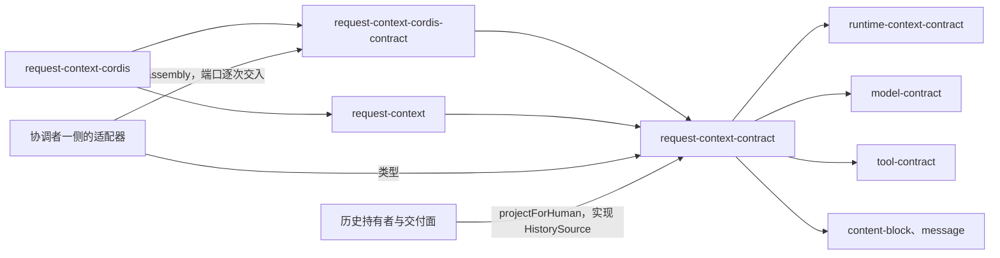

# Request Context 纯契约的使用与定位

本页说明消费方怎样使用本成员，以及本成员在系统与能力组中的位置。系统关系归[系统页 Request Context](../../../../docs/architecture/runtime/request-context.md)，领域责任归[领域页](../../../../docs/domains/runtime-context/README.md)，组内分解归[组入口](../../README.md)。本页不另立架构。

## 使用方式

本成员的根入口已实现下面的纯操作，见[公开接口页](public-api.md#现有根导出)。运行场景见 tests，示例目录没有独立应用，调用顺序的职责伪代码见对象模型的[调用方怎样使用](object-model.md#调用方怎样使用)。

### 独立消费

独立调用方不建协调者或历史持有者，也不装配 Cordis。它只安装本成员，自己给出七组输入与构造依赖（[RQ-01](../SPEC.md#rq-01-调用方与计算边界)）。步骤如下：

1. 准备构造依赖：一个 `HistorySource` 实现、Model 的计量端口、本成员的 `ConversionResultSource` 读口（结果类型使用 Model 的 `ConversionResult`）及适配器序列化端口、压缩策略与表示策略的实现。
2. 准备七组输入，见 [RQ-02](../SPEC.md#rq-02-组装的前置输入) 的表。只处理自己给出的数据时，可以没有访问身份。
3. 调用 `assemble`，按四种结局处置：
   - 候选成立：自己交 Model 准备并固定。覆盖证据由自己保存，下一次组装作为「已采用」传回。
   - 需要压缩：调用 `planCompaction`，再逐步调用 `deriveStep`。摘要步的模型调用由自己发起，进度由自己保存。
   - 装不下：失败回到自己，本成员不造任何上层对象。
4. 得到压缩转换后，自己作为合法历史拥有者保存压缩记录，再调用 `resume` 重算。
5. 只需要人侧投影时，单独调用 `projectForHuman`。

没有协调者就没有共同提交。读取系统托管的历史、档案或其他资源时，仍适用原来源契约的身份、资格及保留责任，不因未运行 Cordis 而绕过。

### 托管消费

协调者不直接调用本成员。它经适配器调用：适配器实现协调者自己定义的请求准备端口，把端口的输入翻译成本成员的输入，把本成员的结果翻译回端口的结果。字段级对应见下文[字段对应](#字段对应)，适配器的位置与职责见[适配方案](#适配方案)。

### 两条组装入口

| 入口 | 适用场景 | 端口与策略怎样到达 |
| --- | --- | --- |
| 托管入口：[request-context-cordis-contract](../../request-context-cordis-contract/docs/cordis.md#服务定义) 的 `assembly(scope, ports)` | 装配了 Cordis 的系统，协调者一侧的适配器组装请求。贡献从登记面现取，策略按提供者的配置选定，缓存在提供者的机制实例里 | 历史源读口、计量端口、转换件结果端口与请求序列化端口由适配器在每次 `assembly(scope, ports)` 时交入。提供者不 `inject` 持有者或模型侧的服务 |
| 独立入口：[request-context](../../request-context/SPEC.md) 的机制工厂 | 不装配 Cordis、又要缓存与默认策略的调用方 | 四项端口与两个策略在工厂构造时给出，贡献集合由调用方随第四组传入 |

只要纯操作、不要缓存的独立调用方，按上一节直接用本成员的根入口。托管路径不把「适配器直接调用纯操作」当作组装入口。

### 初始化与释放

本成员没有初始化步骤，不持有资源，也没有需要释放的对象。构造依赖由调用方作为值传入。任一依赖缺席时，相关操作返回不可用，不伪装成功。缓存、默认策略与修剪器由 [request-context](../../request-context/README.md) 提供，提示词贡献的登记面由 [request-context-cordis-contract](../../request-context-cordis-contract/README.md) 提供，它们的寿命归各自成员。

## 消费者与定位

本成员处在请求组装这一块的最底层。下图投影[组架构](../../docs/architecture.md#安装与源码依赖)里与本成员相关的边，两者不一致时以组架构为准。

### 邻域交接

| 邻域 | 它对本成员是什么 | 怎样交接 | 本成员给什么、要什么 |
| --- | --- | --- | --- |
| 协调者 | 发起方。固定最终请求，执行压缩步，保存计划进度 | 经适配器调用 `assemble`、`planCompaction`、`deriveStep`、`resume` | 给四种结局、覆盖证据、计划与步请求、压缩转换。要七组输入与步结果 |
| 历史持有者 | 历史、压缩记录与未结工作的拥有者 | 实现 `HistorySource`。与协调者一起提交压缩转换。调用 `projectForHuman` | 给人侧投影与压缩转换的材料。要 epoch 视图、前缀摘要与未结工作集合 |
| Runtime Context | 模型侧读取结果的来源 | 协调者以模型类资格读取后作为第三组传入。本成员不读 Runtime Context | 要读取结果、块材料与块的 `volatility`，见 [runtime-context-contract](../../runtime-context-contract/docs/context.md) |
| Model | 档案、限制、计量与转换件结果的提供方，请求准备与发出的拥有者 | 选定模型由协调者传入。计量端口与转换件结果端口在独立入口由工厂构造时注入，在托管入口由适配器经 `assembly(scope, ports)` 逐次交入 | 给 Model 的工具声明与历史模态约束。候选交 Model 准备成固定请求的一步归协调者 |
| Tool | 工具定义、绑定与可编程许可的拥有者 | 协调者经装配求值后作为第六组传入 | 给直接集合与脚本可调用集合。声明投影不是执行授权 |
| 贡献者 | 提示词贡献的拥有者 | 在 [request-context-cordis-contract](../../request-context-cordis-contract/README.md) 的登记面登记 | 要有序段与变量两类贡献 |
| 扩展位置 | 调模型之前位置的经过与改写 | 协调者把改写依据与经过作为第七组传入 | 重组装并复核，前缀变化原因可见 |

### 字段对应

本节写协调者一侧的真实端口与本成员的对应。现在唯一定义了这类端口的是 Agent 契约：[request.ts](../../../agent/agent-contract/src/request.ts) 的 `ModelContextReader` 与 `RequestPreparation`。它们的行为见 Agent SPEC 的[请求、扩展和材料接缝](../../../agent/agent-contract/SPEC.md#请求扩展和材料接缝)、[请求准备与压缩](../../../agent/agent-contract/SPEC.md#请求准备与压缩)与[调模型之前的复核与最终请求](../../../agent/agent-contract/SPEC.md#调模型之前的复核与最终请求)。

Agent 契约是本成员的消费者，本成员不依赖它。下表只说适配器要翻译哪些字段，不给本成员增加对 Agent 类型的依赖。表中「组一」至「组七」指 [RQ-02](../SPEC.md#rq-02-组装的前置输入) 的七组，依次是：调用身份与用途、历史与新输入、runtime context 读取结果、系统提示词、模型侧、工具侧、当前条件与本次经过。

#### `RequestPreparation.prepare` 的输入

| Agent 字段 | 进入 `AssemblyInput` 的位置 | 适配器做什么 |
| --- | --- | --- |
| `principal`、`tenant` | 组一：访问身份。托管读取带租户 | 原样传入 |
| `advance` | 不进入 | 适配器核对执行挂接仍有效。已被取代时直接返回 `stale-advance`，不调用本成员 |
| `action` | 组一：候选身份 | 用作候选身份。同一候选身份至多进入一个计划，见下文[对不上的字段](#对不上的字段) |
| `purpose` | 组一：用途 | `main` 译为主请求，`extension` 译为扩展用途。类型已排除 `compaction`：步请求不经组装 |
| `position` | 组一：消费位置 | 作为不透明引用传入 |
| `history` | 组二：历史依据 | 经历史持有者的可信读取适配器解析为 `HistoryEvidence`，即 epoch 与上界 |
| `inputs` | 组二：新输入批 | 批身份、水位线与有序输入引用。本成员要求这批输入已可靠保存 |
| `context` | 组三：读取结果 | `content` 译为完整或增量，`source` 与 `coverage` 译为来源与覆盖证据。`recipient` 必须等于 `selection.recipient` |
| （无） | 组三：上一次已采用的覆盖、压缩转换依据 | 取自适配器服务的那次 `ModelContextReader.read` 的 `adopted` 与 `transition` |
| （无） | 组四：提示词贡献与组装上下文 | 贡献从登记面取得。组装上下文没有对应字段 |
| `selection` | 组五：模型侧 | `recipient` 译为实际收件模型，`resolution` 译为已解析档案（含输入模态、窗口与限制），`parameters` 译为参数，`tools` 与 `evidence` 译为工具证据与来源证据 |
| （无） | 组六：工具侧 | 没有直接字段 |
| `conditions` | 组七：条件证据的投影 | 整体作为证据传入。其中的 `context` 只是条件依据的引用，不含块内容 |
| `previous` | 组七：上一次准备 | 不参与「同输入」比较 |
| `alterations` | 组七：扩展改写依据 | 原样传入 |
| `beforeModelCall` | 组七：调模型之前位置的经过 | `null` 表示尚未经过，数组表示已经经过 |

#### `RequestPreparation.derive` 的输入

| Agent 字段 | 对应 | 适配器做什么 |
| --- | --- | --- |
| `principal`、`tenant`、`advance` | 同 `prepare` | 同 `prepare` |
| `original` | 计划的来源 | 由 `original.input` 重新得到触发压缩的那份 `AssemblyInput`。`planCompaction` 是纯函数，同一输入得同一计划 |
| `progress` | `PlanProgress` | `plan` 译为计划身份，`bound` 译为步数上界，`completed` 译为已完成步数 |
| `action` | 不进入本成员 | 这一步模型调用的身份归协调者 |
| `selection` | 不进入 `deriveStep` | 适配器用它把摘要步请求交 Model 准备成固定请求 |
| `result` | 步结果 | `null` 表示取第一步。否则 `produced` 与 `consumed` 译为摘要结果与保管依据 |

#### `RequestPreparation.resume` 的输入

| Agent 字段 | 对应 | 适配器做什么 |
| --- | --- | --- |
| `principal`、`tenant`、`advance` | 同 `prepare` | 同 `prepare` |
| `original` | 原 `AssemblyInput` | 由 `original.input` 重新得到原输入。改写依据与调模型之前位置的经过沿用 `original` 里的记录 |
| `transition` | 组三：压缩转换依据 | 核对提交来源与原准备一致。不一致时返回 `changed`，不调用本成员 |
| `selection` | 组五：模型侧 | 同 `prepare` |
| `context` | 组三：读取结果 | 压缩提交之后的读取结果，同 `prepare` |

#### `ModelContextReader.read` 的输入与输出

这个端口读的是 Runtime Context，不调用本成员。本成员不读 Runtime Context（[RQ-02](../SPEC.md#rq-02-组装的前置输入)）。适配器经 Runtime Context 的读者面按模型类资格读取，再把结果留给紧接着的 `prepare` 或 `resume`。

| Agent 字段 | 进入 `AssemblyInput` 的位置 | 说明 |
| --- | --- | --- |
| `principal`、`tenant` | 不进入本成员 | 用于 Runtime Context 的读取资格 |
| `advance` | 不进入 | 同 `prepare` |
| `position` | 不进入本成员 | 这次读取服务的消费位置 |
| `recipient` | 组五：实际收件模型 | 读取按实际收件模型过滤。收件模型变化时要重新读取 |
| `history` | 组二：历史依据 | 与同一次准备交给 `prepare` 的历史依据相同 |
| `adopted` | 组三：上一次已采用的覆盖 | 带快照锚点与各层锚点，见 [R4](../SPEC.md#装载布局与前缀) 与 [H3](../SPEC.md#历史源读口与-epoch-视图) |
| `transition` | 组三：压缩转换依据 | 只在压缩提交之后的读取中给出 |
| 输出 `ModelContextRead` | 组三：读取结果 | `content`、`source`、`coverage`、`recipient` 四项。块材料不在其中 |

#### 结果对应

| 本成员的结局 | Agent 的结果 | 适配器做什么 |
| --- | --- | --- |
| 候选成立（还要过扩展位置） | `assembled` | `input` 由候选的层内容按 Model `AssembledModelInput` 的形状给出：系统提示词进 `system`，工具声明进 `tools`，其余各层按顺序进 `messages`。`budget` 取预算报告摘要，`coverage` 取覆盖证据 |
| 候选成立（可固定） | `ready` | 把候选交 Model 的请求准备：档案取 `selection.resolution`，模态依据取本成员给出的历史模态约束。`request` 与 `capacity` 取 Model 的返回 |
| 需要压缩 | `needs-compaction` | 在同一次调用里调用 `planCompaction`。`progress` 取计划身份、步数上界与已完成零步。`original` 记录这次 `prepare` 的完整输入、改写依据与经过 |
| 装不下，固定部分超限 | `cannot-fit`，`reason` 为 `fixed` | `diagnostic` 取原因与诊断 |
| 装不下，压缩后仍装不下 | `cannot-fit`，`reason` 为 `after-compaction` | 同上 |
| `deriveStep` 给出下一个摘要步 | `continue` | `progress` 取新进度。`stepRequest` 是把步请求交 Model 准备后得到的 `ready`，用途为 `compaction` |
| `deriveStep` 给出压缩转换 | `transition` | `value.message` 取压缩记录，`derivation` 取一致性证明，`commitment` 取承诺，`preparation` 取 `original.id` |
| `deriveStep` 给出装不下 | `cannot-fit`，`reason` 为 `after-compaction` | 同上 |
| `resume` 的结局 | 与 `prepare` 相同 | 装得下时的种类由 `original.beforeModelCall` 决定：`null` 得 `assembled`，数组得 `ready` |

限额未知不是失败。候选照常成为 `assembled` 或 `ready`，覆盖证据标明哪项限制未知（[RQ-05](../SPEC.md#rq-05-完整预算与候选完成)）。

#### 失败对应

本成员的失败只有三类（[组装的结果](../SPEC.md#组装的结果)）。适配器按下表映射到 Agent 的 `Failure`，不新增类别，也不把一类改成另一类。

| 本成员的失败 | Agent 的 `Failure` | 说明 |
| --- | --- | --- |
| 无权：身份或资格不足，含历史源读口按访问身份核对后返回无资格 | `denied` | `action` 写被拒绝的操作 |
| 无效：缺必要输入，或输入不合形状、越出范围。含[组装的结果](../SPEC.md#组装的结果)表「无效」行列出的全部情形，以及计划身份或已完成步数核对失败 | `invalid` | `field` 指出越界的输入，`reason` 写原因 |
| 不可用：没有可用表示；来源不可用，含历史源、计量端口、转换件结果端口不可读或缺席，以及 runtime context 读取结果为缺项；实例已关闭或服务已卸载 | `unavailable` | `owner` 写不可读的来源拥有者，`diagnostic` 写原因。表示不可用属于这一类，带原结果转交 |

下列结果由适配器自己产生，不来自本成员：

- `stale-advance`：`advance` 已被取代。
- `changed`：`resume` 的提交来源与原准备不符。
- Model 请求准备的确定拒绝，译为 `invalid`，`field` 为 `request`。Model 请求准备暂时不可用时，按 Model 的原结果转交为 `unavailable`。

装不下是结局，不是失败。它走 `cannot-fit`，不走 `Failure`。

#### 对不上的字段

下列字段在两边没有一一对应。适配器按本节处理。没有写明处理方式的，由契约拥有者裁定，适配器不替它们决定。

| 字段 | 情况 | 现在的处理 |
| --- | --- | --- |
| 本成员的修剪步 | Agent 契约把压缩的每一步当作一次模型调用，`CompactionAdvance` 没有不调模型的步。本成员的修剪步不调模型，计划进度也要加一（[RQ-06](../SPEC.md#rq-06-压缩共同结果与保护边界)） | 两边的步数与已完成步数怎样对应，现在没有契约规定。由两个契约的拥有者裁定 |
| 组三的块材料 | `ModelContextRead` 只带证据，不带块的值。本成员每次组装都需要 ④ 的块材料来渲染快照提醒，增量读取时要的是最近一次完整读取的材料（[RQ-02](../SPEC.md#rq-02-组装的前置输入)），本成员不保存它 | 适配器跨请求保存最近一次完整读取的块材料（按资格过滤后的值）。完整读取时用本次的材料替换它；增量读取时把保存的材料随第三组交入。`prepare` 或 `resume` 按 `source` 与 `coverage` 取回 |
| 组三的「已采用」与转换依据 | `prepare` 与 `resume` 没有 `adopted` 字段。`prepare` 也没有 `transition` 字段 | 适配器沿用它服务的那次 `read` 的输入 |
| 组四 | Agent 端口没有提示词贡献与组装上下文的字段 | 贡献从登记面取得。组装上下文的作用域引用、定义采用与工作区选择从哪里取得，现在没有契约规定 |
| 组六 | Agent 端口没有工具定义、绑定采用与可编程许可的字段，只有 `selection.tools` 这一份证据 | 适配器按证据经装配求值取得完整工具定义。解析途径现在没有契约规定 |
| `action` 与候选身份 | Agent 把同一主请求一步内的多次调用算作同一次准备。本成员以候选身份界定「至多一个计划」 | 同一步内多次 `prepare` 的 `action` 是否相同，Agent 契约没有写。Agent 自己按 checkpoint 拒绝第二个计划，所以至多一个计划的规则在 Agent 一侧总能成立 |
| `Preparation` 的 `source`、`state`、`schema` | Agent 契约没有说明三项的含义 | 本成员没有对应项。由适配器给出 |
| `PreparedContextTransition.source` | 本成员的压缩转换没有这一项 | 由适配器给出 |
| `AssembledModelInput` 的 `toolChoice`、`representation`、`source` | 本成员的候选没有点名这三项 | 由适配器给出 |

### 适配方案

协调者一侧有两个端口要由 Context 一侧实现：可读上下文读取与请求准备。Agent 的 Cordis 服务定义把它们登记为服务键 `agentModelContext` 与 `agentRequests`，提供者归属写为「外域适配器：Context」，见 [Agent 的服务键与提供者](../../../agent/agent-cordis-contract/docs/cordis.md#服务键与提供者)。

**在哪一侧实现。**适配器不在本成员里，也不在本组任何成员里，因为本组成员都不导入协调者的契约（[组架构](../../docs/architecture.md#安装与源码依赖)）。它是一个单独的集成包，属于 Context 一侧，依赖下列入口：

- 协调者的服务定义，用来提供 `agentModelContext` 与 `agentRequests`。
- [request-context-cordis-contract](../../request-context-cordis-contract/README.md) 的服务定义，用 `assembly(scope, ports)` 取得已配置的操作组，并逐次交入历史源读口、计量端口与转换件结果端口。
- Runtime Context 读者面的服务定义 [runtime-context-cordis-contract](../../runtime-context-cordis-contract/README.md)。
- Model 的请求准备与计量端口。

这个包现在没有建立，由哪张卡建立、谁维护尚未指定，已登记在 Context 运行时实现卡 [#542](https://github.com/nemori-ai/omne-harness-lite/issues/542)。跨请求保存 ④ 层块材料（见[对不上的字段](#对不上的字段)）由这个包承担。

**翻译什么。**适配器按[字段对应](#字段对应)翻译输入与结果，并承担下列职责：

1. `prepare` 得到需要压缩时，在同一次调用里调用 `planCompaction`，交回计划身份、步数上界与已完成零步。
2. `derive` 的 `result` 为 `null` 时，从 `original` 重得计划并交回第一步。
3. 候选可固定时与每个摘要步，把内容交 Model 的请求准备，交回固定请求。
4. 核对计划身份与步数上界不变、已完成步数恰好加一。
5. 核对 `resume` 的提交来源与原准备一致。
6. 在 `read` 与随后的 `prepare` 或 `resume` 之间保存「已采用」与转换依据；跨请求保存最近一次完整读取的块材料，增量读取时随第三组交入。

**不翻译什么。**适配器不做以下事情：

- 不选模型，不决定是否压缩，不改装入裁定。
- 不保存计划进度。进度由协调者在自己的执行记录里保存。
- 不提交压缩转换。提交由协调者的执行记录与历史持有者共同完成。
- 不运行扩展位置，不发模型调用。
- 不改写本成员的结局或失败类别。

### 现在的真实消费者

现在没有包依赖本成员，也没有包导入它的根入口。协调者一侧已有契约定义了需要本成员行为的端口，见[字段对应](#字段对应)，但适配器包还没有建立，见上一节。组内的 request-context-cordis-contract、request-context 与 request-context-cordis 依赖本成员，它们的依赖随各自的实现进入。

### 上层页面

- 系统关系、服务面与 Cordis 落位：[系统页 Request Context](../../../../docs/architecture/runtime/request-context.md)。
- 领域责任与各邻域对本域的角色：[领域页](../../../../docs/domains/runtime-context/README.md)、[角色与交接](../../../../docs/domains/runtime-context/architecture.md)。
- 组内成员与跨成员流程：[组入口](../../README.md)、[组协作入口](../../docs/key-flows.md)。
- 本成员的流程：[协议流程](flows.md)。
