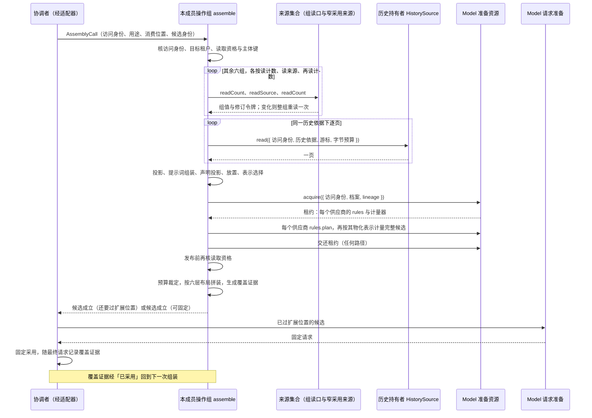
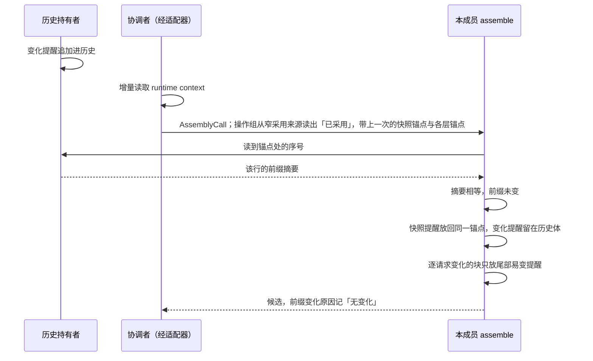
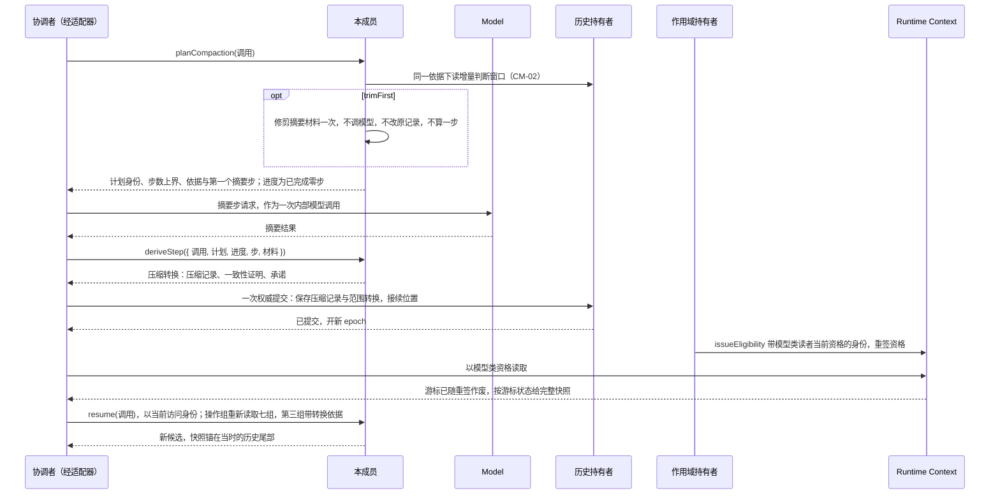
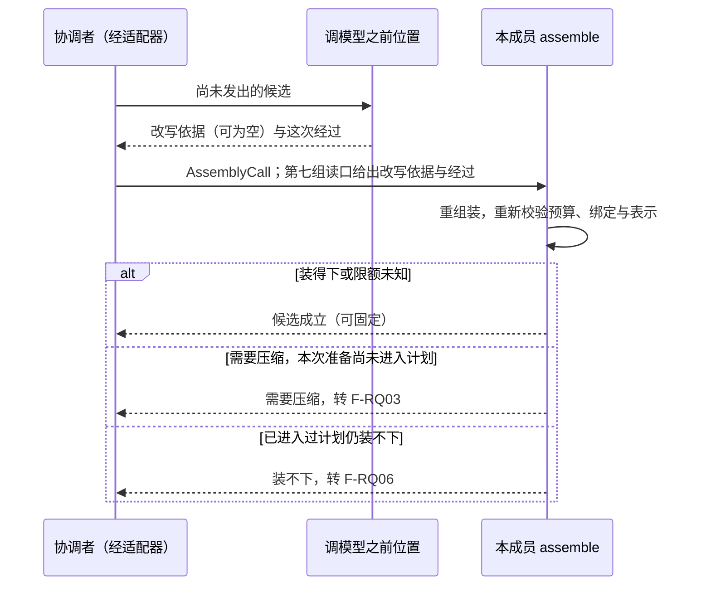
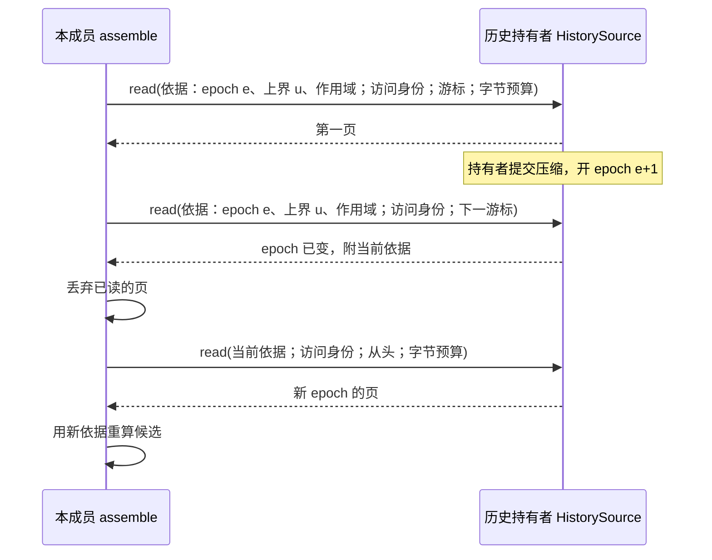
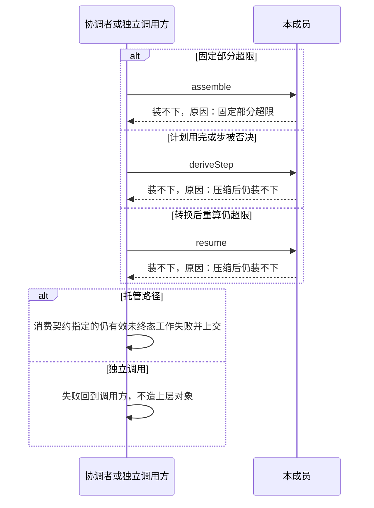

# Request Context 协议流程

本页给出本成员的六条协议级流程。每条流程有一张时序图和一张「失败与责任交接」表，并标出对应的 [SPEC](../SPEC.md) 条款。行为以 SPEC 为准，图只投影条款，不表示运行实现已经存在。

图中的「本成员」指本契约的纯操作，缓存与默认策略的机制归 [request-context](../../request-context/README.md)。跨成员流程 F-CX01 至 F-CX03 归组的[协作入口](../../docs/key-flows.md)。Runtime Context 一侧的读取与提醒流程归 [runtime-context-contract 的协议流程](../../runtime-context-contract/docs/flows.md)。对象的状态与转移见[对象模型](object-model.md#状态与转移)。

图中只出现通用角色：协调者、历史持有者、贡献者、调用方，以及 Model 的公开端口。协调者经适配器调用本成员，独立调用方直接调用。两条路的结果与失败相同。

## 流程

### F-RQ01 一次组装到候选成立与固定

条款：[RQ-01](../SPEC.md#rq-01-调用方与计算边界)、[RQ-02](../SPEC.md#rq-02-组装的前置输入)、[RQ-03](../SPEC.md#rq-03-历史与块投影)、[RQ-04](../SPEC.md#rq-04-模态与可追溯表示)、[RQ-05](../SPEC.md#rq-05-完整预算与候选完成)、[RQ-07](../SPEC.md#rq-07-扩展修改发起与固定采用)、[装载布局与前缀](../SPEC.md#装载布局与前缀)、[H1](../SPEC.md#历史源读口与-epoch-视图)。组的 F-CX01 在 runtime-context-contract 的 [F-RC03](../../runtime-context-contract/docs/flows.md#f-rc03-执行开始或挂接建立时的完整快照) 或 [F-RC04](../../runtime-context-contract/docs/flows.md#f-rc04-增量变化读取与游标作废) 之后进入本流程。

前提：本次要承接的新输入已经可靠保存。协调者一侧已经以模型类资格读到 runtime context，并选定了实际收件模型，二者经组读口交给操作组。本成员不直接读 Runtime Context，也不选模型。

| 环节 | 结果 | 失败与责任交接 |
| --- | --- | --- |
| 交入 AssemblyCall | 操作组稳定读取六组（[RQ-13](../SPEC.md#rq-13-七组的稳定读取)） | 缺访问身份返回无效，外部租户与资格拒绝返回无权，某组两次读取仍变化返回不可用，缺必要输入返回无效，新输入未可靠保存返回无效，实例已关闭或服务已卸载返回不可用（[组装的结果](../SPEC.md#组装的结果)）。没有提示词贡献是空提示词，不是错误 |
| 分页读历史 | 同一候选身份内的全部页用同一历史依据 | 读口不可用时返回不可用。读到「epoch 已变」时按 F-RQ05 重取 |
| 投影 | 模型侧只取标为模型可读且满足当前资格的块。`ToolInternalMessage` 始终排除 | 缺失或不明确的标注不进入请求。私有块不在读取结果里，组装看不到 |
| 表示选择 | 每个内容块选原件、派生表示或 transcript，工具结果的内容引用标为待加载 | 不读字节，不转换。必要表示不存在时返回不可用，带原结果 |
| 计量与预算裁定 | 每份候选经 Model 准备租约，按各供应商 `rules.plan` 的物化表示计量，装入裁定四选一（[RQ-05](../SPEC.md#rq-05-完整预算与候选完成)） | 计量归 Model，阈值比较与取整归本成员。取得租约前失败无须交还；取得后任何路径都交还，交还失败时不交出可固定的成功。计量不可用时返回不可用 |
| 候选成立 | 装得下或限额未知时给出候选、覆盖证据、裁定与表示决定 | 限额未知时覆盖证据标明，不作失败。需要压缩转 F-RQ03，装不下转 F-RQ06 |
| 准备键相同的再次调用 | 复用已有候选的稳定层 | 任一组合法变化即重算，不返回变化前的候选。上一次准备不参与比较 |
| 固定与记录 | 协调者固定实际模型、参数、历史范围、快照与锚点、工具声明与绑定 | 固定归协调者，不在本成员内发生。已固定的请求不随之后的定义、权限或 runtime context 变化而改写 |

### F-RQ02 变化提醒进历史体与快照锚点复用

条款：[装载布局与前缀](../SPEC.md#装载布局与前缀)的 R4、R5、R6、R9，[H3](../SPEC.md#历史源读口与-epoch-视图)，[RQ-02](../SPEC.md#rq-02-组装的前置输入)，[RQ-03](../SPEC.md#rq-03-历史与块投影)。组的 F-CX02 在 runtime-context-contract 的 [F-RC06](../../runtime-context-contract/docs/flows.md#f-rc06-值变化到变化材料到提醒) 之后进入本流程。

前提：上一次请求已经固定，它的覆盖证据记有快照修订、快照锚点和各层锚点处的序号与前缀摘要。在两次请求之间，一个模型可读的块变了，历史持有者把变化材料写成提醒追加进历史。

| 环节 | 结果 | 失败与责任交接 |
| --- | --- | --- |
| 变化提醒追加 | 提醒进历史体，不改快照，不改早先消息 | 提醒的写入归历史持有者。本成员不写历史 |
| 读取结果为增量 | 快照提醒按「已采用」里的快照修订与锚点重放 | 在下一次完整读取之前，每次请求的锚点相同。增量不产生新快照 |
| 前缀判断 | 同一序号的前缀摘要相等即前缀未变，判断是常数时间 | 摘要不等的唯一原因是 epoch 变化，转 F-RQ05。不逐条比对 |
| 逐请求变化的块 | 只进尾部易变提醒，位于请求最末 | 这类块不进快照，不产生变化提醒 |
| 系统提示词或工具集合变化 | 立即变化，不为保住已缓存的开头而推迟 | 覆盖证据记前缀变化原因：系统提示词变了，或工具集合变了 |
| 新的完整读取 | 快照提醒换代，锚点移到这次读取时的模型可见历史尾部 | 锚点不含本次请求承接的新输入。前缀变化原因记「新的完整读取换了快照」 |

### F-RQ03 需要压缩、计划、摘要步、转换提交后重算

条款：[RQ-06](../SPEC.md#rq-06-压缩共同结果与保护边界)、[RQ-07](../SPEC.md#rq-07-扩展修改发起与固定采用)、[RQ-09](../SPEC.md#rq-09-取消恢复与迟到)、[R4](../SPEC.md#装载布局与前缀)、[H2](../SPEC.md#历史源读口与-epoch-视图)。组的 F-CX03 从本流程开始，转换提交后接 runtime-context-contract 的 [F-RC04](../../runtime-context-contract/docs/flows.md#f-rc04-增量变化读取与游标作废)。

前提：装入裁定为需要压缩，且这次请求准备尚未进入压缩计划。历史持有者已给出未结工作的条目引用集合，作为保留名单的下界。

| 环节 | 结果 | 失败与责任交接 |
| --- | --- | --- |
| 出计划 | 计划先定覆盖范围，再在保留预算内选保留名单。再次压缩只读增量判断窗口；窗口违反来源关系时返回无效，不消耗摘要步。步数上界在给出时定下，之后不变 | 覆盖范围从历史起点开始。范围终点不把一次工具调用和它的结果分在两侧，除非调用一侧进了保留名单 |
| 保护未结工作 | 下界集合里落在范围内的条目都进保留名单 | 未读新输入、未答等待和未结后台占位不压。本成员不凭界面不可达或查询失败认定工作已经结束。下界集合本身超出保留预算时，`planCompaction` 返回装不下 |
| 修剪 | `trimFirst` 为真时，`planCompaction` 在给出第一个摘要步之前缩短摘要材料中过大的工具结果与媒体占位一次 | 修剪不是一步，不记进度。它不调模型，不改原记录，不改变装入裁定。步数上界为 1 时先修剪再完成一个摘要步是合法路径 |
| 摘要步 | 协调者发起一次内部模型调用，把结果交回 | 步请求不经组装，不递归。调用的身份、费用、取消与恢复归协调者，结果不形成主流程的助手消息 |
| 保存进度 | 每完成一步，已完成步数恰好加一 | 进度由协调者可靠保存。中断后从已完成的步接续，不重开计划 |
| 给出转换 | 摘要合法且装得下时给出压缩记录、一致性证明与承诺 | 同一承诺只配一条压缩记录。步数用完仍没有合法摘要，或某一步被否决，转 F-RQ06 |
| 共同提交 | 历史持有者保存记录与范围转换，协调者保存接续位置，两者在一次权威提交中完成 | 本成员不提交。提交未知时按原操作查询，不用未提交的派生冒充已压缩 |
| 重算 | `resume` 带转换依据重算候选，补入完整合法快照，再计全部输入限制 | 当前数据不能代替被摘要的旧提醒。补入后仍超限，返回装不下，协调者据此失败；不能只检查摘要长度 |

压缩之后模型看到的历史，顺序见 SPEC 的 [epoch 视图到六层的映射](../SPEC.md#epoch-视图到六层的映射)。持有者在提交压缩之后、重签之前崩溃时，恢复时先重签模型类读者的资格，再接续（[RQ-06](../SPEC.md#rq-06-压缩共同结果与保护边界)）。压缩记录的形状与模型视图规则归 [message](../../../common/message/README.md)。

### F-RQ04 调模型之前位置改写与复核

条款：[RQ-07](../SPEC.md#rq-07-扩展修改发起与固定采用)、[装载布局与前缀](../SPEC.md#装载布局与前缀)的 R8、[RQ-05](../SPEC.md#rq-05-完整预算与候选完成)。

前提：F-RQ01 给出了候选成立（还要过扩展位置）。调模型之前位置归协调者，本成员只接受它产生的改写依据与经过。

| 环节 | 结果 | 失败与责任交接 |
| --- | --- | --- |
| 经过扩展位置 | 协调者记录这次经过与改写依据 | 同一次经过不再次触发这个扩展位置 |
| 重组装与复核 | 改内容、参数或日志后，重新校验预算、合法绑定、资格及实际接收方 | 改写不合法时返回无效 |
| 前缀变化原因 | 改写只追加到历史体尾部时不改变前缀 | 改写触及已有层时，覆盖证据记「扩展改写了已有内容」 |
| 重组装后需要压缩 | 本次准备尚未进入计划时，可以进入一次压缩计划，之后再复核 | 已进入过计划的，返回装不下，协调者据此失败 |
| 候选可固定 | 协调者交 Model 准备成固定请求，再固定并记录 | 派生完成不等于发出成功。发出或提交未知时由协调者与模型调用身份对账 |

### F-RQ05 epoch 变化与重取

条款：[历史源读口与 epoch 视图](../SPEC.md#历史源读口与-epoch-视图)的 H1 至 H5、[RQ-02](../SPEC.md#rq-02-组装的前置输入)。

前提：本成员正在按一份历史依据分页读历史。在这次组装期间，历史持有者提交了一次压缩，开了新 epoch。

| 环节 | 结果 | 失败与责任交接 |
| --- | --- | --- |
| 同一依据分页 | 同一候选身份内的全部页用同一历史依据 | 满足 RQ-02 的共同版本边界。不遍历全历史 |
| epoch 已变 | 用返回的当前依据重取并重算候选 | 不拼接两个 epoch 的页 |
| 字节预算 | 页按字节预算截断 | 字节数只用于分页。token 计量仍由 Model 的计量端口做 |
| 层映射 | 历史头是快照锚点之前的行：有压缩记录行时依次是保留名单、压缩记录与覆盖范围之后到锚点之间的消息，没有时是锚点之前的全部行；历史体是锚点之后的行（[H4](../SPEC.md#历史源读口与-epoch-视图)） | 快照提醒与尾部易变提醒不在 epoch 视图里，由本成员放置 |
| 读口返回无资格或不可用 | 组装分别返回失败「无权」或「不可用」 | 不用其他租户的内容或旧页代替 |

### F-RQ06 固定部分超限、压缩后仍超限与失败上交

条款：[RQ-05](../SPEC.md#rq-05-完整预算与候选完成)、[RQ-06](../SPEC.md#rq-06-压缩共同结果与保护边界)、[RQ-08](../SPEC.md#rq-08-失败否决与消费位置)。

前提：装入裁定为固定部分超限，或这次请求准备已经进入过压缩计划，而计划用完、某一步被否决或转换后重算仍装不下。

| 环节 | 结果 | 失败与责任交接 |
| --- | --- | --- |
| 固定部分超限 | 直接装不下，不进入压缩计划 | 返回结局「装不下」及原采用范围，协调者据此明确失败。系统提示词不靠压缩删除 |
| 压缩后仍装不下 | 计划用完仍没有合法摘要、某一步被否决，或转换后重算仍超限 | 不在相同条件下重开计划。两种原因分别可查 |
| 托管路径上交 | 协调者使消费契约指定的仍有效未终态工作失败 | 保留作用域、历史、设置和已有结果。原工作已终态时不能反转 |
| 独立调用 | 失败回到调用方 | 不暗造任何上层对象 |
| 不做的事 | 不默认分叉、不删历史、不换模型 | 条件不变时不无限新建工作重做。条件后来改变时，新工作沿现有入口判断，不复活失败的原工作 |

## 失败与生命周期

下表汇总六条流程共用的失败、取消与生命周期规则。每条规则的正文在所列条款里，本页只做定位。

| 情形 | 结果 | 责任方 | 条款 |
| --- | --- | --- | --- |
| 组装的结局 | 候选成立（还要过扩展位置）、候选成立（可固定）、需要压缩、装不下四种，没有第五种。固定部分超限是装不下 | 协调者或调用方按结局处置 | [组装的结果](../SPEC.md#组装的结果)、[对象模型](object-model.md#领域特有的结果与提交) |
| 失败与未知 | 无权、无效、不可用三类失败，另有未知。表示不可用是不可用的一种，带原结果 | 调用方按类别处置 | [组装的结果](../SPEC.md#组装的结果) |
| 限额未知 | 候选照常成立，覆盖证据标明 | 发出与否由 Model 发送期裁定 | [RQ-05](../SPEC.md#rq-05-完整预算与候选完成) |
| 共同提交未知 | 按原操作查询，不用未提交的派生冒充已压缩 | 历史持有者与协调者 | [RQ-06](../SPEC.md#rq-06-压缩共同结果与保护边界) |
| 取消组装 | 结束待处理计算 | 不证明压缩内部模型调用已经物理停止，不撤销已提交摘要或外部效果 | [RQ-09](../SPEC.md#rq-09-取消恢复与迟到) |
| 作用域结束 | 业务取消由协调者经原控制协议处理；结束作用域本身不证明内部执行停止或等待已解除 | 本成员只认回迟到结果到原身份及消费位置，不恢复入队或推进。协调者保留未结成本责任 | [RQ-09](../SPEC.md#rq-09-取消恢复与迟到) |
| 恢复 | 已确认保存的压缩转换、固定采用、计划进度及承接位置保留 | 保存归协调者与历史持有者。中断的计划从已完成的步接续，缓存可以重建 | [RQ-09](../SPEC.md#rq-09-取消恢复与迟到) |
| 否决 | 外部输入或工具结果的准入、转换否决按原消费契约处置 | 连续否决不设次数上限，具体设置与推进归协调者 | [RQ-08](../SPEC.md#rq-08-失败否决与消费位置) |

各对象的创建、变化与结束见对象模型的[生命周期](object-model.md#生命周期)。
