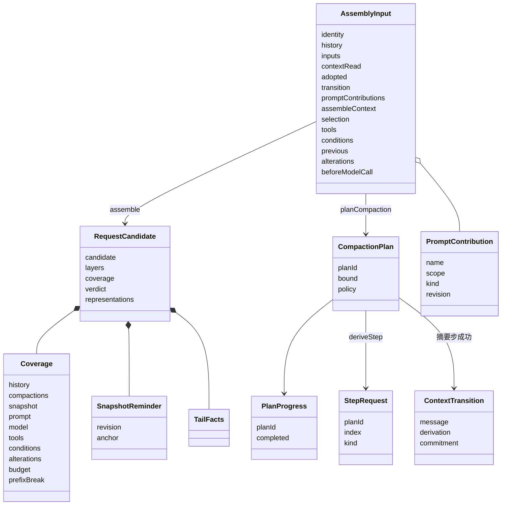
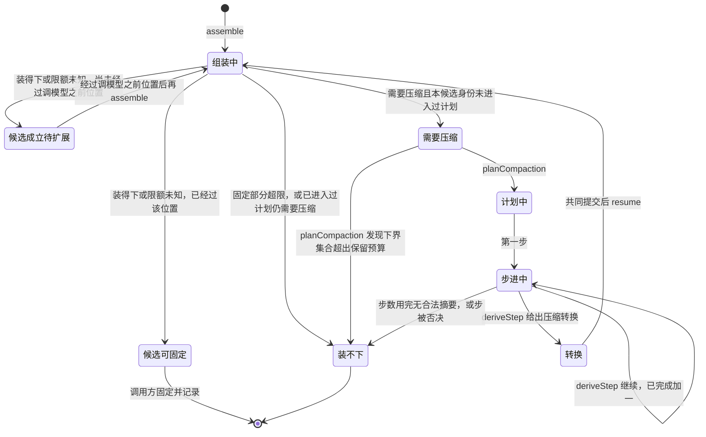

# Request Context 对象模型

组装输入是一次调用交来的七组事实。历史访问身份必需，ContextReadGroup 直接消费 RC 的 SnapshotResult 与 ChangesResult。请求候选是按这些事实算出的一份模型输入。覆盖证据说这份候选用了什么、什么变了、开头为什么变。装入裁定说装不装得下。压缩计划、计划进度、步请求与压缩转换说装不下时怎样压。快照提醒与尾部易变提醒说 runtime context 块在请求里放在哪。提示词贡献说系统提示词从哪来。协调者在本成员之外固定请求、执行步、记录进度；历史持有者保存历史与压缩记录。

本页拥有对象的身份、构造、状态、合法转换、所有者以及销毁或保留条件。精确签名归[公开接口页](public-api.md)，行为归 [SPEC](../SPEC.md)。精确类型与纯操作已进入 `src/`，本页解释其身份和生命周期。图中的技术对象不自动新增产品领域对象。

## 调用方怎样使用

下例是职责伪代码。`assemble` 与 `resume` 要处理 SPEC [组装的结果](../SPEC.md#组装的结果)里的四种结局、三类失败（无权、无效、不可用）与未知；`planCompaction` 与 `deriveStep` 要处理[计划操作的结果](../SPEC.md#计划操作的结果)，完整签名见公开入口。

```text
协调者（经适配器）或独立调用者准备七组输入
    assemble(input) → 候选成立（还要过扩展位置）| 候选成立（可固定）| 需要压缩 | 装不下
    候选成立：自己交 Model 准备、固定、记录；覆盖证据随记录保存，下一次经「已采用」传回
    需要压缩：planCompaction(input) → 计划（身份、步数上界、第一步）| 装不下（下界集合超出保留预算）
        修剪步：deriveStep(plan, progress, 材料) 在本成员内修剪 → 修剪后的材料与下一步（必为摘要步）
        摘要步：协调者发内部模型调用，deriveStep(plan, progress, 摘要结果) → 下一步 | 压缩转换 | 装不下
        协调者每步保存进度
    压缩转换：历史持有者与协调者共同提交，再 resume(input, transition) 重算
历史持有者与交付面：projectForHuman(history, visibility) → 人侧投影，不分页，不写回
```

本成员不记住任何一次调用。已有候选可由调用方经 PreviousPreparation.carried 回传，候选的 preparation 只保留稳定层复用所需的来源键、历史行与投影视图。每次重新求值尾部、表示、预算与结局。不透明访问主体只作为运行时相等比较材料，不序列化；持久覆盖证据仍由 Coverage 单独承载。缓存只按输入范围键控，可丢，不改结果。缓存只存候选内容与各层渲染结果，不存结局。④ 的块材料由调用方每次交入，本成员不保存。

## 跨域概念与内部可见范围

本成员只认识通用角色。下表按[领域语义依赖与模型边界](../../../../docs/architecture/layers-and-dependencies.md#领域语义依赖与模型边界)的四种进入方式标每个外域概念。

| 外域概念 | 进入方式 | 本成员里的形态 | 不进入的部分 |
| --- | --- | --- | --- |
| 历史消息与块（历史持有者） | 消费公开契约 | 历史依据加 `HistorySource` 读口；按块的模型可见标注与压缩记录筛 | 日志格式、持久化 |
| 压缩记录（`packages/common/message`） | 消费公开契约 | 从历史读出的记录；本成员生成候选，不保存 | 形状与判定的定义 |
| runtime context 块 | 消费公开契约 | 模型侧读取结果与 ④ 的块材料（增量读取时是调用方保存的最近一次完整读取的材料），块带变化频率 | 读取本身、块声明的其余部分 |
| 模型档案、限制、计量报告 | 消费公开契约 | 选定模型、预算报告、计量端口 | 选模型、核凭据、发送 |
| 工具定义与绑定采用 | 消费公开契约 | 投影为声明 | 执行、授权 |
| 内容块、消息、提醒角色 | 复用公共值 | 直接使用 | — |
| 扩展改写与调模型之前位置的经过 | 有类型的引用 | 证据列表与经过记录 | 扩展语义 |
| 作用域、定义采用、工作区 | 有类型的引用 | 组装上下文里的不透明键 | 键的含义 |
| 一次执行、一步、一次调用 | 有类型的引用 | 候选身份、消费位置、计划身份 | 它们的状态机 |

本成员不导出任何上层工作流的类型。

## 对象与关系

| 对象 | 身份 | 拥有者 | 可变性 | 关联 |
| --- | --- | --- | --- | --- |
| `AssemblyInput` 组装输入 | 无，按内容比较 | 调用方 | 一次调用 | 七组齐备；上一次准备不参与「同输入」比较 |
| `RequestCandidate` 请求候选 | 候选身份加输入摘要 | 调用方持有 | 到被固定、被新候选取代或被丢弃 | 装得下或限额未知才成候选；带覆盖证据；不含二进制 |
| `Coverage` 覆盖证据 | 随候选 | 本成员生成，调用方记入最终请求 | 随候选 | 逐项列出七组输入的来源与修订、快照锚点、历史 epoch 与各层锚点、前缀变化原因 |
| `FitVerdict` 装入裁定 | 随候选 | 本成员 | 随候选 | 装得下、固定部分超限、需要压缩、限额未知四选一 |
| `RepresentationChoice` 表示决定 | 块身份加模型 | 本成员 | 随候选 | 原件、派生、transcript 三选一或待加载；不读字节 |
| `SnapshotReminder` 上下文快照提醒 | 作用域引用、资格身份、快照修订加锚点 | 本成员每次从调用方交入的块材料生成，只进请求 | 同一完整读取代内每次请求重放于同一锚点 | 只含稳定块。块材料由调用方保存并交入 |
| `TailFacts` 尾部易变提醒 | 随候选 | 本成员生成，只进请求 | 一次请求 | 只含逐请求变化的块；永远在最末 |
| `PromptContribution` 提示词贡献 | 名加作用域 | 贡献者；登记面持有 | 贡献者寿命 | 有序段、变量两类；同层重名拒绝；作用域遮蔽全局 |
| `CompactionPlan` 压缩计划 | 计划身份 | 本成员定义，协调者保存进度 | 从给出到转换提交或装不下 | 一个候选身份至多一个计划；步数上界固定；步只有修剪与摘要；记录给出它的策略身份与参数摘要，`deriveStep` 时不符即无效 |
| `PlanProgress` 计划进度 | 计划身份加已完成步数 | 协调者保存，本成员每步返回新值 | 随计划 | 每步恰加一且小于上界才可继续；同时保留各步消费依据，恢复时核对计数与记录条数 |
| `StepRequest` 步请求 | 计划身份加序号 | 本成员生成 | 一步 | 修剪步不含模型调用；摘要步含完整材料，不经组装 |
| `ContextTransition` 压缩转换 | 随计划 | 本成员生成，持有者与协调者共同提交 | 到提交 | 压缩记录、一致性证明、绑定原准备与每步依据的承诺；同一承诺只配一条记录 |
| `HistoryEvidence` 历史依据 | epoch、上界加作用域引用 | 历史持有者给出 | 一次组装内固定 | `HistorySource.read` 的输入，与访问身份（主体与租户）、游标、字节预算一起传入 |



## 生命周期

| 对象 | 创建 | 变化 | 结束 |
| --- | --- | --- | --- |
| 组装输入 | 调用方准备 | 无；七组任一变化即另一份输入 | 一次调用 |
| 请求候选 | `assemble` 成功 | 无；重算得到新候选 | 固定、取代或丢弃 |
| 覆盖证据 | 随候选 | 无 | 随最终请求记录保存 |
| 压缩计划 | `planCompaction` | 无；上界固定 | 转换提交，或装不下 |
| 计划进度 | 随计划，已完成为零 | 每步恰加一 | 随计划 |
| 压缩转换 | 摘要步产出合法摘要且装得下 | 无 | 持有者与协调者提交 |
| 提示词贡献 | 贡献者登记 | 贡献者升修订 | 贡献者撤销或退出 |
| 快照提醒 | 完整读取 | 无 | 下一次完整读取 |
| 尾部易变提醒 | 每次组装 | 无 | 一次请求 |

### 状态与转移

候选的寿命由调用方驱动，本成员只定义合法转移。



| 从 | 到 | 条件 | 本成员给出 |
| --- | --- | --- | --- |
| 组装中 | 候选成立待扩展 | 装得下或限额未知；尚未经过调模型之前位置 | 候选、覆盖证据、裁定 |
| 组装中 | 候选可固定 | 装得下或限额未知；已经过该位置 | 候选、覆盖证据、裁定 |
| 组装中 | 需要压缩 | 预算不通过且非固定部分可压；本候选身份无计划 | 结局「需要压缩」、覆盖证据、裁定。不带计划 |
| 组装中 | 装不下 | 固定部分超限；或已有计划仍不通过 | 原因与诊断 |
| 需要压缩 | 计划中 | 调用方调 `planCompaction` | 计划（身份、步数上界、第一步）与进度（已完成为零） |
| 需要压缩 | 装不下 | `planCompaction` 发现未结工作的下界集合本身超出保留预算 | 原因：下界集合超出保留预算；不缩短覆盖范围，不突破保留预算 |
| 步进中 | 步进中 | 步结果合法且已完成加一小于上界 | 下一步请求、新进度 |
| 步进中 | 转换 | 摘要步产出合法摘要且装得下 | 压缩转换 |
| 步进中 | 装不下 | 已完成达上界；或步请求被否决 | 原因「压缩后仍装不下」 |
| 转换 | 组装中 | 调用方传入转换依据 | 重算保留名单视图与快照锚点 |

限额未知不进此表：它是装入裁定的一种，候选照常成立，覆盖证据标明限制未知。

## 值、参数与依赖

| 类 | 项 | 说明 |
| --- | --- | --- |
| 值 | 覆盖证据、装入裁定、表示决定、快照提醒、尾部易变提醒、步请求、计划进度、压缩转换、历史依据 | 不可变、可比较、可序列化；不含二进制 |
| 配置（默认值只是初值） | 压缩策略：触发界线、保留预算（比例或 token 数）、保留偏好、修剪优先、步数上界；表示策略：各模态的偏好顺序 | 可替换实现；数值归 [request-context](../../request-context/SPEC.md) |
| 契约常量 | 六层顺序、快照锚点规则、前缀变化原因的取值 | 改它是契约变更 |
| 块声明 | `context.compaction-settings`（供给块，`model`，`stable`，`reread`；当前压缩策略的保留预算与保留偏好）、`context.window-usage`（供给块，`model`，`per-request`，`recompute`；该作用域最近一次固定请求的占用与窗口上限的比例，进程重启后到下一次固定请求之前读到缺项） | 本成员是语义拥有者，用 `declare module` 增补 `ContextBlocks`；生产者是本成员的装配提供者，见 [RQ-02](../SPEC.md#rq-02-组装的前置输入) |
| 依赖端口 | `HistorySource` 读口、Model 的计量端口、本成员的 `ConversionResultSource` 读口（结果类型使用 Model 的 `ConversionResult`）及适配器序列化端口、两个策略实现 | 独立路径在机制工厂构造时给出四项端口；Cordis 路径由调用方经 `assembly(scope, ports)` 逐次交入四项端口。任一缺席使相关操作返回不可用，不伪装成功 |

本成员依赖 model-contract、tool-contract、content-block、message、runtime-context-contract 的公开值与类型，不依赖任何协调者或持有者的契约，也不依赖 Cordis。

## 领域特有的结果与提交

`assemble` 与 `resume` 的结果按 SPEC [组装的结果](../SPEC.md#组装的结果)的封闭表落位：四种结局（候选成立待扩展、候选可固定、需要压缩、装不下），三类失败（无权、无效、不可用），以及未知。`planCompaction` 与 `deriveStep` 的结果按 SPEC [计划操作的结果](../SPEC.md#计划操作的结果)落位，失败用同一套三类，计划身份或进度核对失败归无效。固定部分超限是结局「装不下」，不是失败。表示不可用是失败「不可用」的一种，带原结果。

本成员不提交。两处共同提交由别人兑现，本成员只给材料。

| 共同提交 | 本成员给的材料 | 兑现者 |
| --- | --- | --- |
| 压缩转换 | 压缩记录、摘要与保留名单及覆盖范围一致的证明、绑定原准备与每步依据的承诺 | 历史持有者（保存记录与范围转换）与协调者（接续位置）在一次权威提交中完成 |
| 最终请求记录 | 覆盖证据（含快照锚点、历史锚点、前缀变化原因）、候选或 Model 的固定请求 | 协调者记最终请求；记录后不再改写；锚点经「已采用」回到下一次组装 |

## 集成方关联与独立消费

托管路径上，协调者的请求准备端口由适配器翻译到本成员的操作。适配器经 [request-context-cordis-contract](../../request-context-cordis-contract/docs/cordis.md#服务定义) 的 `assembly(scope, ports)` 取得已配置的操作组，逐次交入四项端口：准备对应 `assemble`，再经 Model 准备得固定请求；推导对应首次 `planCompaction`、之后 `deriveStep`，摘要步请求经 Model 准备成固定步请求，适配器保存进度并核计划身份、上界不变、已完成恰加一；接续对应带转换依据的 `resume`，适配器核提交来源与原准备一致。字段级对应见 [context.md](context.md)。

独立调用者从 [request-context](../../request-context/SPEC.md) 的机制工厂取得操作，在构造时给出四项端口与两个策略，自己提供七组输入；只要纯操作、不要缓存时直接用本成员的根入口。没有协调者就没有共同提交，转换由其合法历史拥有者保存。两条路共用同一套结果与失败。

## SOLID 与扩展边界

| 原则 | 对象层的选择 | 必须防止的反例 |
| --- | --- | --- |
| 单一职责 | 候选只装结果，覆盖证据只记来源，裁定只说装不装，计划只说怎么压 | 把历史或进度存进候选 |
| 开闭 | 新表示策略、新压缩策略、新贡献者都是新实现，对象不变 | 为新策略改候选或覆盖证据的形状 |
| 里氏替换 | 策略实现与 `HistorySource` 实现可互换，调用方不感知 | 某个策略返回契约没有的裁定值 |
| 接口隔离 | 协调者拿四种结果，持有者与交付面只拿 `projectForHuman`，独立调用者拿纯操作集合 | 一个万能上下文对象交给所有人 |
| 依赖倒置 | 协调者与持有者依赖本契约，本契约不依赖它们 | 本成员导入协调者或持有者的类型 |

模块层的选择见 [architecture.md](architecture.md)。

## 产品能力覆盖与验收

| 产品能力 | 本成员承接 | 不在本成员 |
| --- | --- | --- |
| [CAP-RC06](../../../../.meta_harness/design/product/runtime-context/design.md#cap-rc06) 同源历史与块投影 | `project`、`projectForHuman` | 人侧分页与交付 |
| [CAP-RC07](../../../../.meta_harness/design/product/runtime-context/design.md#cap-rc07) 模态转换与表示采用 | 表示决定 | 转换件、发送期物化 |
| [CAP-RC08](../../../../.meta_harness/design/product/runtime-context/design.md#cap-rc08) 完整请求、预算与固定采用 | 候选、覆盖证据、装入裁定 | 固定与记录 |
| [CAP-RC09](../../../../.meta_harness/design/product/runtime-context/design.md#cap-rc09) 合法压缩与未完工作保护 | 压缩计划、步、转换 | 压缩记录的保存与共同提交 |
| [CAP-RC10](../../../../.meta_harness/design/product/runtime-context/design.md#cap-rc10) 恢复、取消与可追查依据 | 覆盖证据、计划进度的接续规则 | 进度与记录的持久化 |

验收以 SPEC 的[持续验证义务](../SPEC.md#rq-11-持续验证与未覆盖)为准。本页不写实现已完成。
