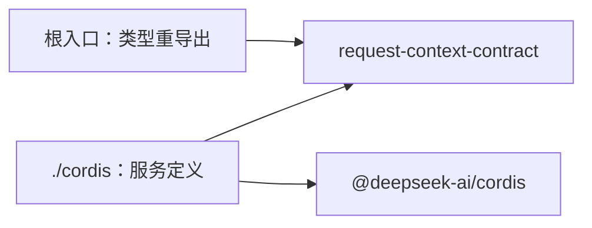

# Request Context Cordis 定义的内部架构

本页说明本成员怎样组织两个入口与依赖，来兑现 [SPEC](../SPEC.md)。服务键、抽象类、intercept 配置、事件、登记协议与策略选择的正文归 [Cordis 说明](cordis.md)。组内八个成员的分解与依赖方向归[组架构](../../docs/architecture.md)。本页不另立公共规则。

本成员没有运行实现，不持有状态，也不持有资源。渲染结果、缓存与默认策略归 [request-context](../../request-context/docs/architecture.md)。贡献登记表、Service 实现与撤除归 [request-context-cordis](../../request-context-cordis/docs/cordis.md)。

## 模块与依赖

本成员有两个入口，各一个源文件。现在两个文件都只有模板标记，没有导出。

| 入口 | 源文件 | 承载 | 现状 |
| --- | --- | --- | --- |
| `@omne-harness/request-context-cordis-contract` | `src/index.ts` | 只重导出契约词汇所需的类型，没有运行值，不导入 Cordis（[IC-4](../../../../docs/architecture/cordis-integration-conventions.md#ic-4)） | 模板标记 |
| `@omne-harness/request-context-cordis-contract/cordis` | `src/cordis.ts` | 抽象类 `RequestContextService`、键常量、intercept 配置类型、策略选择的配置形状、`Context` 与 `Events` 增补 | 模板标记 |

包外依赖只有两项：

- `@omne-harness/request-context-contract`：登记面操作类型、`PromptContribution`、两个策略端口的类型。只做类型导入。它现在还不在 `package.json` 里，随 `./cordis` 的实现进入。
- `@deepseek-ai/cordis`：`Service`、`Context` 与事件增补。它已在 `package.json` 里，只由 `./cordis` 使用。

本成员不导入 `@omne-harness/request-context` 或 `@omne-harness/request-context-cordis`（[性质 10](../SPEC.md#结果与不变量)）。依赖方向是提供者依赖本成员，反方向不成立。本成员也不导入任何协调者、历史持有者或贡献者的契约。

明确缺项：request-context-contract 的[公开接口页](../../request-context-contract/docs/public-api.md)现在没有列出性质 2 所说的登记面操作类型，也没有列出 intercept 配置用到的 `ScopeRef`。抽象类要 `implements` 的类型名随契约的实现确定。

## 关键机制与理由

### 服务定义单独成为一个成员

服务定义与纯契约的变化原因不同。组装输入、结果、失败与七层布局随请求组装的语义变化。服务键、登记的寿命、作用域的声明方式与策略的选择随装配约定变化。分成两个成员后，协调者、历史持有者与独立调用方导入纯操作时不加载 Cordis（[IC-4](../../../../docs/architecture/cordis-integration-conventions.md#ic-4)）。服务定义也不和提供者放在一起，所以贡献者插件只依赖定义，不依赖被选择的实现（[IC-5](../../../../docs/architecture/cordis-integration-conventions.md#ic-5)）。

代价：组内多一个包。契约的登记面操作类型改变时，要同步本成员的抽象类。

### 服务只承载带寿命的登记面

纯操作不放在服务上（性质 2）。理由如下：

1. 纯操作没有寿命。同一组输入得同一结果，不需要随插件登记或撤除（[RQ-01](../../request-context-contract/SPEC.md#rq-01-调用方与计算边界)）。
2. 提示词贡献来自多个插件，每个插件有自己的寿命。登记面是 Request Context 唯一带寿命的部分，所以只有它需要 Cordis 的效应来跟随贡献者撤除（[系统页的提示词贡献登记面](../../../../docs/architecture/runtime/request-context.md#提示词贡献登记面)）。
3. 独立调用方不装配 Cordis 也能用全部纯操作。

代价：经 Cordis 使用缓存与选定策略的路径在服务定义里没有入口，见 [Cordis 说明的服务定义](cordis.md#服务定义)里的明确缺项。

### 作用域由装配声明

作用域键写在贡献者插件的 intercept 配置里，由装配决定，贡献者在运行时不能改（性质 7）。服务方法沿调用方 fiber 读出它。如果作用域是登记方法的普通参数，一个贡献者可以把同一份内容登记到任意作用域，同层重名与遮蔽的规则就失去依据。作用域只决定登记在哪一层，不授予资格（[IC-18](../../../../docs/architecture/cordis-integration-conventions.md#ic-18)）。

代价：这条机制现在只有源码读数，见 Cordis 说明的[机制读数与假设](cordis.md#机制读数与假设)。

### 事件只做失效提示

事件只带作用域键与登记修订，不带段文本或变量值（性质 6）。缓存按修订判断提示词这一组是否变了。修订比较是常数时间，不重渲染、不重哈希内容（[request-context SPEC](../../request-context/SPEC.md#候选缓存)）。如果事件带内容，监听者会把事件当成事实源，丢失一次就会持有错误的内容。只带修订时，丢失的事件不改变结果：缓存项的修订落后时作废。

### 策略选择是配置，不是服务方法

两个策略的实现在提供者构造时按配置选定（性质 8）。理由是策略属于「这份实现怎样计算」，不属于某一次调用。运行中切换策略会让同一组输入在两次调用里得到不同结果，违背纯函数的要求（[RQ-01](../../request-context-contract/SPEC.md#rq-01-调用方与计算边界)）。本成员只定义配置形状，数值归 request-context，因为默认值是可调的初值，不是装配约定（[IC-14](../../../../docs/architecture/cordis-integration-conventions.md#ic-14)）。

## SOLID 与扩展边界

| 原则 | 本成员的具体选择 | 必须防止的反例 |
| --- | --- | --- |
| 单一职责 | 根入口只因契约类型改而改，`./cordis` 只因装配约定改而改 | 在本成员里写渲染、缓存、重名核对或遮蔽解析的逻辑 |
| 开闭 | 新贡献者只在登记面登记，本成员不改。新策略实现只加到提供者的可选项与 request-context，本成员不改。新提供者 `extends` 抽象类 | 为某类贡献者或某个策略加一个服务键或特例方法 |
| 里氏替换 | 任何提供者都 `extends` 同一个抽象类，实现同一组登记面操作，遵守同一个登记协议 | 某个提供者用 `ctx.provide` 另写键，或把登记放在服务自己的 fiber 上 |
| 接口隔离 | 贡献者只调用两个登记方法，组装方只调用 `contributions(scope)`，监听者只订阅事件。纯操作在契约根入口，不在服务上 | 把 `assemble` 等纯操作加到服务上，让贡献者也拿到组装能力 |
| 依赖倒置 | 本成员只依赖契约类型与 Cordis。提供者与依赖方都依赖本成员，二者互不依赖 | `./cordis` 导入机制实现或提供者实现 |

## 验证与维护

| 保证 | 现在的验证 | 后续义务 |
| --- | --- | --- |
| 根入口没有运行值 | [public-entry.spec.ts](../tests/public-entry.spec.ts) 断言根入口没有导出 | 类型重导出进入后，仍断言运行导出为空 |
| `./cordis` 只有定义 | [cordis-entry.spec.ts](../tests/cordis-entry.spec.ts) 断言草稿入口没有导出 | 实现进入后，改为核对导出集合与键常量 |
| 不导入实现成员（性质 10） | 没有 | 核对源码、生成声明与产物的导入 |
| 登记、重名、遮蔽、逐请求变量与事件 | 没有 | 提供者的测试，见 [Cordis 说明的验证义务](cordis.md#验证义务) |
| intercept 配置到达服务方法（性质 7） | 没有 | basis probe，见 [Cordis 说明](cordis.md#机制读数与假设) |

维护规则：

1. 契约的登记面操作类型或 `PromptContribution` 改变时，同步抽象类与本页。
2. 改服务键、intercept 配置、事件或策略选择的配置形状时，同步 [Cordis 说明](cordis.md)、[公开接口页](public-api.md) 与提供者 [request-context-cordis](../../request-context-cordis/README.md)。
3. Cordis 升版时，先重跑 Cordis 说明列出的 basis probe。
