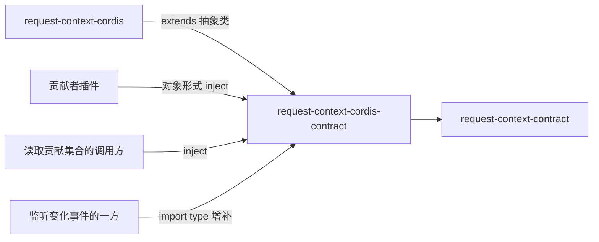

# Request Context Cordis 定义的使用与定位

本页说明谁依赖本成员、怎样依赖，以及本成员在能力组中的位置。系统关系与 Cordis 落位归[系统页 Request Context](../../../../docs/architecture/runtime/request-context.md)，组内分解归[组入口](../../README.md)。本页不另立架构。

## 使用方式

本成员现在没有导出。下面的写法是 SPEC 与 [Cordis 说明](cordis.md)固定的目标用法，随 `./cordis` 的实现生效。

### 贡献者插件

贡献者是提示词内容的拥有者：定义、工作区指导、技能与元能力用法的拥有者（[SPEC 范围与依据](../SPEC.md#范围与依据)）。贡献者插件用对象形式 `inject` 声明作用域，在插件体里登记：

```text
import type {} from '@omne-harness/request-context-cordis-contract/cordis'
inject: { requestContext: { scope: 作用域引用 } }
插件体：dispose = ctx.requestContext.contributeSection(段)
        dispose = ctx.requestContext.contributeVariable(变量)
        插件卸载时登记自动撤除；需要提前撤除时调用 dispose
```

段与变量的精确形状归契约的 `PromptContribution`。登记在三种情形下被拒绝：取不到作用域、同层已有同名贡献、段带逐请求变化的变量。日期、当前目录这类会变的运行事实不走提示词贡献，改走 runtime context 块（[RQ-02](../../request-context-contract/SPEC.md#rq-02-组装的前置输入)）。

### 读取贡献集合的调用方

协调者一侧的适配器要为一次组装准备系统提示词这一组输入。它用数组形式 `inject`，按作用域取当前贡献集合，再把结果作为组装输入传给纯操作：

```text
inject: ['requestContext']
贡献集合 = ctx.requestContext.contributions(作用域引用)
组装输入的系统提示词一组 = 贡献集合与组装上下文
操作组 = ctx.requestContext.assembly(作用域引用)
结局 = 操作组.assemble(组装输入)
```

作用域层的贡献遮蔽全局层的同名贡献。`assembly(scope)` 返回的操作组已按该 isolate 的配置绑定选定的策略与登记面；组装本身仍是纯函数，类型归 [request-context-contract](../../request-context-contract/docs/context.md)。

### 只监听变化事件的一方

不 `inject`。用 `import type {}` 取得事件类型，再 `ctx.on('request-context-cordis-contract/changed', …)`。监听者按载荷里的作用域引用过滤，同步执行，不返回 Promise。事件只是失效提示。读到什么以 `contributions(scope)` 的结果为准。

### 独立使用

不装配 Cordis 的调用方不需要本成员。它自己收集提示词贡献，作为组装输入的一组传给纯操作。只用类型与纯操作时依赖 [request-context-contract](../../request-context-contract/docs/context.md)。要不含 Cordis 的缓存与默认策略时依赖 [request-context](../../request-context/docs/context.md) 的工厂。

### 初始化与释放

本成员不持有资源，没有初始化或释放步骤。贡献登记的释放由 Cordis 的效应完成，见 [Cordis 说明](cordis.md#登记与撤除协议)。

## 消费者与定位

本成员处在纯契约与提供者之间。下图投影[组架构](../../docs/architecture.md#安装与源码依赖)里与本成员相关的边，两者不一致时以组架构为准。



| 依赖方 | 怎样依赖 | 用什么 |
| --- | --- | --- |
| [request-context-cordis](../../request-context-cordis/README.md) | `extends RequestContextService` | 抽象类、键、事件增补、策略选择的配置形状 |
| 贡献者插件 | 对象形式 `inject`，按 [IC-9](../../../../docs/architecture/cordis-integration-conventions.md#ic-9) 取类型 | `contributeSection`、`contributeVariable` |
| 读取贡献集合的调用方 | 数组形式 `inject` | `contributions(scope)` |
| 监听变化事件的一方 | `import type {}` 与 `ctx.on` | 事件 |

依赖方不导入提供者的实现入口（[IC-5](../../../../docs/architecture/cordis-integration-conventions.md#ic-5)）。

### 现在的真实消费者

现在没有包依赖本成员。提供者 request-context-cordis 也还没有在 `package.json` 里依赖它。第一批消费者随提供者、贡献者插件与协调者一侧的适配器一起进入。

### 上层页面

- 系统关系与登记面：[系统页的提示词贡献登记面](../../../../docs/architecture/runtime/request-context.md#提示词贡献登记面)、[成员与 Cordis 落位](../../../../docs/architecture/runtime/request-context.md#成员与-cordis-落位)。
- 组内成员与阅读路径：[组入口](../../README.md)、[组协作入口](../../docs/key-flows.md)。
- 共同集成规则：[IC 约定](../../../../docs/architecture/cordis-integration-conventions.md)。
