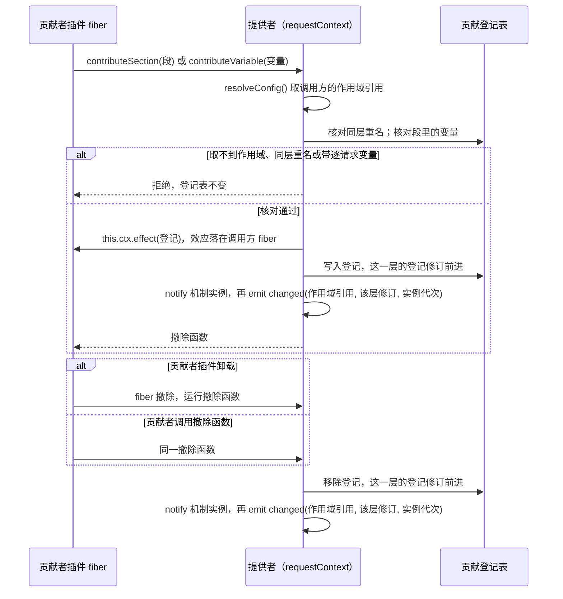
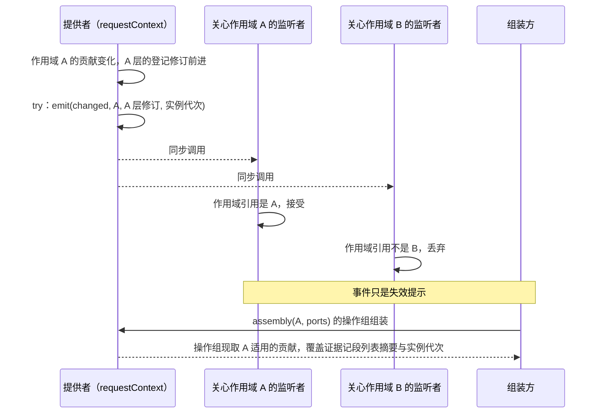

# Request Context Cordis 定义的机制流程

本页给出本成员定义的两条机制级流程。每条有一张时序图和一张「失败与责任交接」表。行为以 [SPEC](../SPEC.md) 和 [Cordis 说明](cordis.md)为准，图只投影它们，不表示运行实现已经存在。

协议级流程归 [request-context-contract 的协议流程](../../request-context-contract/docs/flows.md)：F-RQ01 写组装怎样使用系统提示词这一组输入，F-RQ02 写系统提示词变化时的前缀变化原因。缓存怎样按组失效归 [request-context 的流程](../../request-context/docs/flows.md)。提供者的装载、卸载与在途结算归 [request-context-cordis 的流程](../../request-context-cordis/docs/flows.md)。图中的「提供者」是继承本成员抽象类的 Service 实现。

## 流程

### F-RQD01 贡献登记与撤除

依据：[性质 3、4、5、7](../SPEC.md#结果与不变量)、[IC-13](../../../../docs/architecture/cordis-integration-conventions.md#ic-13)、[RQ-02](../../request-context-contract/SPEC.md#rq-02-组装的前置输入)。

前提：贡献者插件用对象形式 `inject` 声明了 `requestContext` 与自己的作用域，在自己的插件体里调用登记方法。

| 环节                | 结果                                                                                           | 失败与责任交接                                                                                                                                      |
| ------------------- | ---------------------------------------------------------------------------------------------- | --------------------------------------------------------------------------------------------------------------------------------------------------- |
| 取作用域            | 作用域引用来自调用方 fiber 的 intercept 配置                                                   | 取不到时拒绝。贡献者改用对象形式 `inject`。这条机制现在是假设，见 [Cordis 说明](cordis.md#机制读数与假设)                                           |
| 核对                | 同层同名与带逐请求变量的段都被拒绝                                                             | 拒绝不覆盖已有登记。贡献者改名，或把逐请求变化的事实改走 runtime context 块（[RQ-02](../../request-context-contract/SPEC.md#rq-02-组装的前置输入)） |
| 登记                | 登记的寿命等于贡献者插件 fiber 的寿命                                                          | 调用方 fiber 已在卸载时，`effect` 抛 `INACTIVE_EFFECT`，登记不成立                                                                                  |
| 在根 Context 上登记 | 效应属于根 fiber，不随任何贡献者撤除                                                           | 只允许测试或装配入口这样用                                                                                                                          |
| 渲染                | 登记方法不渲染文本。提供者经 `notify('contributions', …)` 告诉机制实例，实例从登记面读段并渲染 | 段渲染结果只归机制实例（[request-context](../../request-context/SPEC.md#预计算的派生物)）                                                           |
| 撤除                | 显式撤除与 fiber 卸载走同一个函数                                                              | 撤除之后的组装不含这条贡献。已经交出的候选不撤回                                                                                                    |
| 提供者换代          | 贡献者插件体重跑，重新登记；登记面实例的代次换新                                               | 旧登记随旧 fiber 撤除                                                                                                                               |

### F-RQD02 变化事件按作用域到达

依据：[性质 6、9](../SPEC.md#结果与不变量)、[IC-12](../../../../docs/architecture/cordis-integration-conventions.md#ic-12)、[IC-17](../../../../docs/architecture/cordis-integration-conventions.md#ic-17)。

前提：监听者用 `ctx.on` 订阅了 `request-context-cordis-contract/changed`，关心一个或几个作用域。

| 环节         | 结果                                                 | 失败与责任交接                                                                                                                                 |
| ------------ | ---------------------------------------------------- | ---------------------------------------------------------------------------------------------------------------------------------------------- |
| 派发         | 载荷只有作用域引用、该层的登记修订与登记面实例的代次 | 派发方把 `emit` 放在 `try` 中。监听者抛出时只记录诊断，已成立的登记不变                                                                        |
| 过滤         | 监听者按载荷的作用域引用过滤，派发方不过滤           | 载荷不带段文本或变量值，收到别的作用域的载荷也读不到内容                                                                                       |
| 监听者执行   | 同步执行，不返回 Promise                             | 要做异步工作的监听者自己处理失败                                                                                                               |
| 事件丢失     | 不改变组装结果                                       | 机制实例经 `notify` 得知变化，不靠本事件；操作组每次现取贡献并比较段列表摘要（[request-context SPEC](../../request-context/SPEC.md#候选缓存)） |
| 不建运行对象 | 每次派发不建 fiber，不建 isolate                     | 作用域只是载荷里的键，不是 Context 或 isolate                                                                                                  |

## 失败与生命周期

| 情形                   | 结果                                                              | 责任方                     | 依据                                                                                                                            |
| ---------------------- | ----------------------------------------------------------------- | -------------------------- | ------------------------------------------------------------------------------------------------------------------------------- |
| 贡献者插件卸载         | 它的登记被撤除                                                    | 提供者验证                 | [IC-13](../../../../docs/architecture/cordis-integration-conventions.md#ic-13)                                                  |
| 登记时取不到作用域     | 拒绝，不默认为任何一层                                            | 提供者                     | [request-context-cordis SPEC](../../request-context-cordis/SPEC.md#结果与不变量)                                                |
| 同层重名或带逐请求变量 | 拒绝，不覆盖                                                      | 贡献者修正贡献             | 性质 4、5                                                                                                                       |
| 提供者不在场           | `inject` 了本服务的插件停在 `PENDING`。只监听事件的一方收不到事件 | 装配者                     | [inject-has-no-optional-form](../../../../.meta_harness/design/basis/cordis/inject-has-no-optional-form.md)                     |
| 提供者换代             | `inject` 了本服务的插件体重跑，重新登记                           | 各依赖方的插件体可重复执行 | [plugin-body-reruns-on-provider-change](../../../../.meta_harness/design/basis/cordis/plugin-body-reruns-on-provider-change.md) |
| 服务撤除               | 在途组装被取消，登记表丢弃，关闭后的登记被拒绝                    | 提供者                     | [request-context-cordis SPEC](../../request-context-cordis/SPEC.md#所有权失败与生命周期)                                        |
| 运行 disposer          | 不撤回已交出的候选、计划或转换                                    | 协调者与历史持有者         | [request-context-cordis SPEC](../../request-context-cordis/SPEC.md#结果与不变量)                                                |
