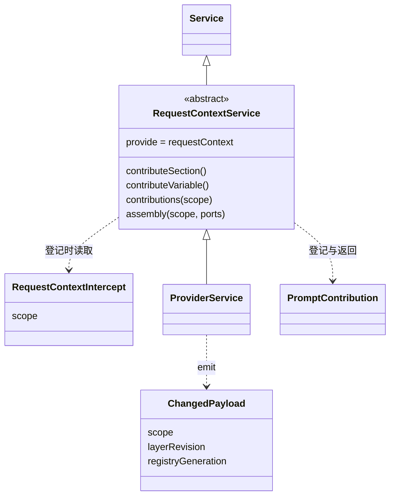

# Request Context Cordis 定义的对象模型

本成员没有自己的领域对象。提示词贡献、组装输入、请求候选与覆盖证据都归 [request-context-contract 的对象模型](../../request-context-contract/docs/object-model.md)，本成员只在服务方法的签名里引用它们。理由是本成员只拥有一个装配接缝：它规定提示词贡献经哪个服务键、以哪种 Cordis 方式登记与撤除，不规定贡献本身。

本成员定义三个技术对象。它们不自动成为产品领域对象。精确形状随 `./cordis` 的实现进入，现在源码里没有，见[公开接口页](public-api.md)。

## 对象与关系

| 对象 | 身份 | 拥有者 | 可变性 | 关联 |
| --- | --- | --- | --- | --- |
| `RequestContextService` 抽象类 | 服务键 `requestContext` | 本成员 | 静态，随包发布 | `extends` Cordis 的 `Service`，`implements` 契约的登记面操作类型，另有组装入口 `assembly(scope, ports)`。提供者 `extends` 它 |
| intercept 配置 `{ scope }` | 贡献者插件 fiber 上的一份配置 | 声明它的贡献者插件 | 随该插件的 `inject` 声明，运行时不改 | `scope` 是不透明的作用域引用。登记方法拿它决定登记在哪一层 |
| 事件载荷 | 一次派发 | 派发它的提供者 | 值，派发即完 | 作用域引用、该层的登记修订与登记面实例的代次，事件名 `request-context-cordis-contract/changed` |

图中 `RequestContextIntercept`、`ChangedPayload` 与 `ProviderService` 是说明用的名字。`ProviderService` 代表 [request-context-cordis](../../request-context-cordis/docs/cordis.md) 的具体子类。`PromptContribution` 归契约。导出的类型名随实现确定。

策略选择的配置形状也由本成员定义（[性质 8](../SPEC.md#结果与不变量)）。它是一个值类型，没有自己的身份。它的实例是提供者插件配置的一部分，归 [request-context-cordis 的对象模型](../../request-context-cordis/docs/object-model.md)。

## 生命周期

| 对象 | 创建 | 变化 | 结束 |
| --- | --- | --- | --- |
| 抽象类 | 包发布 | 契约的登记面操作类型改变时随包升版 | 包退出 |
| intercept 配置 | 贡献者插件装载，Cordis 把对象形式 `inject` 的值写进该 fiber 的 intercept | 不变。改作用域就是改装配 | 随贡献者插件的 fiber 结束 |
| 事件载荷 | 提供者在贡献变化后派发 | 无 | 派发即完。监听者不保存它作为事实 |

本成员定义的协议还约束两类运行期事物，它们的实例都不归本成员：

- 一条贡献的登记：归贡献者插件的 fiber，在插件卸载、调用撤除函数或服务撤除时结束。协议见 [Cordis 说明](cordis.md#登记与撤除协议)，登记表归 [request-context-cordis](../../request-context-cordis/docs/object-model.md)。
- 事件监听：经 `ctx.on` 注册，归监听者的 fiber，随它结束。
