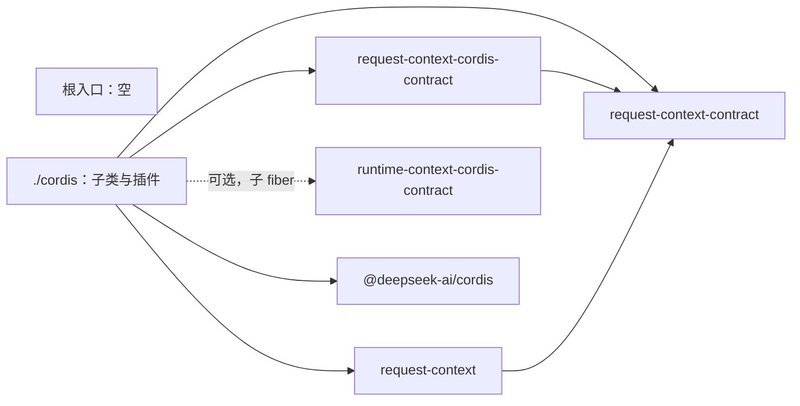

# request-context-cordis 的内部架构

本页说明本成员怎样组织两个入口与依赖，来兑现 [SPEC](../SPEC.md)。插件、配置、isolate、贡献登记表、事件与撤除的正文归 [Cordis 说明](cordis.md)。缓存与默认策略归 [request-context](../../request-context/docs/architecture.md)。组内八个成员的分解与依赖方向归[组架构](../../docs/architecture.md)。本页不另立公共规则。

本成员没有运行实现。`src/index.ts` 与 `src/cordis.ts` 只有模板标记。下文是 SPEC 固定的结构，文件名由实现确定。

## 模块与依赖

| 入口 | 源文件 | 承载 | 现状 |
| --- | --- | --- | --- |
| `@omne-harness/request-context-cordis` | `src/index.ts` | 不导出任何东西（[IC-4](../../../../docs/architecture/cordis-integration-conventions.md#ic-4) 的空根入口）。独立路径从 request-context 取机制工厂 | 模板标记 |
| `@omne-harness/request-context-cordis/cordis` | `src/cordis.ts` | `RequestContextService` 的具体子类、插件与配置 Schema | 模板标记 |

`./cordis` 内部按 Cordis 责任分成六块：

| 模块 | 职责 | 依据 |
| --- | --- | --- |
| 配置与策略选择 | 静态 `Config` 的 Standard Schema，按配置构造两个策略实例，指向不存在的策略即加载失败 | [配置与策略选择](cordis.md#配置与策略选择) |
| 服务子类 | 持有机制实例与贡献登记表，实现登记面三项方法与 `assembly(scope, ports)`，把逐次交入的端口转交机制实例 | 性质 2、6、9 |
| 贡献登记表 | 按作用域与层保存登记，核重名，按作用域解析遮蔽，按层维护登记修订与实例代次，给机制实例一个读口 | 性质 2、3、8 |
| 通知与事件派发 | 贡献变化后先 `notify('contributions', …)` 机制实例，再派发带该层修订与实例代次的事件，捕获监听者失败 | 性质 3、8 |
| 两块的生产者 | 在 `ctx.inject(['runtimeContext'], …)` 的子 fiber 里登记两块的生产者 | 性质 10 |
| 撤除 | 一个 effect 内完成拒绝新请求、取消在途组装、丢弃登记表与缓存 | 性质 5 |

包外依赖：

- `@omne-harness/request-context-contract`：类型、端口与两块的声明，只由 `./cordis` 使用。
- `@omne-harness/request-context-cordis-contract`：抽象类、键、事件增补与策略选择的配置形状，只由 `./cordis` 使用。
- `@omne-harness/request-context`：工厂与默认策略，只由 `./cordis` 使用。
- `@omne-harness/runtime-context-cordis-contract`：可选依赖，只用于在子 fiber 里登记两块的生产者。Runtime Context 不在场时本插件照常可用。
- `@deepseek-ai/cordis`：只由 `./cordis` 使用。

现在 `package.json` 只列出 `@deepseek-ai/cordis`，其余四项随实现进入。本插件不 `inject` 作用域持有者或模型侧的服务，三项端口由调用方逐次交入。本成员不导入任何协调者或持有者的契约（性质 7）。贡献者与组装请求的调用方依赖服务定义，不依赖本成员的 `./cordis`。提供者选择归应用装配（[IC-5](../../../../docs/architecture/cordis-integration-conventions.md#ic-5)）。

根入口不导出任何东西。同一份机制工厂只有一个公开名字，就是 request-context 的根入口。

## 关键机制与理由

### 撤除放在一个 effect 里

撤除有严格次序：先拒绝新的登记与组装，再取消在途组装，最后丢弃登记表与缓存。取消而不等待，是因为在途组装可能停在调用方交入的端口上，等待没有上界（[RQ-09](../../request-context-contract/SPEC.md#rq-09-取消恢复与迟到) 允许取消组装）。Cordis 卸载 fiber 时，不同 effect 的撤除函数并发运行（[effect-disposal-concurrent-not-ordered](../../../../.meta_harness/design/basis/cordis/effect-disposal-concurrent-not-ordered.md)）。所以三步必须写在一个 effect 里按顺序 `await`，不能各注册一个 effect。

代价：撤除函数里的一步抛出时，Cordis 只记日志，不上抛。撤除函数要自己捕获每一步，并保证后续步骤仍然执行。

### 作用域每次调用时读取

登记方法每次都从调用方 fiber 读 intercept 配置，不在插件装载时缓存。理由：服务实例是共享的，调用方各不相同，作用域属于调用方而不属于服务。取不到配置就拒绝，不给默认层，因为默认层会让未声明作用域的贡献者覆盖到错误的层。

### 策略选择失败即加载失败

配置指向不存在的策略，或策略参数不合 Schema，插件加载失败，fiber 进入 `FAILED`（性质 4）。理由：静默回退到默认策略会让装配者以为自己选的策略在用。错误不能静默变成成功。代价是一个配置错误会使整个服务不可用，装配者必须修正配置才能继续。

### 渲染结果只归机制实例

撤除函数移除登记，再调用机制实例的 `notify('contributions', …)`；机制实例重读该层，丢弃已撤除段的渲染结果（性质 2、8）。本插件不持有渲染结果。理由：渲染结果如果同时归登记表与机制实例，两处的寿命与丢弃时点会不一致，后续组装可能用到另一处留下的旧渲染。只有机制实例持有，提供者撤除时释放机制实例就释放了全部渲染结果。移除与通知写在同一个撤除函数里，不依赖两个 effect 的释放次序。

### 只通知贡献变化，不订阅别的变化

本插件只把贡献登记的变化交给机制实例。它不订阅 Runtime Context 的事件、持有者的提交通知或模型选择变更（性质 8）。理由：订阅持有者与模型选择要导入对方的服务定义；订阅 Runtime Context 的事件只能全局监听，而那是约定禁止的；正确性本来只靠每次调用时比较输入携带的修订，订阅不增加正确性。

### 端口逐次交入，Runtime Context 是可选依赖

历史源读口、计量端口与转换件结果端口由调用方在每次 `assembly(scope, ports)` 时交入（性质 6）。本插件不 `inject` 持有者或模型侧的服务，所以它的寿命不随它们换代。两块的生产者登记放在 `ctx.inject(['runtimeContext'], …)` 的子 fiber 里（[IC-8](../../../../docs/architecture/cordis-integration-conventions.md#ic-8)、性质 10）：Runtime Context 不在场时本插件照常提供组装，两块读到缺项；Runtime Context 到场或换代时只有子 fiber 运行或重跑。

### 不为每次请求开运行对象

本成员不为每次请求开 fiber，不用 `inject` 表达输入，不发第二种事件（性质 6）。作用域与租户随操作参数进入。理由：作用域与请求的数量随使用增长。为它们建 fiber 或 isolate，会让每次增删伴随 Cordis 的装卸，而 isolate 也不隔离数据（[isolate-hides-instances-not-data](../../../../.meta_harness/design/basis/cordis/isolate-hides-instances-not-data.md)、[IC-17](../../../../docs/architecture/cordis-integration-conventions.md#ic-17)）。

## SOLID 与扩展边界

| 原则 | 本成员的具体选择 | 必须防止的反例 |
| --- | --- | --- |
| 单一职责 | 本成员只承担 Cordis 责任：装载、配置与策略选择、isolate、登记效应、事件与撤除。缓存与默认策略都在 request-context | 在子类里重写缓存键、按组失效或默认策略的数值 |
| 开闭 | 新策略实现只加到可选项与 Schema，不改登记表或撤除。新贡献者只登记，本成员不改 | 为某类贡献者或某个上层领域加特例分支或第二个服务键 |
| 里氏替换 | 子类遵守抽象类的全部承诺：键只来自抽象类，登记落在调用方 fiber，事件只做失效提示 | 把登记挂在服务自己的 fiber 上，或在事件里携带段文本 |
| 接口隔离 | 贡献者与组装请求的调用方只看到服务定义，不导入本成员 | 让依赖方导入 `./cordis` 的子类来调用登记面 |
| 依赖倒置 | 本成员依赖契约、服务定义与机制工厂。租户、作用域与资格随参数进入 | 从 `ctx`、isolate 标签或插件实例推断租户或资格 |

## 验证与维护

| 保证 | 现在的验证 | 后续义务 |
| --- | --- | --- |
| 根入口为空 | [public-entry.spec.ts](../tests/public-entry.spec.ts) 断言根入口没有导出 | 实现进入后仍断言根入口没有导出 |
| `./cordis` 只有本成员的插件 | [cordis-entry.spec.ts](../tests/cordis-entry.spec.ts) 断言草稿入口没有导出 | 实现进入后，核对导出集合 |
| SPEC 的验证义务 | 没有 | 见 [Cordis 说明的验证义务](cordis.md#验证义务) |

维护规则：

1. 服务定义改变时，同步子类、[Cordis 说明](cordis.md)与测试。
2. request-context 的工厂签名、默认策略或配置改变时，同步配置 Schema 与[公开接口页](public-api.md)。
3. Cordis 升版时，先重跑服务定义成员与 Runtime Context 服务定义列出的 basis probe。
