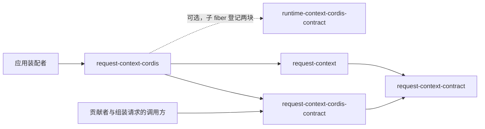

# request-context-cordis 的使用与定位

本页说明谁使用本成员、怎样使用，以及本成员在能力组中的位置。系统关系与 Cordis 落位归[系统页 Request Context](../../../../docs/architecture/runtime/request-context.md)，组内分解归[组入口](../../README.md)。本页不另立架构。

## 使用方式

`./cordis` 现在导出 `RequestContextProvider`，根入口没有导出。下面是 SPEC 固定的用法，其中配置字段随配置 Schema 进入。

### 装配

应用装配者在插件树里加一行本插件，并给出配置。插件树的格式与两层叠加归 [IC-15](../../../../docs/architecture/cordis-integration-conventions.md#ic-15) 与 [IC-16](../../../../docs/architecture/cordis-integration-conventions.md#ic-16)：

```text
行 id：request-context
插件：@omne-harness/request-context-cordis 的 ./cordis 导出
配置：{ 压缩策略的选择与参数, 表示策略的选择与偏好顺序, 修剪阈值, 缓存容量 }
```

字段名与默认值随实现确定。一个 isolate 标签下只加一行。配置指向不存在的策略或参数不合 Schema 时装载失败，装配者据此停下整个装配。

装载后，其他插件经服务定义使用服务：贡献者插件用对象形式 `inject` 声明作用域并登记，组装请求的调用方 `inject` 服务键并按作用域取贡献集合。这些用法归 [request-context-cordis-contract 的使用与定位](../../request-context-cordis-contract/docs/context.md#使用方式)。

### 独立使用

本成员的根入口不导出任何东西。不装配 Cordis 的调用方直接从 request-context 取机制工厂，自己选定策略、在构造时给出四项端口并收集提示词贡献，做法见 [request-context 的独立使用](../../request-context/docs/context.md#独立使用)。

### 初始化与释放

装配者装载插件即初始化，卸载插件即释放。卸载按 [Cordis 说明的撤除顺序](cordis.md#撤除顺序)进行。本成员不需要环境前提，不读取资源，不访问存储。

## 消费者与定位

本成员处在依赖的最上层，只被应用装配者使用。下图投影[组架构](../../docs/architecture.md#安装与源码依赖)里与本成员相关的边，两者不一致时以组架构为准。



| 使用方 | 怎样使用 | 用什么 |
| --- | --- | --- |
| 应用装配者 | 在插件树里加一行本插件 | `./cordis` 的插件与配置 |
| 不装配 Cordis 的调用方 | 不使用本成员，从 request-context 取工厂 | 无 |

贡献者与组装请求的调用方不依赖本成员。它们依赖服务定义，按服务键取用（[IC-5](../../../../docs/architecture/cordis-integration-conventions.md#ic-5)）。

### 现在的真实消费者

现在没有应用装配本插件，也没有包依赖本成员。

### 上层页面

- 系统关系与 Cordis 落位：[系统页的成员与 Cordis 落位](../../../../docs/architecture/runtime/request-context.md#成员与-cordis-落位)、[提示词贡献登记面](../../../../docs/architecture/runtime/request-context.md#提示词贡献登记面)。
- 组内成员与装配者的阅读路径：[组入口](../../README.md)、[组协作入口](../../docs/key-flows.md)。
- 共同集成规则：[IC 约定](../../../../docs/architecture/cordis-integration-conventions.md)。
