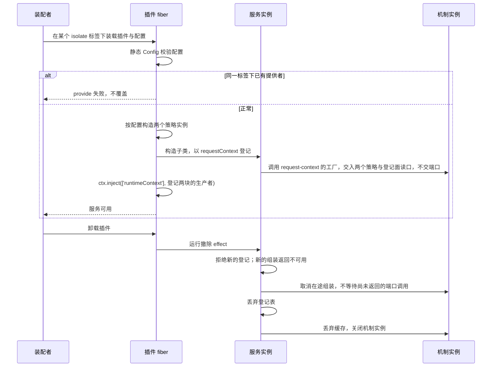
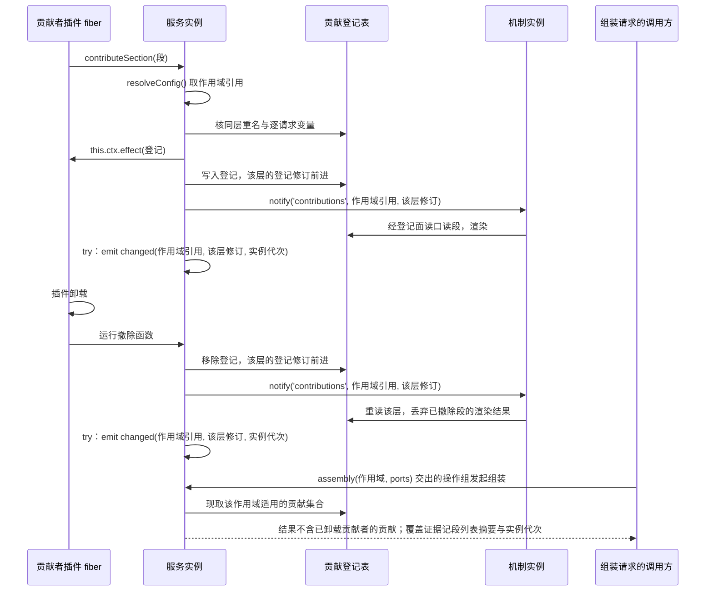
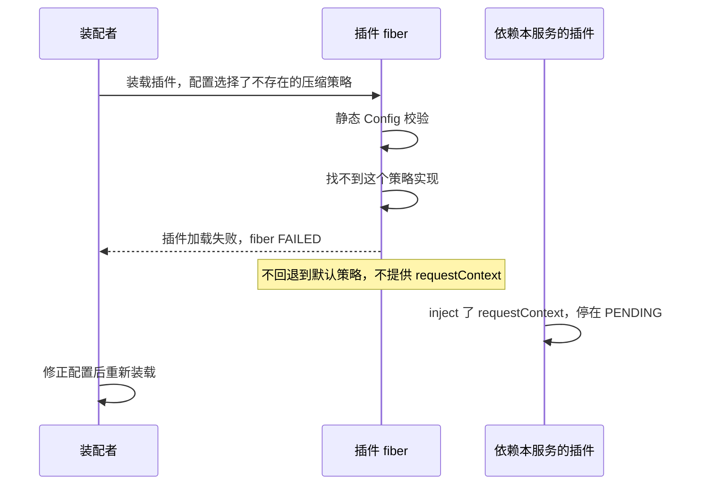

# request-context-cordis 的机制流程

本页给出本成员的三条机制级流程。每条有一张时序图和一张「失败与责任交接」表。行为以 [SPEC](../SPEC.md) 和 [Cordis 说明](cordis.md)为准，图只投影它们，不表示运行实现已经存在。

登记协议与变化事件的定义归 [request-context-cordis-contract 的流程](../../request-context-cordis-contract/docs/flows.md)。缓存、预计算与压缩策略的使用归 [request-context 的流程](../../request-context/docs/flows.md)。图中的「插件」是本成员的具体子类所在的插件 fiber。

## 流程

### F-RQP01 装载与卸载

依据：[性质 1、4、5](../SPEC.md#结果与不变量)、[IC-6](../../../../docs/architecture/cordis-integration-conventions.md#ic-6)、[IC-14](../../../../docs/architecture/cordis-integration-conventions.md#ic-14)。

| 环节 | 结果 | 失败与责任交接 |
| --- | --- | --- |
| 配置校验 | 配置合法才继续 | 配置不合法见 F-RQP03 |
| 登记服务 | 一个标签下一份 | 重复装载失败。要两份实现时由装配者分到不同标签 |
| 构造机制实例 | 选定的策略、登记面读口与配置传给工厂；四项端口由调用方在每次 `assembly(scope, ports)` 时交入 | 端口缺席时，相关操作返回不可用，不伪装成功 |
| 两块的生产者 | Runtime Context 在场时子 fiber 登记两块 | Runtime Context 不在场时子 fiber 停在 `PENDING`，本插件照常可用，两块读到缺项；到场后子 fiber 登记 |
| 卸载 | 三步写在一个 effect 里 | 某一步抛出时 Cordis 只记日志，撤除函数要自己捕获并继续后续步骤 |
| 卸载时在途组装 | 被取消，返回不可用（服务已卸载） | 撤除不无限等待。撤除开始后到达的登记被拒绝，组装返回不可用（服务已卸载） |
| 卸载之后 | 不撤回已交出的候选、计划或转换 | 协调者与历史持有者按原记录处置 |

### F-RQP02 贡献者卸载后登记撤除

依据：[性质 2、3](../SPEC.md#结果与不变量)、[IC-13](../../../../docs/architecture/cordis-integration-conventions.md#ic-13)。

| 环节 | 结果 | 失败与责任交接 |
| --- | --- | --- |
| 取作用域 | 来自调用方 fiber 的 intercept 配置 | 取不到时拒绝。贡献者改用对象形式 `inject` |
| 登记 | 效应落在贡献者插件的 fiber 上 | 贡献者 fiber 已在卸载时，`effect` 抛 `INACTIVE_EFFECT`，登记不成立 |
| 预计算 | 本插件调用 `notify('contributions', …)`，机制实例从登记面读口读段并渲染 | 渲染结果只归机制实例，本插件不持有，见 [SPEC 性质 8](../SPEC.md#结果与不变量) |
| 撤除 | 移除登记与调用 `notify` 在同一个撤除函数里 | 不依赖两个 effect 的释放次序 |
| 撤除之后 | 后续组装不含这条贡献 | 已经交出的候选不撤回 |
| 本插件已先关闭 | 贡献者的撤除函数在登记表丢弃后运行 | 撤除函数要安全返回，不抛出 |

### F-RQP03 配置指向不存在的策略时 fiber FAILED

依据：[性质 4](../SPEC.md#结果与不变量)、[IC-14](../../../../docs/architecture/cordis-integration-conventions.md#ic-14)、[plugin-throw-fails-fiber](../../../../.meta_harness/design/basis/cordis/plugin-throw-fails-fiber.md)。

| 环节 | 结果 | 失败与责任交接 |
| --- | --- | --- |
| 策略不存在 | 插件加载失败，fiber `FAILED` | 装配者修正配置 |
| 策略参数不合 Schema | 同上 | 同上 |
| 不回退 | 不用默认策略代替装配者选的策略 | 错误不能静默变成成功 |
| 依赖方 | `inject` 了本服务的插件停在 `PENDING` | 服务出现后它们的插件体运行 |
| 证据 | 函数插件的 `FAILED` 行为有 basis | Service 子类静态 `Config` 的路径没有单独核验，由本成员的测试补证 |

## 失败与生命周期

| 情形 | 结果 | 责任方 | 依据 |
| --- | --- | --- | --- |
| 配置错误或策略不存在 | fiber `FAILED` | 装配者 | 性质 4、[IC-14](../../../../docs/architecture/cordis-integration-conventions.md#ic-14) |
| 重复装载 | 第二份失败 | 装配者 | 性质 1、[IC-6](../../../../docs/architecture/cordis-integration-conventions.md#ic-6) |
| 登记时取不到作用域 | 拒绝 | 贡献者改用对象形式 `inject` | 性质 2 |
| 同层重名或带逐请求变量 | 拒绝，不覆盖 | 贡献者修正贡献 | 性质 3 |
| 监听者抛出 | 只记录诊断 | 监听者 | 性质 3、[IC-12](../../../../docs/architecture/cordis-integration-conventions.md#ic-12) |
| 插件卸载 | 按三步撤除，在途组装被取消 | 本插件 | 性质 5 |
| 本插件卸载后 | `inject` 了服务的插件卸载或重跑 | 各依赖方 | [plugin-body-reruns-on-provider-change](../../../../.meta_harness/design/basis/cordis/plugin-body-reruns-on-provider-change.md) |
| 进程失败 | 没有可恢复的东西 | 贡献者重新登记 | [SPEC 所有权、失败与生命周期](../SPEC.md#所有权失败与生命周期) |
| 运行 disposer | 不撤回已交出的候选、计划或转换 | 协调者与历史持有者 | 性质 5 |
