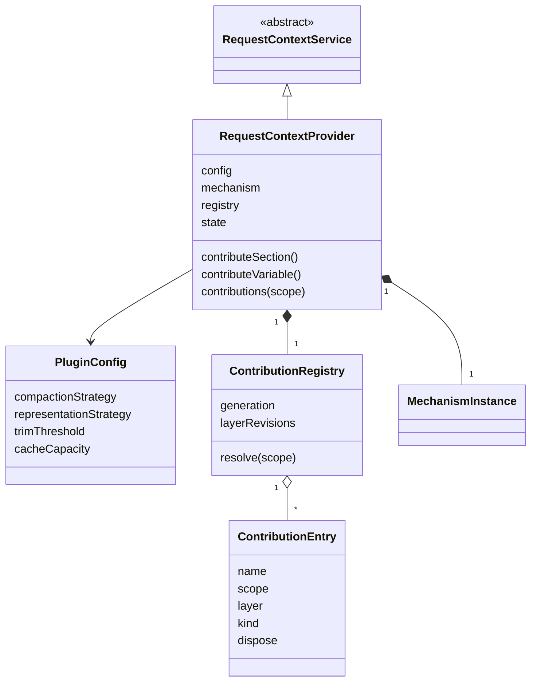

# request-context-cordis 的对象模型

本成员没有自己的领域对象。提示词贡献、组装输入、请求候选与覆盖证据归 [request-context-contract 的对象模型](../../request-context-contract/docs/object-model.md)。缓存条目、派生物与策略的数值归 [request-context 的对象模型](../../request-context/docs/object-model.md)。本成员有四个技术对象：服务实例、插件配置、贡献登记表与它的条目。它们不自动成为产品领域对象。两个策略实例由本插件按配置构造，寿命归本插件（[SPEC 所有权、失败与生命周期](../SPEC.md#所有权失败与生命周期)），它们的字段与默认值归 request-context。

本成员没有运行实现。类名与字段名随实现确定。

## 对象与关系

| 对象 | 身份 | 拥有者 | 可变性 | 关联 |
| --- | --- | --- | --- | --- |
| 服务实例 | 一个 isolate 标签下的服务键 `requestContext` | 本插件的 fiber | 实例状态：开放、撤除中 | `extends` 服务定义的抽象类。拥有一个机制实例、一张贡献登记表与两个策略实例 |
| 插件配置 | 一次装载 | 装配者给出，静态 `Config` 校验 | 装载后不变。改配置即重新装载 | 策略选择与参数、修剪阈值、缓存容量。策略选择部分的形状归服务定义成员 |
| 贡献登记表 | 服务实例，带实例代次 | 服务实例 | 每次登记或撤除只前进该层的修订；实例代次在每次构造时新取 | 按作用域与层组织条目，解析时作用域层遮蔽全局层。机制实例经读口读它 |
| 两块的生产者登记 | 生产者身份 | 本插件的子 fiber（`ctx.inject(['runtimeContext'], …)`） | Runtime Context 换代时重新登记，得到新代际 | `context.compaction-settings` 与 `context.window-usage` 的供值 |
| 登记条目 | 名字、作用域引用与层 | 寿命归贡献者插件的 fiber，存放在登记表里 | 登记后不变。改内容就是撤除后重新登记 | 段或变量的内容、撤除函数。段的渲染结果只在机制实例里 |

图中的类名是说明用的名字。`RequestContextService` 归 [request-context-cordis-contract](../../request-context-cordis-contract/docs/object-model.md)，`MechanismInstance` 归 [request-context](../../request-context/docs/object-model.md)。登记条目用聚合表示，因为条目的寿命归贡献者插件的 fiber，不归登记表。

登记修订按层计：全局层与每个作用域层各有一个修订，一层的变化只使这一层前进。登记表另有实例代次，每次构造新取（[request-context-cordis-contract 性质 6](../../request-context-cordis-contract/SPEC.md#结果与不变量)）。事件载荷带作用域引用、该层修订与实例代次；缓存键用本作用域适用的段列表摘要与实例代次。

## 生命周期

| 对象 | 创建 | 变化 | 结束 |
| --- | --- | --- | --- |
| 插件配置 | 装配者装载插件 | 不变 | 插件卸载 |
| 服务实例 | 配置校验通过、策略实例构造后，构造子类并以键登记 | 开放 → 撤除中 | 撤除的三步完成，键上不再有服务 |
| 策略实例 | 插件加载时按配置构造 | 不变 | 插件卸载 |
| 机制实例 | 服务实例构造时调用工厂，交入两个策略与登记面读口 | 见 request-context | 撤除的最后一步关闭它 |
| 两块的生产者登记 | Runtime Context 在场时子 fiber 登记 | Runtime Context 换代时重新登记 | Runtime Context 撤除或本插件卸载 |
| 贡献登记表 | 服务实例构造 | 每次登记或撤除 | 撤除的最后一步丢弃它 |
| 登记条目 | 贡献者调用登记方法 | 不变 | 贡献者卸载、调用撤除函数，或本插件卸载 |

本成员定义的协议还约束一类运行期事物，它的实例不归本成员：

| 事物 | 拥有者 | 结束 |
| --- | --- | --- |
| 变化事件的监听 | 监听者的 fiber | 监听者卸载 |

进程失败时这些对象都丢失。本成员没有可恢复的东西，重建沿贡献者重新登记（[SPEC](../SPEC.md#所有权失败与生命周期)）。
