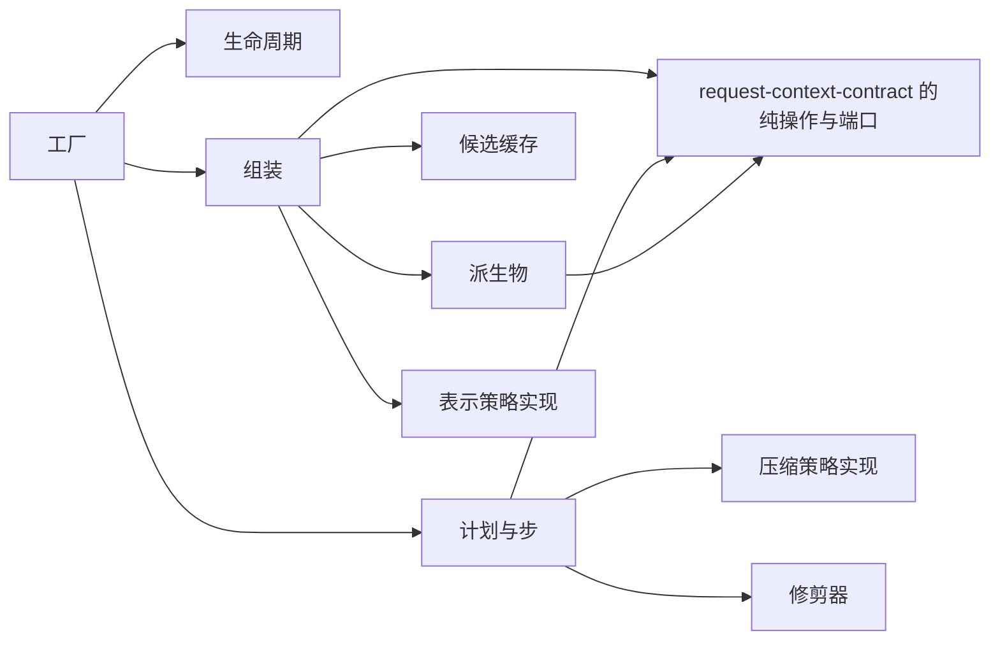

# Request Context 派生计算的内部架构

本页说明本成员怎样组织派生计算、缓存与默认策略来兑现 [SPEC](../SPEC.md)。它是组内「供给机制与缓存」这一主题在 Request Context 一侧的唯一拥有者（[组架构](../../docs/architecture.md#主题与唯一拥有者)）。公开行为归 [request-context-contract SPEC](../../request-context-contract/SPEC.md)，贡献登记面与 Cordis 绑定归 [request-context-cordis-contract](../../request-context-cordis-contract/docs/cordis.md) 与 [request-context-cordis](../../request-context-cordis/docs/cordis.md)。实现内部对象的身份与生灭归[对象模型](object-model.md)。

本成员没有运行实现。`src/index.ts` 只有模板标记。下文是 SPEC 固定的结构，文件名由实现确定。

## 模块与依赖

根入口导出一个工厂。工厂的输入是构造依赖与配置，输出是实现契约纯操作的实例。构造依赖有五项：历史源读口、计量端口、转换件结果端口、压缩策略实现、表示策略实现（[SPEC 范围与依据](../SPEC.md#范围与依据)）。工厂内部分成下列模块：

| 模块 | 持有的状态 | 承担的 SPEC 行为 |
| --- | --- | --- |
| 候选缓存 | 按消费位置：最近一个已固定候选、一个在算候选，各带缓存键与它看到的各组修订 | 七组修订摘要做键、命中、按组失效、修订落后即作废（[候选缓存](../SPEC.md#候选缓存)） |
| 派生物 | 段渲染结果、工具声明投影、快照提醒文本 | 在输入变化时预计算，组装时只取用（[预计算的派生物](../SPEC.md#预计算的派生物)） |
| 组装 | 无持久状态 | 比缓存键，按组只重算对应层，按锚点比前缀摘要，epoch 已变时丢页重取（[本地行为](../SPEC.md#本地行为)） |
| 计划与步 | 无持久状态 | 用压缩策略出计划；`deriveStep` 核计划身份与已完成步数，修剪步在这里由修剪器完成 |
| 默认压缩策略 | 配置初值：触发界线、保留预算、保留偏好、修剪优先、步数上界 | [默认策略与修剪器](../SPEC.md#默认策略与修剪器) |
| 默认表示策略 | 配置初值：按模态的偏好顺序 | 同上 |
| 修剪器 | 配置初值：修剪阈值 | 同上 |
| 生命周期 | 实例状态：开放、关闭中、已关闭 | 关闭后拒绝新的组装，等在途组装结算，释放缓存（[SPEC 所有权、失败与生命周期](../SPEC.md#所有权失败与生命周期)） |

压缩策略与表示策略是构造依赖。本成员同时提供两者的默认实现，调用方可以传入默认实现，也可以传入别的实现。经 Cordis 时由 [request-context-cordis](../../request-context-cordis/docs/cordis.md#配置与策略选择) 按配置选择。

本成员不持有任何耐久状态。缓存与派生物都是进程内副本，失效后从输入重建，不改变任何结果（[SPEC 范围与依据](../SPEC.md#范围与依据)）。计划进度、压缩转换与最终请求记录归协调者与历史持有者。

包外依赖只有 `@omne-harness/request-context-contract`：它给出全部值类型、纯操作、`HistorySource` 与两个策略端口的类型。它现在还不在 `package.json` 里，随实现进入。本成员不导入 `@deepseek-ai/cordis`（[IC-4](../../../../docs/architecture/cordis-integration-conventions.md#ic-4)），也不导入任何协调者、历史持有者或贡献者的契约。

实例经 `notify(change)` 得知变化：四个枚举值分别对应贡献登记的变化、历史持有者的提交、runtime context 的唤醒与模型选择变更，各带来源修订或计数（[候选缓存](../SPEC.md#候选缓存)）。调用方把收到的通知转交这个入口，本成员据此使对应的组失效，并在贡献登记或撤销时预计算段渲染结果。

## 关键机制与理由

### 七组修订摘要做缓存键

缓存键是组装输入每一组各自的修订摘要，覆盖七组的全部成员，含访问身份与候选身份、组装上下文、扩展改写依据与调模型之前位置的经过，只排除上一次准备（[候选缓存](../SPEC.md#候选缓存)）。命中时七组逐项比较，全部相等即返回已有候选，不重算。比较的是修订或计数，不是内容，所以命中的成本是七次比较，不随历史长度或提示词长度增长（[比对代替求值](../../../../docs/architecture/runtime/assembly-and-change.md#比对代替求值)）。

理由：输入按「谁给、什么时候变」分组（[RQ-02](../../request-context-contract/SPEC.md#rq-02-组装的前置输入)），每组有一个修订来源。按组做键，就能在命中失败时知道是哪一组变了，只重算受影响的层。如果把整份输入哈希成一个键，任一组变化都只能全部重算，而且要先读全部内容才能算出键。

上一次准备不参与比较。理由沿契约：它只说明本次处在哪个经过之后，不改变候选应有的内容（[RQ-02](../../request-context-contract/SPEC.md#rq-02-组装的前置输入)）。

### 按组失效，只重算受影响的层

六层装载布局把越稳定的内容放得越靠前（[装载布局与前缀](../../request-context-contract/SPEC.md#装载布局与前缀)）。一组输入变化时，本成员只重算这组输入所在的层，其余层复用：

| 变化的输入 | 重算的层 | 前缀变化原因 |
| --- | --- | --- |
| 只有新输入或历史上界 | ⑤ 历史体尾部、⑥ 尾部易变提醒 | 无变化 |
| 提示词贡献 | ① 系统提示词 | 系统提示词变了 |
| 工具采用集合 | ② 工具声明 | 工具集合变了 |
| 历史 epoch | ③ 历史头（含压缩记录）、④ 快照提醒 | 发生了压缩 |
| 读取结果为完整 | ③ 历史头到新锚点的部分、④ 快照提醒 | 新的完整读取换了快照 |
| 选定模型 | 全部 | 换了模型 |

本表是 SPEC [候选缓存](../SPEC.md#候选缓存)的「按组失效」一行的投影，两者不一致时以 SPEC 为准。前缀变化原因的取值归契约。

理由：只有新输入时前四层逐字不变，供应商的前缀缓存可以命中，本成员的重算量也只与新增消息数成正比。换模型时全部重算。

### 失效来自变化通知，不来自时间

每个失效来源携带修订或计数，缓存项记录它看到的值。来源的当前修订超过缓存项记录的修订时，缓存项作废，不返回旧候选。本成员不用文件时间，也不重哈希内容。

理由：时间不能说明内容是否变了。重哈希要读全部内容，违背「算在请求之前」。修订由来源拥有者在变化时前进，本成员只比较。代价是每个来源拥有者要维护变更计数，这项义务在各来源拥有者一侧（[SPEC 组合与验证](../SPEC.md#组合与验证)）。

### 派生物在输入变化时预计算

段渲染结果在贡献登记或撤销时算出，工具声明投影在工具采用集合变化时算出，快照提醒文本在完整读取时算出。组装时只取用、按变量求值拼接、比摘要（[预计算的派生物](../SPEC.md#预计算的派生物)）。epoch 视图与前缀摘要由历史持有者维护，表示决定由内容拥有者在消息接纳前做出，计量结论由 Model 的计量端口给出，本成员只读取。

理由：请求到了不算，算在请求之前。能在输入变化时维护的派生物，组装时重算就是浪费。快照提醒文本在下一次完整读取之前锚定复用，所以它在两次完整读取之间不必重渲染。

### 前缀比较只在锚点处做

覆盖证据记每层锚点处的序号与前缀摘要。下一次组装在每层锚点处各比较一次摘要，不逐条比对（[H3](../../request-context-contract/SPEC.md#历史源读口与-epoch-视图)）。读口返回「epoch 已变」时，本次组装丢弃已读页，用返回的当前依据重取并重算，不拼接（[H2](../../request-context-contract/SPEC.md#历史源读口与-epoch-视图)）。

### 默认策略只是配置初值

默认压缩策略、默认表示策略与修剪器的全部数值都是配置字段，默认值只是初值（[IC-14](../../../../docs/architecture/cordis-integration-conventions.md#ic-14)）。数值来自同类系统的取证，按本项目的计量口径重核之后才作为初值生效，重核之前在 SPEC 里标明（[默认策略与修剪器](../SPEC.md#默认策略与修剪器)）。

理由：触发界线、保留预算与步数上界取决于模型窗口、计量口径与使用方式。写成常量会让换模型或换计量的调用方无法调整。策略本身也是可替换实现（[RQ-06](../../request-context-contract/SPEC.md#rq-06-压缩共同结果与保护边界)），默认实现只是其中一个。

### 修剪器不改原记录

修剪器只缩短交给摘要步的材料中超过阈值的工具结果与媒体占位。它保留原消息身份与占位的引用，不改原记录，也不改模型视图。理由：原记录归历史持有者，修剪只为让摘要步的材料变短。如果修剪改了模型视图，压缩之前的请求就会看到被截断的内容，而这不是任何一次合法压缩的结果。

### 计划进度不在本成员保存

`deriveStep` 只接受调用方传回的进度，核计划身份与已完成步数后给出下一步。理由：契约要求本成员保持纯函数，进度由协调者可靠保存，中断后从已完成的步接续（[RQ-06](../../request-context-contract/SPEC.md#rq-06-压缩共同结果与保护边界)）。本成员保存进度会使恢复依赖进程内状态。

## SOLID 与扩展边界

| 原则 | 本成员的具体选择 | 必须防止的反例 |
| --- | --- | --- |
| 单一职责 | 缓存只因失效规则改，派生物只因预计算时点改，默认策略只因数值或算法改，修剪器只因修剪规则改 | 组装模块直接保存计划进度，或缓存模块自己读字节、自己计量 |
| 开闭 | 新的压缩策略或表示策略作为构造依赖传入，工厂不变。数值通过配置调整 | 在组装或计划里为某个策略、某个模型写特例分支，或把数值写成常量 |
| 里氏替换 | 工厂输出的实例实现契约的纯操作，有缓存与无缓存同输入结果逐字相同 | 缓存命中返回与重算不同的候选，或把缺席的依赖写成成功 |
| 接口隔离 | 策略、读口、计量与转换件结果各是单独的端口。调用方只给自己拥有的那部分 | 让策略实现拿到缓存或读口的引用 |
| 依赖倒置 | 本成员只依赖契约。历史、计量、转换件结果与策略都经端口注入 | 导入 Cordis，或直接调用存储、Model 或历史持有者的实现 |

## 验证与维护

SPEC 的[组合与验证](../SPEC.md#组合与验证)列出十个持续验证场景。现在都没有测试。

| 保证 | 现在的验证 | 后续义务 |
| --- | --- | --- |
| 根入口没有导出 | [public-entry.spec.ts](../tests/public-entry.spec.ts) 断言根入口的导出为空 | 工厂进入后，改为核对导出集合 |
| 命中、按组失效、修订落后作废 | 没有 | 随实现进入 `tests/`，每组变化一个场景 |
| 有缓存与无缓存同输入同结果 | 没有 | 同一组输入分别走缓存与不走缓存，逐字比较 |
| 修剪器、epoch 已变、依赖缺席、默认数值 | 没有 | 随实现进入 `tests/` |
| 复杂度 | 没有 | 用测量证明：命中为七组比较，只有新输入时与新增消息数成正比，全重算只在换模型或贡献变化时发生 |

维护规则：

1. 契约的组装输入分组、六层布局或前缀变化原因改变时，同步本页的按组失效表、[机制流程](flows.md)与测试。
2. 新增配置项或改默认值时，同步 SPEC、[公开接口页](public-api.md)与 request-context-cordis 的配置 Schema。
3. 缓存或派生物的结构改变时，同步[对象模型](object-model.md)。
