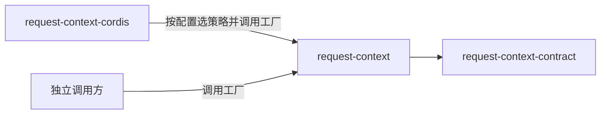

# Request Context 派生计算的使用与定位

本页说明谁使用本成员、怎样使用，以及本成员在能力组中的位置。系统关系归[系统页 Request Context](../../../../docs/architecture/runtime/request-context.md)，组内分解归[组入口](../../README.md)。本页不另立架构。

## 使用方式

本成员导出 `createContextSourceRegistry` 与 `createContextAccounting`。候选缓存与默认策略尚未实现，下文只写已实现的用法。

### 经 Cordis 使用

装配 Cordis 的系统不直接导入本成员。[request-context-cordis](../../request-context-cordis/docs/cordis.md) 在插件加载时按配置选定两个策略实现，再调用 `createContextSourceRegistry`，把登记表投影为服务。来源适配者经服务的 `register` 与 `replace` 登记某个目标的来源集合，组装请求的调用方经服务的 `assembly(target)` 取该目标的操作组（[Cordis 说明的服务定义](../../request-context-cordis-contract/docs/cordis.md#服务定义)）。request-context-cordis 的迁移由其拥有者完成。

### 独立使用

不装配 Cordis 又要托管登记的调用方直接调用工厂。下例是职责伪代码：

```text
登记表 = createContextSourceRegistry({ 主体绑定, 登记授权, 策略: { 压缩策略, 表示策略 } })
句柄 = 登记表.register({ 访问身份, 目标, 拥有者, 来源集合 })
操作组 = 登记表.assembly(目标)
结果 = 操作组.assemble({ 访问身份, 用途, 消费位置, 候选身份 })
      候选成立：自己交 Model 准备、固定，并保存采用事实
      需要压缩：计划 = 操作组.planCompaction(调用)
                逐步 操作组.deriveStep({ 调用, 计划, 进度, 步, 材料 })
                进度由自己可靠保存；摘要步的模型调用由自己发起
换来源：登记表.replace({ 访问身份, 原登记引用, 新来源集合 })
撤除：句柄.withdraw().settled 等在途操作与租约结算
结束：登记表.close()

账目 = createContextAccounting({ 来源核验, 读取资格, 窄采用来源, 恢复授权, limits })
启动：账目.recovery.rebuildAccounts({ 系统访问身份, 目标, 日志快照 })
收账：账目.inbox.receive({ 访问身份, 原账目修订 })
窗口占用：账目.inbox.usage({ 访问身份, 目标 })
```

独立调用方要自己承担下列事项：

1. 给出来源集合的全部读口：七组读口、窄采用来源、历史源读口、转换件结果读口、读取资格与 Model 准备资源。任一读口失败时，相关操作按类别返回失败。
2. 选定两个策略实现。
3. 保存计划进度、采用事实与压缩转换。本成员不持有耐久状态。
4. 进程启动后先以系统访问身份重建账目投影，重建完成之前收账与窗口占用都不可用。`limits` 必填，没有默认值。

访问系统托管的历史、档案或其他资源时，仍适用原来源契约的身份、资格及保留责任（[RQ-01](../../request-context-contract/SPEC.md#rq-01-调用方与计算边界)）。

只需要独立操作组时，不需要本成员，直接用 [request-context-contract](../../request-context-contract/docs/context.md) 根入口的 `createAssemblyOperations`。

### 初始化与释放

工厂调用即初始化，没有其他前提。调用工厂的一方拥有实例。登记表的 `close()` 拒绝新登记与新借用，等待全部代际结算；关闭不取消在途操作，也不撤回已交出的候选、计划或转换。账目投影实例丢弃时不清理原日志。

## 消费者与定位

本成员是 Request Context 的机制实现，只依赖纯契约。下图投影[组架构](../../docs/architecture.md#安装与源码依赖)里与本成员相关的边，两者不一致时以组架构为准。



| 使用方 | 怎样使用 | 本成员给什么 |
| --- | --- | --- |
| [request-context-cordis](../../request-context-cordis/README.md) | 插件加载时选策略并调用 `createContextSourceRegistry`，把登记表投影为服务；插件卸载时关闭登记表 | 来源登记表与按目标的操作组 |
| 独立调用方 | 直接调用两个工厂 | 来源登记表与账目投影。进度与证据保存由调用方自己承担 |

组内只有 request-context-cordis 依赖本成员。贡献者与组装请求的调用方不直接依赖本成员，它们依赖服务定义或纯契约（[IC-5](../../../../docs/architecture/cordis-integration-conventions.md#ic-5)）。

### 现在的真实消费者

现在没有包依赖本成员。request-context-cordis 的 `package.json` 还没有列出本成员，其服务迁移由拥有者完成。

### 上层页面

- 系统关系与长期性能要求：[系统页 Request Context](../../../../docs/architecture/runtime/request-context.md)、[装配与变化](../../../../docs/architecture/runtime/assembly-and-change.md#比对代替求值)。
- 公开行为：[request-context-contract SPEC](../../request-context-contract/SPEC.md)、[协议流程](../../request-context-contract/docs/flows.md)。
- 组内成员与阅读路径：[组入口](../../README.md)、[组协作入口](../../docs/key-flows.md)。
