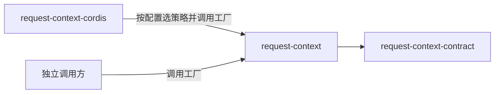

# Request Context 派生计算的使用与定位

本页说明谁使用本成员、怎样使用，以及本成员在能力组中的位置。系统关系归[系统页 Request Context](../../../../docs/architecture/runtime/request-context.md)，组内分解归[组入口](../../README.md)。本页不另立架构。

## 使用方式

本成员现在没有导出。下面是 SPEC 固定的用法，随工厂的实现生效。

### 经 Cordis 使用

装配 Cordis 的系统不直接导入本成员。[request-context-cordis](../../request-context-cordis/docs/cordis.md) 在插件加载时按配置选定两个策略实现，再调用工厂，交入登记面读口，不交三项端口。贡献者经服务定义 [request-context-cordis-contract](../../request-context-cordis-contract/docs/context.md) 登记提示词贡献。组装请求的调用方经服务的 `assembly(scope, ports)` 用到这个实例：每次调用交入历史源读口、计量端口与转换件结果端口，提供者经实例的按调用交入端口的入口转交（[Cordis 说明的服务定义](../../request-context-cordis-contract/docs/cordis.md#服务定义)）。

### 独立使用

不装配 Cordis 的调用方直接调用工厂。下例是职责伪代码，不表示当前包已有运行导出：

```text
实例 = 工厂(
  { 历史源读口, 计量端口, 转换件结果端口,
    压缩策略: 默认压缩策略或自己的实现,
    表示策略: 默认表示策略或自己的实现 },
  { 修剪阈值, 缓存容量 })

组装：结果 = 实例.assemble(七组输入)
      增量读取时第三组带自己保存的最近一次完整读取的块材料
      七组逐项相同时复用层内容；⑥、装入裁定与结局每次按输入重算
      候选成立：自己交 Model 准备、固定，并保存覆盖证据
      需要压缩：计划 = 实例.planCompaction(七组输入)
                逐步 实例.deriveStep(计划, 进度, 上一步结果)
                进度由自己可靠保存；摘要步的模型调用由自己发起
      装不下：失败回到自己

结束：关闭实例；关闭后的组装返回不可用
```

独立调用方要自己承担下列事项：

1. 在构造时给出三项端口与两个策略。任一依赖缺席时，相关操作返回不可用。
2. 选定两个策略实现。默认实现的数值只是配置初值，可以按自己的模型窗口与计量口径调整。
3. 自己收集提示词贡献，作为第四组输入传入。经 Cordis 时由登记面提供。
4. 保存计划进度、覆盖证据与压缩转换。本成员不持有耐久状态。
5. 跨请求保存最近一次完整读取的块材料，增量读取时随第三组交入。本成员不保存它。

访问系统托管的历史、档案或其他资源时，仍适用原来源契约的身份、资格及保留责任（[RQ-01](../../request-context-contract/SPEC.md#rq-01-调用方与计算边界)）。

只需要纯操作、不需要缓存与默认策略时，不需要本成员，直接用 [request-context-contract](../../request-context-contract/docs/context.md) 的根入口。

### 初始化与释放

工厂调用即初始化，没有其他前提。调用工厂的一方拥有实例，负责关闭它。关闭后新的组装返回不可用，关闭先取消在途组装，再释放缓存。关闭不撤回已交出的候选、计划或转换。

## 消费者与定位

本成员是 Request Context 的机制实现，只依赖纯契约。下图投影[组架构](../../docs/architecture.md#安装与源码依赖)里与本成员相关的边，两者不一致时以组架构为准。



| 使用方 | 怎样使用 | 本成员给什么 |
| --- | --- | --- |
| [request-context-cordis](../../request-context-cordis/README.md) | 插件加载时选策略并调用工厂，交入登记面读口；每次 `assembly(scope, ports)` 把端口转交实例；插件卸载时关闭实例 | 带缓存的纯操作实现与默认策略 |
| 独立调用方 | 直接调用工厂 | 同上。贡献收集、进度与证据保存由调用方自己承担 |

组内只有 request-context-cordis 依赖本成员。贡献者与组装请求的调用方不直接依赖本成员，它们依赖服务定义或纯契约（[IC-5](../../../../docs/architecture/cordis-integration-conventions.md#ic-5)）。

### 现在的真实消费者

现在没有包依赖本成员。request-context-cordis 的 `package.json` 还没有列出本成员，随实现进入。

### 上层页面

- 系统关系与长期性能要求：[系统页 Request Context](../../../../docs/architecture/runtime/request-context.md)、[装配与变化](../../../../docs/architecture/runtime/assembly-and-change.md#比对代替求值)。
- 公开行为：[request-context-contract SPEC](../../request-context-contract/SPEC.md)、[协议流程](../../request-context-contract/docs/flows.md)。
- 组内成员与阅读路径：[组入口](../../README.md)、[组协作入口](../../docs/key-flows.md)。
