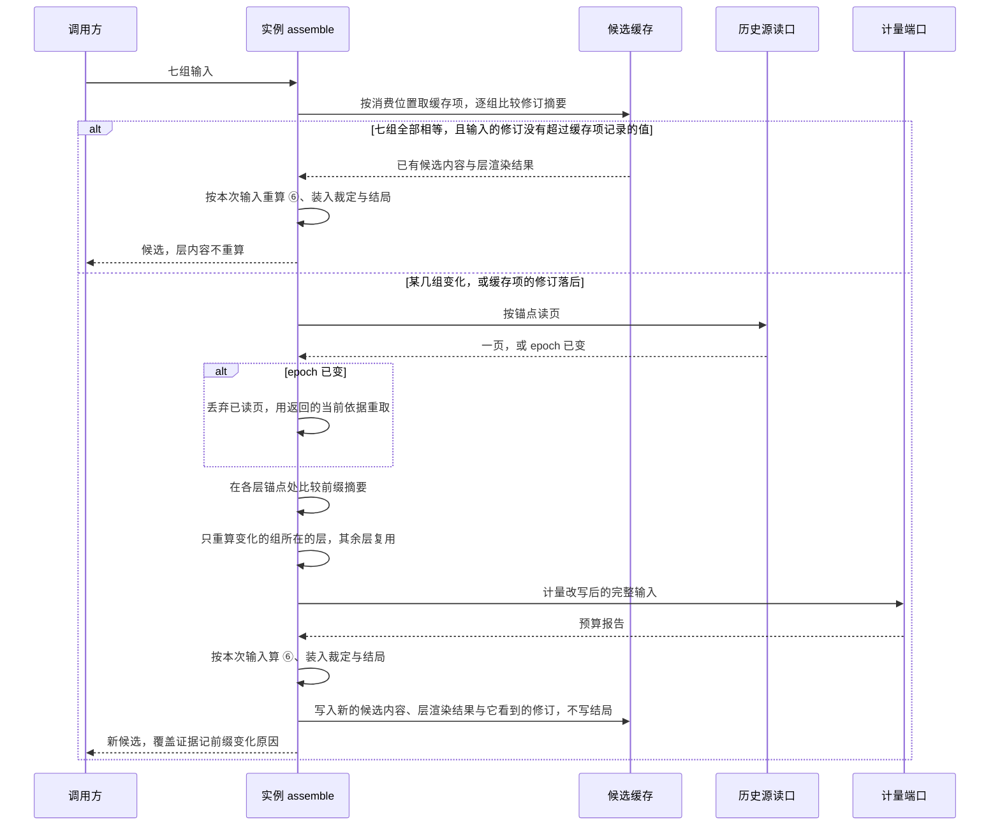
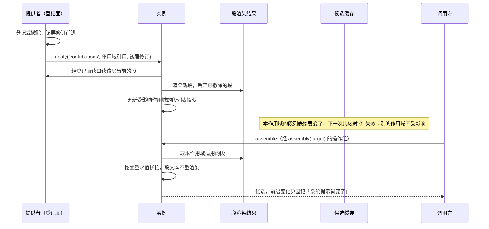
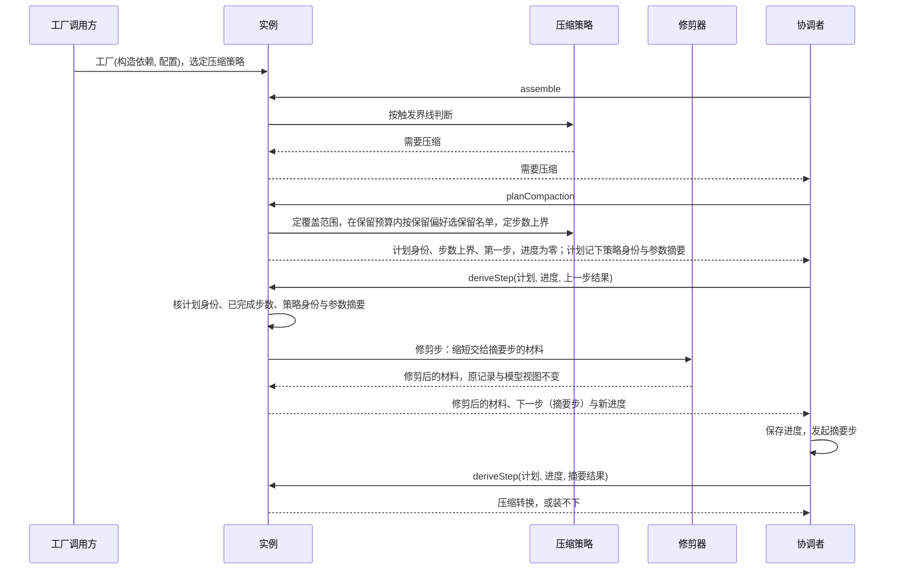

# Request Context 派生计算的流程

本页给出本成员的三条机制级流程。每条有一张时序图和一张「失败与责任交接」表。行为以 [SPEC](../SPEC.md) 为准，图只投影条款，不表示运行实现已经存在。

协议级流程归 [request-context-contract 的协议流程](../../request-context-contract/docs/flows.md)，本页的流程是它们在实现内部的展开。贡献登记、变化事件与 Cordis 装卸归 [request-context-cordis-contract 的流程](../../request-context-cordis-contract/docs/flows.md)与 [request-context-cordis 的流程](../../request-context-cordis/docs/flows.md)。图中的「实例」是 `createContextSourceRegistry` 返回的登记表实例；三条流程描述的候选缓存与派生物尚未实现。内部模块见[内部架构](architecture.md#模块与依赖)。

## 流程

### F-RQI01 缓存命中与按组失效

协议流程：契约的 F-RQ01、F-RQ02 与 F-RQ05。条款：[候选缓存](../SPEC.md#候选缓存)、[本地行为](../SPEC.md#本地行为)、[RQ-01](../../request-context-contract/SPEC.md#rq-01-调用方与计算边界)、[H2、H3](../../request-context-contract/SPEC.md#历史源读口与-epoch-视图)。

前提：调用方给出七组输入，其中带上一次已采用的覆盖证据。实例在同一消费位置上可能已有缓存项。

| 环节 | 结果 | 失败与责任交接 |
| --- | --- | --- |
| 比较缓存键 | 七组逐项比较修订摘要，覆盖七组的全部成员。只有上一次准备不参与比较，因为结局不进缓存 | 命中只说明层内容可以复用，不说明候选已经固定。⑥、装入裁定与结局每次重算 |
| 修订落后 | 缓存项作废，不返回旧内容 | 输入的来源拥有者要在变化时前进修订。输入不带修订时不能命中 |
| 按组重算 | 只有新输入时，前四层逐字不变，只重算尾部 | 各组对应哪一层见[内部架构的按组失效](architecture.md#按组失效只重算受影响的层) |
| epoch 已变 | 本次组装丢弃已读页并重算 | 不拼接两个 epoch 的页 |
| 前缀比较 | 每层锚点处比较一次摘要 | 不逐条比对。摘要不等的唯一原因是 epoch 变化 |
| 依赖缺席 | 读口、计量端口或转换件结果端口缺席或不可用时，返回不可用，带诊断 | 不伪装成功，不用旧页或其他租户的内容代替 |
| 有缓存与无缓存 | 同一组输入的结果逐字相同 | 不同即是缺陷，归本成员 |

### F-RQI02 预计算派生物在贡献变化时重算

条款：[预计算的派生物](../SPEC.md#预计算的派生物)、[候选缓存](../SPEC.md#候选缓存)、[RQ-02](../../request-context-contract/SPEC.md#rq-02-组装的前置输入)。

前提：一个贡献者在登记面登记或撤销了一条贡献，该层的修订前进。登记面归 [request-context-cordis-contract](../../request-context-cordis-contract/docs/cordis.md#登记与撤除协议)。缓存实现时，实例在构造时取得登记面的读口；提供者在登记或撤除之后调用实例的 `notify('contributions', …)`，带作用域引用（全局层为 `null`）与该层的修订（[候选缓存](../SPEC.md#候选缓存)）。

| 环节 | 结果 | 失败与责任交接 |
| --- | --- | --- |
| 预计算 | 段文本在收到通知后渲染一次 | 组装时不重渲染段文本，只按变量求值拼接 |
| 渲染结果的拥有者 | 只有实例持有渲染结果 | 提供者撤除只释放实例，不另持有渲染结果 |
| 撤除 | 下一次读该层时，已撤除段的渲染结果被丢弃 | 撤除之后的组装不含这条贡献。已经交出的候选不撤回 |
| 缓存失效 | 只有本作用域适用的段列表摘要或登记面实例代次变化时，① 失效 | 只重算系统提示词。别的作用域的贡献变化不使本作用域失效 |
| 独立路径 | 没有登记面与通知，贡献集合随第四组输入交入 | 段按段摘要渲染并复用 |
| 逐请求变量 | 带逐请求变化变量的段在登记时已被拒绝 | 拒绝归登记面。组装时遇到这样的段，按无效返回（[RQ-02](../../request-context-contract/SPEC.md#rq-02-组装的前置输入)） |
| 其他派生物 | 工具声明投影在第六组的工具采用集合变化时重算，不经通知；快照提醒文本按作用域引用、资格身份、快照修订与锚点复用 | 快照提醒的块材料由调用方每次交入，缓存缺失时从输入重算 |

### F-RQI03 压缩策略选择与修剪

协议流程：契约的 F-RQ03。条款：[默认策略与修剪器](../SPEC.md#默认策略与修剪器)、[本地行为](../SPEC.md#本地行为)、[RQ-06](../../request-context-contract/SPEC.md#rq-06-压缩共同结果与保护边界)。

前提：工厂调用方在构造时传入了压缩策略实现，可以是本成员的默认实现。这次请求准备尚未进入压缩计划。

| 环节 | 结果 | 失败与责任交接 |
| --- | --- | --- |
| 选择策略 | 工厂调用方传入压缩策略。经 Cordis 时由 [request-context-cordis](../../request-context-cordis/docs/cordis.md#配置与策略选择) 按配置选择 | 实例构造后不换策略。换策略就是新建实例 |
| 触发界线 | 默认实现取窗口的 80% 与「窗口减输出预留减余量」两者的较小值 | 数值是配置初值，重核之前不作为初值生效 |
| 保留名单 | 默认保留预算为窗口减输出预留的 16%，作用于保留名单。默认较新优先 | 未结工作的条目集合由历史持有者给出。它是保留名单的下界，不是策略的选择（[RQ-06](../../request-context-contract/SPEC.md#rq-06-压缩共同结果与保护边界)） |
| 步数上界 | 默认 3，修剪优先 | 上界在计划给出时定下，之后不变 |
| 核进度与策略 | 计划身份、已完成步数、策略身份或参数摘要对不上时返回无效 | 进度只由调用方保存，本成员不保存。换策略就是新建实例，旧计划不能在新策略下推导 |
| 修剪步 | 只缩短超过阈值的工具结果与媒体占位，保留原消息身份与占位的引用 | 不改原记录，不改模型视图。修剪步不调用模型，仍记一步进度 |
| 进入摘要步 | 修剪步之后必有摘要步。修剪只缩短交给摘要步的材料，不改变装入裁定 | 主请求的模型视图在修剪后不变，所以计划必须经摘要步得到压缩记录（[RQ-06](../../request-context-contract/SPEC.md#rq-06-压缩共同结果与保护边界)） |
| 用完或被否决 | 按压缩后仍装不下处理 | 不在相同条件下重开计划 |

## 失败与生命周期

| 情形 | 结果 | 责任方 | 依据 |
| --- | --- | --- | --- |
| 来源集合的读口失败或不可用 | 相关操作按类别返回失败，带诊断 | 登记该来源集合的来源适配者修复后经 `replace` 换新来源集合 | [本地行为](../SPEC.md#本地行为) |
| 缓存项修订落后 | 作废，重算 | 本成员 | [候选缓存](../SPEC.md#候选缓存) |
| 读口返回 epoch 已变 | 丢弃已读页，重取重算 | 本成员 | [H2](../../request-context-contract/SPEC.md#历史源读口与-epoch-视图) |
| 计划身份、步序号、压缩依据或策略对不上 | 返回无效 | 调用方按保存的进度重新调用；策略已换时重新准备 | [本地行为](../SPEC.md#本地行为) |
| 实例关闭 | 新的组装返回不可用（实例已关闭），取消在途组装，释放缓存 | 关闭方 | [SPEC 所有权、失败与生命周期](../SPEC.md#所有权失败与生命周期) |
| 关闭之后 | 不撤回已交出的候选、计划或转换 | 协调者与历史持有者 | 同上 |
| 进程失败 | 缓存与派生物丢失，从输入重建 | 本成员，结果不变 | 同上 |

各内部对象的创建与结束见[对象模型](object-model.md#生命周期)。
