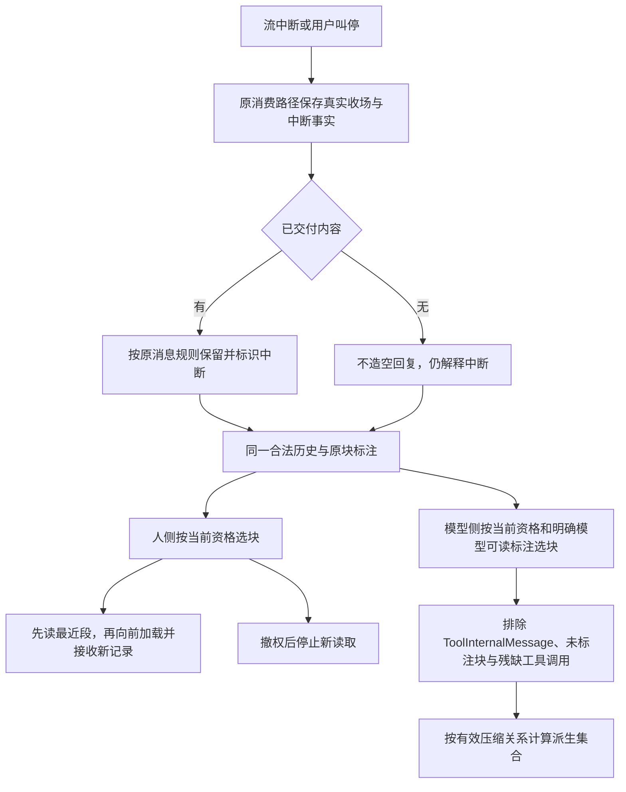
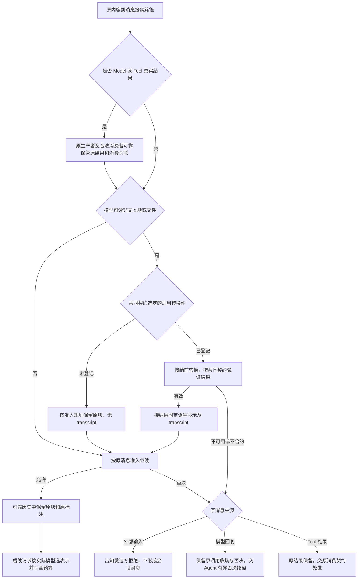
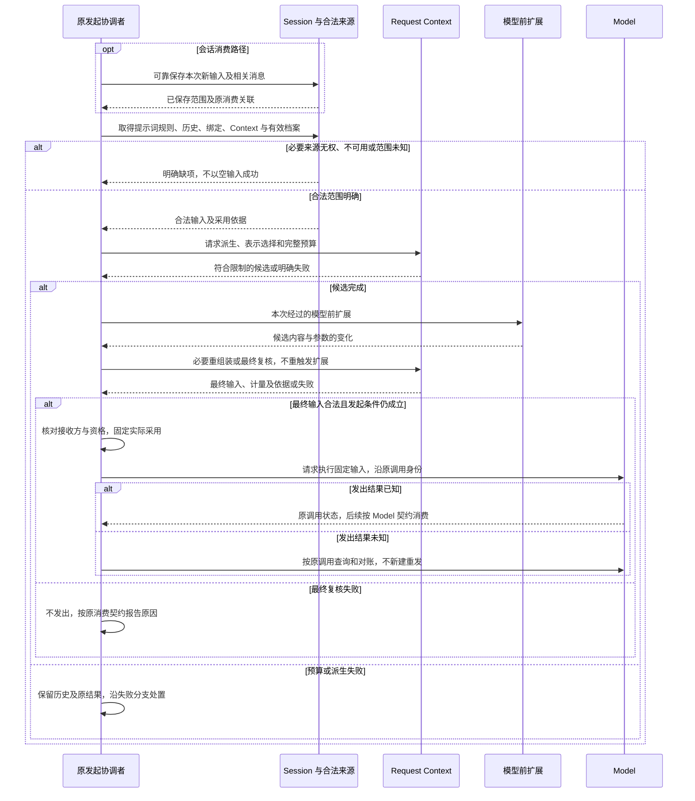
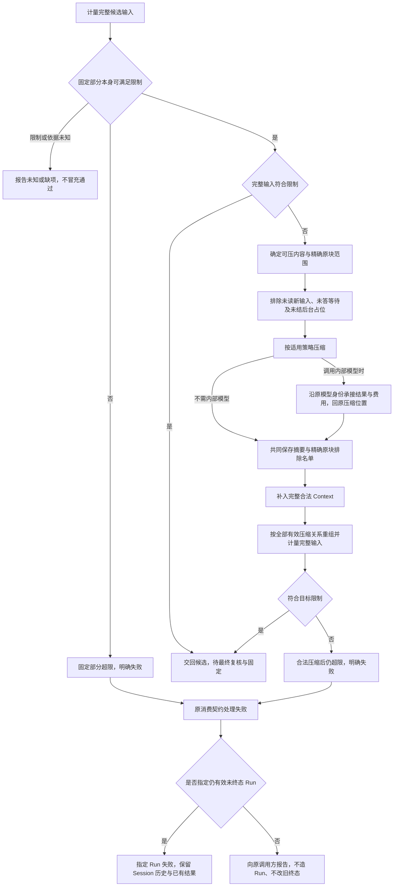

# 请求派生协作流程

本页在正式位置维护待审细化，只有文档目标，没有真实包、公开形状或实际运行验证。产品既定规则保持原确认范围，阶段支持仍待用户选择。

## RC-F04 人侧历史与模型侧块投影

承接 [RC-J04](../../../../.meta_harness/design/product/runtime-context/design.md#rc-j04)，能力 CAP-RC06、10。历史持久事实与交付状态由 Session、Model、Tool 及交付面共同衔接，Context 不发明新的消息种类或分页 API。

取消人侧读取不删历史；停止语音播放不等于取消原业务。模型窗口不裁人侧历史，残缺调用不执行。图中已交付内容的保留是目标保证，展示至耐久边界尚见 [CONTEXT-M03](../../../../.meta_harness/design/product/runtime-context/design.md#context-m03)，不能由收场后 ACK 推导逐片同步保存。持续验证见 [RQ-VJ04](../SPEC.md#rq-vj04)。

## RC-F05 接纳前转换与按来源处置失败

承接 [RC-J05](../../../../.meta_harness/design/product/runtime-context/design.md#rc-j05)，能力 CAP-RC06、07、10。Model 的[转换件共同契约](../../../model/model/docs/profile-and-modality.md#转换件的共同契约)唯一拥有键选择及合约输出。本域消费转换结果并在请求时选用实际表示，转换不是组装时临时改写历史的步骤。

| 分支守卫 | 后果与拥有者 |
| --- | --- |
| 模型回复被否决且原工作仍有效未终态 | Agent 从原位置按有界路径继续，达到否决上限使消费契约指定的 Run 失败；Model 原调用真实收场不改成供应商故障。 |
| Tool 结果被否决且消费契约指向有效未终态 Run | 原消费方使指定 Run 失败，Tool 结果、效果与账目继续保留。 |
| 后台、Run 外、旧 Run 已终态或已取消 | 保留原身份及消费位置，不造 Run、不挂无关后继、不反转终态、不恢复取消资格；具体旁路后果由原消费者细化。 |
| 取消转换等待、资格失效或消费者换代 | 停止不再合法的新交付，原生产者或获准接手者继续保管原结果；不靠重跑 Tool 或副作用函数补结果。 |
| 转换执行或接纳提交未知 | 按原内容、调用和消费位置查询接续；精确幂等身份与接续协议待设计，不推定未处理。 |

失败分支见 [RQ-08](../SPEC.md#rq-08-失败否决与消费位置)。转换与旁路协议见 [CONTEXT-M02](../../../../.meta_harness/design/product/runtime-context/design.md#context-m02)，最终工具块全集及嵌套投影见 [CONTEXT-E01](../../../../.meta_harness/design/product/runtime-context/design.md#context-e01)，共享身份 MODEL-E01。未知嵌套分支不能当相容输入，已知模态检查仍须执行。持续验证见 [RQ-VJ05](../SPEC.md#rq-vj05)。

## RC-F06 一次请求的完整组装与固定采用

承接 [RC-J06](../../../../.meta_harness/design/product/runtime-context/design.md#rc-j06)，能力 CAP-RC01、06、07、08、10。图中的原发起者在主流程是 Agent，在压缩、扩展及独立调用是各自具名发起路径。独立输入不需要 Session，但托管数据读取和外发责任仍须承接。

完整预算包含提示词、历史、提醒、工具定义、完整 Context 和实际发送模态。字节、图片数等精确检查，token 按适用方法及明确余量计量；方法或限制未知不能伪装通过。精确计量条件消费 Model 档案契约。首次组装和扩展后复核都适用 [RC-F07](#rc-f07) 的压缩保护与失败后果，不重复触发该扩展位置。

取消组装只结束计算和订阅，已发出调用的控制归 Model 原契约。固定后变化不改旧请求，下一动作仍按当前资格。版本复核、跨源一致采用、提交未知及精确失败集合仍见 [CONTEXT-M02](../../../../.meta_harness/design/product/runtime-context/design.md#context-m02)。持续验证见 [RQ-VJ06](../SPEC.md#rq-vj06)。

## RC-F07 压缩、内部调用与预算失败

承接 [RC-J07](../../../../.meta_harness/design/product/runtime-context/design.md#rc-j07)，能力 CAP-RC04、08、09、10。压缩计算归 Request Context，Session 保存共同结果，原压缩消费者承担内部 Model 调用的接续与费用交接。

摘要与精确原块引用共同保存的成功，才允许该压缩事实参与后续投影；旧历史及原可见性不变。较早未排除块仍参与，固定要求不能靠压缩删除。所有适用压缩均受同一保护及完整预算规则约束。必要压缩失败不默认换模型或分叉，条件未变不无限重做。

若取消或故障发生在内部调用之后，原调用可能仍执行或已收场。接续方认回其身份，按 Model 契约完成结果承接和 ACK，不把结果当主流程回复，也不重发或重计原账。Model ACK 存在先完成处理或先可靠保管再确认的合法路径，选择须保证清理后原压缩接续不依赖已释放全文。取消本地等待不撤销共同保存事实，也不证明原执行物理停止。共同保存、原消费位置、未知对账及 ACK 接续精确机制仍见 [CONTEXT-M02](../../../../.meta_harness/design/product/runtime-context/design.md#context-m02)。持续验证见 [RQ-VJ07](../SPEC.md#rq-vj07)。
