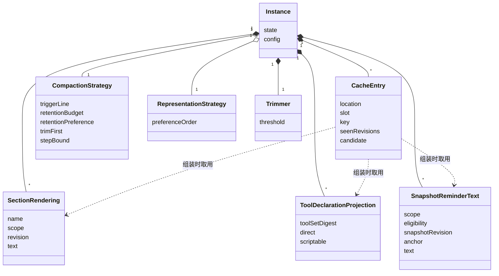
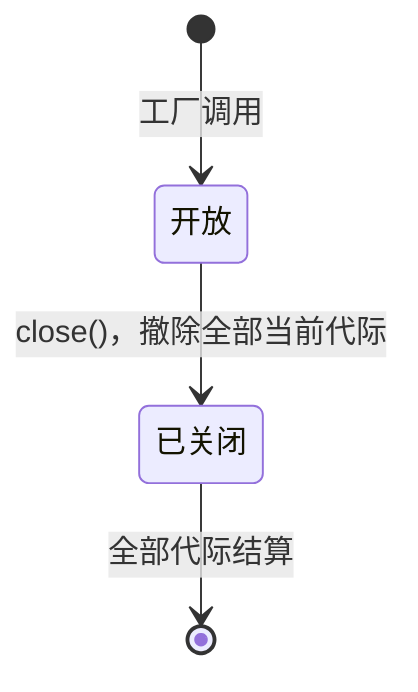
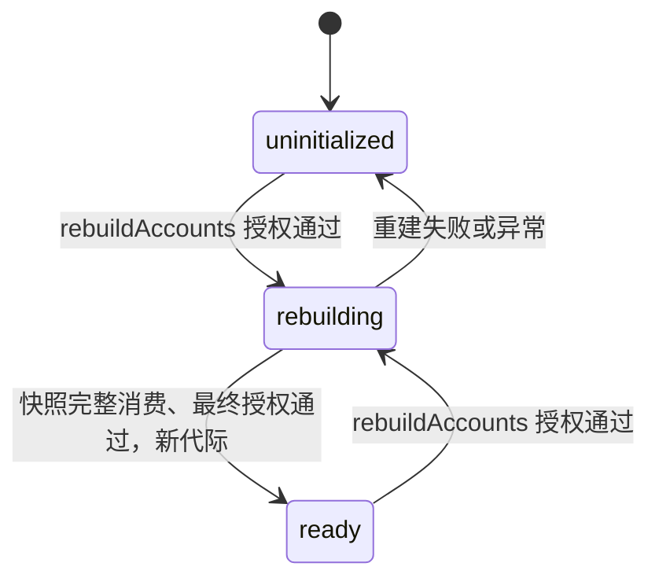

# Request Context 派生计算的对象模型

本页描述本成员的实现内部对象：实例、缓存条目、派生物与策略实例。它们是技术对象，不自动成为产品领域对象。组装输入、请求候选、覆盖证据、压缩计划、计划进度与提示词贡献这些领域对象归 [request-context-contract 的对象模型](../../request-context-contract/docs/object-model.md)，本页只说明实现怎样保存它们的派生副本。

登记项与账目目标状态已实现。其余对象由 SPEC 的[结果与不变量](../SPEC.md#结果与不变量)固定，类名与字段名随实现确定。

## 对象与关系

| 对象 | 身份 | 持有什么 | 拥有者 | 对应的领域对象 |
| --- | --- | --- | --- | --- |
| 登记表实例 | 一次 `createContextSourceRegistry` 调用 | 登记项、主体绑定、登记授权、策略实例、关闭状态；缓存实现后另有缓存与派生物 | 调用工厂的一方 | 契约的 `ContextSourceRegistry` |
| 登记项（代际） | `(tenant, scope)` 加 `SourceGeneration`，进程内单调，不复用 | 登记引用、来源集合、拥有者、在途借用数、撤除标记、未归还租约的拥有者、结算承诺 | 登记表实例 | 契约的来源集合 |
| 账目投影实例 | 一次 `createContextAccounting` 调用 | 目标状态表、核验与授权端口、容量上限 | 调用工厂的一方 | 契约的收件口与恢复口 |
| 账目目标状态 | `(tenant, scope)` 加 `AccountingGeneration` | 状态（`uninitialized`、`rebuilding`、`ready`）与按 `(call, dispatch)` 的修订指纹索引 | 账目投影实例，从日志授权重建 | `context.window-usage` 的值来源 |
| 缓存条目 | 消费位置，加「已固定」或「在算」 | 缓存键（七组全部成员的修订摘要，只排除上一次准备），它看到的各来源修订，候选内容与各层渲染结果。不含 ⑥、装入裁定与结局 | 实例 | 契约的请求候选及其覆盖证据 |
| 段渲染结果 | 贡献的名字加作用域，加该层的修订；独立路径按段摘要 | 有序段渲染出的文本、来源与修订 | 实例，唯一拥有者。收到 `notify('contributions', …)` 后从登记面读口读段并渲染 | 契约的提示词贡献 |
| 工具声明投影 | 工具采用集合摘要 | 直接集合与脚本可调用集合 | 实例 | 契约 `declareTools` 的结果 |
| 快照提醒文本 | 作用域引用、资格身份、快照修订加锚点 | 稳定块的提醒文本，从调用方交入的块材料渲染 | 实例，可丢；缺失时从输入重算 | 契约的上下文快照提醒 |
| 压缩策略实例 | 一次工厂调用 | 触发界线、保留预算、保留偏好、修剪优先、步数上界 | 实例，由工厂调用方选定 | 契约的压缩策略端口的一个实现 |
| 表示策略实例 | 一次工厂调用 | 按模态的偏好顺序 | 实例，由工厂调用方选定 | 契约的表示策略端口的一个实现 |
| 修剪器 | 一次工厂调用 | 修剪阈值 | 实例 | 修剪步的执行者 |

关系说明：

- 每个消费位置至多有两个缓存条目：最近一个已固定候选与一个在算候选。容量是配置初值（[候选缓存](../SPEC.md#候选缓存)）。
- 两个策略实例由工厂调用方传入，所以用聚合表示。默认实现由本成员提供，调用方也可以传入别的实现。
- epoch 视图与前缀摘要归历史持有者，表示决定归内容拥有者，计量结论归 Model 的计量端口，④ 的块材料归调用方。它们不是本成员的对象，本成员只读取（[预计算的派生物](../SPEC.md#预计算的派生物)）。
- 缓存条目不存结局。⑥、装入裁定与结局每次按本次输入（含「上一次准备」）计算（[候选缓存](../SPEC.md#候选缓存)）。
- 计划进度不是本成员的对象。`deriveStep` 只接受调用方传回的进度（[本地行为](../SPEC.md#本地行为)）。

## 生命周期

| 对象 | 创建 | 变化 | 结束 |
| --- | --- | --- | --- |
| 登记表实例 | 工厂调用 | 开放、已关闭 | `close()` 等到全部代际结算，或进程失败 |
| 登记项（代际） | `register` 或成功的 `replace` | 借用数增减；撤除或被替换后不再接受新借用 | 撤除且借用归零时结算；进程失败即丢失，来源适配者重新登记 |
| 账目目标状态 | 第一次授权重建 | `uninitialized` → `rebuilding` → `ready`；重建失败回到 `uninitialized`，保留旧索引但不服务 | 实例丢弃，或进程失败；不清理原日志 |
| 缓存条目 | 组装没有命中时写入在算候选 | 同一消费位置的新候选取代旧的 | 输入携带的修订超过它记录的值时作废。实例结束时释放 |
| 段渲染结果 | 收到 `contributions` 通知后从登记面读出新段 | 该层修订前进时重读重渲染 | 段从登记面撤除后的下一次通知时丢弃，或实例结束。提供者撤除只释放实例 |
| 工具声明投影 | 工具采用集合第一次出现 | 集合变化时重算，新投影取代旧投影 | 实例结束 |
| 快照提醒文本 | 调用方交入的块材料第一次以某个身份出现 | 无。下一次完整读取产生新的一份 | 下一次完整读取，或被缓存淘汰，或实例结束。淘汰后从输入重算 |
| 策略实例与修剪器 | 工厂调用 | 无。改策略或配置就是新建实例 | 实例结束 |

### 状态与转移

登记表实例只有两个状态：

已关闭的登记表对新登记与新借用返回不可用，在途操作照常结束，结果因代际已撤除而不发布。

账目目标状态：

只有 `ready` 的目标收账并给出窗口占用。关闭不撤回已交出的候选、计划或转换（[SPEC 所有权、失败与生命周期](../SPEC.md#所有权失败与生命周期)）。

本成员的对象都不耐久。进程失败时全部丢失，从输入重建，结果不变。

实例只从输入「已采用」得知一个候选已经被调用方固定：输入带已采用且七组逐项相同时返回原采用。本成员不另外记录固定状态（[候选缓存](../SPEC.md#候选缓存)）。
