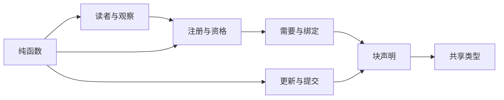

# Runtime Context 纯契约的内部架构

本页说明本成员怎样组织根入口与依赖，来兑现 [SPEC](../SPEC.md)。对象的身份、状态与生灭归[对象模型](object-model.md)。组内八个成员的分解与依赖方向归[组架构](../../docs/architecture.md)。本页不另立公共规则。

本成员没有运行实现，不持有状态，也不持有资源。登记表、生产者表、观察链与游标的机制归 [runtime-context](../../runtime-context/README.md)。注册、步提交与提醒的提交归作用域持有者。

## 模块与依赖

根入口 `src/index.ts` 是唯一公开入口。它按下表分成七个模块，每个模块一个源文件，`index.ts` 只做再导出。文件名由实现确定。现在只有前两个模块的类型在 `src/index.ts` 里，其余随实现切片进入，形状以 SPEC 和对象模型为准。

| 模块 | 承载 | 条款 | 现状 |
| --- | --- | --- | --- |
| 共享类型 | `ScopeRef`、`ContextBlockKey`、`ConsumerClass`、空块表 `ContextBlocks` | [RC-01](../SPEC.md#rc-01-消费者身份与范围)、[RC-02](../SPEC.md#rc-02-块声明注册与参数) | 已在 `src/index.ts` |
| 块声明 | `BlockDescriptorBase`、`SuppliedBlockDescriptor`、`StatefulBlockDescriptor`、`ContextBlockDescriptor` | [RC-02](../SPEC.md#rc-02-块声明注册与参数) | 已在 `src/index.ts` |
| 需要与绑定 | `ContextNeed`、`NeedBinding` | [RC-06](../SPEC.md#rc-06-需要绑定与读者形状) | 未进入 |
| 注册与资格 | `Registration`、`Eligibility` | [RC-02](../SPEC.md#rc-02-块声明注册与参数)、[RC-03](../SPEC.md#rc-03-当前读取资格与缺项) | 未进入 |
| 读者与观察 | `ContextReader`、`Snapshot`、`Changes`、读取的四种结果与游标作废、`ChangeMaterial` | [RC-03](../SPEC.md#rc-03-当前读取资格与缺项)、[RC-04](../SPEC.md#rc-04-读取时点观察与变化材料) | 未进入 |
| 更新与提交 | 供给块一侧的 `ProducerHandle`，状态块一侧的 `ContextUpdate` 与 `StepCommit` | [RC-05](../SPEC.md#rc-05-状态块上下文更新与步提交)、[RC-07](../SPEC.md#rc-07-生产者句柄并发撤除与恢复) | 未进入 |
| 纯函数 | `judgeNeed`、`judgeBinding`、`judgeRegistration`、`reduceStep`、`diffForReminder` | RC-02、RC-04、RC-05、RC-06 | 未进入 |

模块之间只有单向依赖。方向沿对象模型的[对象与关系](object-model.md#对象与关系)：绑定引用需要与块声明，注册聚合绑定，资格引用注册修订，读者按资格建立。纯函数模块读取类型模块，类型模块不导入纯函数模块。

包外依赖只有两项：

- `@standard-schema/spec`：用 `StandardSchemaV1` 表达块的值、参数与需要的形状。现在已在 `package.json` 里，源码只做类型导入。
- `@omne-harness/legal-identity`：用 `TenantId` 表达读取资格里的租户。它随 `Eligibility` 进入，现在还不在 `package.json` 里。

本成员不导入 `@deepseek-ai/cordis`，见 [Cordis 说明](cordis.md)。本成员也不导入任何上层领域的契约。上层领域依赖本成员，反方向不成立。现在已经依赖本成员的包是 execution-environment-contract 与 execution-environment。组架构列出的其他依赖方见[安装与源码依赖](../../docs/architecture.md#安装与源码依赖)。

## 关键机制与理由

### 块声明归语义拥有者

一块值的意思由决定这份意思的一方说明，所以块声明归语义拥有者（[RC-02](../SPEC.md#rc-02-块声明注册与参数)）。存放这份值的一方和供值的生产者都可以更换：生产者可以换代，恢复方式可以从重读换成持久保存。值的意思不随这些更换而变。如果声明归存放者或生产者，换一个提供者就要改声明，所有消费者都要跟着核对。

本成员只提供空块表 `ContextBlocks`。语义拥有者在自己的包里导出描述符，并用 `declare module` 增补块表。这样新增一块只改语义拥有者的包，本成员不改。

代价与边界：「全系统一个块键一份声明」部分靠类型系统保证。两个包用不同值类型增补同一键时，TypeScript 报告声明冲突。值类型相同的重复增补不报错，只靠块键前缀 `<语义拥有者域>` 避免。

### 需要以消费者的形状声明

消费者在自己的定义里用自己的形状声明需要，不点名块键（[RC-06](../SPEC.md#rc-06-需要绑定与读者形状)）。理由是集成原则：被集成方只说自己供什么、要什么，不知道被谁集成。块键只是集成方在注册时对上两边的手段。这样生产者和消费者可以分别演进，任一方改名或改形状只影响对应的绑定。

代价：形状不同时，集成方要为每条绑定写一个翻译纯函数。`judgeBinding` 在注册时核对绑定，不在每次读取时核对。读取时只按已核对的绑定翻译。

### 快照只进请求，变化进历史

完整快照可以随时按当前值重新求得，所以它只进请求，不进历史（[RC-04](../SPEC.md#rc-04-读取时点观察与变化材料)）。如果快照进历史，历史会重复保存同一批值，旧值还会被读成仍然有效的事实。变化材料经作用域持有者写成提醒追加进历史，模型由此保持对变化的连续理解。

代价：只有推送不能覆盖空闲期间的变化。所以执行开始或挂接建立时，调用方必须主动取一次完整快照。本成员把这一点写成义务，不把它留给调用方判断。

### 缺项不是失败

必需块的生产者不在场时，注册照常成立，读取返回缺项（[RC-03](../SPEC.md#rc-03-当前读取资格与缺项)）。理由有两条：

1. 作用域的创建不应依赖每个生产者的到场时序。
2. 只有依赖这一块的动作知道缺了它该怎么办，所以由那个动作按自己的契约处置。

本成员不伪造占位值，也不把缺项写成空值或旧值。未知与缺项分开：资格无法取得、来源查询失败或超时时返回未知，不返回空集合；权威来源明确答复不可用时返回缺项。代价是每个消费者都要显式处理缺项与未知两种结果。

### 游标五种作废

游标属于一个绑定读者，记录它上次读到哪里。授权范围变化、生产者换代、进程重建、持有者重签资格、游标早于观察链保留下界，这五种情形之后游标作废，读者必须重新取完整快照（[RC-04](../SPEC.md#rc-04-读取时点观察与变化材料)）。五种情形的共同点是：自游标以来的增量不再能证明完整，或持有者要求读者从完整快照重新开始。

| 情形 | 增量为什么不可信 |
| --- | --- |
| 授权范围变化 | 旧游标之后的增量按旧资格过滤，可能多给已经无权的内容，也可能漏掉新获准的内容 |
| 生产者换代 | 新一代的修订与旧一代不连续，旧游标无法定位到新一代的值 |
| 进程重建 | 观察链在原进程里，重建后无法从旧游标接续 |
| 持有者重签资格 | 持有者要求该读者从完整快照重新开始，例如压缩提交之后的模型类读者。本成员不认识压缩 |
| 早于保留下界 | 观察链已丢弃游标之后的部分变化，增量会残缺 |

是否作废由本成员按游标状态判断，不由发起请求的一方猜测。这样调用方只需要处理「游标作废」这一种结果，不需要自己追踪这五种情形。

### 本成员只给材料，不提交

注册、块内容与步提交是三笔分开的提交，都不在本成员内发生（[RC-02](../SPEC.md#rc-02-块声明注册与参数)、[RC-05](../SPEC.md#rc-05-状态块上下文更新与步提交)）。本成员给的是核对结果与合并材料：`judgeRegistration` 核对注册材料，`reduceStep` 合并更新，`diffForReminder` 算出变化材料。这样纯函数不需要存储端口，独立调用方不建持有者也能使用它们。

## SOLID 与扩展边界

本节讲模块层的选择。对象层的选择见对象模型的 [SOLID 与扩展边界](object-model.md#solid-与扩展边界)。

| 原则 | 本成员的具体选择 | 必须防止的反例 |
| --- | --- | --- |
| 单一职责 | 每个模块只因一类变化而改：块声明随声明字段改，读者与观察随读取协议改，纯函数随核对与合并规则改 | 纯函数模块持有注册表、缓存或游标。类型模块里出现服务键 |
| 开闭 | 新块只在语义拥有者的包里增补 `ContextBlocks`。新导出只加到对应模块，再由 `index.ts` 再导出 | 本成员出现具体块键，或为某个上层领域加特例分支 |
| 里氏替换 | 供给块与状态块以 `kind` 区分，接收 `ContextBlockDescriptor` 的函数按 `kind` 穷举两种 | 用 `writers` 字段是否存在来判断类别。对状态块套用供给块的恢复方式 |
| 接口隔离 | 生产者用的类型、持有者用的类型、读者用的类型分在不同模块，消费方只导入自己那一面 | 一个聚合类型同时暴露注册写入与读取 |
| 依赖倒置 | 本成员只依赖 `@standard-schema/spec` 与 legal-identity。翻译函数与 `reduce` 由集成方和声明者作为值传入 | 导入 Cordis 或上层领域契约。纯函数调用存储端口或服务 |

## 验证与维护

保证与持续验证资源的对应如下：

| 保证 | 现在的验证 | 后续义务 |
| --- | --- | --- |
| 根入口没有运行值，只导出类型 | [public-entry.spec.ts](../tests/public-entry.spec.ts) 断言根入口的运行导出为空 | 五个纯函数进入后，改为核对导出集合 |
| 公开类型可以被语义拥有者增补和使用 | 依赖方 execution-environment-contract 的类型检查 | 无 |
| SPEC 的行为条款 | 没有 | SPEC 的[持续验证义务](../SPEC.md#持续验证义务)，随纯函数和机制成员的实现进入 |

维护规则：

1. 新增或改名导出时，同步[公开接口页](public-api.md)、[src 索引](../src/index.md)与导出测试。
2. 改变块声明字段、`ConsumerClass` 或读取结果时，同步依赖方：execution-environment-contract、request-context-contract、runtime-context-cordis-contract 与 runtime-context。
3. 以下情形出现时，重新判断本页的模块切分：需要第五种消费者类，出现多层作用域持有者，或独立入口的字节编码确定。
