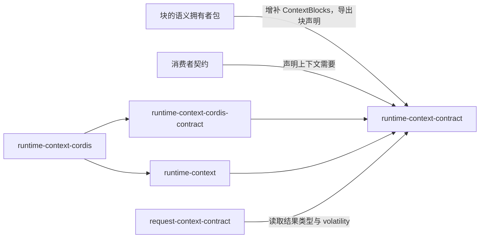

# Runtime Context 纯契约的使用与定位

本页说明消费方怎样使用本成员，以及本成员在系统与能力组中的位置。系统关系归[系统页 Runtime Context](../../../../docs/architecture/runtime/runtime-context.md)，领域责任归[领域页](../../../../docs/domains/runtime-context/README.md)，组内分解归[组入口](../../README.md)。本页不另立架构。

## 使用方式

### 独立消费

独立调用方不建作用域持有者，也不装配 Cordis。它只安装本成员，自己给出 `ScopeRef`、块声明、生产者与资格材料。用到三面操作时，它还给出两个权威端口的适配器：可信绑定来源 `ScopeBindingSource` 与权威端口 `RuntimeContextAuthority<P>`；访问系统托管数据的适配器必须接到该数据的真实权威来源，本成员没有免核验模式（[通用权威端口](../SPEC.md#通用权威端口)）。只处理调用方自己给出的数据时，缺上层对象不算拒绝。访问系统托管的数据时，仍适用原访问契约（[RC-01](../SPEC.md#rc-01-消费者身份与范围)）。

根入口同时提供类型和纯函数。下例在语义拥有者的包里声明一个供给块，它只用现有导出：

```ts
import type { SuppliedBlockDescriptor } from '@omne-harness/runtime-context-contract'
import type { StandardSchemaV1 } from '@standard-schema/spec'

export type Locale = Readonly<{ tag: string }>

declare module '@omne-harness/runtime-context-contract' {
  interface ContextBlocks {
    'example.locale': Locale
  }
}

declare const localeSchema: StandardSchemaV1<unknown, Locale>

export const localeBlock: SuppliedBlockDescriptor<'example.locale', Locale> = {
  kind: 'supplied',
  key: 'example.locale',
  schema: localeSchema,
  consumers: ['model', 'tool'],
  required: false,
  disclosure: 'plain',
  carriesPrevious: true,
  volatility: 'stable',
  recovery: 'reread',
}
```

`localeSchema` 可以是任何实现 Standard Schema 的校验器。块键前缀写语义拥有者自己的域。

五个纯函数进入根入口之后，独立调用方可以直接调用它们：

1. 用 `judgeNeed` 与 `judgeBinding` 核对需要与绑定。
2. 用 `judgeRegistration` 核对注册材料。
3. 用 `reduceStep` 对一步的每条更新判接受或拒绝，把接受的合并成步提交材料。被拒的更新按逐项原因退回提出者。
4. 用 `diffForReminder` 从两份快照算出变化材料。

这些函数已导出，见[公开接口页](public-api.md)。提交与存储仍归调用方自己。

`ScopeRef.ref` 是品牌字符串。根入口的 `decodeScopeRef` 与 `decodeContextBlockKey` 从字符串得到品牌类型，独立调用方不用类型断言。作用域引用的文本由持有者铸造，带租户、持有者侧标识与作用域代次；任何一方都不从文本解析租户（[作用域引用的铸造](../SPEC.md#作用域引用的铸造)）。

### 初始化与释放

本成员没有初始化步骤，不持有资源，也没有需要释放的对象。纯函数不触碰存储。需要供给中介的运行时行为时，改用组内的机制成员与 Cordis 成员，见下一节。

## 消费者与定位

本成员处在依赖的最底层。下图投影[组架构](../../docs/architecture.md#安装与源码依赖)里与本成员相关的边，两者不一致时以组架构为准。



### 邻域交接

本成员只定义各面交换的类型与纯函数。各面的运行实现与服务入口在别的成员里。

| 面 | 谁实现 | 谁使用 | 怎样进入 | 本成员给什么 |
| --- | --- | --- | --- | --- |
| 声明面 | 块的语义拥有者 | 集成方与供给中介 | 语义拥有者包导出块声明，用 `declare module` 增补 `ContextBlocks` | 块声明类型与空块表 |
| 需要面 | 消费者契约的作者 | 集成方 | 在消费者自己的定义里声明 `ContextNeed`，不点名块键 | 需要类型、`judgeNeed` |
| 生产者面 | [runtime-context](../../runtime-context/README.md) 的机制，经 [runtime-context-cordis-contract](../../runtime-context-cordis-contract/docs/cordis.md) 的服务提供 | 生产者 | 生产者在自己的插件生命周期里为一个租户登记供值，得到带租户的生产者句柄 | `ProducerHandle`、按租户的生产者槽与代际规则 |
| 持有者面 | 同上 | 作用域持有者，它在注册时是集成方 | 经同一服务提交注册、签发资格、提交步与作用域结束，并用恢复会话恢复作用域 | `Registration`、`Eligibility`、`StepCommit` 与恢复材料，`judgeRegistration`、`judgeBinding`、`reduceStep`、`diffForReminder` |
| 读者面 | 同上 | 消费者一侧的适配器，按消费者类读取 | 按持有者签发的资格建立绑定读者 | `ContextReader`、`Snapshot`、`Changes` 与四种读取结果、游标作废 |
| 权威面 | 集成方或应用装配的适配器 | 本成员的三面操作 | 每个带目标的入口先问权威端口，再问可信绑定来源 | `RuntimeContextAuthority<P>`、`ScopeBindingSource`、`AuthorityDecision` 与动作类型 |
| 请求组装 | [request-context-contract](../../request-context-contract/README.md) | 发起请求的协调者 | 依赖本成员的读取结果类型与块声明的 `volatility` | 读取结果类型、`volatility` |

服务键、各面方法名与消费者类的读取方式归 runtime-context-cordis-contract，本页不复制。

### 现在的真实消费者

execution-environment-contract 与 request-context-contract 都用本成员的公开类型声明自己拥有的块，并增补 `ContextBlocks`。前者声明执行安置与宿主事实，后者声明压缩设置与窗口占用。runtime-context-cordis-contract 已依赖本成员的操作类型；execution-environment-contract 另用 `ScopeBindingSource` 与 `AuthorityDecision` 的形状做访问核验，execution-environment 导入 `ScopeRef` 与 `ScopeBindingSource`。四个 Context 机制与 Cordis 提供者的生产实现仍待完成。

### 上层页面

- 系统关系、成员切分与 Cordis 落位：[系统页 Runtime Context](../../../../docs/architecture/runtime/runtime-context.md)。
- 领域责任与各邻域对本域的角色：[领域页](../../../../docs/domains/runtime-context/README.md)、[角色与交接](../../../../docs/domains/runtime-context/architecture.md)。
- 组内成员与跨成员流程：[组入口](../../README.md)、[组协作入口](../../docs/key-flows.md)。
- 本成员的流程：[协议流程](flows.md)。
