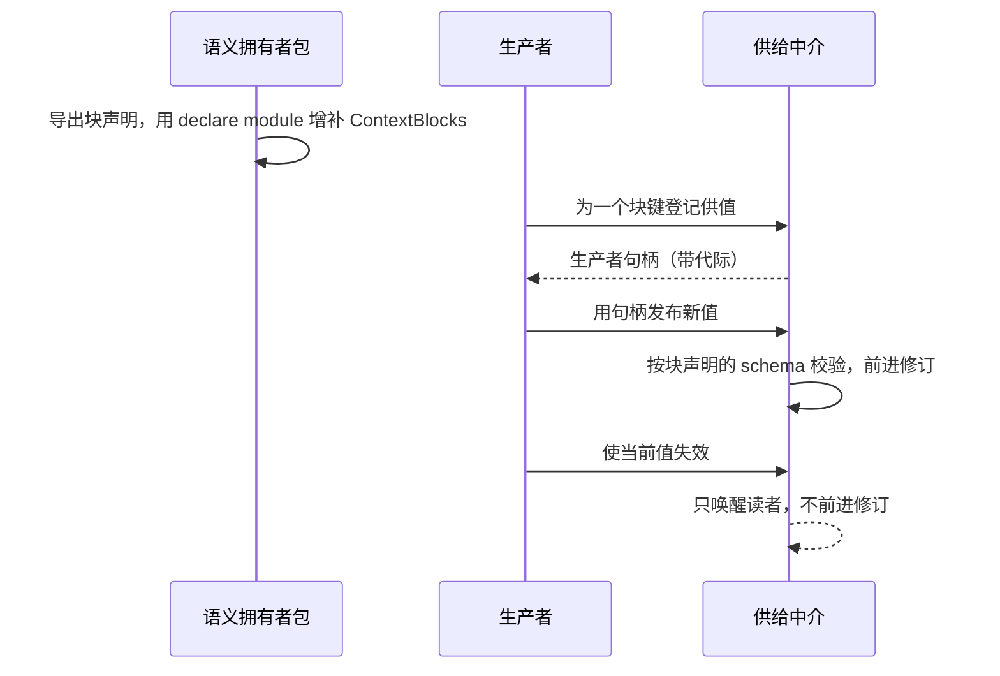
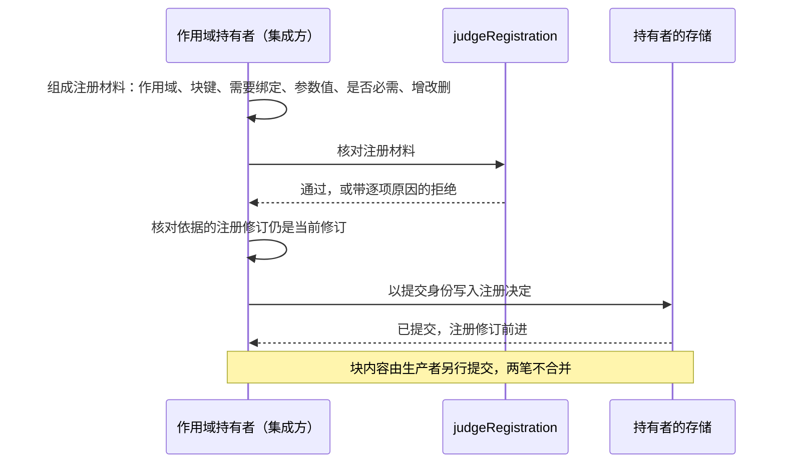
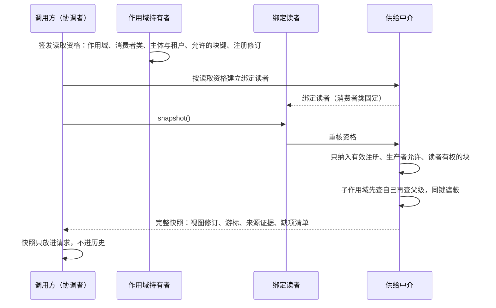
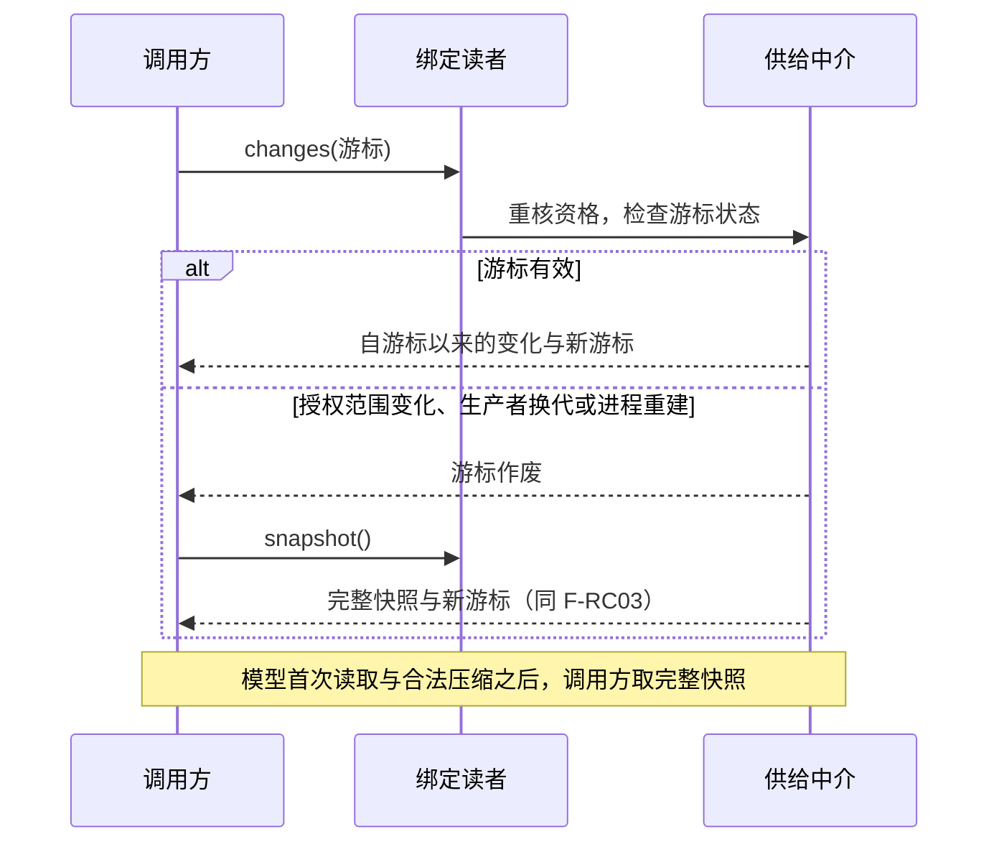
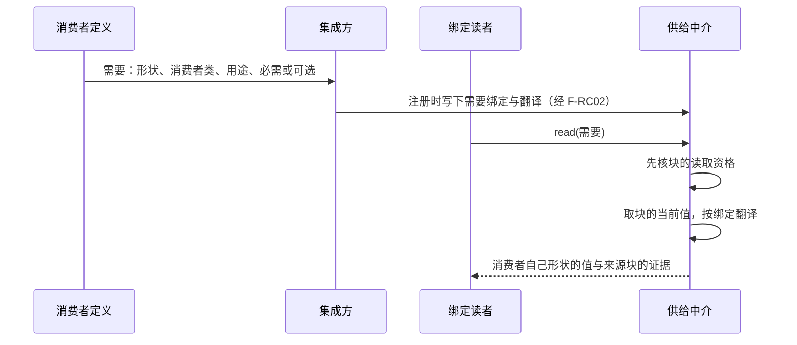
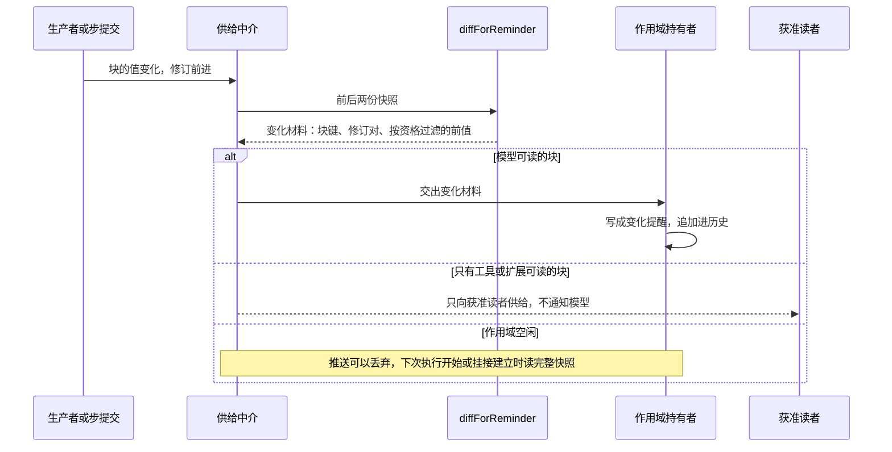
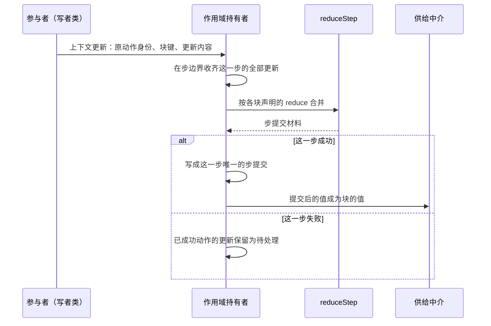
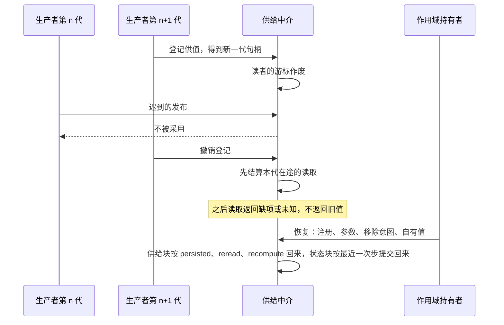

# Runtime Context 协议流程

本页给出本成员的八条协议级流程。每条流程有一张时序图和一张「失败与责任交接」表，并标出对应的 [SPEC](../SPEC.md) 条款。行为以 SPEC 为准，图只投影条款，不表示运行实现已经存在。

图中的「供给中介」是本契约的实现，机制归 [runtime-context](../../runtime-context/README.md)，机制级流程见它的 `docs/flows.md`。跨成员流程 F-CX01 至 F-CX03 归组的[协作入口](../../docs/key-flows.md)。对象的状态与转移见[对象模型](object-model.md#状态与转移)。

图中只出现通用角色：语义拥有者、生产者、作用域持有者、集成方、绑定读者、调用方与协调者。

## 流程

### F-RC01 块声明发布与生产者登记

条款：[RC-02](../SPEC.md#rc-02-块声明注册与参数)、[RC-07](../SPEC.md#rc-07-生产者句柄并发撤除与恢复)。

前提：块声明是静态的，随语义拥有者的包发布。块声明不安装块，也不授权读它。谁供值由生产者登记决定。

| 环节 | 结果 | 失败与责任交接 |
| --- | --- | --- |
| 发布块声明 | 一个块键一份声明，本成员不声明任何具体块键 | 两个包用不同值类型增补同一键时，类型检查报告冲突。修正归两个语义拥有者 |
| 生产者登记 | 生产者得到带代际的句柄，用它发布、使失效或撤销登记 | 登记寿命怎样落在 Cordis 归 [runtime-context-cordis-contract](../../runtime-context-cordis-contract/SPEC.md)。换代与撤销见 F-RC08 |
| 发布新值 | 新值成为当前值，修订前进 | 值不合 schema 时，它不作为合法当前值交给读者，读取按 RC-03 的「内容无法解释」处理 |
| 使当前值失效 | 读者被唤醒 | 读者读到什么以读取时的值为准，不按唤醒推断变化内容 |
| 必需块没有生产者 | 注册仍然成立 | 读取返回缺项，见 F-RC03 |

### F-RC02 注册变更与参数核对

条款：[RC-02](../SPEC.md#rc-02-块声明注册与参数)、[RC-06](../SPEC.md#rc-06-需要绑定与读者形状)。

前提：作用域持有者在注册时是集成方。增加、更新和移除走同一条路径。更新保持块的固定身份，只改绑定或参数，不是先移除再新增。

| 环节 | 结果 | 失败与责任交接 |
| --- | --- | --- |
| 核对注册材料 | `judgeRegistration` 核对块声明存在、参数合乎形状、必需项未被移除，每条绑定通过 `judgeBinding` | 核对失败是定义层的拒绝，带逐项原因。持有者修正材料后重新提交 |
| 核对注册修订 | 依据的注册修订仍是当前修订 | 修订已变时拒绝。调用方按当前注册重新提交，不用后写覆盖先写 |
| 提交注册决定 | 注册修订前进，读取资格可以引用新修订 | 提交未知时按原提交身份查询，不重建另一条注册。同身份同变更重试返回原结果 |
| 移除 | 只停止本作用域后续使用该注册 | 移除必需项被拒绝。共享来源与其他作用域不受影响 |

拒绝原因的完整清单在 RC-02 的注册变更对接表里，本页不复制。

### F-RC03 执行开始或挂接建立时的完整快照

条款：[RC-01](../SPEC.md#rc-01-消费者身份与范围)、[RC-03](../SPEC.md#rc-03-当前读取资格与缺项)、[RC-04](../SPEC.md#rc-04-读取时点观察与变化材料)。组的 F-CX01 从这里开始。

前提：一次执行开始，或为执行建立挂接时，调用方必须主动取完整快照。调用方不能以「没有收到变化通知」为理由省略这次读取。

| 环节 | 结果 | 失败与责任交接 |
| --- | --- | --- |
| 建立绑定读者 | 读者的消费者类在建立时固定 | 读取资格只来自持有者签发，不能凭调用方所在位置或装配树推断 |
| 重核资格 | 资格有效时继续 | 无权时拒绝，不返回未授权正文。资格未知时返回未知，不返回空集合 |
| 求快照 | 快照只含该读者可见的块，`per-request` 块不在快照里 | 来源不可用或结果未知时返回未知，阻止依赖它的新读取或动作 |
| 必需块无当前值 | 快照列出缺的是哪一块 | 不返回空值或旧值。缺项由依赖它的动作按各自契约处置 |
| 放进请求 | 快照锚定在请求里 | 已经固定的请求不随之后的新值改写 |

### F-RC04 增量变化读取与游标作废

条款：[RC-04](../SPEC.md#rc-04-读取时点观察与变化材料)、[RC-03](../SPEC.md#rc-03-当前读取资格与缺项)。组的 F-CX01 与 F-CX03 引用本流程。

前提：读者持有上一次读取得到的游标。是否需要完整快照由本成员按游标状态判断，不由调用方猜测。

| 环节 | 结果 | 失败与责任交接 |
| --- | --- | --- |
| 游标有效 | 返回自游标以来的变化，只含读者可见部分 | 撤权在下一次读取生效。旧读者读不到新内容 |
| 游标作废 | 返回游标作废这一种结果 | 读者重新取完整快照。调用方不需要自己追踪三种作废情形 |
| 合法压缩之后 | 作用域持有者在压缩提交后使模型类读者的游标作废；读者下一次读取得到游标作废，再取完整快照 | 历史提醒被摘要后，不能用摘要代替这次完整读取。私有块不因走全量路径而进入模型。本成员不认识压缩，作废由持有者发起 |
| 资格撤销 | 游标结束 | 撤权停止新内容供给，不取消独立执行，也不撤回已发生的效果 |

### F-RC05 带翻译的需要绑定读取

条款：[RC-06](../SPEC.md#rc-06-需要绑定与读者形状)、[RC-03](../SPEC.md#rc-03-当前读取资格与缺项)。

前提：消费者在自己的定义里以自己的形状声明需要，不点名块键。集成方在注册时为需要写下绑定，形状不同时附带翻译纯函数。绑定在注册时已由 `judgeBinding` 核对。

| 环节 | 结果 | 失败与责任交接 |
| --- | --- | --- |
| 核对绑定 | 块声明存在，需要的消费者类在块允许的类之内，必需的需要没有绑到可选移除的块，无翻译时两边形状相同 | 核对失败是定义层的拒绝，带原因。修正归集成方 |
| 核资格 | 先核资格，再翻译 | 无权时拒绝。资格未知时返回未知 |
| 翻译 | 读者拿到自己声明的形状与来源证据 | 翻译失败按读取失败报告 |
| 必需的需要缺项 | 返回缺项与缺的是什么 | 依赖它的动作不可用。系统不用空值、猜值或旧值代替 |

### F-RC06 值变化到变化材料到提醒

条款：[RC-04](../SPEC.md#rc-04-读取时点观察与变化材料)。组的 F-CX02 从这里开始。

前提：变化材料不是提醒消息本身。提醒的写入归作用域持有者，提醒的放置归 [request-context-contract](../../request-context-contract/SPEC.md)。

| 环节 | 结果 | 失败与责任交接 |
| --- | --- | --- |
| 算变化材料 | 材料说明哪一块从哪个修订变到哪个修订 | 块声明不允许带前值时不带前值。曾经可读、现在无权读的前值不披露 |
| `per-request` 块变化 | 不产生变化材料 | 这类块只进请求最末的尾部易变提醒 |
| 交给持有者 | 持有者写成提醒追加进历史 | 本成员不能用唤醒到达或订阅成功代替提醒已经持久成立 |
| 注册增加或移除 | 后续适用消费者感知变化 | 不改写已经发出的输入 |
| 空闲推送丢失 | 下一次执行开始或挂接建立时由 F-RC03 承接 | 普通输入、控制、结果和已承担交付责任的数据不得走这条可丢路径。重复唤醒不重复承接 |

### F-RC07 状态块更新与步提交

条款：[RC-05](../SPEC.md#rc-05-状态块上下文更新与步提交)。

前提：上下文更新是提案，不是事实。一条更新只能指向状态块，提出它的一方必须在块声明的写者类之内。提交归作用域持有者，本成员只给合并材料。

| 环节 | 结果 | 失败与责任交接 |
| --- | --- | --- |
| 提出更新 | 更新带原动作身份 | 指向供给块的更新、写者类不在声明之内的更新，都不成为事实 |
| 同一步多个写者 | 按 `reduce` 合并 | `singleWriterPerStep` 为真时，同一步第二个写者的更新被拒绝 |
| 合并 | `reduceStep` 给出合并结果，不触碰任何存储 | 写入提交归持有者。一步只有一份步提交 |
| 失败的步 | 已成功动作的更新保留为待处理 | 不进这一步的提交，也不被丢弃。怎样处置由持有者决定 |
| 提交之后 | 模型可读的状态块进入 F-RC06 | `persistence: 'untracked'` 的块随该次执行结束而失效，恢复时不读回 |

### F-RC08 生产者换代、撤除与恢复

条款：[RC-07](../SPEC.md#rc-07-生产者句柄并发撤除与恢复)、[RC-04](../SPEC.md#rc-04-读取时点观察与变化材料)。

前提：生产者句柄有代际。恢复需要保留本作用域的注册、参数、移除意图、自有不可重算值，以及足以解释旧执行的采用依据。

| 环节 | 结果 | 失败与责任交接 |
| --- | --- | --- |
| 生产者换代 | 新一代句柄生效，读者游标作废 | 旧一代迟到的发布不被采用，不能覆盖新一代的值 |
| 撤销登记 | 本代在途的读取先结算 | 撤除后合法重读返回缺项或未知，不返回旧值。已保管的不可重算事实不随实例或进程消失 |
| 供给块恢复 | `persisted` 读回原值，`reread` 向权威来源重取，`recompute` 从当前事实重算 | `reread` 按当前资格取得。共享来源不可用时保持缺项，不用历史允许或缓存掩盖 |
| 状态块恢复 | `checkpointed` 按最近一次步提交恢复 | `untracked` 不恢复 |
| 恢复核对 | 核对原身份与当前资格 | 主动移除的块不装回。必需信息不绕过。旧备份不复活已撤销的资格 |

## 失败与生命周期

下表汇总八条流程共用的失败、取消与生命周期规则。每条规则的正文在所列条款里，本页只做定位。

| 情形 | 结果 | 责任方 | 条款 |
| --- | --- | --- | --- |
| 读取的结果 | 成功、拒绝、缺项、未知、游标作废五种。缺项与未知是一等结果，不是失败的另一种写法 | 读者的调用方按结果处置 | [RC-03](../SPEC.md#rc-03-当前读取资格与缺项)、[对象模型](object-model.md#领域特有的结果与提交) |
| 提交未知 | 保留原操作身份，按原拥有者查询与对账 | 提交的拥有者：注册与步提交归持有者，块内容归生产者 | [RC-02](../SPEC.md#rc-02-块声明注册与参数) |
| 并发 | 注册修改、生产者更新、撤权、读取和请求固定可能并发。每次读取都能解释合法的采用范围 | 最终发起的协调者保护多块的一致性 | [RC-03](../SPEC.md#rc-03-当前读取资格与缺项)、[RC-07](../SPEC.md#rc-07-生产者句柄并发撤除与恢复) |
| 取消一次读取或结束绑定读者 | 结束等待与资源 | 不证明来源变更未提交，不取消原工具或模型执行，不删除历史。原责任方继续对账 | [RC-07](../SPEC.md#rc-07-生产者句柄并发撤除与恢复) |
| 释放资源或运行 disposer | 不撤回外部输出 | 外部输出的拥有者 | [RC-07](../SPEC.md#rc-07-生产者句柄并发撤除与恢复) |
| 作用域结束 | 等待解除。迟到结果不复活推进 | 真实结果和账目按原拥有者保留 | [RC-07](../SPEC.md#rc-07-生产者句柄并发撤除与恢复) |

各对象的创建、变化与结束见对象模型的[生命周期](object-model.md#生命周期)。
