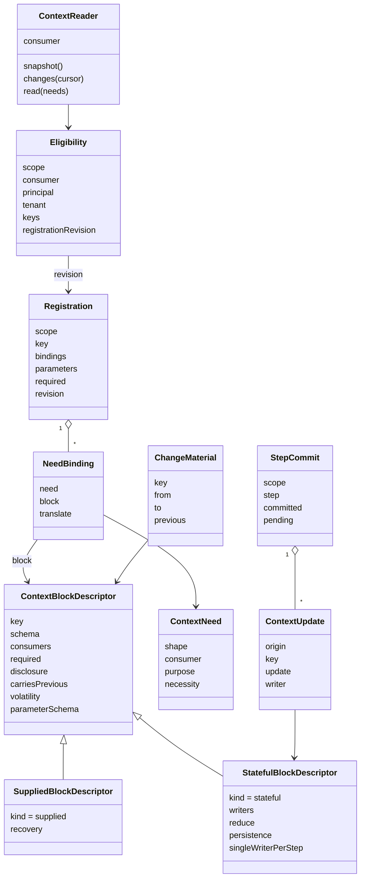
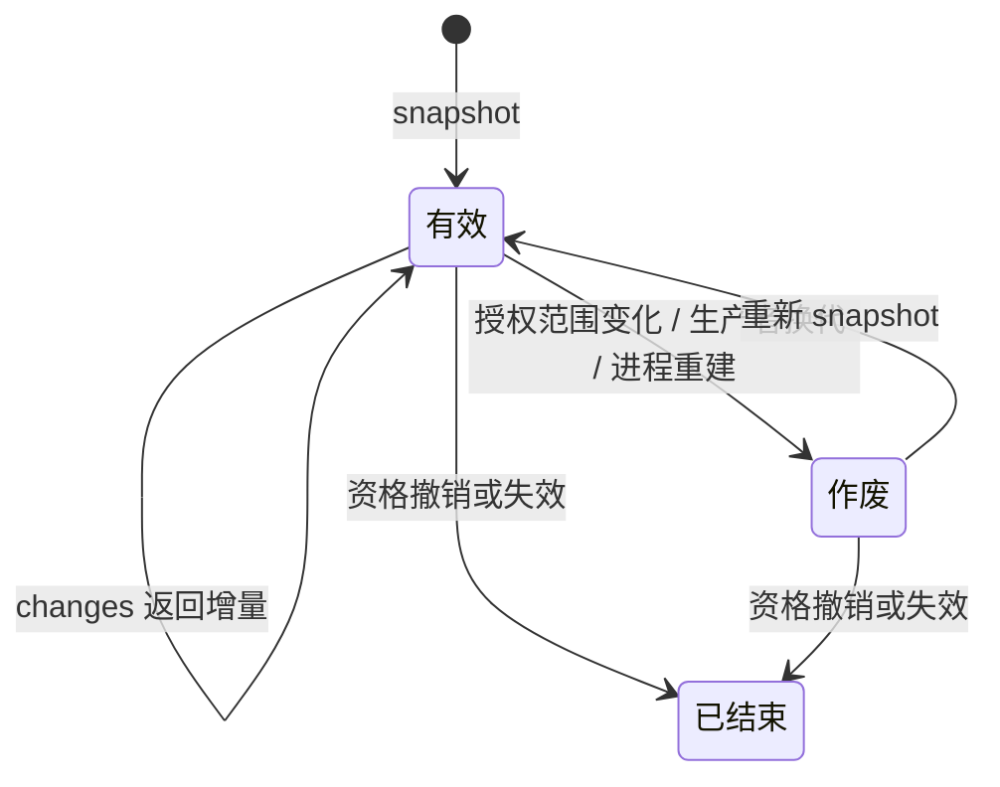

# Runtime Context 对象模型

块声明说一种块长什么样、归谁。注册说一个作用域里有哪些块。生产者句柄说谁在供值。读取资格与绑定读者说谁能读、读到什么形状。上下文更新与步提交说状态块怎样改。变化材料说变了什么。作用域持有者在本成员之外维护注册、签发资格、提交步，并把变化写成提醒。

本页拥有对象的身份、构造、状态、合法转换、所有者以及销毁或保留条件。精确签名归[公开接口页](public-api.md)，行为归 [SPEC](../SPEC.md)。`src/` 现在只有共享类型（`ScopeRef`、`ContextBlockKey`、`ConsumerClass`、`ContextBlocks`、两类块声明）。其余对象的类型随实现切片进入，形状以本页为准。图中的技术对象不自动新增产品领域对象。

## 调用方怎样使用

下例是职责伪代码。每个操作都要处理成功、拒绝、缺项和未知，不表示当前包已有运行导出。

```text
语义拥有者在自己的包里导出块声明，并增补 ContextBlocks
生产者插件登记供值，拿到生产者句柄；换代后旧句柄的发布不被采用
消费者在自己的定义里声明需要：形状、消费者类、用途、必需或可选

作用域持有者创建一个作用域
    为每条需要写一条需要绑定，形状不同就带翻译
    用 judgeRegistration 核对注册材料，再作为自己的一笔提交写入注册
    为每个消费者签发读取资格：作用域、消费者类、主体与租户、允许的块键、注册修订

集成方按读取资格建立绑定读者
    第一次 snapshot 取完整快照与游标
    之后 changes(游标) 取变化；游标作废则重新 snapshot
    read(需要) 每次重核资格，返回消费者自己的形状与来源证据

参与者在一步里对状态块提出上下文更新
    持有者在步边界用 reduceStep 合并成步提交材料，再自己提交
    失败步里成功动作的更新保留为待处理

值变化后，本成员用 diffForReminder 算出变化材料交给持有者
    持有者把它写成变化提醒追加进历史；完整快照只进请求
```

## 跨域概念与内部可见范围

本成员只认识通用角色。下表按[领域语义依赖与模型边界](../../../../docs/architecture/layers-and-dependencies.md#领域语义依赖与模型边界)的四种进入方式标每个外域概念。

| 外域概念 | 进入方式 | 本成员里的形态 | 不进入的部分 |
| --- | --- | --- | --- |
| 作用域（上层的会话、租户或一次执行） | 有类型的引用 | 不透明 `ScopeRef`，可带父引用 | 它是什么、它的状态机 |
| 主体与租户 | 复用公共值 | 读取资格里的主体与 `TenantId` | 身份域的解析与授权 |
| 块的值 | 消费公开契约 | 语义拥有者包的块声明与 `ContextBlocks` 增补 | 任何具体块键 |
| 消费者的需要 | 消费公开契约 | 消费者定义里的 `ContextNeed` | 消费者是谁 |
| 提交 | 放到外部协调者 | 注册与步提交由持有者提交，本成员只给材料 | 存储、事务、历史 |
| 提醒消息 | 放到外部协调者 | 变化材料交持有者；来源标记的取值归消息的拥有者 | 消息形状与历史位置 |
| 步 | 有类型的引用 | 步提交里的步引用 | 步怎样划分、谁驱动 |

本成员内部可见的只有：注册表（按作用域）、生产者表（按块键）、需要绑定、当前投影、观察链与游标。它们的机制归 [runtime-context](../../runtime-context/SPEC.md)。

## 对象与关系

| 对象 | 身份 | 拥有者 | 可变性 | 关联 |
| --- | --- | --- | --- | --- |
| `ScopeRef` 作用域引用 | 不透明引用加可选父引用 | 持有者 | 值 | 注册、读取资格、块的归属共用 |
| `ContextBlockKey` 块键 | `<语义拥有者域>.<名>` | 语义拥有者包 | 值 | 一键一份声明 |
| `ContextBlockDescriptor` 块声明 | 块键 | 语义拥有者包 | 静态，随包发布 | `supplied` 或 `stateful`；`volatility`、`recovery` 或 `persistence` 是它的属性 |
| `ContextNeed` 上下文需要 | 消费者定义内的一条 | 消费者定义 | 静态，随定义 | 形状是消费者自己的，不点名块键 |
| `NeedBinding` 需要绑定 | 需要加块键 | 集成方 | 随注册 | 可带翻译纯函数 |
| `Registration` 注册 | 作用域加块键 | 持有者 | 持有者的提交改它 | 带需要绑定、参数值、是否必需、注册修订 |
| `ProducerHandle` 生产者句柄 | 代际 | 本成员签发，生产者持有 | 随生产者寿命 | 发布、失效、撤销 |
| `Eligibility` 读取资格 | 一次绑定 | 持有者签发 | 持有者可撤销 | 作用域、消费者类、主体与租户、允许的键集合、注册修订 |
| `ContextReader` 绑定读者 | 一次 `bind` | 本成员 | 资格撤销或失效时结束 | 消费者类固定；持有游标 |
| `Snapshot` 与 `Changes` | 视图修订与游标 | 本成员 | 只读 | 只含该读者可见部分；游标可作废 |
| `ContextUpdate` 上下文更新 | 原动作身份加块键 | 提出它的参与者 | 到提交为止 | 只指向状态块；写者类受声明限制 |
| `StepCommit` 步提交 | 作用域加步引用 | 持有者 | 一步一份 | 合并结果是 `reduceStep` 的纯输出 |
| `ChangeMaterial` 变化材料 | 块键加修订对 | 本成员产生，交持有者 | 交付即完 | 前值按读者资格过滤 |



## 生命周期

| 对象 | 创建 | 变化 | 结束 |
| --- | --- | --- | --- |
| 块声明 | 语义拥有者包发布 | 包升版 | 包退出；同键不得并存两份 |
| 注册 | 持有者创建作用域时固定必需项 | 持有者提交增、改、删可选项；每次提交前进注册修订 | 随作用域结束；移除一项只停本作用域后续使用 |
| 生产者句柄 | 生产者登记供值 | 发布新值、使当前值失效 | 生产者撤销或换代；旧代迟到的发布不被采用；撤销前本代在途读取先结算 |
| 读取资格 | 持有者签发 | 持有者撤销 | 撤销后下一次读取拒绝 |
| 绑定读者 | 按资格 `bind` | 游标前进；授权范围变化、生产者换代、进程重建后游标作废 | 资格撤销或失效 |
| 上下文更新 | 参与者在一步内提出 | 无 | 并入步提交，或在失败步里保留为待处理 |
| 步提交 | 持有者在步边界合成 | 无 | 持有者提交后成为块的值；一步一份 |
| 变化材料 | 值变化后算出 | 无 | 交给持有者即完成 |

### 状态与转移

游标只有三个状态：有效、作废、已结束。



上下文更新只有三个状态：已提出、已提交、待处理。已提出的更新在本步提交时进入已提交；本步失败时，成功动作的更新进入待处理，由持有者处置。待处理不会自动回到已提出。

供给块的值没有状态机。它只有修订。每次发布前进修订，使失效不前进修订。

## 值、参数与依赖

| 值 | 定义者 | 给值者 | 本成员做什么 |
| --- | --- | --- | --- |
| 块的值 | 块声明的 `schema` | 生产者或步提交 | 按 schema 校验，不解释含义 |
| 作用域级参数 | 块声明的 `parameterSchema` | 持有者在注册时 | 按形状校验；声明里没有的参数拒绝 |
| 需要的形状 | 消费者定义 | 翻译或同形块 | 读取时翻译并校验 |
| 前值 | 块声明的 `carriesPrevious` | 变化材料 | 按读者资格过滤 |

本成员依赖 `@standard-schema/spec` 的 `StandardSchemaV1` 表达形状，依赖 legal-identity 的 `TenantId` 表达租户。它不依赖任何上层领域的契约，也不依赖 Cordis。

## 领域特有的结果与提交

注册是持有者的一笔提交。块内容是生产者的另一笔提交。步提交是持有者的第三种提交。三者都不在本成员内发生。本成员给的是材料与核对结果：`judgeRegistration` 给注册材料的核对，`reduceStep` 给步提交的合并结果，`diffForReminder` 给变化材料。

读取的结果有五种：成功、拒绝、缺项、未知、游标作废。缺项与未知是一等结果。它们不是失败的另一种写法。

## 集成方关联与独立消费

集成方知道被集成方，被集成方不知道集成方。持有者在注册时是集成方，装配时接线的一方和为一次调用求设置的协调者也是。集成方拥有需要绑定与翻译。消费者经本成员读到的始终是自己声明的形状。

独立调用者不建作用域持有者，也不装配 Cordis。它自己给出 `ScopeRef`、块声明、生产者与资格材料，直接用五个纯函数。访问系统托管数据时仍适用原访问契约。独立消费路径见 [context.md](context.md)。

## SOLID 与扩展边界

| 原则 | 对象层的选择 | 必须防止的反例 |
| --- | --- | --- |
| 单一职责 | 块声明只说形状与归属；需要只说消费者要什么；注册只说作用域有什么；资格只说能读什么 | 把「为什么要」写进块声明；把授权判定写进读取 |
| 开闭 | 新块等于新声明加 `ContextBlocks` 增补；新消费者等于新需要；本成员不改 | 本成员出现具体块键；消费者类写死为某个上层类型 |
| 里氏替换 | 所有生产者实现同一个句柄协议；翻译是纯函数，可替换 | 某个生产者绕过修订直接改值 |
| 接口隔离 | 消费者只拿绑定读者，不拿整张注册表；持有者面与读者面分开 | 一个万能 Context 对象交给所有人 |
| 依赖倒置 | 上层领域依赖本契约，本契约不依赖它们 | 本成员导入某个上层领域的类型 |

模块层的选择见 [architecture.md](architecture.md)。

## 产品能力覆盖与验收

| 产品能力 | 本成员承接 | 不在本成员 |
| --- | --- | --- |
| [CAP-RC01](../../../../.meta_harness/design/product/runtime-context/design.md#能力定义与实现状态记录表) 分块供给与资格 | 块声明、注册、资格、绑定读者 | 块的内容 |
| CAP-RC02 注册、自有值与状态块提交 | 注册材料核对、`reduceStep` | 提交本身 |
| CAP-RC03 当前值与变化感知 | 快照、变化、变化材料 | 提醒的写入与放置 |
| CAP-RC08 故障恢复 | 恢复方式的声明与核对规则 | 存储与持久化 |

验收以 SPEC 的[持续验证义务](../SPEC.md#持续验证义务)为准。本页不写实现已完成。
