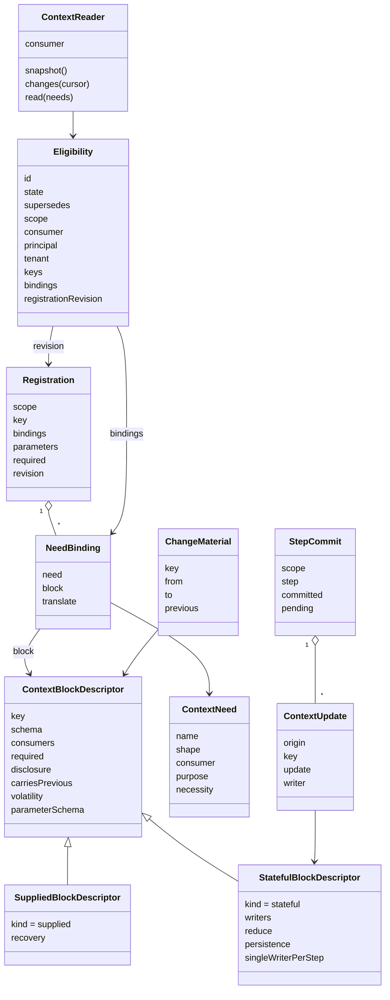
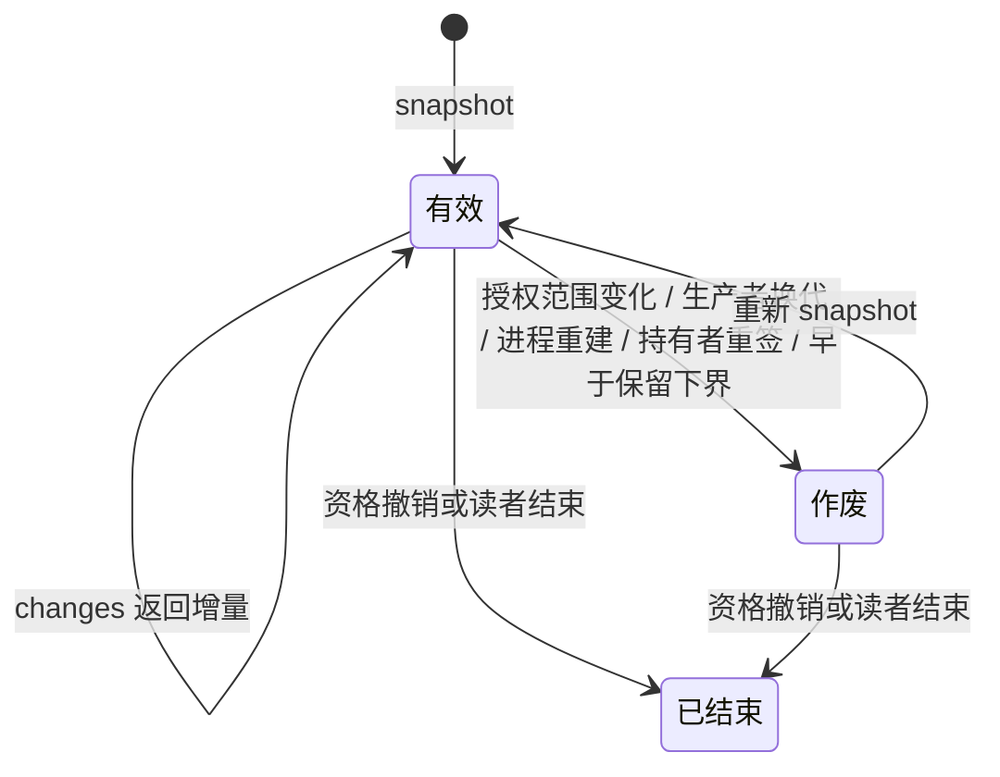
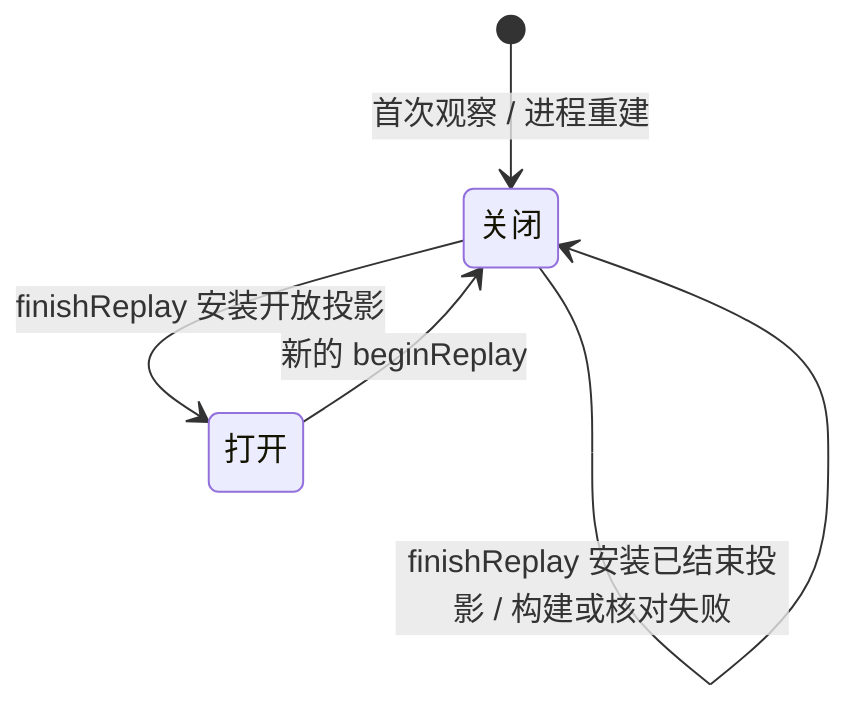

# Runtime Context 对象模型

块声明说一种块长什么样、归谁。注册说一个作用域里有哪些块。生产者句柄说谁在供值。读取资格与绑定读者说谁能读、读到什么形状。上下文更新与步提交说状态块怎样改。变化材料说变了什么。作用域持有者在本成员之外维护注册、签发资格、提交步与作用域结束，并把变化写成提醒。权威端口与可信绑定来源由集成方提供，回答谁能做什么、作用域属于哪个租户。恢复会话说本实例重建之后怎样把作用域投影原子地装回来。

本页拥有对象的身份、构造、状态、合法转换、所有者以及销毁或保留条件。精确签名归[公开接口页](public-api.md)，行为归 [SPEC](../SPEC.md)。类型与纯函数已在 `src/`，精确签名以源码为准。图中的技术对象不自动新增产品领域对象。

## 调用方怎样使用

下例是职责伪代码。每个操作都要处理成功、拒绝、缺项和未知，不表示持有者与生产机制已经实现。

```text
语义拥有者在自己的包里导出块声明，并增补 ContextBlocks
生产者插件带租户、生产者身份与供给块的块声明登记供值，拿到带租户与代际的生产者句柄；每次发布带作用域引用、租户与值；作用域无关的块登记时给出按作用域供值的回调，由本成员在注册、后登记、使失效三种时点对各作用域调用；换代后旧句柄的发布不被采用
消费者在自己的定义里声明需要：name、形状、消费者类、用途、必需或可选

集成方提供可信绑定来源与权威端口；每个带目标的入口先问权威端口，再问绑定来源

作用域持有者铸造作用域引用（租户、持有者侧标识、作用域代次），并在可信绑定来源里绑定它的租户
    beginReplay 再 finishReplay：空作用域用空的恢复材料完成，围栏打开之后才接受普通业务推进
    为每条需要写一条需要绑定，形状不同就带翻译
    用 judgeRegistration 核对注册材料，再作为自己的一笔提交写入注册；注册材料带作用域所属租户
    提交之后用 applyCommit 把结果交给本成员，带提交身份与依据的注册修订；返回顺序不符时按耐久顺序重放
    为每个消费者签发读取资格：资格身份、作用域、消费者类、主体与租户、允许的块键、允许的需要绑定、注册修订
    要作废游标或收窄范围时，带取代的资格身份重签
    结束作用域时提交只结束作用域，再 applyCommit；已结束永远不回到开放
    本实例重建或提交顺序不符时，用新的恢复会话按耐久事实装回投影，再重新签发资格

集成方按资格身份建立绑定读者
    第一次 snapshot 取完整快照与游标
    之后 changes(游标) 取变化；游标作废则重新 snapshot
    read(需要) 每次重核资格，返回消费者自己的形状与来源证据

参与者在一步里对状态块提出上下文更新
    持有者在步边界用 reduceStep 逐条判接受或拒绝，把接受的合并成步提交材料，再自己提交
    被拒的更新由持有者按逐项原因退回提出者
    失败步里成功动作的更新保留为待处理

值变化后，持有者用游标拉取 changes，再用 diffForReminder 算出变化材料
    持有者把它写成变化提醒追加进历史；完整快照只进请求
```

## 跨域概念与内部可见范围

本成员只认识通用角色。下表按[领域语义依赖与模型边界](../../../../docs/architecture/layers-and-dependencies.md#领域语义依赖与模型边界)的四种进入方式标每个外域概念。

| 外域概念 | 进入方式 | 本成员里的形态 | 不进入的部分 |
| --- | --- | --- | --- |
| 作用域（上层的会话、租户或一次执行） | 有类型的引用 | 不透明 `ScopeRef`，可带父引用；持有者用租户、持有者侧标识与代次铸造文本，本成员不解析 | 它是什么、它的状态机 |
| 作用域的租户归属 | 放到外部协调者 | 集成方提供的可信绑定来源 `ScopeBindingSource` 的答复 | 绑定怎样写入与保存 |
| 授权 | 放到外部协调者 | 集成方提供的权威端口 `RuntimeContextAuthority<P>` 按封闭动作答授权判定，带同步的 `current()` | 授权依据、撤权与原工作失效的来源 |
| 主体与租户 | 复用公共值 | 读取资格里的主体与 `TenantId` | 身份域的解析与授权 |
| 块的值 | 消费公开契约 | 语义拥有者包的块声明与 `ContextBlocks` 增补 | 任何具体块键 |
| 消费者的需要 | 消费公开契约 | 消费者定义里的 `ContextNeed` | 消费者是谁 |
| 提交 | 放到外部协调者 | 注册与步提交由持有者提交，本成员只给材料 | 存储、事务、历史 |
| 提醒消息 | 放到外部协调者 | 变化材料交持有者；来源标记的取值归消息的拥有者 | 消息形状与历史位置 |
| 步 | 有类型的引用 | 步提交里的步引用 | 步怎样划分、谁驱动 |

本成员内部可见的只有：注册表（按作用域，另记作用域所属租户、寿命状态与恢复围栏）、生产者表（按租户加块键登记，发布的值按作用域加块键）、恢复会话与待刷新标记、资格表（按资格身份）、需要绑定、当前投影（按作用域加块键）、观察链与游标。它们的机制归 [runtime-context](../../runtime-context/SPEC.md)。

## 对象与关系

| 对象 | 身份 | 拥有者 | 可变性 | 关联 |
| --- | --- | --- | --- | --- |
| `ScopeRef` 作用域引用 | 不透明引用加可选父引用 | 持有者 | 值 | 注册、读取资格、块的归属共用 |
| `ContextBlockKey` 块键 | `<语义拥有者域>.<名>` | 语义拥有者包 | 值 | 一键一份声明 |
| `ContextBlockDescriptor` 块声明 | 块键 | 语义拥有者包 | 静态，随包发布 | `supplied` 或 `stateful`；`volatility`、`recovery` 或 `persistence` 是它的属性 |
| `ContextNeed` 上下文需要 | 消费者定义内的一条 | 消费者定义 | 静态，随定义 | 形状是消费者自己的，不点名块键 |
| `NeedBinding` 需要绑定 | 需要加块键 | 集成方 | 随注册 | 可带翻译纯函数 |
| `Registration` 注册 | 作用域加块键 | 持有者 | 持有者的提交改它 | 带需要绑定、参数值、是否必需、注册修订 |
| 生产者槽 | 租户加块键 | 本成员 | 同一身份再登记换代；另一身份被拒绝 | 另一租户的同一块键是另一个槽，声明摘要须与目录相同 |
| `ProducerHandle` 生产者句柄 | 生产者槽加生产者身份加代际。代际由本成员每次登记新取 | 本成员签发，生产者持有 | 随生产者寿命 | 带只读的租户；发布（带作用域引用、租户与值）、失效（指定作用域或本租户全部作用域）、撤销；作用域无关的块在登记时带按作用域供值的回调，本成员在持有者注册、生产者后登记、使当前值失效三种时点调用它 |
| `Eligibility` 读取资格 | 资格身份 | 持有者签发，本成员保管 | 三个状态：有效、被取代（记取代者身份）、已撤销 | 作用域、消费者类、主体与租户、允许的块键集合、允许的需要绑定集合、注册修订；重签时带取代的资格身份。租户须等于作用域所属租户 |
| `ContextReader` 绑定读者 | 一次 `bind` | 本成员 | 资格被撤销时结束；资格被重签取代时沿新资格继续，游标作废 | 按资格身份建立；消费者类固定；持有游标 |
| `Snapshot` 与 `Changes` | 视图修订与游标 | 本成员 | 只读 | 只含该读者可见部分；游标可作废；每次读取另带该读者可读的逐请求块的当前值，这一部分不进快照、不进观察链、不产生变化提醒 |
| `ContextUpdate` 上下文更新 | 原动作身份加块键 | 提出它的参与者 | 到提交为止 | 只指向状态块；写者类受声明限制 |
| `StepCommit` 步提交 | 作用域加步引用；交给本成员时带提交身份 | 持有者 | 一步一份 | 合并结果是 `reduceStep` 的纯输出，只含它接受的更新；本成员按提交身份幂等应用 |
| 作用域寿命 | 作用域引用 | 持有者的提交；本成员保管投影 | 开放或已结束，已结束不回到开放 | 只结束作用域可以在任何围栏状态下应用 |
| 恢复披露围栏 | 作用域加本实例 | 本成员 | 关闭或打开；首次观察与进程重建时关闭 | 关闭时不签发资格、不建立读者、不披露投影 |
| `ReplayRef` 恢复引用 | 作用域、租户与恢复代次 | 本成员生成，持有者持有 | 被取代或进程关闭即失效 | 不是凭据，不能跨实例使用 |
| 恢复材料 | 一次 `finishReplay` 的输入 | 持有者从自己的耐久事实构造 | 交付即完 | 注册链、每个 `checkpointed` 块最近一次步提交的全值、结束 |
| 待刷新标记 | 作用域、块键、生产者代际与恢复代次 | 本成员 | 成功发布或有效刷新时清除 | 只说明供给值尚未恢复，不是取值许可，不启动后台工作 |
| `ChangeMaterial` 变化材料 | 块键加修订对 | 持有者拉取 `changes` 后用纯函数 `diffForReminder` 算出 | 交付即完 | 前值按该读者资格过滤 |



## 生命周期

| 对象 | 创建 | 变化 | 结束 |
| --- | --- | --- | --- |
| 块声明 | 语义拥有者包发布 | 包升版 | 包退出；同键不得并存两份 |
| 注册 | 持有者创建作用域时固定必需项 | 持有者提交增、改、删可选项；每次提交前进注册修订。修订的权威是持有者的耐久提交，本成员按提交顺序应用 | 随作用域结束；移除一项只停本作用域后续使用 |
| 生产者句柄 | 生产者带租户、身份与块声明登记供值 | 发布新值、使当前值失效 | 生产者撤销或同一槽同一身份换代；旧代迟到的发布不被采用；撤销只移除本代登记；撤销前本代在途读取先结算 |
| 读取资格 | 持有者 `issueEligibility` 签发，返回资格身份 | 内容不变；改范围靠重签 | 被重签取代（`issueEligibility` 带它的资格身份），或被 `revokeEligibility` 撤销。撤销后该资格的读取按拒绝（无权）。开始恢复会话也使该作用域的旧资格失效。本成员关闭时释放，重建后由持有者重新签发 |
| 绑定读者 | 按资格身份 `bind` | 游标前进；授权范围变化、生产者换代、进程重建、持有者重签资格、游标早于保留下界之后游标作废；资格被重签取代时沿新资格继续 | 资格被撤销，或读者结束、实例关闭 |
| 作用域寿命 | 首次观察时开放 | 只结束作用域，或带结束标记的注册决定与步提交 | 已结束永远不回到开放；之后签发、绑定、读取与发布答 `scope-ended` |
| 恢复会话 | `beginReplay` 生成恢复引用，围栏关闭 | 显式取代生成新引用 | `finishReplay` 成功安装后就绪；进程关闭即失效 |
| 上下文更新 | 参与者在一步内提出 | 无 | 并入步提交；被 `reduceStep` 拒绝后由持有者退回提出者；或在失败步里保留为待处理 |
| 步提交 | 持有者在步边界合成，只含 `reduceStep` 接受的更新 | 无 | 持有者提交后经 `applyCommit` 成为块的值；含被拒更新时 `applyCommit` 整笔拒绝（无效），投影不变；一步一份 |
| 变化材料 | 值变化后算出 | 无 | 交给持有者即完成 |

### 状态与转移

游标只有三个状态：有效、作废、已结束。



恢复披露围栏只有两个状态：关闭、打开。



读取资格只有三个状态：有效、被取代、已撤销。重签使旧资格从有效转为被取代，并记下取代者身份；按它建立的读者改按取代者读取，游标作废。撤销使资格转为已撤销，下一次读取被拒绝（无权）。被取代与已撤销都不回到有效。

上下文更新只有四个状态：已提出、已拒绝、已提交、待处理。`reduceStep` 拒绝的更新进入已拒绝，原因是无权或不合形状，由持有者退回提出者，不进步提交。被接受的更新在本步提交时进入已提交；本步失败时，成功动作的更新进入待处理，由持有者处置。待处理不会自动回到已提出。

供给块的值没有状态机。它只有修订与供给序号；恢复之后另带待刷新标记。每次发布前进修订。使失效把当前值变为缺项，也前进修订。作用域无关的块在使失效时由本成员重调回调，回调取得的新值按发布再前进修订。

## 值、参数与依赖

| 值 | 定义者 | 给值者 | 本成员做什么 |
| --- | --- | --- | --- |
| 块的值 | 块声明的 `schema` | 生产者或步提交 | 按 schema 校验，不解释含义 |
| 作用域级参数 | 块声明的 `parameterSchema` | 持有者在注册时 | 按形状校验；声明里没有的参数拒绝 |
| 需要的形状 | 消费者定义 | 翻译或同形块 | 读取时翻译并校验 |
| 前值 | 块声明的 `carriesPrevious` | 持有者保留的上一份按资格过滤的快照 | 本成员不保存旧值；持有者重启或游标作废后的第一份变化材料不带前值 |

本成员依赖 `@standard-schema/spec` 的 `StandardSchemaV1` 表达形状，依赖 legal-identity 的 `TenantId` 表达租户。可信绑定来源与权威端口是集成方作为值交给实现的端口。它不依赖任何上层领域的契约，也不依赖 Cordis。

## 领域特有的结果与提交

注册是持有者的一笔提交。块内容是生产者的另一笔提交。步提交是持有者的第三种提交。三者都不在本成员内发生。本成员给的是材料与核对结果：`judgeRegistration` 给注册材料的核对，`reduceStep` 给每条更新的接受或拒绝与步提交的合并结果，`diffForReminder` 给变化材料。

读取结果按 SPEC [读取结果](../SPEC.md#读取结果)的封闭表分成功、拒绝、缺项、未知四种。可选需要无值时，成功结果里该项标「无值」。完整快照与变化另带逐请求块的当前值，读取时向生产者取得，取不到值时按同一张表落位（[RC-04](../SPEC.md#rc-04-读取时点观察与变化材料)）。`changes` 另有游标作废（RC-04），读者据此重取完整快照。缺项与未知是一等结果。它们不是失败的另一种写法。

## 集成方关联与独立消费

集成方知道被集成方，被集成方不知道集成方。持有者在注册时是集成方，装配时接线的一方和为一次调用求设置的协调者也是。集成方拥有需要绑定与翻译。消费者经本成员读到的始终是自己声明的形状。

独立调用者不建作用域持有者，也不装配 Cordis。它自己给出 `ScopeRef`、块声明、生产者与资格材料，直接用五个纯函数；用到三面操作时还给出两个权威端口的适配器。访问系统托管数据时仍适用原访问契约。独立消费路径见 [context.md](context.md)。

## SOLID 与扩展边界

| 原则 | 对象层的选择 | 必须防止的反例 |
| --- | --- | --- |
| 单一职责 | 块声明只说形状与归属；需要只说消费者要什么；注册只说作用域有什么；资格只说能读什么 | 把「为什么要」写进块声明；把授权判定写进读取 |
| 开闭 | 新块等于新声明加 `ContextBlocks` 增补；新消费者等于新需要；本成员不改 | 本成员出现具体块键；消费者类写死为某个上层类型 |
| 里氏替换 | 所有生产者实现同一个句柄协议；翻译是纯函数，可替换 | 某个生产者绕过修订直接改值 |
| 接口隔离 | 消费者只拿绑定读者，不拿整张注册表；持有者面与读者面分开；权威端口按三面分动作 | 一个万能 Context 对象交给所有人 |
| 依赖倒置 | 上层领域依赖本契约，本契约不依赖它们 | 本成员导入某个上层领域的类型 |

模块层的选择见 [architecture.md](architecture.md)。

## 产品能力覆盖与验收

| 产品能力 | 本成员承接 | 不在本成员 |
| --- | --- | --- |
| [CAP-RC01](../../../../.meta_harness/design/product/runtime-context/design.md#cap-rc01) 按消费者供给合法块 | 块声明、注册、资格、绑定读者 | 块的内容 |
| [CAP-RC02](../../../../.meta_harness/design/product/runtime-context/design.md#cap-rc02) 注册、自有值与状态块提交 | 注册材料核对、`reduceStep` | 提交本身 |
| [CAP-RC04](../../../../.meta_harness/design/product/runtime-context/design.md#cap-rc04) 当前读取与变化链 | 快照、变化、逐请求块的读取、变化材料 | 提醒的写入与放置 |
| [CAP-RC10](../../../../.meta_harness/design/product/runtime-context/design.md#cap-rc10) 恢复、取消与可追查依据 | 恢复方式的声明与核对规则 | 存储与持久化 |

验收以 SPEC 的[持续验证义务](../SPEC.md#持续验证义务)为准。本页不写实现已完成。

## 读取材料的承载

快照和变化成功时带 `missing`，逐请求块在 `perRequest` 逐项落位。`read` 缺任一必需需要时整份返回缺项。变化材料只带键、前后修订与前值；当前值从本次快照或变化按键取得。前值仅在声明允许且当前资格仍可读时携带。精确类型见 [reader.ts](../src/reader.ts)。
