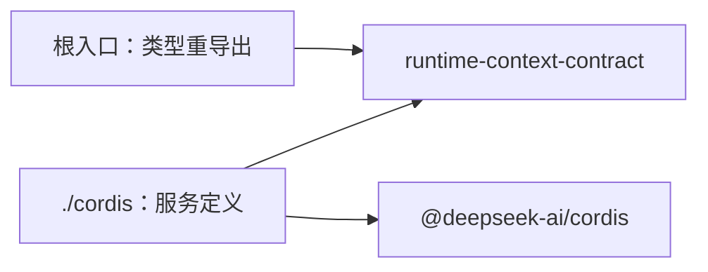

# Runtime Context Cordis 定义的内部架构

本页说明本成员怎样组织两个入口与依赖，来兑现 [SPEC](../SPEC.md)。服务键、抽象类、intercept 配置、事件与登记协议的正文归 [Cordis 说明](cordis.md)。组内八个成员的分解与依赖方向归[组架构](../../docs/architecture.md)。本页不另立公共规则。

本成员提供抽象 Service 定义，不持有领域状态或资源。值、修订、游标与资格核对归 [runtime-context](../../runtime-context/docs/architecture.md)。Service 实现与撤除归 [runtime-context-cordis](../../runtime-context-cordis/docs/cordis.md)。

## 模块与依赖

本成员有两个入口，各一个源文件。根入口只有类型重导出；Cordis 入口提供抽象类、键及增补。

| 入口 | 源文件 | 承载 | 现状 |
| --- | --- | --- | --- |
| `@omne-harness/runtime-context-cordis-contract` | `src/index.ts` | 只重导出契约词汇所需的类型，没有运行值，不导入 Cordis（[IC-4](../../../../docs/architecture/cordis-integration-conventions.md#ic-4)） | 已实现 |
| `@omne-harness/runtime-context-cordis-contract/cordis` | `src/cordis.ts` | 抽象类 `RuntimeContextService`、键常量、intercept 配置类型、`Context` 与 `Events` 增补 | 已实现 |

包外依赖只有两项：

- `@omne-harness/runtime-context-contract`：三面操作类型、`ConsumerClass`、`ScopeRef` 与块键类型。只做类型导入。它已在 `package.json` 登记。
- `@deepseek-ai/cordis`：`Service`、`Context` 与事件增补。它已在 `package.json` 里，只由 `./cordis` 使用。

本成员不导入 `@omne-harness/runtime-context` 或 `@omne-harness/runtime-context-cordis`（[性质 8](../SPEC.md#结果与不变量)）。依赖方向是提供者依赖本成员，反方向不成立。本成员也不导入任何上层领域的契约。

## 关键机制与理由

### 服务定义单独成为一个成员

服务定义与纯契约的变化原因不同。块声明、需要与读取结果随领域语义变。服务键、登记的效应、消费者类的读取方式随装配约定变。分成两个成员后，语义拥有者包与独立调用方导入块声明时不加载 Cordis（[IC-4](../../../../docs/architecture/cordis-integration-conventions.md#ic-4)）。服务定义也不和提供者放在一起，所以消费者插件只依赖定义，不依赖被选择的实现（[IC-5](../../../../docs/architecture/cordis-integration-conventions.md#ic-5)）。

代价：组内多一个包，契约的操作类型改变时要同步本成员的抽象类。

### 一个服务三面，不按块建服务

本成员只定义一个服务键 `runtimeContext`，三面操作都在这一个抽象类上。块是数据，不是服务。理由如下：

1. 每块一个服务，键的数量随块数增长，也不合 [IC-7](../../../../docs/architecture/cordis-integration-conventions.md#ic-7) 的能力名词键名。
2. 作用域登记了哪些块是 Runtime Context 的数据。Cordis 服务表只知道进程里有哪些服务，两张表会并存。
3. 消费者按块直接取服务会绕过资格核对。
4. 块缺席要给读取时的缺项。`inject` 一个块会让消费者在块缺席时停在 `PENDING`（[RC-03](../../runtime-context-contract/SPEC.md#rc-03-当前读取资格与缺项)、[inject-has-no-optional-form](../../../../.meta_harness/design/basis/cordis/inject-has-no-optional-form.md)）。

代价：「生产者在不在场」不能由 Cordis 服务表直接回答，要由提供者的生产者表回答。

### 消费者类由装配声明

消费者类写在消费者插件的 intercept 配置里，由装配决定，调用方在运行时不能改。服务方法沿调用方 fiber 读出它，再与读取资格核对。这样读者以哪一类来读是装配事实，能读什么仍由持有者签发的资格决定（[IC-18](../../../../docs/architecture/cordis-integration-conventions.md#ic-18)）。如果消费者类是 `bind` 的普通参数，调用方可以自称任何一类，核对就失去依据。

这条核对是一致性检查，不计为访问控制。访问边界是读取资格：资格由持有者签发，由机制的资格表保管，每次读取按资格的状态、租户与集合核对（[RC-03](../../runtime-context-contract/SPEC.md#rc-03-当前读取资格与缺项)）。intercept 配置与资格不一致，说明装配与签发对不上，所以拒绝；一致也不授予任何超出资格的读取。

代价：这条机制已有本成员的真实 Cordis 测试，但共同 basis 登记仍缺，见 Cordis 说明的[机制读数与假设](cordis.md#机制读数与假设)。

### 事件只做唤醒

事件只带作用域引用与视图修订，不带块键，不带值。值、修订与游标都在提供者的状态里，读者经绑定读者按资格读取。理由有两条：

1. 唤醒可以丢失：空闲时丢失的唤醒由下一次完整快照承接（[RC-04](../../runtime-context-contract/SPEC.md#rc-04-读取时点观察与变化材料)）。如果事件带值，丢失一次就会让监听者持有错误的当前值。
2. 「不得全局监听」只是约定，Cordis 不阻止它。如果载荷带块键，全局监听者就能观察别的作用域有哪些块、多久变一次。载荷不含受存在性披露约束的信息，约定被违反时也不泄露内容。

代价：监听者不能按块键挑选唤醒，被唤醒后要经读取才知道变了什么。

## SOLID 与扩展边界

| 原则 | 本成员的具体选择 | 必须防止的反例 |
| --- | --- | --- |
| 单一职责 | 根入口只因契约类型改而改，`./cordis` 只因装配约定改而改 | 在本成员里写值、修订、游标或资格核对的逻辑 |
| 开闭 | 新块只在语义拥有者的包里增补，本成员不改。新提供者 `extends` 抽象类，本成员不改 | 为某个块或某个上层领域加一个服务键或特例方法 |
| 里氏替换 | 任何提供者都 `extends` 同一个抽象类，实现同一组三面操作类型，遵守同一个登记协议 | 某个提供者用 `ctx.provide` 另写键，或把登记放在服务自己的 fiber 上 |
| 接口隔离 | 三面在契约里是分开的操作类型。生产者、持有者与读者的适配器只调用自己那一面 | 给读者面的调用方暴露注册写入或生产者登记 |
| 依赖倒置 | 本成员只依赖契约类型与 Cordis。提供者依赖本成员，消费者依赖本成员，二者互不依赖 | `./cordis` 导入机制实现或提供者实现 |

## 验证与维护

| 保证 | 现在的验证 | 后续义务 |
| --- | --- | --- |
| 根入口没有运行值 | [public-entry.spec.ts](../tests/public-entry.spec.ts) 断言根入口没有运行值 | 持续核对重导出符号身份与运行入口为空 |
| `./cordis` 只有定义 | [cordis-entry.spec.ts](../tests/cordis-entry.spec.ts) 核对服务类、键与模块增补的实际导出 | 持续核对导出集合与键常量 |
| 不导入实现成员（性质 8） | 没有 | 核对源码、生成声明与产物的导入 |
| 三条机制读数 | 真实 Cordis 4.0.4 测试通过 | 三个 basis probe 与提供者的测试，见 [Cordis 说明](cordis.md#机制读数与假设) |

维护规则：

1. 契约的三面操作类型改变时，同步抽象类与本页。
2. 改服务键、intercept 配置或事件时，同步 [Cordis 说明](cordis.md)、[公开接口页](public-api.md) 与提供者 [runtime-context-cordis](../../runtime-context-cordis/README.md)。
3. Cordis 升版时，先重跑 Cordis 说明列出的 basis probe。
