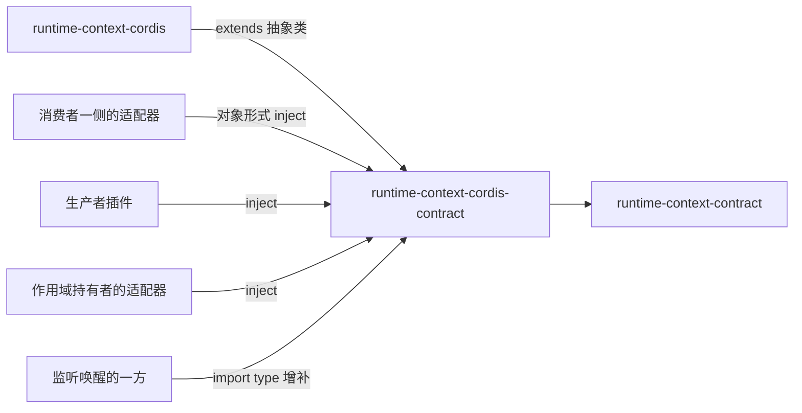

# Runtime Context Cordis 定义的使用与定位

本页说明谁依赖本成员、怎样依赖，以及本成员在能力组中的位置。系统关系与 Cordis 落位归[系统页 Runtime Context](../../../../docs/architecture/runtime/runtime-context.md)，组内分解归[组入口](../../README.md)。本页不另立架构。

## 使用方式

本成员现在没有导出。下面的写法是 SPEC 与 [Cordis 说明](cordis.md)固定的目标用法，随 `./cordis` 的实现生效。

### 消费者一侧的适配器插件

读者面的调用方用对象形式 `inject` 声明消费者类，再按持有者签发的读取资格 `bind`：

```ts
import type {} from '@omne-harness/runtime-context-cordis-contract/cordis'

export const inject = {
  runtimeContext: { consumer: 'tool' },
}
```

```text
插件体：reader = ctx.runtimeContext.bind(持有者签发的读取资格 …)
        第一次读取取完整快照，之后按游标取变化
```

`bind` 的精确参数与读取结果归契约，上面的伪代码只表示调用位置。读者面的调用方不能用 `ctx.get` 现取服务，因为那样没有 intercept 配置，`bind` 会被拒绝。

### 生产者插件

生产者用数组形式 `inject`，在插件体里登记。登记随插件的 fiber 撤除，不需要手动注销：

```text
inject: ['runtimeContext']
插件体：handle = ctx.runtimeContext.registerProducer(块键, 生产者)
        用 handle 发布、使失效；插件卸载时登记自动撤除
```

### 作用域持有者的适配器

持有者的适配器用数组形式 `inject`，调用 `prepareRegistration`、`issueEligibility`、`applyCommit`。注册与步提交的耐久保存仍归持有者自己。

### 只监听唤醒的一方

不 `inject`。用 `import type {}` 取得事件类型，在标了作用域引用的扩展 ctx 上 `ctx.on('runtime-context-cordis-contract/changed', …)`。监听者同步执行，不返回 Promise。

### 独立使用

不装配 Cordis 的调用方不需要本成员。只用类型与纯函数时依赖 [runtime-context-contract](../../runtime-context-contract/docs/context.md)。要不含 Cordis 的供给机制时依赖 [runtime-context](../../runtime-context/docs/context.md) 的工厂。

### 初始化与释放

本成员不持有资源，没有初始化或释放步骤。生产者登记的释放由 Cordis 的效应完成，见 [Cordis 说明](cordis.md#登记与撤除协议)。

## 消费者与定位

本成员处在纯契约与提供者之间。下图投影[组架构](../../docs/architecture.md#安装与源码依赖)里与本成员相关的边，两者不一致时以组架构为准。



| 依赖方 | 怎样依赖 | 用什么 |
| --- | --- | --- |
| [runtime-context-cordis](../../runtime-context-cordis/README.md) | `extends RuntimeContextService` | 抽象类、键、事件增补 |
| 消费者一侧的适配器 | 对象形式 `inject`，按 [IC-9](../../../../docs/architecture/cordis-integration-conventions.md#ic-9) 取类型 | `bind` |
| 生产者插件 | 数组形式 `inject` | `registerProducer` |
| 作用域持有者的适配器 | 数组形式 `inject` | `prepareRegistration`、`issueEligibility`、`applyCommit` |
| 监听唤醒的一方 | `import type {}` 与 `ctx.on` | 事件 |

依赖方不导入提供者的实现入口（[IC-5](../../../../docs/architecture/cordis-integration-conventions.md#ic-5)）。

### 现在的真实消费者

现在没有包依赖本成员。提供者 runtime-context-cordis 也还没有在 `package.json` 里依赖它。第一批消费者随提供者与持有者、生产者、读者的适配器一起进入。

### 上层页面

- 系统关系与 Cordis 落位：[系统页 Runtime Context](../../../../docs/architecture/runtime/runtime-context.md#成员与-cordis-落位)。
- 组内成员与阅读路径：[组入口](../../README.md)、[组协作入口](../../docs/key-flows.md)。
- 共同集成规则：[IC 约定](../../../../docs/architecture/cordis-integration-conventions.md)。
