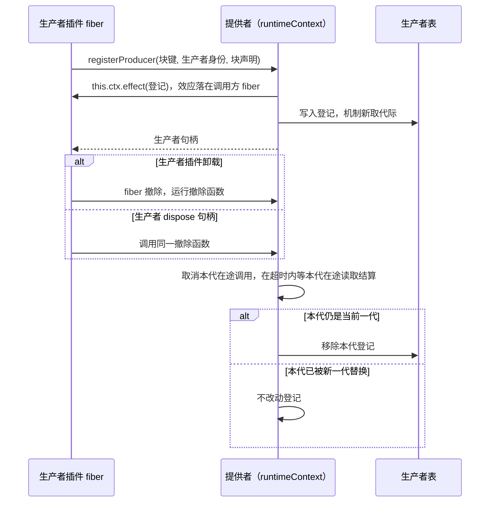
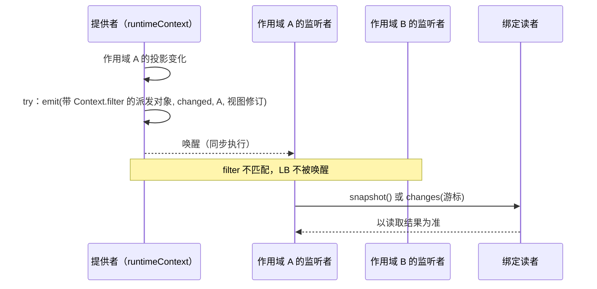

# Runtime Context Cordis 定义的机制流程

本页给出本成员定义的两条机制级流程。每条有一张时序图和一张「失败与责任交接」表。行为以 [SPEC](../SPEC.md) 和 [Cordis 说明](cordis.md)为准，图只投影它们，不表示运行实现已经存在。

协议级流程归 [runtime-context-contract 的协议流程](../../runtime-context-contract/docs/flows.md)：F-RC01 写生产者登记的协议，F-RC08 写换代与撤除的协议。提供者的装载、卸载与在途结算归 [runtime-context-cordis 的流程](../../runtime-context-cordis/docs/flows.md)。图中的「提供者」是继承本成员抽象类的 Service 实现。

## 流程

### F-RCD01 生产者登记与撤除

依据：[性质 4](../SPEC.md#结果与不变量)、[IC-13](../../../../docs/architecture/cordis-integration-conventions.md#ic-13)、[RC-07](../../runtime-context-contract/SPEC.md#rc-07-生产者句柄并发撤除与恢复)。

前提：生产者插件 `inject` 了 `runtimeContext`，在自己的插件体里调用 `registerProducer`。

| 环节 | 结果 | 失败与责任交接 |
| --- | --- | --- |
| 登记 | 登记的寿命等于生产者插件 fiber 的寿命 | 调用方 fiber 已在卸载时，`effect` 抛 `INACTIVE_EFFECT`，登记不成立。为没有块声明的块键登记被拒绝（[RC-07](../../runtime-context-contract/SPEC.md#rc-07-生产者句柄并发撤除与恢复)） |
| 取代际 | 代际由机制在每次登记时新取，单调递增 | 不取 fiber `uid`。同一块键另一生产者身份的登记被拒绝 |
| 在根 Context 上登记 | 效应属于根 fiber，不随任何生产者撤除 | 只允许测试或装配入口这样用 |
| 撤除 | 先取消本代在途调用并在超时内结算本代在途读取，再只移除本代登记 | 结算与移除写在同一个 effect 里。不同 effect 之间的释放并发，不能靠两个 effect 的注册顺序排次序 |
| 撤除之后 | 依赖该块的读取读到缺项，不读到旧值 | 读取结果的语义归 [RC-03](../../runtime-context-contract/SPEC.md#rc-03-当前读取资格与缺项)、[RC-07](../../runtime-context-contract/SPEC.md#rc-07-生产者句柄并发撤除与恢复) |
| 提供者换代或插件体重跑 | 生产者插件体重跑，以同一身份重新登记，得到新代际 | 旧代迟到的发布被丢弃。旧撤除函数晚于新登记运行时只移除旧一代，不删新一代。交错由提供者测试覆盖。机制归 [runtime-context](../../runtime-context/docs/flows.md) |

### F-RCD02 唤醒按作用域过滤

依据：[性质 5](../SPEC.md#结果与不变量)、[IC-12](../../../../docs/architecture/cordis-integration-conventions.md#ic-12)、[IC-17](../../../../docs/architecture/cordis-integration-conventions.md#ic-17)、[RC-04](../../runtime-context-contract/SPEC.md#rc-04-读取时点观察与变化材料)。

前提：监听者在一个以属性键 `scope` 标了作用域引用的扩展 ctx 上 `on` 本事件，见 [Cordis 说明的事件](cordis.md#事件)。

| 环节 | 结果 | 失败与责任交接 |
| --- | --- | --- |
| 派发 | 派发方按作用域过滤，只到达作用域 A 的监听者 | 用全局方式注册的监听者不经过过滤。不得全局监听是约定，执行点是载荷：载荷只有作用域引用与视图修订，不含块键或值 |
| 监听者执行 | 同步执行，不返回 Promise | 监听者抛出时，派发方只记录诊断，不改变已提交的结果。要做异步工作的监听者自己处理失败 |
| 唤醒丢失 | 没有影响 | 下一次执行开始或挂接建立时，调用方取完整快照承接 |
| 唤醒之后 | 监听者经绑定读者读取，按读取取得变化 | 不按唤醒推断变化内容。读取的资格与结果归契约 |
| 不建运行对象 | 每次派发不建 fiber，不建 isolate | 作用域只是派发对象与扩展 ctx 上的标记，不是 Context 或 isolate |

## 失败与生命周期

| 情形 | 结果 | 责任方 | 依据 |
| --- | --- | --- | --- |
| 生产者插件卸载 | 它的登记被撤除 | 提供者验证 | [IC-13](../../../../docs/architecture/cordis-integration-conventions.md#ic-13) |
| 提供者不在场 | `inject` 了本服务的插件停在 `PENDING`。只监听事件的一方收不到唤醒 | 装配者 | [inject-has-no-optional-form](../../../../.meta_harness/design/basis/cordis/inject-has-no-optional-form.md) |
| 提供者换代 | `inject` 了本服务的插件体重跑，重新登记或重新 `bind` | 各依赖方的插件体可重复执行 | [plugin-body-reruns-on-provider-change](../../../../.meta_harness/design/basis/cordis/plugin-body-reruns-on-provider-change.md) |
| 读者面拿不到 intercept 配置 | `bind` 被拒绝，不默认为任何一类 | 提供者 | [runtime-context-cordis SPEC](../../runtime-context-cordis/SPEC.md#结果与不变量) |
| 服务撤除 | 在途读取的结算、关闭后的拒绝与迟到发布的丢弃 | 提供者 | [runtime-context-cordis SPEC](../../runtime-context-cordis/SPEC.md#所有权失败与生命周期) |
| 运行 disposer | 不撤回外部输出，不撤回已交给持有者的变化材料 | 外部输出的拥有者 | [RC-07](../../runtime-context-contract/SPEC.md#rc-07-生产者句柄并发撤除与恢复) |
