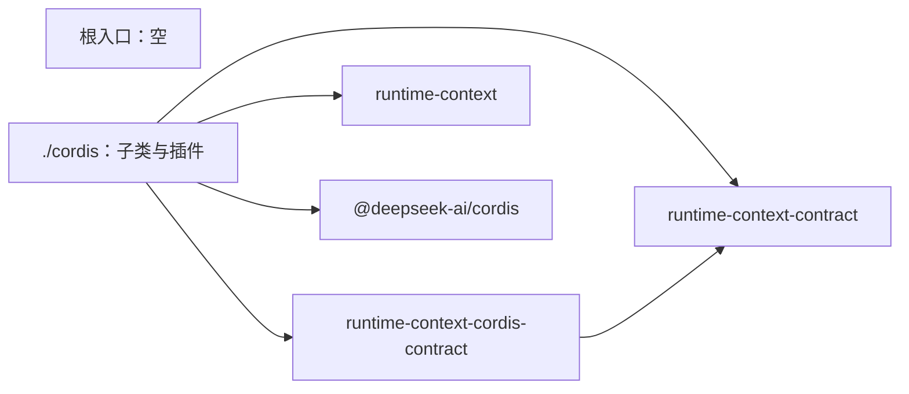

# runtime-context-cordis 的内部架构

本页说明本成员怎样组织两个入口与依赖，来兑现 [SPEC](../SPEC.md)。插件、配置、isolate、撤除与唤醒的正文归 [Cordis 说明](cordis.md)。机制归 [runtime-context](../../runtime-context/docs/architecture.md)。组内八个成员的分解与依赖方向归[组架构](../../docs/architecture.md)。本页不另立公共规则。

本成员没有运行实现。`src/index.ts` 与 `src/cordis.ts` 只有模板标记。下文是 SPEC 固定的结构，文件名由实现确定。

## 模块与依赖

| 入口 | 源文件 | 承载 | 现状 |
| --- | --- | --- | --- |
| `@omne-harness/runtime-context-cordis` | `src/index.ts` | 不导出任何东西（[IC-4](../../../../docs/architecture/cordis-integration-conventions.md#ic-4) 的空根入口）。独立路径从 runtime-context 取机制工厂 | 模板标记 |
| `@omne-harness/runtime-context-cordis/cordis` | `src/cordis.ts` | `RuntimeContextService` 的具体子类、插件与配置 Schema | 模板标记 |

`./cordis` 内部按 Cordis 责任分成四块：

| 模块 | 职责 | 依据 |
| --- | --- | --- |
| 配置 | 静态 `Config` 的 Standard Schema，观察链保留上限、来源调用与回调的超时、诊断级别 | [Cordis 说明的配置](cordis.md#配置) |
| 服务子类 | 持有机制实例，三面操作转给它；`bind` 取 intercept 配置做一致性核对；`registerProducer` 登记效应，撤除只移除本代 | 性质 2、3 |
| 唤醒派发 | 机制经变化出口回调本模块，带 filter 派发载荷为作用域引用与视图修订的事件，捕获监听者失败 | 性质 4 |
| 撤除 | 一个 effect 内完成拒绝新请求、结束读者、取消在途调用、限时等在途读取、关闭机制实例 | 性质 6 |

包外依赖：

- `@omne-harness/runtime-context-contract`：类型，只由 `./cordis` 使用。
- `@omne-harness/runtime-context-cordis-contract`：抽象类、键与事件增补，只由 `./cordis` 使用。
- `@omne-harness/runtime-context`：机制工厂，只由 `./cordis` 使用。
- `@deepseek-ai/cordis`：只由 `./cordis` 使用。

现在 `package.json` 只列出 `@deepseek-ai/cordis`，其余三项随实现进入。本成员不导入任何上层领域的契约（性质 7）。没有包应依赖本成员的 `./cordis` 来调用三面操作。消费者依赖服务定义，提供者选择归应用装配（[IC-5](../../../../docs/architecture/cordis-integration-conventions.md#ic-5)）。

根入口不导出任何东西，Cordis 绑定只在 `./cordis` 加上。同一份机制工厂只有一个公开名字，就是 runtime-context 的根入口；不装配 Cordis 的独立调用方从那里取工厂，那时没有 intercept 配置，`bind` 的消费者类取自读取资格（[SPEC 范围与依据](../SPEC.md#范围与依据)）。

## 关键机制与理由

### 撤除放在一个 effect 里

撤除有严格次序：先拒绝新请求，再结束读者、等在途读取，最后关闭机制实例。Cordis 卸载 fiber 时，不同 effect 的撤除函数并发运行（[effect-disposal-concurrent-not-ordered](../../../../.meta_harness/design/basis/cordis/effect-disposal-concurrent-not-ordered.md)）。所以四步必须写在一个 effect 里按顺序 `await`，不能各注册一个 effect。

代价：撤除函数里的一步抛出时，Cordis 只记日志，不上抛。撤除函数要自己捕获每一步，并保证后续步骤仍然执行。

### 消费者类每次调用时读取

`bind` 每次都从调用方 fiber 读 intercept 配置，不在插件装载时缓存。理由：服务实例是共享的，调用方各不相同，消费者类属于调用方而不属于服务。取不到配置就拒绝，不给默认值，因为默认值会让未声明身份的调用方以某一类读到数据。

### 唤醒经变化出口，走过滤后的 emit，不建运行对象

机制不认识 Cordis，所以它经工厂收到的变化出口 `onChange(scope, revision)` 告诉本插件视图修订前进了。本插件在回调里派发事件。载荷只有作用域引用与视图修订，不带块键或值。每次唤醒只派发一个事件，用 `Context.filter` 选出该作用域的监听者。不为作用域建 fiber 或 isolate。理由：作用域是数据，它的数量随使用增长。为每个作用域建 fiber 或 isolate，会让作用域的增删伴随 Cordis 的装卸，并且 isolate 也不隔离数据（[isolate-hides-instances-not-data](../../../../.meta_harness/design/basis/cordis/isolate-hides-instances-not-data.md)、[IC-17](../../../../docs/architecture/cordis-integration-conventions.md#ic-17)）。

### 端口缺席等于缺项

本阶段没有耐久存储端口。缺席时 `persisted` 供给块在生产者重新发布前读到缺项，服务照常加载。理由：缺项是契约的一等结果（[RC-03](../../runtime-context-contract/SPEC.md#rc-03-当前读取资格与缺项)），读者已经要处理它。让服务因端口缺席而加载失败，会使所有块都不可读，代价远大于少数块暂时缺项。

## SOLID 与扩展边界

| 原则 | 本成员的具体选择 | 必须防止的反例 |
| --- | --- | --- |
| 单一职责 | 本成员只承担 Cordis 责任：装载、配置、isolate、消费者类的一致性核对、登记效应、唤醒与撤除。机制规则都在 runtime-context | 在子类里取代际、重写代际比较、观察链或资格核对 |
| 开闭 | 存储端口进入时作为可选依赖加入，缺席含义不变。新配置项加到 Schema，不改机制 | 为某个块或某个上层领域加特例分支或第二个服务键 |
| 里氏替换 | 子类遵守抽象类的全部承诺：键只来自抽象类，登记落在调用方 fiber，事件只做唤醒 | 把登记挂在服务自己的 fiber 上，或在事件里携带值 |
| 接口隔离 | 消费者、生产者与持有者只看到服务定义，不导入本成员 | 让依赖方导入 `./cordis` 的子类来调用三面操作 |
| 依赖倒置 | 本成员依赖契约、服务定义与机制工厂。租户、作用域与资格随参数进入 | 从 `ctx`、isolate 标签或插件实例推断租户或资格 |

## 验证与维护

| 保证 | 现在的验证 | 后续义务 |
| --- | --- | --- |
| 根入口为空 | [public-entry.spec.ts](../tests/public-entry.spec.ts) 断言根入口没有导出 | 实现进入后仍断言根入口没有导出 |
| `./cordis` 只有本成员的插件 | [cordis-entry.spec.ts](../tests/cordis-entry.spec.ts) 断言草稿入口没有导出 | 实现进入后，核对导出集合 |
| SPEC 的六项验证义务 | 没有 | 见 [Cordis 说明的验证义务](cordis.md#验证义务) |

维护规则：

1. 服务定义改变时，同步子类、[Cordis 说明](cordis.md)与测试。
2. 机制工厂的签名、配置或变化出口改变时，同步配置 Schema、唤醒派发与[公开接口页](public-api.md)。
3. 存储端口进入时，同步 SPEC 性质 5、[Cordis 说明](cordis.md#持久化端口的缺席)与本页。
4. Cordis 升版时，先重跑服务定义成员列出的 basis probe。
