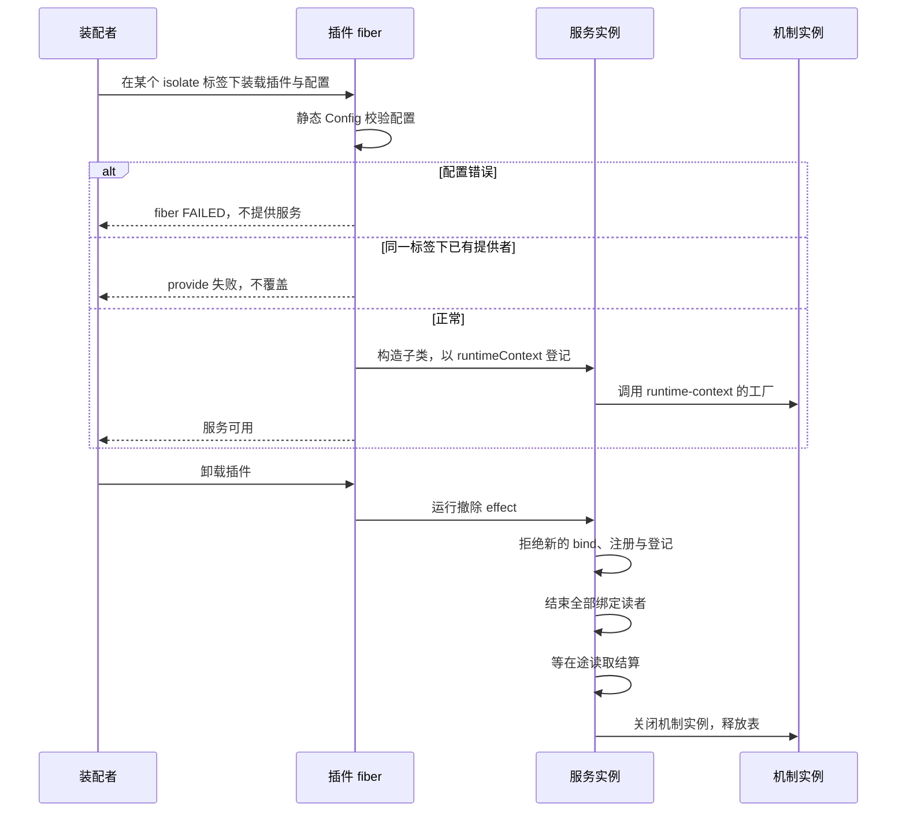
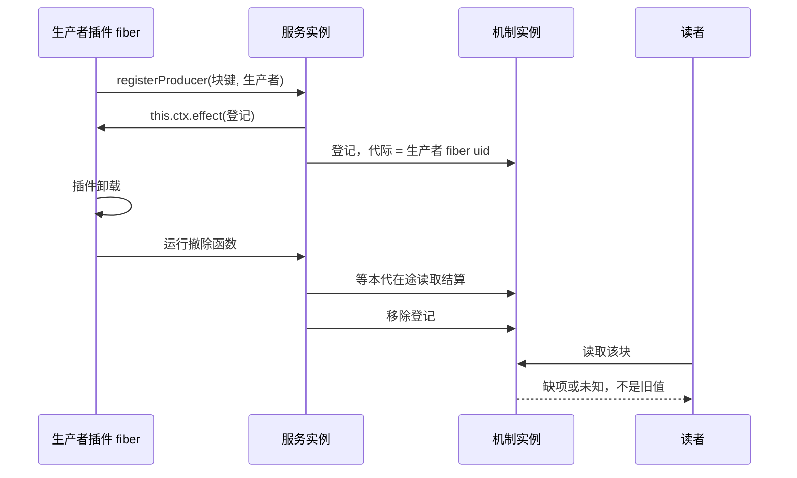
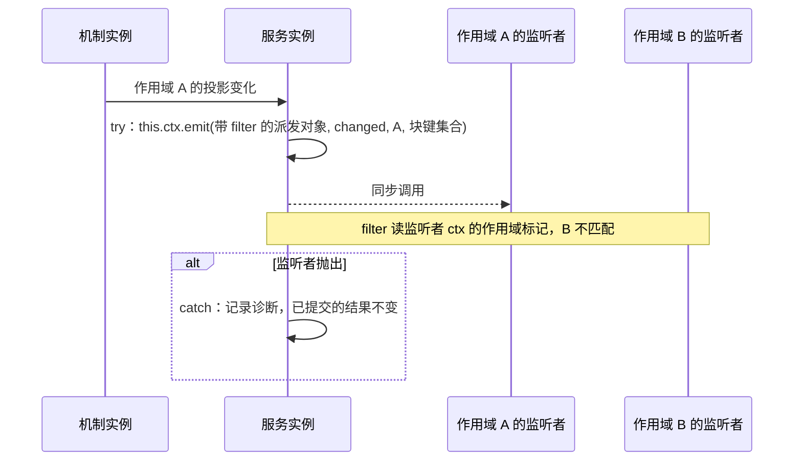

# runtime-context-cordis 的机制流程

本页给出本成员的三条机制级流程。每条有一张时序图和一张「失败与责任交接」表。行为以 [SPEC](../SPEC.md) 和 [Cordis 说明](cordis.md)为准，图只投影它们，不表示运行实现已经存在。

登记协议与唤醒事件的定义归 [runtime-context-cordis-contract 的流程](../../runtime-context-cordis-contract/docs/flows.md)。机制内部的发布、读取与关闭归 [runtime-context 的流程](../../runtime-context/docs/flows.md)。图中的「插件」是本成员的具体子类所在的插件 fiber。

## 流程

### F-RCP01 装载与卸载

依据：[性质 1、5、6](../SPEC.md#结果与不变量)、[IC-6](../../../../docs/architecture/cordis-integration-conventions.md#ic-6)、[IC-14](../../../../docs/architecture/cordis-integration-conventions.md#ic-14)。

| 环节 | 结果 | 失败与责任交接 |
| --- | --- | --- |
| 配置校验 | 配置合法才继续 | 配置错误时 fiber `FAILED`，装配者修正配置 |
| 登记服务 | 一个标签下一份 | 重复装载失败。要两份实现时由装配者分到不同标签 |
| 没有存储端口 | 服务照常加载 | `persisted` 供给块在生产者重新发布前读到缺项 |
| 卸载 | 四步写在一个 effect 里 | 某一步抛出时 Cordis 只记日志，撤除函数要自己捕获并继续后续步骤 |
| 卸载时在途读取 | 结算前不被打断，结算后返回撤除前的值 | 撤除开始后到达的读取返回拒绝 |
| 卸载时在途发布 | 丢弃，记录诊断 | 生产者在新的提供者上重新登记并发布 |

### F-RCP02 生产者插件卸载后登记撤除

依据：[性质 3](../SPEC.md#结果与不变量)、[IC-13](../../../../docs/architecture/cordis-integration-conventions.md#ic-13)、[RC-07](../../runtime-context-contract/SPEC.md#rc-07-生产者句柄并发撤除与恢复)。

| 环节 | 结果 | 失败与责任交接 |
| --- | --- | --- |
| 登记 | 效应落在生产者插件的 fiber 上 | 生产者 fiber 已在卸载时，`effect` 抛 `INACTIVE_EFFECT`，登记不成立 |
| 撤除 | 等本代在途读取，再移除登记 | 两步在同一个撤除函数里 |
| 撤除之后读取 | 缺项或未知 | 依赖该块的动作按自己的契约处置 |
| 本插件已先关闭 | 生产者的撤除函数在机制实例关闭后运行 | 撤除函数要安全返回，不抛出 |

### F-RCP03 唤醒到达作用域监听者

依据：[性质 4](../SPEC.md#结果与不变量)、[IC-12](../../../../docs/architecture/cordis-integration-conventions.md#ic-12)、[IC-17](../../../../docs/architecture/cordis-integration-conventions.md#ic-17)。

| 环节 | 结果 | 失败与责任交接 |
| --- | --- | --- |
| 投影变化通知本插件 | 机制实例告诉服务实例哪个作用域的哪些块变了 | 通知方式还没有定义，见 [Cordis 说明](cordis.md#按作用域过滤的唤醒) |
| 过滤 | 只到达作用域 A 的监听者 | 监听者的作用域标记键还没有定义 |
| 监听者抛出 | 只记录诊断 | 排在抛出者后面的监听者这一轮不被调用，下一次读取承接 |
| 不建运行对象 | 不建 fiber，不建 isolate | 无 |

## 失败与生命周期

| 情形 | 结果 | 责任方 | 依据 |
| --- | --- | --- | --- |
| 配置错误 | fiber `FAILED` | 装配者 | [IC-14](../../../../docs/architecture/cordis-integration-conventions.md#ic-14) |
| 重复装载 | 第二份失败 | 装配者 | [IC-6](../../../../docs/architecture/cordis-integration-conventions.md#ic-6) |
| `bind` 取不到 intercept 配置 | 拒绝 | 消费者插件改用对象形式 `inject` | 性质 2 |
| 插件卸载 | 按四步撤除 | 本插件 | 性质 6 |
| 本插件卸载后 | `inject` 了服务的插件卸载或重跑 | 各依赖方 | [plugin-body-reruns-on-provider-change](../../../../.meta_harness/design/basis/cordis/plugin-body-reruns-on-provider-change.md) |
| 进程失败 | 没有可恢复的东西 | 重建沿 runtime-context 的顺序 | [runtime-context SPEC](../../runtime-context/SPEC.md#所有权失败与生命周期) |
| 运行 disposer | 不撤回已交出的变化材料或外部效果 | 外部效果的拥有者 | 性质 6 |
