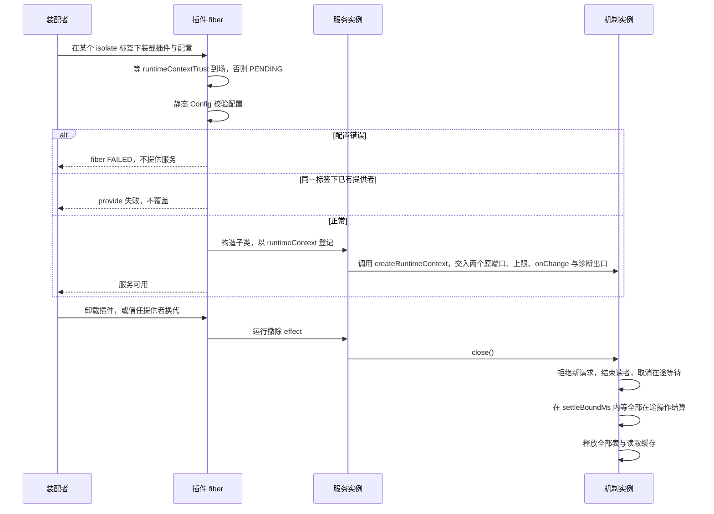
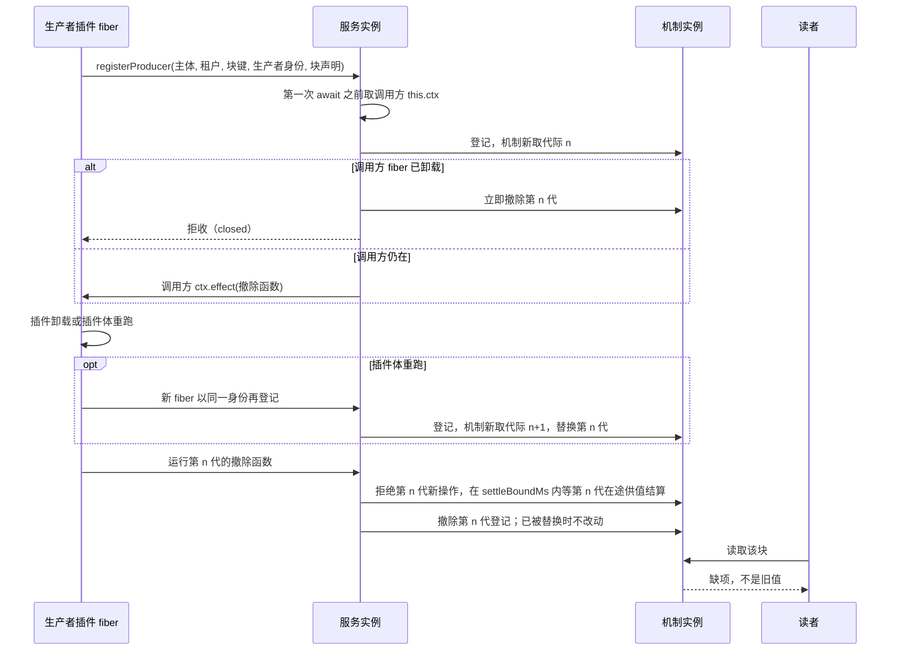
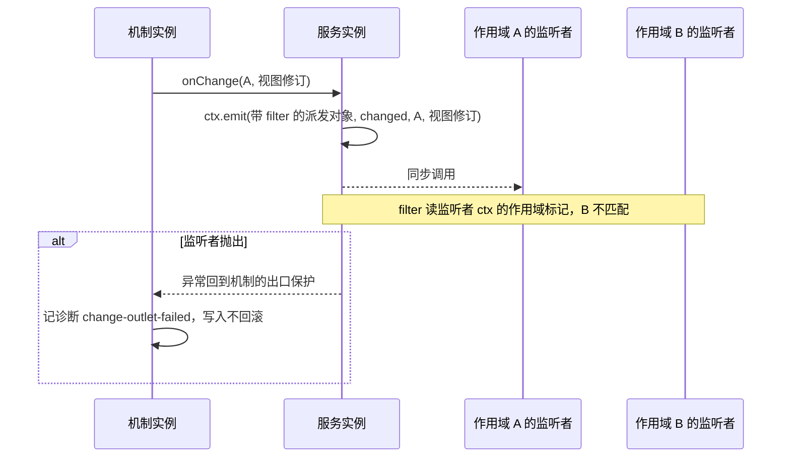

# runtime-context-cordis 的机制流程

本页给出本成员的三条机制级流程。每条有一张时序图和一张「失败与责任交接」表。行为以 [SPEC](../SPEC.md) 和 [Cordis 说明](cordis.md)为准，图只投影它们。

登记协议与唤醒事件的定义归 [runtime-context-cordis-contract 的流程](../../runtime-context-cordis-contract/docs/flows.md)。机制内部的发布、读取与关闭归 [runtime-context 的流程](../../runtime-context/docs/flows.md)。图中的「插件」是本成员的具体子类所在的插件 fiber。

## 流程

### F-RCP01 装载与卸载

依据：[性质 1、5、6、8](../SPEC.md#结果与不变量)、[IC-6](../../../../docs/architecture/cordis-integration-conventions.md#ic-6)、[IC-14](../../../../docs/architecture/cordis-integration-conventions.md#ic-14)。

| 环节 | 结果 | 失败与责任交接 |
| --- | --- | --- |
| 配置校验 | 配置合法才继续 | 配置错误时 fiber `FAILED`，装配者修正配置 |
| 登记服务 | 一个标签下一份 | 重复装载失败。要两份实现时由装配者分到不同标签 |
| 信任键缺席 | 插件停在 PENDING，不建立机制 | 装配者在受信子树提供 `runtimeContextTrust` |
| 没有存储端口 | 服务照常加载 | `persisted` 供给块在生产者重新发布前读到缺项 |
| 卸载 | 一个 effect 调用机制的 `close()`，五步在机制的一个函数里 | 重复关闭返回同一次关闭 |
| 卸载时在途操作 | 在途等待被取消，操作在上界内结算为关闭、未知或缺项，不答成功 | 撤除开始后到达的调用答关闭 |
| 卸载时在途发布 | 拒收（`closed`） | 生产者在新的提供者上重新登记并发布 |
| 新的机制实例 | 全部作用域围栏关闭，等同于进程重建 | 持有者用恢复会话恢复每个作用域并重新签发资格 |

### F-RCP02 生产者插件卸载后登记撤除

依据：[性质 3](../SPEC.md#结果与不变量)、[IC-13](../../../../docs/architecture/cordis-integration-conventions.md#ic-13)、[RC-07](../../runtime-context-contract/SPEC.md#rc-07-生产者句柄并发撤除与恢复)。

| 环节 | 结果 | 失败与责任交接 |
| --- | --- | --- |
| 登记 | 效应落在生产者插件的 fiber 上 | 生产者 fiber 已在卸载时，`effect` 抛 `INACTIVE_EFFECT`。本插件立即撤除这次登记并答拒收（`closed`），不抛出，槽空出 |
| 撤除 | 拒绝本代新操作，在上界内等本代在途供值，再只撤除本代登记 | 几步在机制句柄的同一个 `dispose` 里。显式撤除与 fiber 卸载共用一次 |
| 插件体重跑的交错 | 新一代先登记、旧一代后撤除时，新一代的登记仍在 | 本成员的测试覆盖这种交错 |
| 卸载之后读取 | 缺项 | 依赖该块的动作按自己的契约处置 |
| 本插件已先关闭 | 生产者的撤除函数在机制实例关闭后运行 | 句柄的 `dispose` 立即返回，不抛出 |

### F-RCP03 唤醒到达作用域监听者

依据：[性质 4](../SPEC.md#结果与不变量)、[IC-12](../../../../docs/architecture/cordis-integration-conventions.md#ic-12)、[IC-17](../../../../docs/architecture/cordis-integration-conventions.md#ic-17)。

| 环节 | 结果 | 失败与责任交接 |
| --- | --- | --- |
| 变化出口回调本插件 | 视图修订前进后，机制同步调用 `onChange(scope, revision)` | 派发抛错时机制只记诊断，不回滚写入。使当前值失效也前进修订，同样经这条路 |
| 过滤 | 派发方按监听者 ctx 上属性键 `scope` 的标记过滤，只到达作用域 A 的监听者 | 全局监听者不经过过滤。载荷只有作用域引用与视图修订，不带块键 |
| 监听者抛出 | 只记录诊断 | 排在抛出者后面的监听者这一轮不被调用，下一次读取承接 |
| 不建运行对象 | 不建 fiber，不建 isolate | 无 |

## 失败与生命周期

| 情形 | 结果 | 责任方 | 依据 |
| --- | --- | --- | --- |
| 配置错误 | fiber `FAILED` | 装配者 | [IC-14](../../../../docs/architecture/cordis-integration-conventions.md#ic-14) |
| 重复装载 | 第二份失败 | 装配者 | [IC-6](../../../../docs/architecture/cordis-integration-conventions.md#ic-6) |
| `bind` 取不到 intercept 配置，或类不一致 | 访问核对之后答 `callerMismatch` | 消费者插件改用对象形式 `inject` 声明正确的类 | 性质 2 |
| 插件卸载 | 机制按五步关闭 | 本插件 | 性质 6 |
| 本插件卸载后 | `inject` 了服务的插件卸载或重跑 | 各依赖方 | [plugin-body-reruns-on-provider-change](../../../../.meta_harness/design/basis/cordis/plugin-body-reruns-on-provider-change.md) |
| 进程失败或信任提供者换代 | 新机制实例从空开始 | 持有者用恢复会话重建，沿 runtime-context 的顺序 | [runtime-context SPEC](../../runtime-context/SPEC.md#所有权失败与生命周期) |
| 运行 disposer | 不撤回已交出的变化材料或外部效果 | 外部效果的拥有者 | 性质 6 |
