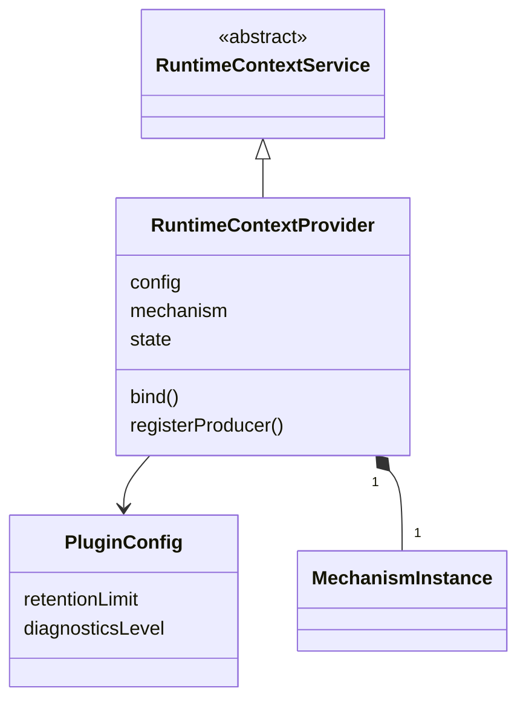

# runtime-context-cordis 的对象模型

本成员没有自己的领域对象。块声明、注册、读取资格、生产者句柄、绑定读者与变化材料归 [runtime-context-contract 的对象模型](../../runtime-context-contract/docs/object-model.md)。四张表、观察链与读者游标归 [runtime-context 的对象模型](../../runtime-context/docs/object-model.md)。本成员只有两个技术对象：服务实例与插件配置。它们不自动成为产品领域对象。

本成员没有运行实现。类名与字段名随实现确定。

## 对象与关系

| 对象 | 身份 | 拥有者 | 可变性 | 关联 |
| --- | --- | --- | --- | --- |
| 服务实例 | 一个 isolate 标签下的服务键 `runtimeContext` | 本插件的 fiber | 实例状态：开放、撤除中 | `extends` 服务定义的抽象类。拥有一个机制实例 |
| 插件配置 | 一次装载 | 装配者给出，静态 `Config` 校验 | 装载后不变。改配置即重新装载 | 观察链保留上限传给机制实例，诊断级别留在服务实例 |

图中的类名是说明用的名字。`RuntimeContextService` 归 [runtime-context-cordis-contract](../../runtime-context-cordis-contract/docs/object-model.md)，`MechanismInstance` 归 [runtime-context](../../runtime-context/docs/object-model.md)。

## 生命周期

| 对象 | 创建 | 变化 | 结束 |
| --- | --- | --- | --- |
| 插件配置 | 装配者装载插件 | 不变 | 插件卸载 |
| 服务实例 | 配置校验通过后构造子类，以键登记 | 开放 → 撤除中 | 撤除的四步完成，键上不再有服务 |
| 机制实例 | 服务实例构造时调用工厂 | 见 runtime-context | 撤除的最后一步关闭它 |

本成员定义的协议还约束三类运行期事物，它们的实例都不归本成员：

| 事物 | 拥有者 | 结束 |
| --- | --- | --- |
| 生产者登记 | 生产者插件的 fiber | 生产者卸载、`dispose`，或本插件卸载 |
| 绑定读者 | 建立它的消费者插件 | 资格撤销、消费者卸载，或本插件卸载 |
| 唤醒监听 | 监听者的 fiber | 监听者卸载 |

进程失败时这些对象都丢失。本成员没有可恢复的东西（[SPEC](../SPEC.md#所有权失败与生命周期)）。
