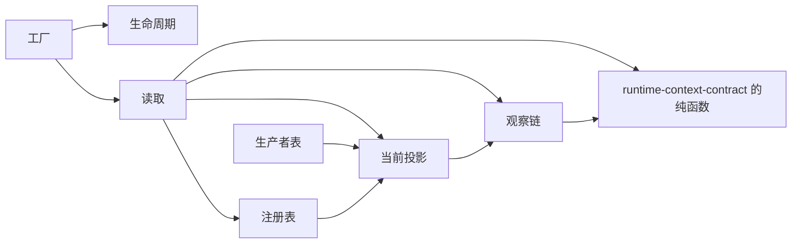

# Runtime Context 供给机制的内部架构

本页说明本成员怎样组织供给机制来兑现 [SPEC](../SPEC.md)。它是组内「供给机制与缓存」这一主题的唯一拥有者（[组架构](../../docs/architecture.md#主题与唯一拥有者)）。公开行为归 [runtime-context-contract SPEC](../../runtime-context-contract/SPEC.md)，Cordis 绑定归 [runtime-context-cordis](../../runtime-context-cordis/docs/cordis.md)。实现内部对象的身份与生灭归[对象模型](object-model.md)。

本成员没有运行实现。`src/index.ts` 只有模板标记。下文是 SPEC 固定的结构，文件名由实现确定。

## 模块与依赖

根入口导出一个工厂。工厂的输入是契约的端口与配置，输出是实现契约三面操作的机制实例。工厂内部分成下列模块：

| 模块 | 持有的状态 | 承担的 SPEC 行为 |
| --- | --- | --- |
| 注册表 | 按作用域加块键：需要绑定、参数值、是否必需、注册修订 | 注册变更按注册修订比较后写入 |
| 生产者表 | 按块键：生产者句柄、代际、作用域无关块的按作用域供值回调、本代在途读取的计数；发布的值与修订按作用域加块键 | 代际比较与丢弃，撤除前等在途读取结算 |
| 当前投影 | 按作用域加块键：当前值与修订 | 作用域链查找、同键遮蔽，步提交写入 |
| 观察链 | 按作用域：视图修订序列，每个绑定读者的游标 | 快照与变化、保留上限、游标作废 |
| 读取 | 无持久状态 | 核读取资格、翻译、缺项与「无值」、契约读取结果表的四种结果与游标作废 |
| 生命周期 | 实例状态：开放、关闭中、已关闭 | 关闭顺序，关闭后拒绝 |

四张表只由本成员实例持有，都是进程内副本。注册、自有值与步提交的耐久保存归作用域持有者。`persisted` 供给块的值由生产者在重启后重新发布（[SPEC 范围与依据](../SPEC.md#范围与依据)、[IC-19](../../../../docs/architecture/cordis-integration-conventions.md#ic-19)）。

包外依赖只有 `@omne-harness/runtime-context-contract`：它给出全部类型，以及 `reduceStep`、`diffForReminder` 等纯函数。它现在还不在 `package.json` 里，随实现进入。本成员不导入 `@deepseek-ai/cordis`（[IC-4](../../../../docs/architecture/cordis-integration-conventions.md#ic-4)），也不导入任何上层领域的契约。翻译函数与 `reduce` 由集成方和块声明作为值传入。

## 关键机制与理由

### 注册修订比较后写入

持有者面的 `prepareRegistration` 只核对注册材料，不写表。持有者在本成员之外提交注册决定，提交后调用 `applyCommit`，本成员才写入注册表。写入前比较依据的注册修订：它不是当前修订时拒绝，当前注册不变（[RC-02](../../runtime-context-contract/SPEC.md#rc-02-块声明注册与参数)）。

理由：提交归持有者，本成员只采用已经提交的结果。比较修订使并发的两次变更不会互相覆盖。后写覆盖先写会让一个已经提交的注册决定静默消失。

### 代际丢弃

生产者表为每个块键记录当前生产者的代际。发布的值按作用域加块键存，不按块键只存一个值。代际小于当前代际的发布被丢弃，投影与修订都不变，并记录诊断（[RC-07](../../runtime-context-contract/SPEC.md#rc-07-生产者句柄并发撤除与恢复)）。

代际由登记方给出，本成员只比较。Cordis 提供者取登记时的 fiber `uid`（[runtime-context-cordis-contract](../../runtime-context-cordis-contract/docs/cordis.md#登记与撤除协议)）。独立调用方自己给出可比较的代际。理由：本成员不知道生产者的寿命由什么承载，所以不自己造代际。

使当前值失效不改投影，不前进修订，只向观察链写一次唤醒。理由：失效表示「值可能已经过时」，不表示有了新值。前进修订会让读者以为有新内容。

### 作用域链查找

读一个块键时，先查本作用域，再沿父引用查父作用域，同键子级遮蔽父级（[RC-03](../../runtime-context-contract/SPEC.md#rc-03-当前读取资格与缺项)）。当前投影只保存每个作用域加块键的最新值，所以查找的成本与链长成正比，不随历史长度增长。

理由：长期运行的作用域不能让每次读取重新扫描历史。派生的当前值在变化时写入投影，读取时只查表。

### 观察链上限与重取

观察链为每个作用域记录视图修订序列与每个读者的游标。它有保留上限。超过上限时最老的变化被丢弃。持有旧游标的读者在下一次 `changes` 得到游标作废，必须重取完整快照（[RC-04](../../runtime-context-contract/SPEC.md#rc-04-读取时点观察与变化材料)）。上限是配置初值，不是常量。

理由：观察链不能无限增长。读者落后太多时，给一个残缺的增量比要求重取更危险，因为读者无法知道自己漏了什么。本成员 SPEC 把这个结果写作「需要重取」，它对应契约的游标作废。

`per-request` 块不进快照，也不进观察链。它们只随一次请求读取。

### 读取先核资格，翻译在读取时执行

每次读取先核读者当前的读取资格：作用域、消费者类、允许的块键、允许的需要绑定与注册修订。按原形状读要求块键在块键集合里，读带翻译的需要要求绑定在需要绑定集合里，否则返回拒绝（无权）。资格被撤销后读取返回拒绝（无权）。资格被重签取代后，读者按新资格核对。资格签发时的注册修订落后于当前修订时，读取仍按当前注册进行，结果带上两个修订，由持有者判断是否重新签发。

带翻译的绑定在读取时执行翻译。翻译抛出时按缺项返回，带来源块的修订，不返回部分结果。

理由：资格可以在两次读取之间被撤销，所以不能只在 `bind` 时核一次。翻译放在读取时，读者始终拿到按当前值算出的自己的形状。翻译失败不返回部分结果，是因为部分结果会被读成完整的当前值。

### 步提交只在提交之后写入投影

`reduceStep` 对每条更新给出接受或拒绝，只合并接受的更新。它的结果写入当前投影只发生在 `applyCommit`，也就是持有者提交之后。含被拒更新的步提交整笔拒绝（无效）。本成员不在提交前改投影（[RC-05](../../runtime-context-contract/SPEC.md#rc-05-状态块上下文更新与步提交)）。变化材料由 `diffForReminder` 算出，只为模型可读块生成，前值按读者资格过滤。本成员不保存变化材料。

### 关闭顺序与重建

实例关闭按固定顺序进行：

1. 拒绝新的注册与登记。
2. 使全部绑定读者结束。
3. 等在途读取结算。
4. 释放四张表。

关闭不撤回已经交给持有者的变化材料，也不撤回任何外部效果。关闭时在途的读取先结算，结算后返回关闭前的值与修订（[SPEC 所有权、失败与生命周期](../SPEC.md#所有权失败与生命周期)）。

进程崩溃后本成员没有东西可恢复。重建由外部按顺序完成：持有者重新注册并重新签发资格，生产者重新登记并发布，读者重新 `bind` 并取完整快照。`persisted` 供给块在生产者重新发布之前读到缺项，本成员不用旧值填充。

## SOLID 与扩展边界

| 原则 | 本成员的具体选择 | 必须防止的反例 |
| --- | --- | --- |
| 单一职责 | 每张表只因一类变化而改：注册表随注册协议改，生产者表随登记与代际规则改，观察链随读取时点协议改 | 读取模块直接写注册表，或观察链保存块的值 |
| 开闭 | 新块不改本成员。保留上限与诊断级别作为配置传入工厂 | 为某个块键写特例分支，或把上限写成常量 |
| 里氏替换 | 工厂输出的机制实例实现契约的三面操作类型，任何调用方都能替换成另一份实现 | 机制实例返回契约没有的读取结果种类，或把缺项写成失败 |
| 接口隔离 | 生产者面、持有者面、读者面是三组分开的操作 | 让读者拿到注册表或生产者表的引用 |
| 依赖倒置 | 本成员只依赖契约。代际、翻译与 `reduce` 由调用方作为值传入。Cordis 提供者依赖本成员 | 导入 Cordis，从 fiber 或 Context 自取代际或租户 |

## 验证与维护

SPEC 的[组合与验证](../SPEC.md#组合与验证)列出十个持续验证场景。现在都没有测试。

| 保证 | 现在的验证 | 后续义务 |
| --- | --- | --- |
| 根入口没有导出 | [public-entry.spec.ts](../tests/public-entry.spec.ts) 断言根入口的导出为空 | 工厂进入后，改为核对导出集合 |
| 十个机制场景 | 没有 | 随实现进入 `tests/`，每个场景对一条 SPEC 行为 |
| 当前点读取成本 | 没有 | 用测试或测量证明成本与块数和链长成正比，与历史长度无关 |
| 持久化、跨进程一致性、租户隔离的端到端证据 | 不在本成员 | 归持有者与装配的真实组合验证 |

维护规则：

1. 契约的读取结果种类、游标规则或步提交规则改变时，同步本页、[机制流程](flows.md)与测试。
2. 新增配置项时，同步[公开接口页](public-api.md)与 runtime-context-cordis 的配置 Schema。
3. 表的结构改变时，同步[对象模型](object-model.md)。
