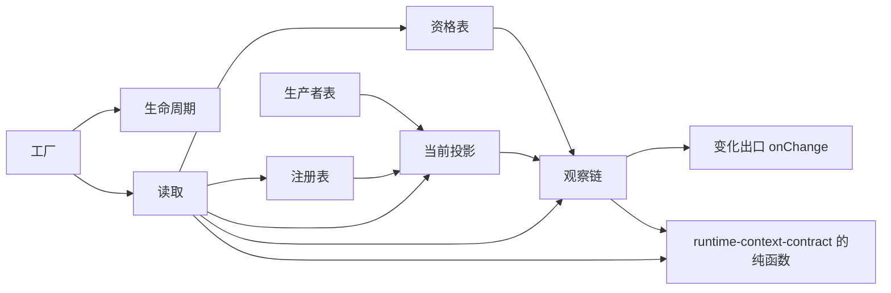

# Runtime Context 供给机制的内部架构

本页说明本成员怎样组织供给机制来兑现 [SPEC](../SPEC.md)。它是组内「供给机制与缓存」这一主题的唯一拥有者（[组架构](../../docs/architecture.md#主题与唯一拥有者)）。公开行为归 [runtime-context-contract SPEC](../../runtime-context-contract/SPEC.md)，Cordis 绑定归 [runtime-context-cordis](../../runtime-context-cordis/docs/cordis.md)。实现内部对象的身份与生灭归[对象模型](object-model.md)。

本成员没有运行实现。`src/index.ts` 只有模板标记。下文是 SPEC 固定的结构，文件名由实现确定。

## 模块与依赖

根入口导出一个工厂。工厂的输入是配置（观察链保留上限、来源调用与回调的超时）与变化出口回调，输出是实现契约三面操作的机制实例。工厂内部分成下列模块：

| 模块 | 持有的状态 | 承担的 SPEC 行为 |
| --- | --- | --- |
| 注册表 | 按作用域加块键：需要绑定、参数值、是否必需、注册修订、状态块的声明。按作用域：所属租户、当前注册修订、已应用提交的记录 | 按提交身份应用提交，顺序不符返回无效；租户核对；声明摘要核对 |
| 生产者表 | 按块键：生产者身份、代际、供给块的声明、作用域无关块的按作用域供值回调、本代在途调用；写入的值、修订与写入序号按作用域加块键 | 新取代际、身份核对、代际比较与丢弃、写入序号比较、回调超时，撤除前取消在途调用并在超时内等在途读取结算 |
| 当前投影 | 按作用域加块键：当前值与修订 | 作用域链查找、同键遮蔽，步提交写入 |
| 观察链 | 按作用域：视图修订序列 | 快照与变化、保留上限、游标作废；视图修订前进后调用变化出口 |
| 资格表 | 按资格身份：资格内容、状态与取代者身份；引用它的绑定读者，每个读者带游标 | 签发时核消费者类，重签与撤销，读者沿取代者读取 |
| 读取 | 无持久状态 | 按顺序核读取资格、翻译、缺项与「无值」、来源调用超时、契约读取结果表的四种结果与游标作废 |
| 生命周期 | 实例状态：开放、关闭中、已关闭 | 关闭顺序，关闭后拒绝 |

五张表只由本成员实例持有，都是进程内副本。注册、自有值与步提交的耐久保存归作用域持有者，注册修订的唯一权威是持有者的耐久提交。`persisted` 供给块的值由生产者在重启后重新发布（[SPEC 范围与依据](../SPEC.md#范围与依据)、[IC-19](../../../../docs/architecture/cordis-integration-conventions.md#ic-19)）。

包外依赖只有 `@omne-harness/runtime-context-contract`：它给出全部类型，以及 `reduceStep`、`diffForReminder` 等纯函数。它现在还不在 `package.json` 里，随实现进入。本成员不导入 `@deepseek-ai/cordis`（[IC-4](../../../../docs/architecture/cordis-integration-conventions.md#ic-4)），也不导入任何上层领域的契约。翻译函数与 `reduce` 由集成方和块声明作为值传入。[runtime-context-cordis](../../runtime-context-cordis/SPEC.md) 的根入口不导出任何东西，独立调用方直接从本成员取工厂。

## 关键机制与理由

### 按提交顺序应用持有者的提交

持有者面的 `prepareRegistration` 只核对注册材料，不写表。持有者在本成员之外提交注册决定，提交后调用 `applyCommit`，输入带提交身份与依据的注册修订。本成员按提交身份记录已应用的结果：同一身份重试返回原结果；依据的修订等于当前修订时应用并前进；依据不等且身份未见过时返回无效（顺序不符），持有者按耐久顺序重放。步提交按提交身份幂等应用，不与注册修订比较（[注册修订与提交顺序](../../runtime-context-contract/SPEC.md#注册修订与提交顺序)）。

理由：注册修订的唯一权威是持有者的耐久提交，本成员的注册表只是投影。按提交身份记录结果，使回执丢失后的重试拿到原结果；比较依据修订，使乱序到达的提交不会让投影停在与持有者不同的修订；重建与乱序都由持有者按耐久顺序重放收口。已应用提交的记录只在进程内，重建后由重放重新建立。

作用域第一次注册时，本成员记下注册材料带的所属租户。之后带不同租户的注册拒绝（无效）。读取按这个租户核对资格，所以跨租户的读取在本成员里有比较的依据。

### 生产者身份、代际与写入序号

生产者表为每个块键记录当前生产者的身份与代际。代际由本成员在每次登记时新取，单调递增。生产者身份是登记时给出的名字，独立于代际。同一块键另一身份的登记被拒绝；同一身份再登记取新代际，替换旧一代。撤销只移除本代登记，已被替换时不改动任何登记。代际小于当前代际的发布被丢弃，投影与修订都不变，并记录诊断（[RC-07](../../runtime-context-contract/SPEC.md#rc-07-生产者句柄并发撤除与恢复)）。

理由：代际由本成员新取，任何承载方式下都单调，不依赖 Cordis fiber 的计数器在插件体重跑时的行为。身份与代际分开，本成员才能区分「另一个生产者抢同一块」与「同一个生产者换代」：前者拒绝，后者替换。撤销只移除本代，使旧一代迟到的撤除函数不会删掉新一代的登记。

发布的值按作用域加块键存，不按块键只存一个值。每个作用域加块键另有写入序号。回调发起时与直接发布到达时各取一个序号，写入前比较，晚到的旧序号结果不写入。持有者注册时触发的回调不阻塞 `applyCommit`：注册先应用，回调结果到达之前该块读到缺项；回调失败记录诊断，该块保持缺项。理由：回调可能乱序返回，只比代际挡不住同一代内旧值写回；注册不等回调，持有者的提交路径就不依赖生产者的响应时间。

来源调用与生产者回调都有超时，超时值来自工厂的配置。超时按未知结算。理由：契约把超时写成未知（[RC-03](../../runtime-context-contract/SPEC.md#rc-03-当前读取资格与缺项)），而没有超时的调用会让读取、撤除与关闭的等待没有上界。

使当前值失效把当前值变为缺项，视图修订前进，变化出口被调用。理由：失效表示这份值不再可用，读者此后读到缺项，这是值的变化，所以照常前进修订并唤醒。作用域无关的块经回调取回值时修订再前进一次。这样唤醒只有一条路径，就是变化出口。

持有者可以先于生产者注册供给块。这时只核与声明无关的部分；生产者带声明登记时，本成员按声明核对已有注册，不相容的注册记诊断，该块在那个作用域读到缺项，直到持有者重新注册。理由：注册不能依赖生产者的到场时序（[RC-03](../../runtime-context-contract/SPEC.md#rc-03-当前读取资格与缺项)），而声明只随生产者到来。

### 作用域链查找

读一个块键时，先查本作用域，再沿父引用查父作用域，同键子级遮蔽父级（[RC-03](../../runtime-context-contract/SPEC.md#rc-03-当前读取资格与缺项)）。当前投影只保存每个作用域加块键的最新值，所以查找的成本与链长成正比，不随历史长度增长。

理由：长期运行的作用域不能让每次读取重新扫描历史。派生的当前值在变化时写入投影，读取时只查表。

### 观察链上限与重取

观察链为每个作用域记录视图修订序列。每个绑定读者的游标挂在读者上，指向观察链上的位置。观察链有保留上限。超过上限时最老的变化被丢弃。持有旧游标的读者在下一次 `changes` 得到游标作废，必须重取完整快照（[RC-04](../../runtime-context-contract/SPEC.md#rc-04-读取时点观察与变化材料)）。上限是配置初值，不是常量。

理由：观察链不能无限增长。读者落后太多时，给一个残缺的增量比要求重取更危险，因为读者无法知道自己漏了什么。本成员 SPEC 把这个结果写作「需要重取」，它对应契约的游标作废。

`per-request` 块不进快照，也不进观察链，本成员不存它们的值。绑定读者每次读取（完整快照或变化）时，本成员按读者资格过滤出可读的逐请求块，向生产者取当前值，随这次读取另行交给读者（[RC-04](../../runtime-context-contract/SPEC.md#rc-04-读取时点观察与变化材料)、[SPEC 本地行为](../SPEC.md#本地行为)）。
### 读取先核资格，翻译在读取时执行

每次读取先按契约 [RC-03](../../runtime-context-contract/SPEC.md#rc-03-当前读取资格与缺项) 的顺序核读者当前的读取资格：资格状态为有效，资格的租户等于作用域所属租户，作用域与两个集合，读者的消费者类按当前注册仍合乎块允许的类。按原形状读要求块键在块键集合里，读带翻译的需要要求绑定在需要绑定集合里，否则返回拒绝（无权）。资格被撤销后读取返回拒绝（无权）。资格被重签取代后，读者沿取代者核对。读者的消费者类在签发时已核过一次，读取时再核，因为注册可能在签发之后变化。资格签发时的注册修订落后于当前修订时，读取仍按当前注册进行，结果带上两个修订，由持有者判断是否重新签发。

带翻译的绑定在读取时执行翻译。翻译抛出时按缺项返回，带来源块的修订，不返回部分结果。

理由：资格可以在两次读取之间被撤销，所以不能只在 `bind` 时核一次。翻译放在读取时，读者始终拿到按当前值算出的自己的形状。翻译失败不返回部分结果，是因为部分结果会被读成完整的当前值。

### 步提交只在提交之后写入投影

`reduceStep` 对每条更新给出接受或拒绝，只合并接受的更新。它的结果写入当前投影只发生在 `applyCommit`，也就是持有者提交之后。含被拒更新的步提交整笔拒绝（无效）。本成员不在提交前改投影（[RC-05](../../runtime-context-contract/SPEC.md#rc-05-状态块上下文更新与步提交)）。变化材料由 `diffForReminder` 算出，只为模型可读块生成，前值按读者资格过滤。本成员不保存变化材料。

### 变化出口

工厂接收回调 `onChange(scope, revision)`。某个作用域的视图修订每前进一次，本成员在写入完成之后同步调用它，传入作用域引用与新的视图修订。回调抛错只记录诊断，不回滚已经完成的写入（[SPEC 变化出口](../SPEC.md#变化出口)）。

理由：本成员不认识 Cordis，不能自己派发事件，但 Cordis 一侧要在修订前进时唤醒监听者。出口只带作用域引用与修订，不带块键或值，所以它不携带受披露约束的信息。同步调用使出口看到的修订就是刚写入的修订。抛错不回滚，因为写入已经是事实，唤醒只是提示。runtime-context-cordis 用它派发唤醒事件，独立调用方自己接。

### 关闭顺序与重建

实例关闭按固定顺序进行：

1. 拒绝新的注册、登记与签发。
2. 使全部绑定读者结束。
3. 取消在途的来源调用与生产者回调。
4. 在同一超时内等在途读取结算。被取消的调用按未知结算。
5. 释放五张表。

关闭不撤回已经交给持有者的变化材料，也不撤回任何外部效果。关闭时在途的读取先结算，结算后返回关闭前的值与修订（[SPEC 所有权、失败与生命周期](../SPEC.md#所有权失败与生命周期)）。

进程崩溃后本成员没有东西可恢复。重建由外部按顺序完成：持有者按耐久顺序重放全部注册提交，交回每个 `checkpointed` 状态块最近一次步提交后的全值，再重新签发资格；生产者重新登记并发布；读者重新 `bind` 并取完整快照。资格不从本成员恢复。`persisted` 供给块在生产者重新发布之前读到缺项，本成员不用旧值填充。

## SOLID 与扩展边界

| 原则 | 本成员的具体选择 | 必须防止的反例 |
| --- | --- | --- |
| 单一职责 | 每张表只因一类变化而改：注册表随注册协议改，生产者表随登记与代际规则改，资格表随资格协议改，观察链随读取时点协议改 | 读取模块直接写注册表，或观察链保存块的值 |
| 开闭 | 新块不改本成员。保留上限与超时作为配置传入工厂 | 为某个块键写特例分支，或把上限与超时写成常量 |
| 里氏替换 | 工厂输出的机制实例实现契约的三面操作类型，任何调用方都能替换成另一份实现 | 机制实例返回契约没有的读取结果种类，或把缺项写成失败 |
| 接口隔离 | 生产者面、持有者面、读者面是三组分开的操作 | 让读者拿到注册表或生产者表的引用 |
| 依赖倒置 | 本成员只依赖契约。翻译与 `reduce` 由调用方作为值传入，变化出口由工厂调用方给出。Cordis 提供者依赖本成员 | 导入 Cordis，从 fiber 或 Context 取代际或租户 |

## 验证与维护

SPEC 的[组合与验证](../SPEC.md#组合与验证)列出持续验证场景。现在都没有测试。

| 保证 | 现在的验证 | 后续义务 |
| --- | --- | --- |
| 根入口没有导出 | [public-entry.spec.ts](../tests/public-entry.spec.ts) 断言根入口的导出为空 | 工厂进入后，改为核对导出集合 |
| SPEC 的机制场景 | 没有 | 随实现进入 `tests/`，每个场景对一条 SPEC 行为 |
| 当前点读取成本 | 没有 | 用测试或测量证明成本与块数和链长成正比，与历史长度无关 |
| 持久化、跨进程一致性、租户隔离的端到端证据 | 不在本成员 | 归持有者与装配的真实组合验证 |

维护规则：

1. 契约的读取结果种类、游标规则或步提交规则改变时，同步本页、[机制流程](flows.md)与测试。
2. 新增配置项时，同步[公开接口页](public-api.md)与 runtime-context-cordis 的配置 Schema。
3. 表的结构改变时，同步[对象模型](object-model.md)。

重判条件：出现多层作用域持有者时，重新判断观察链的切分。观察链现在只挂本作用域，父作用域的变化不进入子作用域读者的变化。那时观察链要改为沿作用域链，使子作用域的读者也观察到父作用域的变化。
