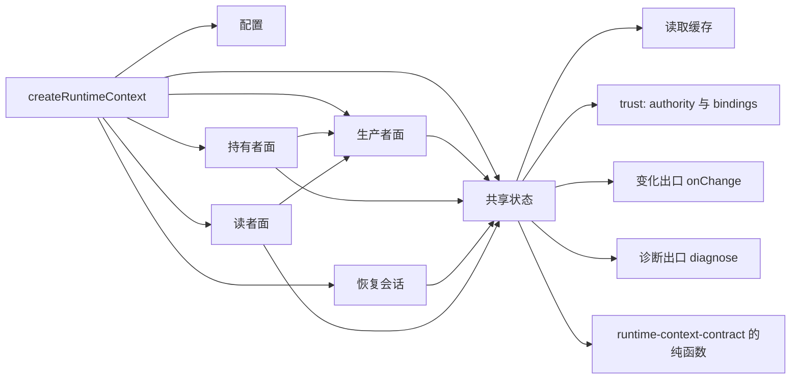

# Runtime Context 供给机制的内部架构

本页说明本成员怎样组织供给机制来兑现 [SPEC](../SPEC.md)。它是组内「供给机制与缓存」这一主题的唯一拥有者（[组架构](../../docs/architecture.md#主题与唯一拥有者)）。公开行为归 [runtime-context-contract SPEC](../../runtime-context-contract/SPEC.md)，Cordis 绑定归 [runtime-context-cordis](../../runtime-context-cordis/docs/cordis.md)。实现内部对象的身份与生灭归[对象模型](object-model.md)。

## 模块与依赖

根入口导出工厂 `createRuntimeContext`。工厂取信任对象、配置、变化出口与诊断出口，输出实现契约三面八操作的机制实例，另有 `close()`。工厂内部分成下列模块：

| 模块 | 源码 | 持有的状态 | 承担的 SPEC 行为 |
| --- | --- | --- | --- |
| 配置 | `src/config.ts` | 无 | 初值与上限的唯一判定，非法值抛 `RangeError` |
| 共享状态 | `src/world.ts` | 全部表、关闭标记、在途操作集合、取消信号、读取缓存 | 两个端口的核对与映射、等待与取消、投影版本、声明目录的变更与跨租户核对、变化出口、关闭五步 |
| 生产者面 | `src/producer.ts` | 生产者表 | 按租户加块键的槽、代际、发布八步、失效、供值回调协议、撤销登记 |
| 持有者面 | `src/holder.ts` | 注册表、已应用提交表、资格表 | 注册核对、按提交身份应用、步提交、作用域结束、签发与撤销 |
| 恢复会话 | `src/replay.ts` | 恢复会话表 | `beginReplay` 与 `finishReplay`、暂存与原子安装、待刷新标记 |
| 读者面 | `src/reader.ts` | 绑定读者与游标 | 六步核对、快照、变化、需要读取、翻译、恢复后供值的合并与限制、读取缓存的查询与写入 |
| 读取缓存 | `src/read-cache.ts` | 有上限的最近使用表 | 键的拼接、命中与淘汰 |
| 诊断 | `src/diagnostics.ts` | 无 | 诊断事件的封闭集合 |

全部表只由本成员实例持有，都是进程内副本。注册、自有值与步提交的耐久保存归作用域持有者，注册修订的唯一权威是持有者的耐久提交。`persisted` 供给块的值由生产者在重启后重新发布（[SPEC 范围与依据](../SPEC.md#范围与依据)、[IC-19](../../../../docs/architecture/cordis-integration-conventions.md#ic-19)）。

包外依赖是 `@omne-harness/runtime-context-contract`（类型、`judgeRegistration`、`reduceStep`、`declarationDigest`、解码函数）与 `@omne-harness/legal-identity`（租户的编码与比较），以及 `@standard-schema/spec` 的类型。本成员不导入 `@deepseek-ai/cordis`（[IC-4](../../../../docs/architecture/cordis-integration-conventions.md#ic-4)），也不导入契约的 `./testing` 入口或任何上层领域的契约。翻译函数与 `reduce` 由集成方和块声明作为值传入。

## 关键机制与理由

### 以替身的分解为起点

实现以契约 `./testing` 替身的分解（共享状态、生产者面、持有者面、恢复、读者面）为结构起点移植，再补上替身没有的生产责任：关闭五步与在途操作结算、关闭后最终同步段答关闭、构造时校验上限、变化出口与诊断出口、读取缓存、恢复后供值的合并与限制。

理由：替身已经通过整套 conformance，覆盖了契约全部交错。从零写要重新证明这些交错。直接导入替身则让生产成员依赖测试入口。代价是两份近似代码分别演进，记为 [SPEC 明确缺项](../SPEC.md#明确缺项)。

### 两个端口、`current()` 与等待

每个带目标的入口先核权威端口，再核可信绑定来源，最后核本实例的状态。对外部端口与来源的每次等待都经同一个等待函数：它把外部 promise 与实例的取消信号竞速。关闭开始时取消信号完成，所有在途等待立即结束，等待端口的操作答关闭。等待返回之后先查关闭标记，再到最终同步段之间没有 `await`。最终提交或披露之前同步调用 `current()`。

理由：契约要求检查与受保护的动作之间没有 `await`（[当前授权前提](../../runtime-context-contract/SPEC.md#当前授权前提)）。把关闭检查放在每次等待返回之后，最终同步段就不会在实例关闭之后答成功（评审 N2）。取消信号使关闭的等待有上界，即使某个端口永远不应答。

### 按提交顺序应用持有者的提交

持有者面的 `prepareRegistration` 只核对注册材料，不写表。持有者在本成员之外提交注册决定，提交后调用 `applyCommit`。本成员按作用域加提交身份记录已应用的结果。同一身份重试返回原结果；依据的修订等于当前修订时应用并前进；依据不等且身份未见过时答无效（顺序不符），持有者用恢复会话补齐后原输入重试。步提交按提交身份幂等应用（[注册修订与提交顺序](../../runtime-context-contract/SPEC.md#注册修订与提交顺序)）。

理由：注册修订的唯一权威是持有者的耐久提交，本成员的注册表只是投影。按提交身份记录结果，使回执丢失后的重试拿到原结果。

### 生产者槽、代际与供给序号

生产者槽是租户加块键。代际由本成员在每次登记时新取，单调递增。生产者身份独立于代际：同一槽另一身份的登记被拒绝，同一身份再登记取新代际。撤销只移除本代登记，已被替换时不改动任何登记（[RC-07](../../runtime-context-contract/SPEC.md#rc-07-生产者句柄并发撤除与恢复)）。

每个作用域加块键有一个供给序号。发布、失效、注册改变与供值回调各取一个序号，回调结果写入前比较序号与恢复代次，晚到的旧结果被丢弃。

理由：代际由本成员新取，不依赖 Cordis fiber 的计数器。只比代际挡不住同一代内乱序返回的回调，所以另比序号。

### 声明目录与跨租户核对

声明进入目录或替换同键的声明对象时，本成员按新声明核对全部租户里该块键已有的注册，不相容的注册记诊断，该块在那个作用域读到缺项，并推进这些作用域的投影版本。生产者换代只影响本租户的作用域。

理由：持有者可以先于生产者注册供给块（[RC-02](../../runtime-context-contract/SPEC.md#rc-02-块声明注册与参数)）。声明是全系统一份，它的到场可能来自另一个租户的生产者，所以核对不能只看本租户。

### 恢复会话与待刷新标记

`beginReplay` 在一个没有 `await` 的同步段里关闭围栏、换恢复代次、撤销本作用域的全部资格，并释放本作用域的缓存条目。`finishReplay` 捕获材料，构建暂存投影，在最终同步段核对 `current()`、绑定、最新会话、结束与已应用提交的版本，通过之后原子安装，为开放投影的供给块建立待刷新标记。没有步提交的 `checkpointed` 块可以缺席（[SPEC 恢复会话](../SPEC.md#恢复会话)）。

恢复之后的第一次普通读取遇到标记时供值。同一标记的并发读取加入同一次来源调用。跨作用域的在途刷新受 `refreshConcurrency` 限制。失败之后 `refreshRetryMs` 之内不再调用来源。

理由：契约把恢复后供值的代价控制交给提供者（RC-09「恢复后的普通供值」，评审 N4）。合并把来源调用数从「并发读取数乘以待刷新块数」降到「待刷新块数」。

### 读取缓存

缓存放在读取路径里、六步核对之后。键是可信绑定确认的租户、作用域引用文本、当前资格身份、当前注册修订与作用域的投影版本。命中路径照常完成核对，披露之前同步调用 `current()`。投影版本的推进点与绕过条件见 [SPEC 读取缓存](../SPEC.md#读取缓存)。

理由：缓存放在服务层要么在核对之前查缓存，违反「命中仍核当前资格」，要么重写一遍核对。独立调用方也得不到缓存。缓存权威端口或可信绑定的答复会用缓存补出许可，契约不允许。投影版本使命中从不提供旧值：正确性只依赖版本推进，不依赖显式释放。带父引用的读取不进缓存，所以命中路径不会跳过逐跳核对。本阶段只有单层作用域，这条限制不损失命中。

缓存不改变读取的复杂度量级。它省掉同一投影版本上的重复过滤与查找。

### 观察链与游标

游标挂在绑定读者上，记录视图修订、游标代次与资格身份。游标代次在注册变化、生产者换代与恢复会话开始时前进。落后超过 `retention` 的游标作废，读者必须重取完整快照（[RC-04](../../runtime-context-contract/SPEC.md#rc-04-读取时点观察与变化材料)）。

`per-request` 块不进快照，也不进观察链，本成员不存它们的值。每次读取按读者资格向生产者取当前值。

### 变化出口与诊断

视图修订每前进一次，本成员在写入完成之后同步调用 `onChange(scope, revision)`。回调抛错只记诊断，不回滚写入。诊断事件只带块键、修订、代际与结果种类。

理由：本成员不认识 Cordis，不能自己派发事件。出口只带作用域引用与修订，所以它不携带受披露约束的信息。诊断不带作用域引用，因为引用文本含租户材料。

### 关闭顺序与重建

实例关闭按固定顺序进行：

1. 拒绝新请求。
2. 使全部绑定读者结束。
3. 取消在途的等待。
4. 在 `settleBoundMs` 内等全部在途操作结算，包括持有者面与生产者面的操作。
5. 释放全部表与读取缓存。

五步写在一个函数里，重复调用返回同一次关闭。关闭不撤回已经交给持有者的变化材料，也不撤回任何外部效果（[SPEC 所有权、失败与生命周期](../SPEC.md#所有权失败与生命周期)）。

进程崩溃后本成员没有东西可恢复。持有者对每个作用域开始恢复会话并交回完整恢复材料，再重新签发资格；生产者重新登记；读者重新 `bind` 并取完整快照。

## SOLID 与扩展边界

| 原则 | 本成员的具体选择 | 必须防止的反例 |
| --- | --- | --- |
| 单一职责 | 生产者面随登记与代际规则改，持有者面随注册与资格协议改，恢复会话随 RC-09 改，读者面随读取时点协议改，缓存只随键与容量改 | 读者面直接写注册表，或缓存保存许可 |
| 开闭 | 新块不改本成员。上限作为配置传入工厂 | 为某个块键写特例分支，或把上限写成常量 |
| 里氏替换 | 机制实例实现契约的操作类型，整套 conformance 对它通过 | 返回契约没有的结果种类，或把缺项写成失败 |
| 接口隔离 | 三面操作分开；`bind` 的调用方声明是可选参数 | 让读者拿到注册表或生产者表的引用 |
| 依赖倒置 | 本成员只依赖契约与 legal-identity。端口、翻译、`reduce`、变化出口与诊断出口由调用方作为值传入 | 导入 Cordis，从 fiber 或 Context 取代际或租户 |

## 验证与维护

SPEC 的[组合与验证](../SPEC.md#组合与验证)列出持续验证场景与对应测试。用例经包名导入 `dist`，改源码后先构建再跑用例。

维护规则：

1. 契约的读取结果种类、游标规则、恢复会话或步提交规则改变时，同步本页、[机制流程](flows.md)与测试，并重跑整套 conformance。
2. 新增配置项时，同步 `src/config.ts`、[公开接口页](public-api.md)与 runtime-context-cordis 的配置 Schema。
3. 新增会改变过滤后读取输出的状态时，在同一处推进投影版本，或让读取绕过缓存，并加一条用例。
4. 表的结构改变时，同步[对象模型](object-model.md)。

重判条件：出现多层作用域持有者时，重新判断观察链的切分与带父引用的读取是否进入缓存。
