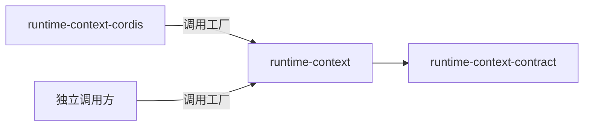

# Runtime Context 供给机制的使用与定位

本页说明谁使用本成员、怎样使用，以及本成员在能力组中的位置。系统关系归[系统页 Runtime Context](../../../../docs/architecture/runtime/runtime-context.md)，组内分解归[组入口](../../README.md)。本页不另立架构。

## 使用方式

根入口导出工厂 `createRuntimeContext`，精确签名见[公开接口页](public-api.md)。

### 经 Cordis 使用

装配 Cordis 的系统不直接导入本成员。[runtime-context-cordis](../../runtime-context-cordis/docs/cordis.md) 在插件装载时调用工厂，把机制实例装进服务 `runtimeContext`。生产者、作用域持有者与读者经服务定义 [runtime-context-cordis-contract](../../runtime-context-cordis-contract/docs/context.md) 使用它。

### 独立使用

不装配 Cordis 的调用方直接调用工厂。下例是职责伪代码，不是可运行代码：

```text
实例 = createRuntimeContext({ trust: { authority, bindings }, config?, onChange?, diagnose? })
       trust 必需：两个端口接到真实的权威来源；没有免核验模式

作用域持有者：恢复 = 实例.beginReplay(主体, { 作用域, 租户, 检查点, 被取代的恢复引用 })
              实例.finishReplay(主体, { 恢复引用, 完整恢复材料 })；空作用域用空材料
              核对结果 = 实例.prepareRegistration(主体, 注册材料)
              在自己的存储里提交注册决定（注册材料带作用域所属租户）
              实例.applyCommit(主体, 已提交的输入)
              返回顺序不符时，以新检查点开始取代旧会话的恢复会话，补齐后原输入重试
              资格 = 实例.issueEligibility(主体, 资格材料)
              重签或收窄范围：issueEligibility 带取代的资格身份；读者沿新资格继续，游标作废
              实例.revokeEligibility(主体, 资格身份)；之后该资格的读取按拒绝（无权）

生产者：句柄 = 实例.registerProducer(主体, { 块键, 租户, 生产者身份, 块声明, 供值回调？ })
        代际由本成员新取；同一身份再登记换代，旧代的发布被拒收
        用句柄按作用域与租户发布、使失效；不再供值时 dispose

读者：读者 = 实例.bind(资格身份)
      第一次 snapshot 取完整快照与游标
      之后 changes(游标)；游标作废时重新 snapshot

结束：await 实例.close()；关闭后的请求答关闭
```

独立调用方要自己承担 Cordis 提供者替它做的事：

1. 在生产者结束时调用 `dispose`。经 Cordis 时登记随插件卸载自动撤除。
2. 接变化出口 `onChange`，自己决定何时唤醒读者。本成员不派发事件。
3. 注册、自有值与步提交的耐久保存，以及本成员重建后的恢复：对每个作用域开始恢复会话、交回完整恢复材料，再重新签发资格。本成员不持有耐久状态。

代际由本成员在每次登记时新取，独立调用方不给代际。

访问系统托管的数据时，仍适用原访问契约（[RC-01](../../runtime-context-contract/SPEC.md#rc-01-消费者身份与范围)）。

### 初始化与释放

工厂调用即初始化，没有其他前提。调用工厂的一方拥有机制实例，负责关闭它。关闭按[内部架构](architecture.md#关闭顺序与重建)的顺序进行。

## 消费者与定位

本成员是 Runtime Context 的机制实现，只依赖纯契约。下图投影[组架构](../../docs/architecture.md#安装与源码依赖)里与本成员相关的边，两者不一致时以组架构为准。



| 使用方 | 怎样使用 | 本成员给什么 |
| --- | --- | --- |
| [runtime-context-cordis](../../runtime-context-cordis/README.md) | 插件装载时调用工厂，插件卸载时关闭实例 | 三面操作的机制实现 |
| 独立调用方 | 直接调用本成员的工厂 | 同上，撤除与唤醒的接线由调用方自己承担 |

组内只有 runtime-context-cordis 依赖本成员。生产者、持有者与读者不直接依赖本成员，它们依赖服务定义（[IC-5](../../../../docs/architecture/cordis-integration-conventions.md#ic-5)）。

### 现在的真实消费者

[runtime-context-cordis](../../runtime-context-cordis/README.md) 依赖本成员：它的插件装载时调用工厂，卸载时关闭实例。

### 上层页面

- 系统关系：[系统页 Runtime Context](../../../../docs/architecture/runtime/runtime-context.md)。
- 公开行为：[runtime-context-contract SPEC](../../runtime-context-contract/SPEC.md)、[协议流程](../../runtime-context-contract/docs/flows.md)。
- 组内成员与阅读路径：[组入口](../../README.md)、[组协作入口](../../docs/key-flows.md)。
