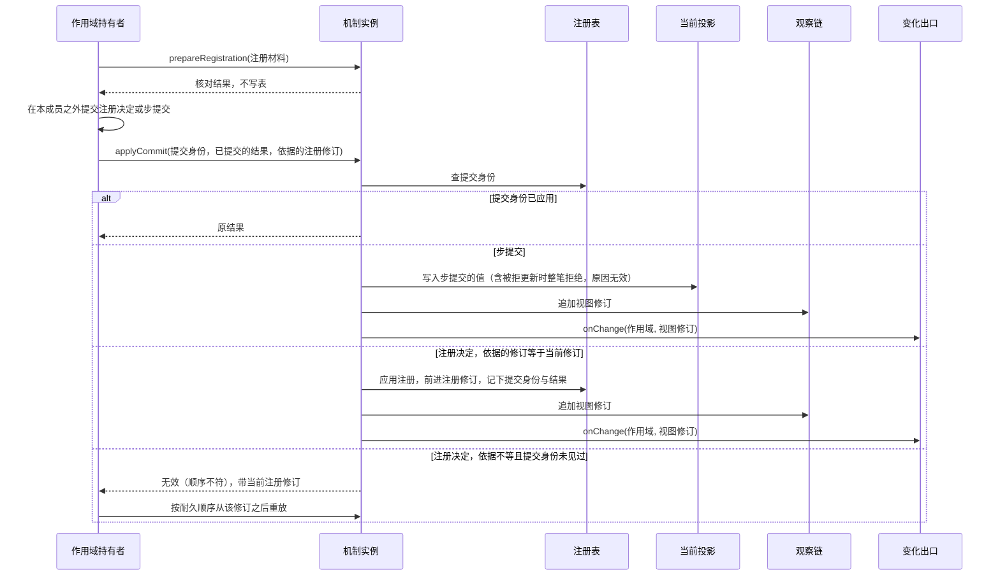
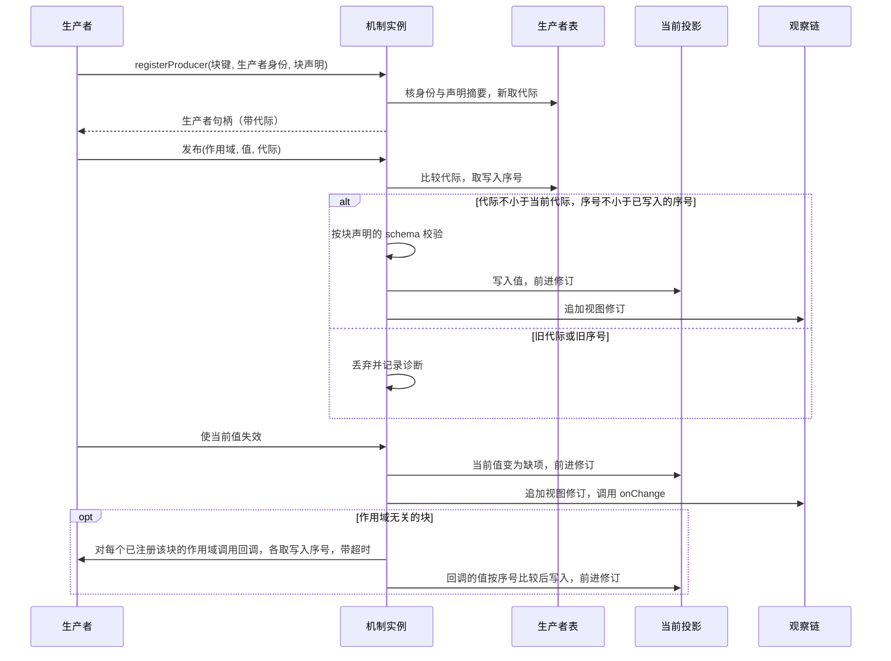
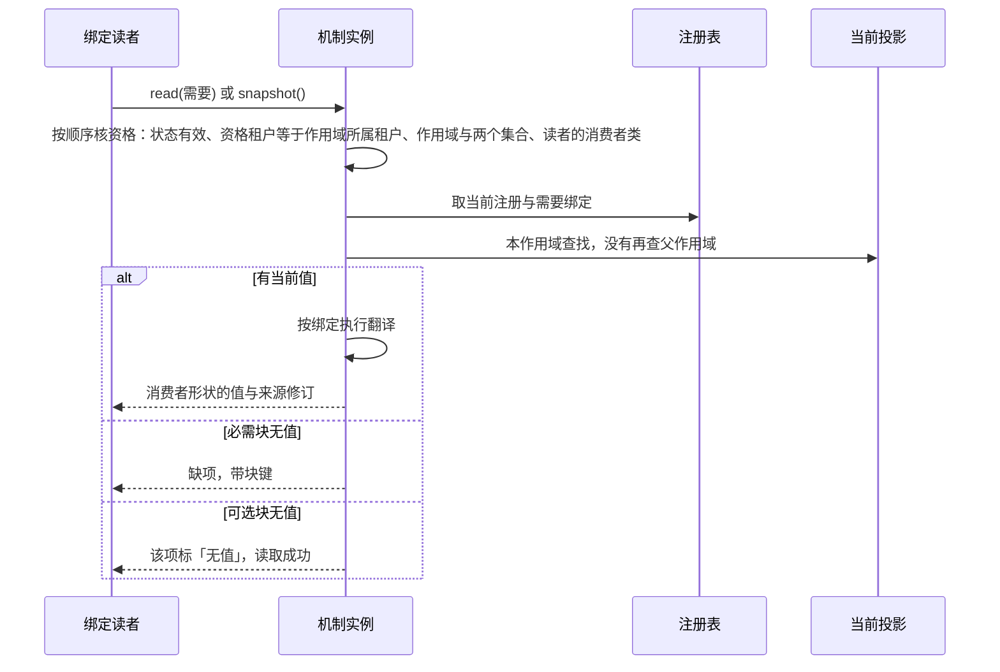
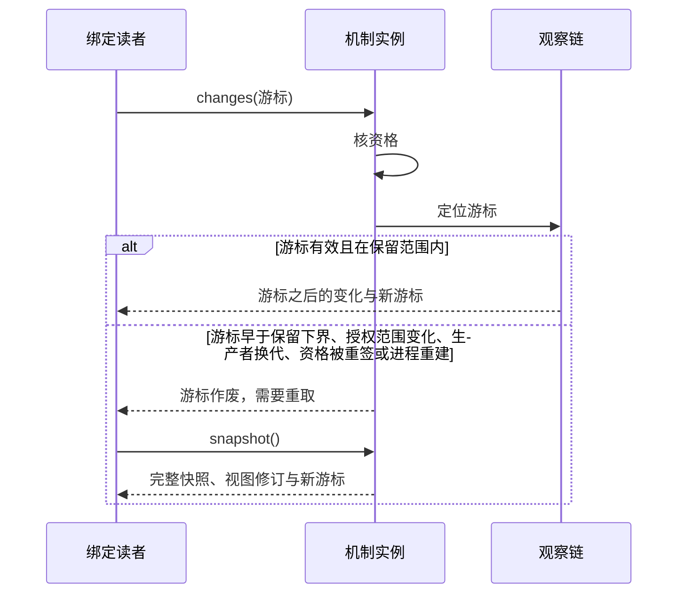
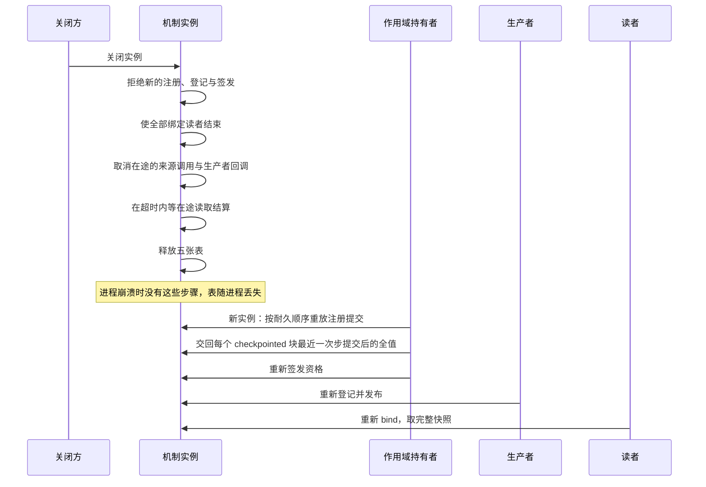

# Runtime Context 供给机制的流程

本页给出本成员的五条机制级流程。每条有一张时序图和一张「失败与责任交接」表。行为以 [SPEC](../SPEC.md) 为准，图只投影条款，不表示运行实现已经存在。

协议级流程归 [runtime-context-contract 的协议流程](../../runtime-context-contract/docs/flows.md)，本页的流程是它们在机制内部的展开。Cordis 装载、登记寿命与唤醒派发归 [runtime-context-cordis 的流程](../../runtime-context-cordis/docs/flows.md)。图中的「机制实例」是工厂的输出，内部的表见[内部架构](architecture.md#模块与依赖)。

## 流程

### F-RCI01 注册变更与步提交的核对和写入

协议流程：契约的 F-RC02 与 F-RC07。条款：[RC-02](../../runtime-context-contract/SPEC.md#rc-02-块声明注册与参数)、[RC-05](../../runtime-context-contract/SPEC.md#rc-05-状态块上下文更新与步提交)。

| 环节 | 结果 | 失败与责任交接 |
| --- | --- | --- |
| 核对 | 只给核对结果，表不变 | 核对失败带逐项原因，持有者修正材料后重新提交 |
| 持有者提交 | 提交在本成员之外完成 | 提交未知时由持有者按原提交身份查询，本成员不重建另一条注册 |
| 按提交身份应用 | 同一身份重试返回原结果；依据的修订等于当前修订时应用并前进 | 依据不等且身份未见过时返回无效（顺序不符），持有者按耐久顺序重放。注册修订的唯一权威是持有者的耐久提交 |
| 作用域所属租户 | 作用域第一次注册时记下 | 之后带不同租户的注册拒绝（无效） |
| 声明 | 注册状态块时带来的声明进入目录 | 与同键已有声明的摘要不同时拒绝（无效） |
| 写入步提交 | `reduceStep` 对每条更新给出接受或拒绝；接受的合并结果在 `applyCommit` 时写入投影。步提交按提交身份幂等，不与注册修订比较 | 被拒的更新由持有者按逐项原因退回提出者。含被拒更新的步提交整笔拒绝（无效），投影不变。提交前不改投影。失败步里成功动作的更新由持有者处置，本成员不写入 |
| 变化出口 | 视图修订前进后同步调用 `onChange` | 回调抛错只记诊断，写入不回滚 |

### F-RCI02 发布与代际

协议流程：契约的 F-RC01 与 F-RC08。条款：[RC-07](../../runtime-context-contract/SPEC.md#rc-07-生产者句柄并发撤除与恢复)。

| 环节 | 结果 | 失败与责任交接 |
| --- | --- | --- |
| 登记 | 生产者表记录生产者身份与本成员新取的代际 | 没有带块声明，或声明与同键已有声明的摘要不同，登记被拒绝（无效）。同一块键另一身份登记被拒绝。同一身份再登记取新代际，替换旧一代 |
| 旧代发布 | 丢弃，投影与修订不变，有诊断 | 旧代不能覆盖新代的值 |
| 值不合 schema | 发布被拒绝，当前值与修订不变 | 不存成「内容无法解释」 |
| 使失效 | 当前值变为缺项，视图修订前进，变化出口被调用 | 读者读到什么以读取时的值为准。回调取回值时修订再前进 |
| 作用域无关块的回调 | 持有者注册该块时对该作用域调用；生产者后登记或使当前值失效时对每个已注册作用域调用 | 回调的值按写入序号比较后写入，晚到的旧结果不写入。持有者注册时的回调不阻塞 `applyCommit`，结果到达前该块读到缺项。回调失败或超时记诊断，该块保持缺项。生产者不需要知道作用域列表 |
| `dispose` | 先取消本代在途调用，再在超时内等在途读取结算，然后移除本代登记 | 在途读取用撤除前的值与修订，被取消的调用按未知结算。这一代已被替换时不改动登记。撤除后依赖该块的读取读到缺项 |

### F-RCI03 读取：核资格、翻译、缺项

协议流程：契约的 F-RC03 与 F-RC05。条款：[RC-03](../../runtime-context-contract/SPEC.md#rc-03-当前读取资格与缺项)、[RC-06](../../runtime-context-contract/SPEC.md#rc-06-需要绑定与读者形状)。

| 环节 | 结果 | 失败与责任交接 |
| --- | --- | --- |
| 核资格 | 资格有效且租户相符时继续。按原形状读要求块键在块键集合里；读带翻译的需要要求绑定在需要绑定集合里 | 任一项不满足、资格已撤销或租户不符时返回拒绝（无权）。撤权前已返回的值不收回。资格被重签取代后沿取代者核对 |
| 来源调用 | `reread` 与 `recompute` 的取值有超时 | 超时按未知结算 |
| 注册修订落后 | 按当前注册读取，结果带签发时与当前的两个修订 | 持有者判断是否重新签发资格 |
| 作用域链查找 | 同键读到子级值，子级无值时读到父级值 | 成本与链长成正比 |
| 翻译 | 读者拿到自己的形状 | 翻译抛出时返回缺项，带来源修订，没有部分结果 |
| 缺项与「无值」 | 都不是失败；「无值」只用于可选需要 | 依赖它的动作按自己的契约处置。本成员不用空值或旧值填充 |

### F-RCI04 `changes` 与游标作废

协议流程：契约的 F-RC04。条款：[RC-04](../../runtime-context-contract/SPEC.md#rc-04-读取时点观察与变化材料)。

| 环节 | 结果 | 失败与责任交接 |
| --- | --- | --- |
| 游标有效 | 只返回读者资格允许的变化 | `per-request` 块不在观察链里，所以不在变化里 |
| 超过保留上限 | 最老的变化被丢弃 | 持有旧游标的读者得到游标作废，不得到残缺的增量 |
| 游标作废 | 读者重取完整快照 | 调用方不需要自己判断是哪种情形 |
| 变化材料 | 只为模型可读块生成，前值来自持有者保留的上一份按资格过滤的快照 | 本成员不保存变化材料，也不保存旧值。写成提醒归持有者 |

### F-RCI05 关闭与重建

条款：[SPEC 所有权、失败与生命周期](../SPEC.md#所有权失败与生命周期)、[IC-19](../../../../docs/architecture/cordis-integration-conventions.md#ic-19)。

| 环节 | 结果 | 失败与责任交接 |
| --- | --- | --- |
| 关闭后的新请求 | 拒绝（服务已关闭） | 调用方改用新实例 |
| 关闭时在途读取 | 先取消在途调用，再在超时内结算，结算后返回关闭前的值与修订 | 被取消的调用按未知结算。关闭后到达的读取返回拒绝（服务已关闭） |
| 已交出的变化材料与外部效果 | 不撤回 | 外部效果的拥有者 |
| 重建 | 持有者重放注册、交回 `checkpointed` 全值、重新签发资格，再由生产者登记、读者重取快照 | 资格不从本成员恢复。`persisted` 供给块在生产者重新发布之前读到缺项。本成员不用旧值填充 |

## 失败与生命周期

| 情形 | 结果 | 责任方 | 依据 |
| --- | --- | --- | --- |
| 提交顺序不符 | 返回无效，当前注册不变 | 持有者按耐久顺序重放 | [注册修订与提交顺序](../../runtime-context-contract/SPEC.md#注册修订与提交顺序) |
| 旧代发布 | 丢弃，有诊断 | 生产者 | [RC-07](../../runtime-context-contract/SPEC.md#rc-07-生产者句柄并发撤除与恢复) |
| 撤权后的读取 | 拒绝（无权），已返回的值不收回 | 持有者 | [RC-03](../../runtime-context-contract/SPEC.md#rc-03-当前读取资格与缺项) |
| 翻译抛出 | 缺项，带来源修订 | 集成方修正翻译 | [RC-06](../../runtime-context-contract/SPEC.md#rc-06-需要绑定与读者形状) |
| 游标落后或作废 | 要求重取完整快照 | 读者的调用方 | [RC-04](../../runtime-context-contract/SPEC.md#rc-04-读取时点观察与变化材料) |
| 进程失败 | 五张表丢失 | 持有者重放与重新签发，生产者重新登记 | [SPEC 所有权、失败与生命周期](../SPEC.md#所有权失败与生命周期) |

各内部对象的创建与结束见[对象模型](object-model.md#生命周期)。
