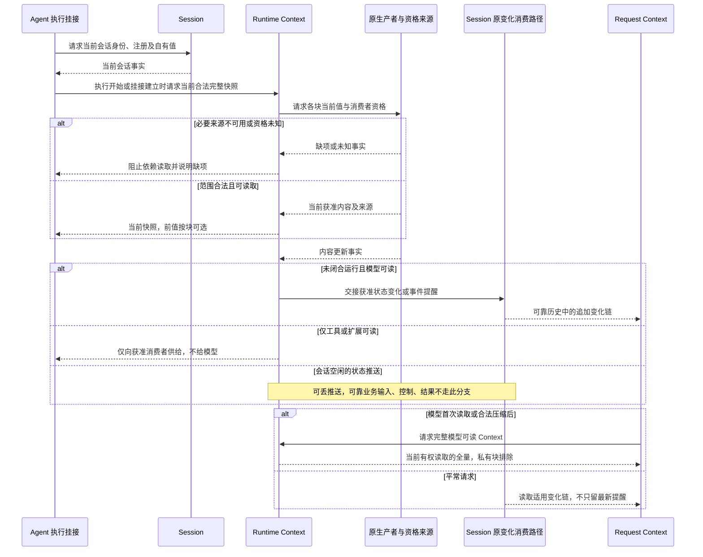
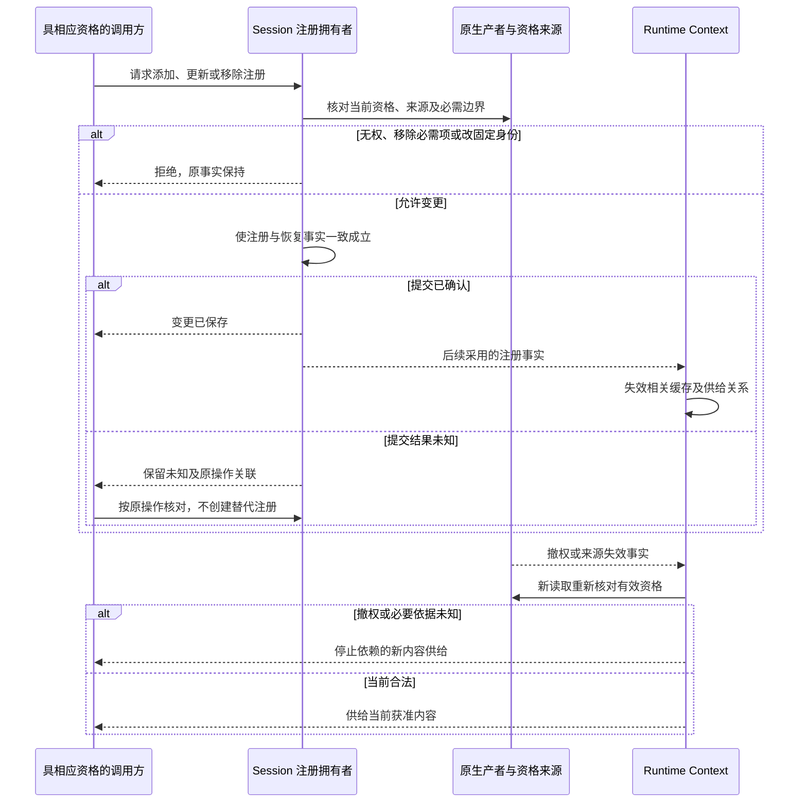
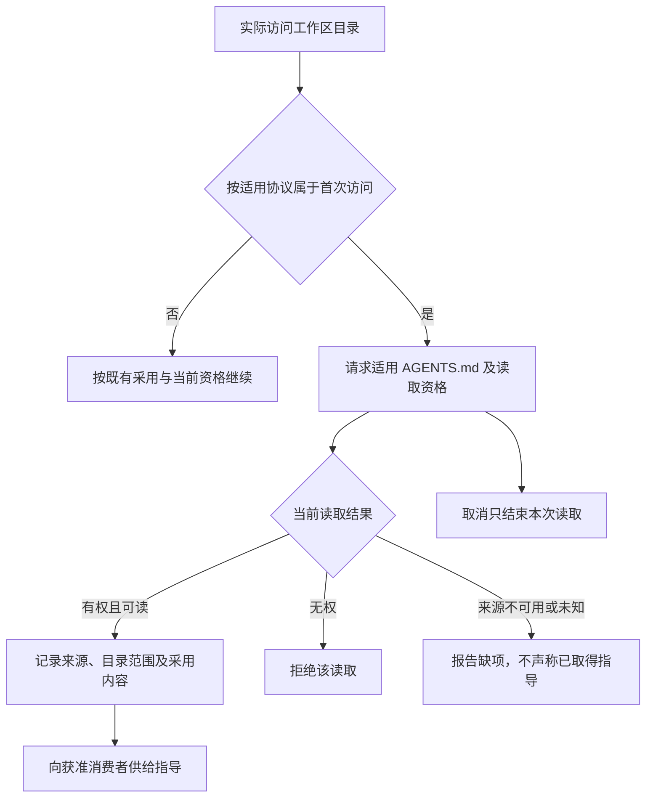

# 当前块供给协作流程

本页在正式位置维护待审细化，只有文档目标，没有真实包、公开形状或实际运行验证。产品既定规则保持原确认范围，阶段支持仍待用户选择。

## RC-F01 执行开始或挂接建立时的当前快照与后续变化

承接 [RC-J01](../../../../.meta_harness/design/product/runtime-context/design.md#rc-j01)，能力 CAP-RC01、03、04。Session 先供给会话注册和模式事实，Runtime Context 从原来源按各消费者当前资格取值。模式创建默认与后续修改由 Session 拥有。Context 不设置模式。谁可以改模式见[产品模式规则](../../../../.meta_harness/design/product/sessions-and-work/design.md#按协作需要调整三个独立模式)。

状态提醒表达本会话实际感知的获准前后值，事件提醒表达发生事实；完整快照允许可选前值。历史提醒不能替代当前授权。取消读取或订阅只结束相应等待与资源。故障后重新拉当前值并沿已保存变化接续，不能伪造空闲期间所有中间状态。前值关联、变化身份、通知补查及一致读取由 Runtime Context、Session 和原消费者落实，仍见 [CONTEXT-M01](../../../../.meta_harness/design/product/runtime-context/design.md#context-m01)。持续验证见 [RC-VJ01](../SPEC.md#rc-vj01)。

## RC-F02 注册变更、移除与资格失效

承接 [RC-J02](../../../../.meta_harness/design/product/runtime-context/design.md#rc-j02)，能力 CAP-RC01、02、04、10。Session 拥有注册业务，Runtime Context 只在 Session 授权提交契约中供给变更；资格仍回原拥有者判断。

可选移除不删共享源或他会话，恢复不装回。取消等待不能认定提交未发生；提交未知由 Session 原操作继续对账。已固定请求不被注册更新重写，也不撤回原外部效果。并发变更、撤权、读取和固定采用之间的精确边界仍属 [CONTEXT-M01](../../../../.meta_harness/design/product/runtime-context/design.md#context-m01)，图不声称跨独立源同一事务。持续验证见 [RC-VJ02](../SPEC.md#rc-vj02)。

## RC-F03 首次目录访问的指导供给

承接 [RC-J03](../../../../.meta_harness/design/product/runtime-context/design.md#rc-j03)，能力 CAP-RC01、05、10。活动图不定义文件遍历算法。

普通资产发现与 reload 不触发此链，远端变更不承诺立即同步。读取失败对原工作后续处理由其消费契约承担。规范版本、精确首次访问、合并及恢复标识未确定，不能从图中的判断节点推导算法，见 [CONTEXT-E02](../../../../.meta_harness/design/product/runtime-context/design.md#context-e02)。持续验证见 [RC-VJ03](../SPEC.md#rc-vj03)。
