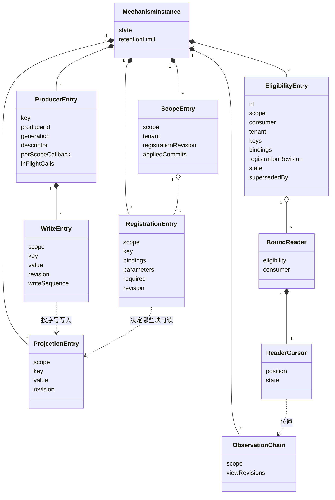
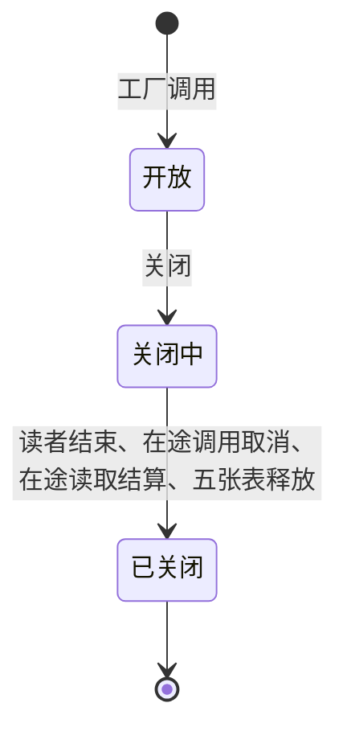

# Runtime Context 供给机制的对象模型

本页描述本成员的实现内部对象：五张表里的条目、读者游标与机制实例。它们是技术对象，不自动成为产品领域对象。块声明、注册、读取资格、生产者句柄、绑定读者、快照与变化、步提交与变化材料这些领域对象归 [runtime-context-contract 的对象模型](../../runtime-context-contract/docs/object-model.md)，本页只说明机制怎样持有它们的当前状态。

本成员没有运行实现。下面的对象由 SPEC 的[表与投影](../SPEC.md#表与投影)固定，类名与字段名随实现确定。

## 对象与关系

| 对象 | 身份 | 持有什么 | 拥有者 | 对应的领域对象 |
| --- | --- | --- | --- | --- |
| 机制实例 | 一次工厂调用 | 五张表、配置、变化出口与实例状态 | 调用工厂的一方 | 三面操作的一份实现 |
| 作用域条目 | 作用域 | 所属租户（第一次注册时记下）、当前注册修订、已应用提交的记录（提交身份到结果） | 机制实例 | 持有者耐久提交按顺序应用的投影 |
| 注册条目 | 作用域加块键 | 需要绑定、参数值、是否必需、注册修订；状态块的块声明 | 机制实例 | 契约的注册 |
| 生产者条目 | 块键 | 生产者身份、代际、供给块的块声明、作用域无关块的按作用域供值回调、本代在途调用 | 机制实例 | 契约的生产者句柄 |
| 写入条目 | 作用域加块键 | 生产者表里该作用域最近一次写入的值、修订与写入序号 | 机制实例 | 一次发布或回调的结果 |
| 投影条目 | 作用域加块键 | 当前值与修订。状态块的值来自最近一次步提交 | 机制实例 | 读取看到的当前值 |
| 观察链 | 作用域 | 视图修订序列，有保留上限 | 机制实例 | 快照与变化的来源 |
| 资格条目 | 资格身份 | 作用域、消费者类、主体与租户、两个集合、签发时的注册修订；状态与取代者身份 | 机制实例，替持有者保管 | 契约的读取资格 |
| 绑定读者 | 一次 `bind` | 引用的资格身份、固定的消费者类、游标 | 机制实例，替集成方保存 | 契约的绑定读者 |
| 读者游标 | 一个绑定读者 | 在本作用域观察链上的位置 | 挂在绑定读者上 | 契约的游标 |

关系说明：

- 投影条目按作用域链查找。子作用域的投影条目遮蔽父作用域里同键的条目。
- 供给块的投影条目由生产者条目的发布写入，每次发布只写所带作用域的条目。作用域无关的块由回调写入：持有者注册时写该作用域的条目，生产者后登记或使当前值失效时写每个已注册作用域的条目。写入前比较写入序号，晚到的旧序号结果不写入。状态块的投影条目由 `applyCommit` 写入。
- 运行时的块声明目录不单独成为对象：供给块的声明在生产者条目里，状态块的声明在注册条目里，按块键查时两处合起来查。
- 绑定读者引用资格身份。资格被重签取代时，引用它的读者改引用取代者，游标作废。读者游标只指向本作用域的观察链。
- `per-request` 块不进观察链，也没有投影条目。它只有生产者条目，值在每次读取时向生产者取得。

## 生命周期

| 对象 | 创建 | 变化 | 结束 |
| --- | --- | --- | --- |
| 机制实例 | 工厂调用 | 开放、关闭中、已关闭 | 关闭完成，或进程失败 |
| 作用域条目 | 作用域第一次注册，记下所属租户 | 每次应用注册提交前进注册修订，记下提交身份与结果 | 实例结束 |
| 注册条目 | 持有者提交后 `applyCommit` | 后续提交按提交身份与依据修订应用，每次前进注册修订 | 持有者提交移除，或实例结束 |
| 生产者条目 | 生产者带身份与声明登记，本成员新取代际 | 发布前进修订。使失效把当前值变为缺项，也前进修订。同一身份再登记取新代际，替换旧一代 | `dispose` 先取消本代在途调用，在超时内等在途读取结算后移除本代登记；已被替换时不改动。或实例结束 |
| 资格条目 | `issueEligibility` | 有效转为被取代或已撤销，不再回到有效 | 实例结束。重建后由持有者重新签发 |
| 绑定读者 | `bind` | 资格被取代时改引用取代者 | 读者结束、资格撤销或实例结束 |
| 投影条目 | 第一次发布或第一次步提交 | 每次发布或步提交前进修订 | 生产者撤除后不再有当前值，读取得到缺项。实例结束时释放 |
| 观察链 | 作用域第一次出现变化 | 追加视图修订。超过保留上限时丢弃最老的变化 | 实例结束 |
| 读者游标 | 读者第一次取完整快照 | 每次 `changes` 前进；资格被重签取代时作废 | 作废后由重取快照重建。读者结束或实例结束时释放 |

### 状态与转移

机制实例只有三个状态：

关闭中与已关闭的实例拒绝新的注册与登记。读者游标的状态与转移沿契约对象模型的[状态与转移](../../runtime-context-contract/docs/object-model.md#状态与转移)。本成员多一种作废原因：游标早于观察链的保留下界。

读取资格的状态与转移沿契约对象模型的[状态与转移](../../runtime-context-contract/docs/object-model.md#状态与转移)：有效、被取代、已撤销。

本成员的对象都不耐久。进程失败时全部丢失，由持有者按耐久顺序重放注册、交回 `checkpointed` 状态块的全值并重新签发资格，生产者重新登记，读者重新 `bind` 来重建（[SPEC](../SPEC.md#所有权失败与生命周期)）。
