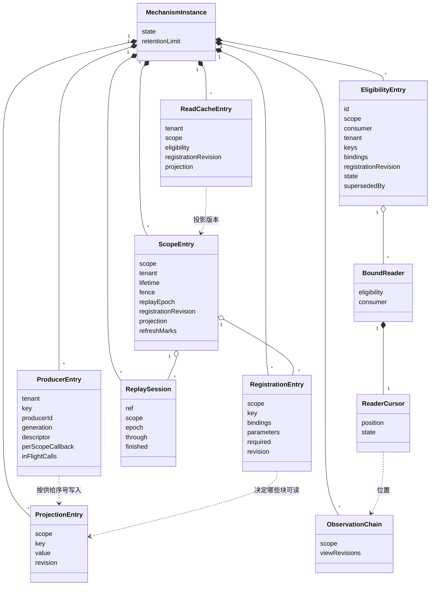
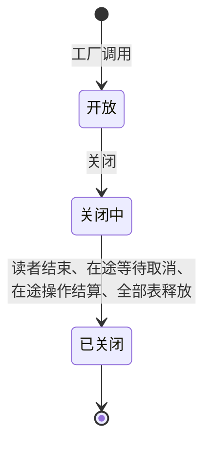

# Runtime Context 供给机制的对象模型

本页描述本成员的实现内部对象：各表里的条目、恢复会话、读取缓存条目、读者游标与机制实例。它们是技术对象，不自动成为产品领域对象。块声明、注册、读取资格、生产者句柄、绑定读者、快照与变化、步提交与变化材料这些领域对象归 [runtime-context-contract 的对象模型](../../runtime-context-contract/docs/object-model.md)，本页只说明机制怎样持有它们的当前状态。

下面的对象由 SPEC 的[表与投影](../SPEC.md#表与投影)固定，源码在 `src/world.ts` 与各面的模块里。

## 对象与关系

| 对象 | 身份 | 持有什么 | 拥有者 | 对应的领域对象 |
| --- | --- | --- | --- | --- |
| 机制实例 | 一次工厂调用 | 全部表、配置、两个端口、变化出口、诊断出口、关闭标记与在途操作集合 | 调用工厂的一方 | 三面操作的一份实现 |
| 作用域条目 | 作用域引用文本 | 可信绑定确认的租户、寿命（开放或已结束）、恢复围栏与恢复代次、当前注册修订、视图修订、投影版本、游标代次、待刷新标记、供给序号 | 机制实例 | 持有者耐久提交按顺序应用的投影 |
| 已应用提交 | 作用域加提交身份 | 普通提交的完整输入、摘要与结果 | 机制实例 | 认回与恢复动作里的已知成功提交 |
| 注册条目 | 作用域加块键 | 需要绑定、参数值、是否必需、注册修订 | 机制实例 | 契约的注册 |
| 声明目录条目 | 块键 | 全系统一份块声明 | 机制实例 | 契约的块声明 |
| 生产者条目 | 租户加块键 | 生产者身份、代际、供给块的块声明、作用域无关块的供值回调、本代在途调用 | 机制实例 | 契约的生产者句柄 |
| 投影条目 | 作用域加块键 | 当前值或替代它的失败（缺项原因、未知、拒绝）、块修订、来源代际。状态块的值来自最近一次步提交 | 机制实例 | 读取看到的当前值 |
| 观察链 | 作用域 | 视图修订序列，有保留上限 | 机制实例 | 快照与变化的来源 |
| 资格条目 | 资格身份 | 作用域、消费者类、主体与租户、两个集合、签发时的注册修订；状态与取代者身份 | 机制实例，替持有者保管 | 契约的读取资格 |
| 绑定读者 | 一次 `bind` | 引用的资格身份、固定的消费者类、游标 | 机制实例，替集成方保存 | 契约的绑定读者 |
| 读者游标 | 一个绑定读者 | 视图修订、游标代次、资格身份与上一份快照 | 挂在绑定读者上 | 契约的游标 |
| 恢复会话 | 恢复引用 | 作用域、恢复代次、检查点、被取代的引用、完成时的材料指纹与就绪回执 | 机制实例 | 契约的恢复会话 |
| 待刷新标记 | 作用域加块键，带恢复代次 | 供给值尚未恢复。不是取值许可 | 作用域条目 | 契约的恢复后供值意图 |
| 读取缓存条目 | 租户、作用域、资格身份、注册修订与投影版本 | 一次快照的稳定条目 | 机制实例的读取缓存 | 无。只是性能手段 |

关系说明：

- 投影条目按作用域链查找。子作用域的投影条目遮蔽父作用域里同键的条目。
- 供给块的投影条目由生产者条目的发布写入，每次发布只写所带作用域的条目。作用域无关的块由回调写入：持有者注册时写该作用域的条目，生产者后登记或使当前值失效时写本租户每个已注册作用域的条目，恢复后的第一次普通读取写有待刷新标记的条目。写入前比较供给序号与恢复代次，晚到的旧结果不写入。状态块的投影条目由 `applyCommit` 与恢复安装写入。
- 块声明目录是全系统一份。声明进入或替换同键的声明对象时，本成员核对全部租户里该块键的注册，并推进这些作用域的投影版本。
- 读取缓存条目只在键的五项完全相同时被使用。投影版本前进之后，旧条目不再命中，最终按最近使用被淘汰。
- 绑定读者引用资格身份。资格被重签取代时，引用它的读者改引用取代者，游标作废。读者游标只指向本作用域的观察链。
- `per-request` 块不进观察链，也没有投影条目。它只有生产者条目，值在每次读取时向生产者取得。

## 生命周期

| 对象 | 创建 | 变化 | 结束 |
| --- | --- | --- | --- |
| 机制实例 | 工厂调用 | 开放、关闭中、已关闭 | `close()` 完成，或进程失败 |
| 作用域条目 | 作用域第一次经可信绑定确认（开始恢复或只结束作用域），记下租户；围栏默认关闭 | 恢复会话开关围栏；注册提交前进注册修订；结束使寿命转为已结束，不再回到开放 | 实例结束 |
| 注册条目 | 持有者提交后 `applyCommit` | 后续提交按提交身份与依据修订应用，每次前进注册修订 | 持有者提交移除，或实例结束 |
| 生产者条目 | 生产者带身份与声明登记，本成员新取代际 | 发布前进修订。使失效把当前值变为缺项，也前进修订。同一身份再登记取新代际，替换旧一代 | `dispose` 立即拒绝本代新操作，在上界内等本代在途供值结算后撤除本代登记；已被替换时不改动。或实例结束 |
| 资格条目 | `issueEligibility` | 有效转为被取代或已撤销，不再回到有效。恢复会话开始撤销本作用域的全部资格 | 实例结束。重建后由持有者重新签发 |
| 绑定读者 | `bind` | 资格被取代时改引用取代者 | 读者结束、资格撤销或实例关闭（关闭第 2 步） |
| 恢复会话 | `beginReplay` | 完成时记下材料指纹与就绪回执 | 被新的开始取代，或实例结束 |
| 待刷新标记 | 恢复安装开放投影 | 失败保留 | 有效的值或合法的无值、成功发布，或新的恢复代次 |
| 读取缓存条目 | 一次可缓存的快照 | 命中时移到最近使用一端 | 按最近使用淘汰，或撤销、重签、恢复开始、作用域结束与实例关闭时释放 |
| 投影条目 | 第一次发布或第一次步提交 | 每次发布或步提交前进修订 | 生产者撤除后不再有当前值，读取得到缺项。实例结束时释放 |
| 观察链 | 作用域第一次出现变化 | 追加视图修订。超过保留上限时丢弃最老的变化 | 实例结束 |
| 读者游标 | 读者第一次取完整快照 | 每次 `changes` 前进；资格被重签取代时作废 | 作废后由重取快照重建。读者结束或实例结束时释放 |

### 状态与转移

机制实例只有三个状态：

关闭中与已关闭的实例对每个入口答关闭。关闭开始之后，在途操作的最终同步段也答关闭。读者游标的状态与转移沿契约对象模型的[状态与转移](../../runtime-context-contract/docs/object-model.md#状态与转移)。本成员多一种作废原因：游标早于观察链的保留下界。

读取资格的状态与转移沿契约对象模型的[状态与转移](../../runtime-context-contract/docs/object-model.md#状态与转移)：有效、被取代、已撤销。

作用域的寿命（开放、已结束）与恢复围栏（关闭、打开）沿契约 [RC-09](../../runtime-context-contract/SPEC.md#rc-09-作用域结束恢复会话与恢复后供值)。

本成员的对象都不耐久。进程失败时全部丢失，由持有者开始恢复会话、交回完整恢复材料并重新签发资格，生产者重新登记，读者重新 `bind` 来重建（[SPEC](../SPEC.md#所有权失败与生命周期)）。
