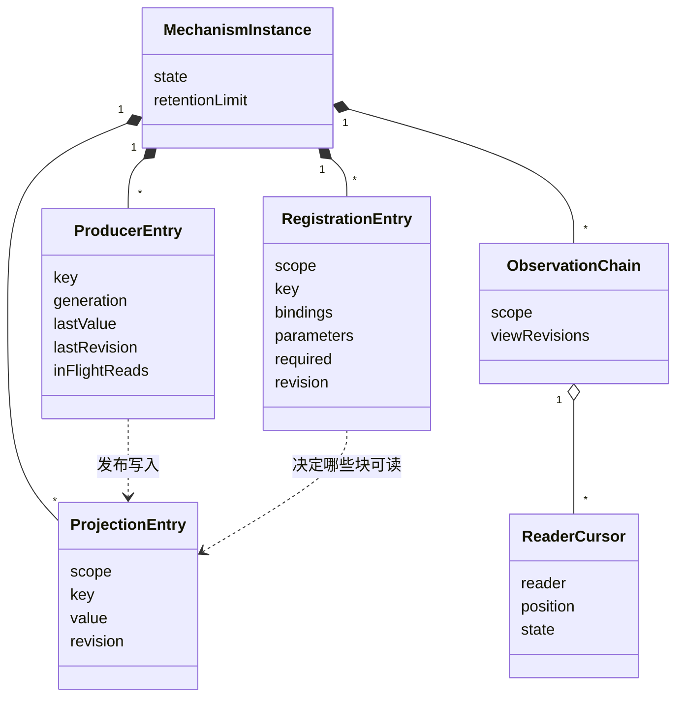
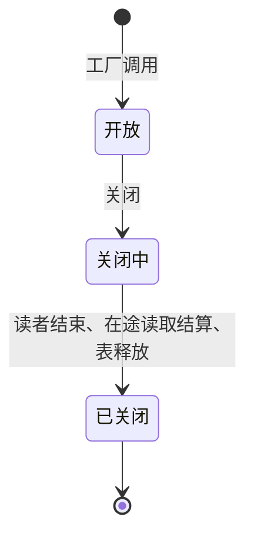

# Runtime Context 供给机制的对象模型

本页描述本成员的实现内部对象：四张表里的条目、读者游标与机制实例。它们是技术对象，不自动成为产品领域对象。块声明、注册、读取资格、生产者句柄、绑定读者、快照与变化、步提交与变化材料这些领域对象归 [runtime-context-contract 的对象模型](../../runtime-context-contract/docs/object-model.md)，本页只说明机制怎样持有它们的当前状态。

本成员没有运行实现。下面的对象由 SPEC 的[表与投影](../SPEC.md#表与投影)固定，类名与字段名随实现确定。

## 对象与关系

| 对象 | 身份 | 持有什么 | 拥有者 | 对应的领域对象 |
| --- | --- | --- | --- | --- |
| 机制实例 | 一次工厂调用 | 四张表与实例状态 | 调用工厂的一方 | 三面操作的一份实现 |
| 注册条目 | 作用域加块键 | 需要绑定、参数值、是否必需、注册修订 | 机制实例 | 契约的注册 |
| 生产者条目 | 块键 | 生产者句柄、代际、最近一次发布的值与修订、本代在途读取 | 机制实例 | 契约的生产者句柄 |
| 投影条目 | 作用域加块键 | 当前值与修订。状态块的值来自最近一次步提交 | 机制实例 | 读取看到的当前值 |
| 观察链 | 作用域 | 视图修订序列，有保留上限 | 机制实例 | 快照与变化的来源 |
| 读者游标 | 一个绑定读者 | 在观察链上的位置 | 机制实例，替绑定读者保存 | 契约的游标 |

关系说明：

- 投影条目按作用域链查找。子作用域的投影条目遮蔽父作用域里同键的条目。
- 供给块的投影条目由生产者条目的发布写入。状态块的投影条目由 `applyCommit` 写入。
- 读者游标只指向本作用域的观察链。`per-request` 块不进观察链，也没有投影条目。

## 生命周期

| 对象 | 创建 | 变化 | 结束 |
| --- | --- | --- | --- |
| 机制实例 | 工厂调用 | 开放、关闭中、已关闭 | 关闭完成，或进程失败 |
| 注册条目 | 持有者提交后 `applyCommit` | 后续提交按注册修订比较后改写，每次前进注册修订 | 持有者提交移除，或实例结束 |
| 生产者条目 | 生产者登记 | 发布前进修订。使失效不前进修订。新一代登记替换旧一代 | `dispose` 在本代在途读取结算后撤除，或实例结束 |
| 投影条目 | 第一次发布或第一次步提交 | 每次发布或步提交前进修订 | 生产者撤除后不再有当前值，读取得到缺项或未知。实例结束时释放 |
| 观察链 | 作用域第一次出现变化 | 追加视图修订。超过保留上限时丢弃最老的变化 | 实例结束 |
| 读者游标 | 读者第一次取完整快照 | 每次 `changes` 前进 | 作废后由重取快照重建。读者结束或实例结束时释放 |

### 状态与转移

机制实例只有三个状态：

关闭中与已关闭的实例拒绝新的注册与登记。读者游标的状态与转移沿契约对象模型的[状态与转移](../../runtime-context-contract/docs/object-model.md#状态与转移)。本成员多一种作废原因：游标早于观察链的保留下界。

本成员的对象都不耐久。进程失败时全部丢失，由持有者重新注册、生产者重新登记、读者重新 `bind` 来重建（[SPEC](../SPEC.md#所有权失败与生命周期)）。
