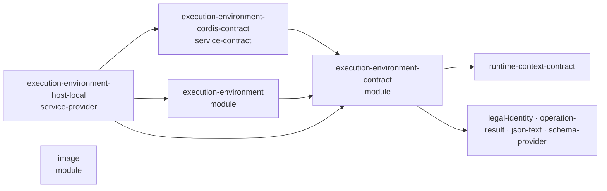

# 执行环境能力组工程设计

本页只放成员分解、依赖方向与主题的唯一拥有者。精确机制归各成员的 `docs/architecture.md`、`docs/object-model.md`、`docs/flows.md` 与 `docs/cordis.md`。组页不复制算法、状态机或 Cordis 落位。

## 成员与依赖

图例：箭头从依赖方指向被依赖方，即 `A --> B` 表示 A 的 `package.json` 依赖 B。成员页的依赖图用同一方向。

- 契约成员是 Cordis-free 的根。它导出全部值类型、端口类型、设施形状、块声明与纯函数，不含任何提供者实现。
- Cordis 定义成员只导出抽象 Service 与键，不实现。
- 机制成员实现登记表，不依赖 Cordis，也不碰机器资源。
- Service 实现成员把机制装进 Cordis，并提供宿主机上的设施提供者。
- 图像成员独立，不依赖本组其他成员，也不被它们依赖。

沙箱以新的提供者加入：它放在新的提供者成员里，经同一个服务登记到同一个登记表，不是新的 Service 实现。一个 isolate 标签下只有一个 Service 实现与一个登记表。宿主层的新设施（`command`、`terminal`）也加在已有的宿主提供者上，不另立宿主提供者，所以一层仍由一个提供者提供全部所需设施。

Tool 宿主依赖契约成员与 Cordis 定义成员。Tool 契约不依赖本组：工具的环境声明是 JSON 值加 schema 采用身份，schema 与采用身份归契约成员，Tool 契约经 schema-provider 校验。

## 主题与唯一拥有者

| 主题 | 唯一拥有者 |
| --- | --- |
| 访问身份、绑定层、连续性、环境要求、落点 | [execution-environment-contract 对象模型](../execution-environment-contract/docs/object-model.md) |
| 获取、采用记录、租约、受管资源，以及获取状态的语义 | [execution-environment-contract 对象模型](../execution-environment-contract/docs/object-model.md) |
| 设施协议、`files`、`command`、`terminal` 的规则 | [execution-environment-contract SPEC](../execution-environment-contract/SPEC.md#设施协议)；逐设施的展开与理由在[契约内部架构](../execution-environment-contract/docs/architecture.md#设施协议) |
| 需要端口（资源账本、设施守卫、恢复授权、环境授权）、可信绑定来源与许可先于效果 | [execution-environment-contract SPEC](../execution-environment-contract/SPEC.md) |
| 工具环境声明的 schema 与采用身份 | [execution-environment-contract 公开定义](../execution-environment-contract/docs/public-api.md) |
| 两条块声明 | [execution-environment-contract 公开定义](../execution-environment-contract/docs/public-api.md) |
| 服务键、intercept 配置、调用方类 | [execution-environment-cordis-contract Cordis 说明](../execution-environment-cordis-contract/docs/cordis.md) |
| 提供者与设施表、匹配、获取状态的机制、租约视图、恢复编排 | [execution-environment 架构](../execution-environment/docs/architecture.md) |
| 宿主文件使用、宿主机制、撤除保留 | [execution-environment-host-local 架构](../execution-environment-host-local/docs/architecture.md) |
| Service 实现、插件、配置与撤除顺序 | [execution-environment-host-local Cordis 说明](../execution-environment-host-local/docs/cordis.md) |
| 图像预算与编码 | [image 架构](../image/docs/architecture.md) |

## 验证分工

契约成员验证纯函数、导出面与 schema。机制成员验证匹配、幂等与状态转移。Service 实现成员验证真实宿主上的设施行为、撤除与平台前提。集成方验证许可、终局与采用记录的耐久顺序。共同保证沿[领域关键流程](../../../docs/domains/execution-environments/key-flows.md)用真实集成方核对；替身就绪不证明资源停止或数据耐久。
