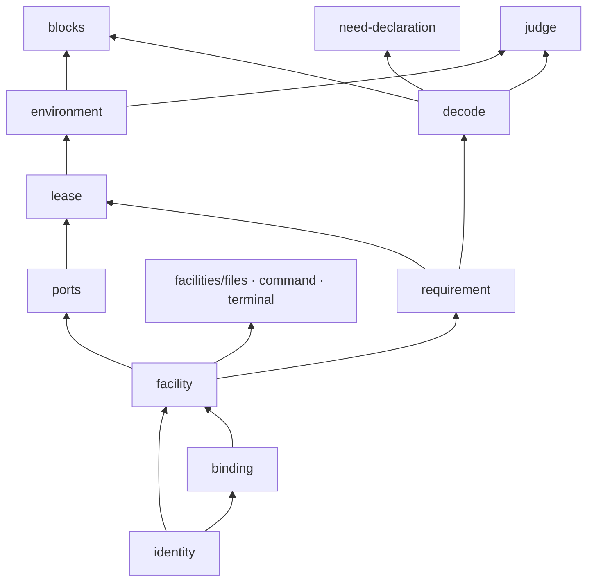

# 执行环境契约的内部架构

本页说明本成员怎样组织根入口与依赖，来兑现 [SPEC](../SPEC.md)。对象的身份、状态与生灭归[对象模型](object-model.md)。四个成员的分解与依赖方向归[组架构](../../docs/architecture.md)。本页不另立公共规则。

本成员只有类型、设施声明、schema、块声明与纯函数。它不持有状态，不持有资源，也没有提供者。登记表、获取状态与恢复编排的机制归 [execution-environment](../../execution-environment/README.md)，宿主提供者与宿主文件使用归 [execution-environment-host-local](../../execution-environment-host-local/README.md)。

## 模块与依赖

根入口 `src/index.ts` 与 `./testing` 入口只做再导出。生产入口不导入测试套件。每个模块一个源文件。

| 源文件 | 承载 | 条款 |
| --- | --- | --- |
| `identity.ts` | 访问身份 `Access`（再导出 legal-identity 的唯一定义）、原调用引用 `OriginRef`、获取键 `AcquisitionRef`，以及两个引用的构造函数 | [INV-EE01](../SPEC.md#inv-ee01-身份和事实拥有者分别可辨认)、[INV-EE04](../SPEC.md#inv-ee04-原主体在实际边界继续受约束) |
| `binding.ts` | 四种绑定层 `EnvironmentBinding`、连续性 `EnvironmentContinuity`、`bindingKinds`、`bindingScope` | [INV-EE01](../SPEC.md#inv-ee01-身份和事实拥有者分别可辨认)、[INV-EE06](../SPEC.md#inv-ee06-逻辑工作实例资源和数据不共用寿命) |
| `requirement.ts` | 开放的隔离断言表 `IsolationClaims` 与环境要求 `EnvironmentRequirement` | [INV-EE02](../SPEC.md#inv-ee02-策略在域外求值环境只在允许清单内匹配)、[INV-EE03](../SPEC.md#inv-ee03-必需设施和隔离不得降低满足) |
| `facility.ts` | 开放的设施表 `EnvironmentFacilities`、设施声明、设施请求、设施结果四态、拒绝原因，以及 `describeFacility` | [设施协议](../SPEC.md#设施协议) |
| `facilities/files.ts`、`facilities/command.ts`、`facilities/terminal.ts` | 三个核心设施的接口与声明。三个文件各自增补 `EnvironmentFacilities` | [设施协议](../SPEC.md#设施协议)、[INV-EE09](../SPEC.md#inv-ee09-资源和秘密以最小必要条件提供)、[INV-EE13](../SPEC.md#inv-ee13-控制请求与实际停止释放分别确认) |
| `ports.ts` | 受管资源 `ManagedResource`，三个需要端口 `FacilityGuard`、`ResourceLedger`、`RecoveryAuthority`，恢复授权 `RecoveryAccess` 与 `createRecoveryAccess` | [INV-EE15](../SPEC.md#inv-ee15-准备持有回收与确认保持一致)、[恢复](../SPEC.md#恢复) |
| `lease.ts` | 提供者身份、实例身份、落点（带配额域）、采用记录、租约、获取状态、采用失败与清理状态、获取未知、原获取描述、两种查询与答复、释放结果、拒绝原因与 `FacilitySet` | [获取与租约](../SPEC.md#获取与租约)、[INV-EE05](../SPEC.md#inv-ee05-实际执行捕获原落点与版本) |
| `environment.ts` | 提供者接口 `EnvironmentProvider` 及其事实、配额声明、回执、原获取状态、获取列出、结清、退役与恢复结果；环境授权端口 `EnvironmentAuthority` 与动作 `EnvironmentAction`；操作面 `ExecutionEnvironment`；登记面 `ProviderRegistrations` | [获取与租约](../SPEC.md#获取与租约)、[恢复](../SPEC.md#恢复)、[INV-EE18](../SPEC.md#inv-ee18-提供者换代和-cordis-集成保留原责任) |
| `need-declaration.ts` | 工具环境声明 `EnvironmentNeedDeclaration`、它的 Standard Schema 与采用身份 | [工具环境声明](../SPEC.md#工具环境声明) |
| `blocks.ts` | 两条块声明及其值类型，增补 Runtime Context 的 `ContextBlocks` | [INV-EE17](../SPEC.md#inv-ee17-真实落点痕迹与诊断可定位且守住披露) |
| `judge.ts` | 纯函数 `judgeRequirement` 与 `matchProviders` | [INV-EE02](../SPEC.md#inv-ee02-策略在域外求值环境只在允许清单内匹配)、[获取与租约](../SPEC.md#获取与租约) |
| `operation-schemas.ts` | 三面九操作的参数、七个数据结果 schema 与索引 | [获取与租约](../SPEC.md#获取与租约)、[恢复](../SPEC.md#恢复) |
| `testing/` | 非耐久替身、提供者与环境的契约用例列表 | [持续验证义务](../SPEC.md#持续验证义务) |
| `decode.ts` | 内部解码器与 `standardSchema` 包装。根入口只再导出它的 `Issue` 类型，名为 `DecodeIssue` | [工具环境声明](../SPEC.md#工具环境声明) |

模块之间只有单向依赖。方向沿对象模型的[关系](object-model.md#关系)：身份与绑定层在最底层，设施与要求引用它们，租约与提供者引用设施和端口，解码、块声明与纯函数在最上层。

箭头从被依赖的模块指向依赖它的模块。`facilities/terminal.ts` 另外依赖 `facilities/command.ts` 的 `ProcessHandle`，因为终端的一段执行与一次命令交出同一种进程句柄。

包外依赖如下。`operation-result`、`json-text` 与 `legal-identity` 是运行值依赖；其余包只做类型导入。

| 依赖 | 用于什么 |
| --- | --- |
| `@omne-harness/runtime-context-contract` | `ScopeRef` 作请求方作用域、绑定层、恢复与描述的作用域引用；`SuppliedBlockDescriptor` 与 `ConsumerClass` 作两条块声明；增补 `ContextBlocks` |
| `@omne-harness/legal-identity` | `TenantId` 作访问身份里的租户、租户级沙箱的归属与提供者获取输入里的租户 |
| `@omne-harness/operation-result` | `Outcome`、`succeed`、`fail` 作 `judgeRequirement` 的返回 |
| `@omne-harness/json-text` | `JsonValue` 作采用记录与恢复结果里的提供者证据，以及受管资源的恢复引用 |
| `@omne-harness/schema-provider` | `StandardTyped` 让本成员导出的 schema 能交给 Schema 提供者校验 |
| `@standard-schema/spec` | `StandardSchemaV1` 作工具环境声明与两条块的 schema 形状 |

本成员不导入 `@deepseek-ai/cordis`。根入口按 [IC-4](../../../../docs/architecture/cordis-integration-conventions.md#ic-4) 与 Cordis 无关，测试逐个源文件核对这一点，见 [Cordis 说明](cordis.md)。本成员也不导入 Tool、授权或任何上层工作流的契约。它们依赖本成员，反方向不成立。

`operation-schemas.ts` 通过同一解码器形制提供三面九操作的参数与七个数据结果 schema。`testing/` 独立暴露非耐久替身与契约用例；测试框架由消费者选择，断言使用 `node:assert`。

## 关键机制与理由

### 域盲身份

本成员只认通用角色（[范围与依据](../SPEC.md#范围与依据)）。访问身份 `Access
` 是主体加租户：主体的类型由集成方给出，执行环境只传递主体，不比较也不解释它。租约只绑定租户，主体由设施守卫判断。作用域引用、原调用引用与获取键都是不透明字符串。`originRef` 与 `acquisitionRef` 只拒绝空串，不解析内容。

理由：同一个执行环境要服务不同的作用域持有者与独立调用者。如果本成员认识上层工作流的类型，换一种持有者就要改契约，所有提供者都要跟着核对。代价是每个调用方都要把自己的身份翻译成这几样。路径、节点、Cordis Context 或插件实例都不能代替访问身份成为租户权限的依据（[INV-EE01](../SPEC.md#inv-ee01-身份和事实拥有者分别可辨认)）。

### 允许清单在域外翻译

`EnvironmentRequirement` 只有三样：有序的允许绑定层清单、设施键集合、隔离断言集合（[INV-EE02](../SPEC.md#inv-ee02-策略在域外求值环境只在允许清单内匹配)）。策略词不进入本成员。`judgeRequirement` 拒绝这三样以外的字段，所以带策略词的要求在边界上就被拒绝。`matchProviders` 只沿清单顺序匹配，不选清单外的层。

理由：策略属于作用域与工具的治理。求值和翻译都放在本成员之外，换一套策略词或换一种作用域持有者时本成员不用改。代价是集成方必须完成翻译。清单为空时没有可选的层，获取被拒绝。

### 设施声明是开放协议

`EnvironmentFacilities` 在本成员里是空接口。每种设施的拥有者用 `declare module` 增补自己的键与接口。三个核心设施也这样做，只是它们的拥有者是本成员。`describeFacility` 的参数是一个映射类型：设施接口的每个操作都必须标成 `guarded` 或 `open`，漏掉一个操作就不能通过类型检查。

理由：新增设施只改设施拥有者的包，本成员不改（[设施协议](../SPEC.md#设施协议)）。操作名单由类型推出，声明不会漏写须授权的操作。声明只提供词汇，不安装设施，也不授权操作。

代价与边界：「全系统一个键只有一份声明」部分靠类型系统保证。两个包用不同接口增补同一键时，TypeScript 报告声明冲突。同一接口的重复声明由登记表在登记时拒绝，原声明不变。

### 落点与获取分开，获取时重新核对

`Placement` 是 `resolvePlacement` 算出的值。它带原环境要求、绑定层、提供者身份与连续性，不授予设施，也不授予资源。`acquire` 以落点为输入，并重新核对：请求方作用域没有释放，绑定层仍在允许清单内，隔离断言仍被该提供者覆盖，提供者仍在场。核对失败即拒绝，不换落点（[获取与租约](../SPEC.md#获取与租约)）。

理由：从解析落点到获取之间，提供者可能开始退役，授权可能被撤销。两步不是原子动作，所以获取不能按先前的落点直接放行。代价是集成方要调用两次，第二次可能因条件变化被拒绝。

### 请求方作用域独立于绑定层

`PlacementInput` 与 `AcquireInput` 都带请求方作用域 `scope`，`ProviderAcquireInput` 把它交给提供者。获取记录记下它；描述、落点块、作用域释放、恢复与租约失效都按它过滤。绑定层带作用域时，必须等于请求方作用域，否则以 `invalidInput` 拒绝（[获取与租约](../SPEC.md#获取与租约)）。

理由：宿主机与租户级沙箱的绑定层不带作用域，但落在那里的工作仍属于某个作用域。如果只按绑定层的归属过滤，作用域释放之后，宿主机上的租约不会失效，同一作用域还能再获取；描述与落点块列不出宿主落点；提供者也不知道该把宿主进程或终端记在哪个作用域下，恢复枚举会漏掉它们。代价是每次落点解析与获取都要多传一个作用域，带作用域的绑定层还要与它核对一次。

### 访问核验先于读槽

普通入口经两个集成方端口核对访问：`EnvironmentAuthority
` 对一个封闭的动作答授权判定，`ScopeBindingSource`（类型归 Runtime Context）答目标作用域绑定到哪个租户。先授权，再绑定；查询原获取时再核原获取描述的租户等于访问租户。拒绝、未绑定与错租户对外同为 `notAuthorized`（[访问核验](../SPEC.md#访问核验)）。

理由：槽的键含租户，若先读槽，冲突与认回的答复会让未获授权的调用方探测别人的键。绑定来源回答作用域属于谁，执行环境不从作用域文本解析租户。授权判定带同步的 `current()`，在最后的状态转移与采用之前再核，因为授权在等待提供者期间可能被撤销。代价是每次普通操作多两次端口调用，集成方要实现两个端口。

### 同键认回与原获取

获取以调用方租户加集成方给的 `AcquisitionRef` 识别。同键同描述的重复请求返回同一状态，不重新分配；描述不同为 `acquisitionConflict`。执行环境在调用提供者之前形成原获取描述 `OriginalAcquisition`，集成方保存它。提供者按配额域、租户与获取键持有原记录，并提供原获取查询、按作用域列出与结清。`AcquisitionState` 列出获取的全部存储状态；查询答复是另一组类型，`unrecorded` 与 `invalidInput` 都只是答复。

理由：答复可能丢失。分配答复丢失时记为获取未知，同键不重发，而是查询原记录；原记录答已分配才采用。登记表重启之后，本地查询对同一个键答复 `unrecorded`，集成方用保存的原获取描述查询原获取，或由维护者结清，不用获取键去猜配额域（[原获取的查询与结清](../SPEC.md#原获取的查询与结清)）。跨租户查询同一个键也按无记录处理，不泄露另一租户是否有这个键。

### 配额由提供者原子判定

提供者按租户声明配额上界与可选的全局上界，并在 `acquire` 里一步核对与占用名额；名额只在全部责任确认结清时恰好返还一次。执行环境在获取之前只问配额能不能读（[配额与安全上界](../SPEC.md#配额与安全上界)）。

理由：同一配额域可能有多份登记、多个登记表实例，只有原记录的拥有者能在一步里核对并占用。执行环境自己计数会与它竞争，并在答复丢失或清理未结清时提前返还。公平排队需要按租户的队列，放在集成方的协调者。

### 采用记录由本成员签发

提供者的 `acquire` 只交回 `ProviderAcquisition`：一份租约原件加提供者证据。它是临时回执。执行环境的实现核验回执之后才签发 `EnvironmentAdoption` 并交付租约。核验的各项归 SPEC [获取与租约](../SPEC.md#获取与租约)：提供者仍在场、执行环境没有关闭、请求方作用域没有释放、回执的绑定层与落点一致、要求里的设施键都能从租约取到、当前授权仍成立。访问身份由获取记录绑定，不在回执里核验（[INV-EE05](../SPEC.md#inv-ee05-实际执行捕获原落点与版本)）。

理由：如果提供者自签采用记录，它就能凭自己的回执给自己授权。签发与核验放在本成员一侧，提供者证据只是证据。核验失败时原获取永久转为采用失败，保留第一个确定的原因；实现经原回执清理，清理状态是已结清、待定或未知，后两种保留名额，不当成没有分配（[分配后采用失败与清理](../SPEC.md#分配后采用失败与清理)）。

### 账本先许可，后效果

`ResourceLedger` 是集成方实现的耐久端口。可能跨进程寿命存活的受管资源先 `plan`，再 `permit`，许可确认之后才发出首个外部效果；停止用 `stopped` 记下已确认或未确认；接续已有资源时，提供者在 `acquire` 内调用 `adopt`，账本核对记录与访问身份、作用域，不一致时答 `unavailable`；接续不重新启动资源。`closed` 信号表示账本已关闭，之后不再发新许可，也不再开始新的设施操作。经租约的设施操作由执行环境的门在开始前查这个信号；提供者在门之外自己发起的效果，由提供者在发出前查（[INV-EE15](../SPEC.md#inv-ee15-准备持有回收与确认保持一致)）。门是所有设施操作的唯一入口，所以这项核对放在门里只做一次，各提供者不重复。`ManagedResource.reference` 是提供者定义的 JSON 恢复引用，不是活句柄，也不是裸进程号。

理由：任何已经发出外部效果的资源在账本里都有记录，重启后的恢复从这些记录出发，不靠猜进程号。本成员自己不提交耐久事实，所以端口由集成方实现。代价是集成方必须有耐久账本。独立调用者用不耐久的账本时，重启后认不回来的资源由它自己承担，见产品正文[受管资源与资源账本](../../../../.meta_harness/design/product/execution-environments/design.md#受管资源与资源账本先许可后效果)。

### 恢复授权独立于访问

`recoverOwned`、`releaseScope` 与 `inspectRecoveryAcquisition` 接收 `RecoveryAccess`，不接收访问身份。`RecoveryAccess` 带一个模块内的 `unique symbol` 标记，序列化后标记丢失，所以它只能是原对象。持有它不授予任何权利；每次使用由集成方实现的 `RecoveryAuthority` 核对（[恢复](../SPEC.md#恢复)）。

理由：用户撤权或退出不能阻断系统回收资源，所以收场的权利不来自用户访问。恢复授权只能用于停止、认回与结算一个作用域的受管资源与获取，以及恢复查询，不能用于获取或新执行。签名把两种身份分开，类型检查就能拦住混用。

### 两条块声明

`execution.placement` 与 `execution.host-facts` 是 Runtime Context 的供给块声明。本成员是它们的语义拥有者（[INV-EE17](../SPEC.md#inv-ee17-真实落点痕迹与诊断可定位且守住披露)）。生产者是 host-local 的 Service 实现。当前还没有发布。块的值按本成员的解码函数核对，块的字段见[公开接口页](public-api.md#两条块声明)。

理由：块值的意思由决定这份意思的一方说明，所以声明归语义拥有者，不归生产者（[RC-02](../../../context/runtime-context-contract/SPEC.md#rc-02-块声明注册与参数)）。换一个提供者或新增沙箱提供者时，声明不变，读者不用重新核对。块是观察，不是控制。读者看到落点变化，不能据此认定原进程已停或数据已迁移。

### 工具环境声明的 schema 与采用身份

工具包以 JSON 写下自己的 `EnvironmentNeedDeclaration`。schema、采用身份与解码的规则只在[公开接口页的工具环境声明](public-api.md#工具环境声明)写全。

理由：Tool 契约不导入本成员。工具定义里存的是采用身份加声明值，Tool 契约经 schema-provider 按采用身份解析 schema 校验这个值。这样 Tool 契约与本成员各自演进，交接面只有一份 JSON 与一个身份。`FacilitySet<K>` 是规范实例类型：工具执行者按声明的设施键取得设施子集，没有声明的设施在类型上取不到。

代价：schema 文件的每次字节变化都要同步采用身份，测试核对两者一致。

## 设施协议

本节是 SPEC [设施协议](../SPEC.md#设施协议)的展开与理由。规则的唯一源是 SPEC 的设施协议节；本节逐个设施展开它，两处不一致时以 SPEC 为准。流程见[流程](flows.md#f-eec02-一次设施操作)，产品含义见产品正文[设施的声明、请求与守卫](../../../../.meta_harness/design/product/execution-environments/design.md#设施的声明请求与守卫)与[文件设施与文件批次](../../../../.meta_harness/design/product/execution-environments/design.md#文件设施与文件批次)。

### 共同规则

1. 每次操作带 `FacilityRequest`：请求身份、访问身份、原调用引用、绑定层，加该操作自己的参数。
2. 同一请求身份只有一种确认，结果是 `FacilityResult` 四态之一：`done`（完成）、`unresolved`（未找到对象）、`rejected`（拒绝，带原因）、`unknown`（未知）。
3. `done` 只表示这次请求确认的那一项成功。读取完成不表示写入完成，启动被接纳不表示进程已启动或已退出。
4. 后一次操作即使参数相同，也是另一个请求，要重新核对。
5. 拒绝原因只取 `FacilityReason` 的十个值：`invalidInput`、`notAuthorized`、`notFound`、`conflict`、`busy`、`capacity`、`unsupported`、`closed`、`unavailable`、`effectUnknown`。
6. `unresolved` 只用于文件设施里路径上没有对象的读取、查看、列表，以及替换模式的写入。其他操作不返回 `unresolved`。
7. 未知不当成失败，也不当成没有发生。有副作用的操作不因未知而自动重试（[INV-EE14](../SPEC.md#inv-ee14-未知保持原身份不盲目重放效果)）。
8. 三个核心设施的全部操作都是须授权的操作，每次发出前先过设施守卫。
9. 可能造出受管资源的操作在守卫允许之后，先在资源账本里计划并取得许可，再发出效果。进程、终端与文件批次是受管资源。

### `files`：文件

文件设施有十二项操作。前四项是读取 `read`、查看 `stat`、写入 `write`、关闭 `close`。另外八项是列表 `list`、搜索 `search`、建目录 `mkdir`、删除 `remove`、移动 `move`、复制 `copy`，以及文件批次的提交 `commitBatch` 与认回 `recoverBatch`。

对象点名与核对：

1. 每项操作的请求带路径 `path` 与点名对象 `named`。授权在使用前按当前授权点名对象。目标还不存在时，`named` 是它的父目录；`mkdir` 带 `parents` 时，`named` 是最近的已存在祖先。
2. `ObjectToken` 是不透明的对象身份。宿主提供者在里面放设备号与 inode，沙箱提供者放自己的令牌。
3. 提供者在使用时点核对打开到的对象就是 `named`。对象被换掉，或核对不了，操作被拒绝。提供者不改按路径字符串放行，也不改落宿主机（[INV-EE09](../SPEC.md#inv-ee09-资源和秘密以最小必要条件提供)）。
4. 声称文件限制的落点确认不了使用对象仍在授予根内时，操作被拒绝。请求不能另带一个绝对路径充当授予根。
5. 只有 `stat` 可以报告符号链接。内容操作拒绝末段是符号链接的路径。
6. 命令与终端碰到的文件不走这套核对，由落点自身的隔离约束。

单项操作：

1. 成功的读取、查看与写入返回 `FileIdentity`：对象身份、句柄代际 `HandleGeneration` 与元数据版本 `FileVersion`。
2. `read` 可按偏移与长度分段，返回字节、下一段的偏移与是否到达末尾。
3. `write` 的模式是 `create` 或 `replace`，可带 `expectedVersion`。元数据版本是观察条件，不是权限，也不是外部的比较并交换。
4. `close` 以句柄代际为参数，是另一次请求。成功结果带被关闭的句柄代际。没有成功回执时结果是未知。调用方丢掉引用不是关闭成功。
5. `list` 与 `search` 用偏移与上限分页。它们描述的是这一次扫描，不是能跨外部变化的快照。`search` 按名称或内容匹配字节模式，可递归，结果标出是否被截断。
6. `remove`、`move`、`copy` 可带 `expectedVersion`。`move` 与 `copy` 的目标 `FileTarget` 自己带点名对象，`replace` 决定是否覆盖已有目标。

文件批次：

1. `commitBatch` 一次写入多条路径，每条带路径、点名对象、字节与期望版本。
2. 预检整批每个目标。任何一条不通过，整批都不改动。
3. 预检通过后，批次作为受管资源先在账本里计划并取得许可，然后暂存全部条目，再逐条发布。每条路径有自己的发布收据。系统不承诺多条路径同时生效。
4. 结果 `FileBatchOutcome` 带批次身份（编号加代）与已发布的路径。每条路径都有收据时是 `committed`，否则是 `unknown` 并带原因：`effectUnknown`、`conflict`、`closed` 或 `unavailable`。某条路径的收据丢失时，后续路径停止发布。
5. 已提交与未知都是批次的终态。释放时它们不算未停的受管资源（[INV-EE15](../SPEC.md#inv-ee15-准备持有回收与确认保持一致)）。
6. `recoverBatch` 只读批次的写入清单、目标与收据，把这一批认成完整、部分、中断、冲突或待确认之一。它不续发布，不回滚，也不覆盖外部的新写入。
7. 认回结果里，`published` 只含有耐久发布收据的路径。`matchingPrepared` 列出当前字节恰好与暂存一致的路径，一致不等于有收据。

### `command`：命令

命令设施只有一项操作：`start` 启动一个进程。

1. 请求带可执行文件、参数、工作目录、显式环境变量，可选标准输入、输出模式与终端尺寸。请求里给出的环境变量由集成方按该消费者允许的名单与宿主实际具有的值组成（[INV-EE09](../SPEC.md#inv-ee09-资源和秘密以最小必要条件提供)）；子进程只取得请求里给出的环境变量，不继承宿主的整份环境（[INV-EE09](../SPEC.md#inv-ee09-资源和秘密以最小必要条件提供)）。
2. 进程是受管资源。守卫允许之后，提供者先在账本里计划并取得许可，再启动进程。
3. `done` 交出 `ProcessHandle`。它表示进程实际已启动，句柄带进程身份。它不表示进程已退出。
4. 提供者接纳了请求，但进程映像没有启动时，结果是 `rejected`，原因 `unavailable`，不是 `done`。启动与否不可确认时，结果是 `unknown`。
5. 进程身份是提供者给的身份加代，不是裸进程号。
6. 输出模式是 `separate`（标准输出与标准错误分开）或 `terminal`（合成一路终端输出）。
7. 增量流式输出：`output` 是唯一的输出主体，只允许一个读者。读者调用 `return()` 只放弃读取权，不停止进程。
8. 每个输出块是原始字节，保留换行、ANSI 序列与回车，不按行或字符切分。`observedOffset` 是这一路此前观察到的字节数。与上一块之间有空隙，表示中间有字节被丢弃。
9. 有界缓冲：`OutputPolicy` 给出缓冲上限与单块上限。溢出时丢弃，结果里的 `OutputSummary` 按每一路给出观察到与丢弃的字节数。
10. `result` 给出终局。`completed` 带退出码、信号或未知退出，以及时长与输出计数；`failed` 带 `unavailable` 或 `effectUnknown`，以及观察到的时长与输出计数。`failed` 只用于已启动的进程之后失联或效果未知，不表示启动失败。启动失败是第 4 条的 `rejected`。重复或并发地等待终局不会再启动任何东西。
11. 进程已退出只来自域外监督者对该进程身份记录的回收状态。超时或没有返回不写成已退出（[INV-EE13](../SPEC.md#inv-ee13-控制请求与实际停止释放分别确认)）。
12. 停止有两种方式：`graceful` 与 `forced`。结果只有两态：`confirmed` 或 `unconfirmed`。未确认的停止保留处置责任，不写成已停。

### `terminal`：终端

终端是独立的设施，不是命令设施的一个操作。一个环境可以只提供命令而不提供终端。在这样的环境里，要求终端的请求被拒绝，不降成一次性执行。

1. `create` 以工作目录、显式环境变量与可选尺寸创建一个持久 shell，交出 `TerminalRef`（身份加代）。终端是受管资源，创建前先在账本里计划并取得许可。
2. `execute` 在一个终端里执行一段脚本，可临时改工作目录、环境变量与标准输入。每一段是一个独立的请求，各自过守卫。结果是与命令设施相同的 `ProcessHandle`，输出模式固定为 `terminal`，输出、终局与停止的规则同上。
3. `close` 关闭一个终端，结果是 `confirmed` 或 `unconfirmed`。
4. `list` 只列出本次获取创建的终端，不列出同一宿主上其他获取的终端。每项带状态 `idle`、`running`、`invalid` 或 `closed`，以及最近一次成功观察到的工作目录。观察到的工作目录不是权限。
5. 无效的终端引用由终端设施明确失败。新实例使用新身份，不复活旧终端的状态（[INV-EE07](../SPEC.md#inv-ee07-临时状态边界与实际回收明确)）。

## SOLID 与扩展边界

本节讲模块层的选择。

| 原则 | 本成员的具体选择 | 必须防止的反例 |
| --- | --- | --- |
| 单一职责 | 每个模块只因一类变化而改：设施协议随设施操作改，租约与获取随获取协议改，块声明随观察内容改，纯函数随核对规则改 | 纯函数模块持有登记表、缓存或计时器。类型模块里出现服务键或提供者实现 |
| 开闭 | 新设施只在设施拥有者的包里增补 `EnvironmentFacilities`。新隔离种类增补 `IsolationClaims`。新沙箱是新的提供者，放在新的提供者成员里，登记到同一个登记表，不是新的 Service 实现 | 本成员为某个提供者或某种上层工作流加特例分支，或在绑定层里加入上层工作流的标识 |
| 里氏替换 | 每个提供者实现同一个 `EnvironmentProvider`。没有 `listRecoveryResources` 与 `recover` 的提供者明确记为不支持恢复，不伪造空列表 | 提供者以统一形状虚构它不支持的设施或隔离断言。按提供者名字判断能力 |
| 接口隔离 | 集成方用 `ExecutionEnvironment`，提供者与设施拥有者用 `ProviderRegistrations`，维护者只用恢复两操作与恢复查询。五个端口各管一件事 | 一个聚合接口同时暴露获取、登记与恢复。设施守卫兼管资源许可 |
| 依赖倒置 | 本成员只定义账本、守卫与恢复授权的端口，实现由集成方注入。本成员只依赖通用基础包与 Runtime Context 契约 | 导入 Cordis、Tool、授权或上层工作流的契约。纯函数调用存储端口或服务 |

## 技术后续设计与来源缺项

以下事项由技术或来源拥有者补足，不转成产品默认值投票。公开形状、机制与证据未定时，不删除既定的必要行为。产品侧的问题入口与分类见产品正文[未决问题与待定事项](../../../../.meta_harness/design/product/execution-environments/design.md#未决问题与待定事项)。

### Q-EE02 选择、准备与实际发起的协调边界

维护责任：条件协调、环境资源与原工具调用的拥有者。

场景：准备完成后，取消、权限变更或新选择到达。迟到的准备仍可能已经分配了资源。

待明确：具名技术设计怎样表达原准备身份、资源代际、最终准入与发起、一致确认及迟到资源的处置？

既定约束：

- 动作准入、环境就绪、来源校验、装配采用和原工具发起分别确认。
- 没有环境声明的工具固定它明确的直接依赖，本成员不为它虚构环境对象。
- 迟到的资源仍须查询和处置。旧的合法采用不能复活已撤销的访问。

处理方向及后果：

- 采用已有的资源与调用协调机制，并补足真实环境消费者和故障证据。
- 已有机制不能承载所需保证时，形成有明确消费者的专用责任设计。

先核对实际已有的公开承诺，再形成技术设计。公开形状、协调机制和耐久证明不由本页猜定。

影响：影响 CAP-EE02、03、06 及 [INV-EE03](../SPEC.md#inv-ee03-必需设施和隔离不得降低满足)、[INV-EE05](../SPEC.md#inv-ee05-实际执行捕获原落点与版本)、[INV-EE15](../SPEC.md#inv-ee15-准备持有回收与确认保持一致) 的可实施性。

### Q-EE03 受限执行域、宿主桥接与监督证据

维护责任：执行隔离、受控宿主接口、工具与部署的拥有者。

场景：恶意代码在主进程内尝试窃密、越权或耗尽资源。代码终止后，宿主调用仍可能返回。

待明确：执行、安全、工具和部署拥有者采用什么机制及桥接边界？怎样证明限额、终止与独立的结果承接？

既定约束：

- 支持主进程内受限执行，并按恶意代码设防，这一点已经决定。
- 可达的数据与能力、宿主验证、使用时授权、可归属的事实、限额及不合作代码的终止分别成立。
- 同进程共享进程故障域。域终止不丢弃已准入的宿主调用及迟到结果。

处理方向及后果：

- 提交满足全部既定边界的执行机制、受控接口与监督设计，以及真实攻击证据。
- 提供者不能满足某种运行方式时拒绝承接，并准确记录限制，同时继续补足目标机制。

保留技术义务，核对具体引擎、API、桥接和配额的采用范围。不重开恶意代码边界的产品投票。

影响：影响 CAP-EE08、09 及 [INV-EE10](../SPEC.md#inv-ee10-受限执行域限制可达数据和能力)、[INV-EE11](../SPEC.md#inv-ee11-资源消耗有界且不合作代码可终止)、[INV-EE12](../SPEC.md#inv-ee12-域停止后原宿主调用及迟到结果仍有人承接)。机制未验证时，不能授予不可信代码这种运行方式。

### Q-EE04 托管数据与计算分别恢复

维护责任：数据托管、存储与部署的拥有者。

托管数据的写入者与键待定。[数据与状态的共同成立表](../../../../docs/architecture/data-and-state.md#共同成立的业务事实)把工作区托管文件的写入者定为执行环境的资源托管，本成员与执行环境自己都不提交耐久事实。资源托管的写入者是谁、键是否含租户或工作区，随本项一起定；定下之前，不声明托管数据能力，跨租户的私有访问仍默认拒绝。

场景：租户仍存续时技术 TTL 到期，或计算关闭、节点丢失、备份及迁移响应丢失之后，需要保全未经合法删除的租户级沙箱数据及原调用事实。

待明确：数据和部署拥有者怎样在满足租户级数据寿命的前提下，采用保存机制、兼容协议、备份或副本窗口、迁移和恢复机制，并声明故障范围及跨后端进度？

既定约束：

- 租户级沙箱内数据的有效保存寿命与租户生命周期相应。租户存续且数据未按合法规则删除时，计算停止、更换、空闲回收及技术 TTL 不得自行缩短这个寿命。
- 数据保留、备份或迁移、目标可读、新计算就绪及原执行恢复分别确认。
- 未知不降为未发生，不重放外部动作，跨租户私有访问默认拒绝。
- 同租户共享数据，不承诺同租户内不同使用者的文件互相隔离。不承诺无条件热迁移。
- 备份或副本窗口只约束对应的技术副本。清理副本不能提前删除唯一有效的托管内容。合法删除及租户结束后的处置沿相应的数据规则，不推出永久留存，也不推出任意物理损毁后的恢复保证。

处理方向及后果：

- 在所选提供者范围内定义可恢复数据与确认协议，核对技术副本窗口不缩短业务寿命，并验证部分成功、崩溃和响应丢失。
- 不支持的恢复或异构组合明确拒绝，保留原数据、事实及处置责任。

把备份或副本窗口、介质、兼容和故障证据交具名技术采用，满足既定的租户级数据寿命。不补固定默认值，不新增产品投票。

影响：影响 CAP-EE05、10、12，以及 [INV-EE08](../SPEC.md#inv-ee08-租户托管数据不随计算消失)、[INV-EE16](../SPEC.md#inv-ee16-恢复数据计算与原执行分别验证) 的数据耐久、共享冲突与恢复接受证据。

### Q-EE05 设施控制、观察及原结果交接协议

维护责任：设施提供者、原调用与 Runtime Context 的拥有者。

场景：终端状态到期、资源释放失败或执行域停止之后，需要查询实际状态，并把结果交给合法的消费者。

待明确：提供者和原调用拥有者怎样公开设施状态、控制与查询、终端失效、结果保管与交接的完整必要行为？

既定约束：

- 作用域、调用方实例、设施、计算、数据和原调用各有寿命。
- 控制受理不等于实际停止或关闭。查询不重做动作。
- 原结果的保管独立于临时设施，披露按当前资格。Runtime Context 只供给真实变化。

处理方向及后果：

- 沿实际设施与工具的公开承诺定义控制、查询及交接，保留原身份和真实阶段。
- 设施缺少所需的控制或观察时，明确能力限制，不用成功占位掩盖未知。

本成员的[设施协议](#设施协议)已定下三个核心设施的控制两态、终端列表与无效终端的明确失败。逐操作参数与结果的 schema，以及终端到期与结果交接的完整协议，仍由技术设计覆盖真实设施消费者与迟到结果。本页不指定 TTL 或接口编码。

影响：影响 CAP-EE04、09、11、12，以及 [INV-EE07](../SPEC.md#inv-ee07-临时状态边界与实际回收明确)、[INV-EE13](../SPEC.md#inv-ee13-控制请求与实际停止释放分别确认)、[INV-EE17](../SPEC.md#inv-ee17-真实落点痕迹与诊断可定位且守住披露) 的资源关闭、痕迹供给和结果不丢失。

### Q-EE06 运行实现与真实提供者尚未核实

维护责任：实际提供者、实现与验证的拥有者。

场景：阶段选择和技术采用需要知道目标与实际实现之间的差距，但现有正文只完成了文档分解。

待明确：实施与接受之前，由谁固定实际实现与提供者的版本、运行条件和真实消费者？要补足哪些证据？

既定约束：

- 除宿主文件使用在 [execution-environment-host-local](../../execution-environment-host-local/SPEC.md) 的运行记录之外，运行时代码、提供者、引擎、资源效果与数据耐久都没有经过实际核查。
- 旧的产品接受、正式目标、结构检查和评审都不证明已经实现。

处理方向及后果：

- 对已选的采用范围实际调查与验证，记录实现状态及限制。
- 取得证据之前，继续标记为未核实，并保留未覆盖的条件。

所有能力保持未核实。不写成未实现，也不从目标文档反推运行保证。

影响：影响能力的实现状态、阶段接受与后续施工准入。

## 验证与维护

保证与持续验证资源的对应如下。测试在 [tests/](../tests/README.md)。

| 保证 | 现在的验证 | 后续义务 |
| --- | --- | --- |
| 根入口导出三个设施声明、需要声明的 schema 与采用身份、两条块声明与两个纯函数 | `public-entry.spec.ts` | 导出变化时同步 |
| 三个核心设施的每项操作都须授权 | `public-entry.spec.ts` 核对三个声明的 `guarded` 等于全部操作 | 新增操作时同步 |
| 两条块是稳定的供给块，恢复方式是重算 | `public-entry.spec.ts` | 块字段变化时同步 Runtime Context 侧的读者 |
| 根入口的任何模块都不导入 Cordis | `public-entry.spec.ts` 逐个源文件或产物文件检查 | 无 |
| 环境要求在边界上一次解码，拒绝策略词与不带作用域引用的绑定层 | `judge-requirement.spec.ts` | [V-EE02](../SPEC.md#持续验证义务) 的其余反例由机制成员与真实集成方验证 |
| 匹配沿允许清单的顺序，不选清单外的层，拒绝原因取最接近的一项 | `match-providers.spec.ts` | 落点的歧义拒绝与获取时的重新核对由机制成员验证 |
| 需要声明接受开放的设施键，拒绝未知字段与不存在的绑定层，`digest` 等于 schema 文件字节的摘要 | `need-declaration.spec.ts` | 改 schema 文件时同步 `digest`，形状变化时前进 `revision` |
| `FacilitySet` 只给出声明点名的设施，示例按公开入口编译 | `facility-set.spec-d.ts` | 无 |
| 三面九操作的参数与七个数据结果按 schema 逐项拒绝 | `operation-schemas.spec.ts` | 操作或结果变化时同步 |
| 提供者套件十六项义务能否定坏提供者（含配额、原获取查询、列出与结清） | `provider-conformance.spec.ts` | 套件变化时同步；执行环境套件由登记表成员与 host-local 运行 |
| SPEC 的其余行为条款 | 没有。本成员没有运行实现 | [持续验证义务](../SPEC.md#持续验证义务) V-EE01 至 V-EE27，由机制成员、提供者与集成方的组合验证 |

维护规则：

1. 新增或改名导出时，同步[公开接口页](public-api.md)、[src 索引](../src/index.md)与导出测试。
2. 改设施操作、结果四态或拒绝原因时，同步本页的[设施协议](#设施协议)、SPEC、提供者成员与 [execution-environment](../../execution-environment/README.md) 的逐操作门。
3. 改 schema 文件时，同步 `digest`（形状变化时还有 `revision`）、[schema 目录](../schema/README.md)与 Tool 侧的采用。
4. 改块字段时，同步 host-local 的 Service 实现里的生产者与 Runtime Context 的读者。
5. 以下情形出现时，重新判断本页的模块切分：逐操作参数与结果的 schema 进入、出现第一个沙箱提供者、出现受限执行域的提供者。
