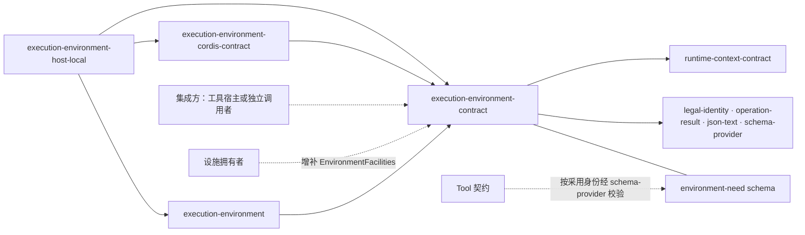

# 执行环境契约的使用与定位

本页说明消费方怎样使用本成员，以及本成员在系统与能力组中的位置。系统关系归[系统页 执行环境](../../../../docs/architecture/runtime/execution-environment.md)与[执行隔离](../../../../docs/architecture/security/execution-isolation.md)，领域责任归[领域页](../../../../docs/domains/execution-environments/README.md)，组内分解归[组入口](../../README.md)。本页不另立架构。

## 使用方式

本成员只有类型、设施声明、schema、块声明与纯函数。它不持有资源，没有初始化步骤，也没有需要释放的对象。`ExecutionEnvironment` 的实现、提供者与 Cordis 服务都在组内其他成员里。

### 独立消费

独立调用者不经过上层工作流，也不装配 Cordis。它安装本成员与机制成员 [execution-environment](../../execution-environment/README.md)，再加一个提供者成员。它自己承担集成方的全部责任：

1. 给出访问身份、作用域引用与原调用引用。作用域引用是请求方作用域，随每次落点解析与获取传入，与选中的绑定层无关：落在宿主机或租户级沙箱的获取也属于它，作用域释放与恢复也按它处理（[获取与租约](../SPEC.md#获取与租约)）。
2. 自己翻译出允许清单，组成 `EnvironmentRequirement`。可以用 `judgeRequirement` 在边界上解码外部值。
3. 实现资源账本、设施守卫与恢复授权三个端口。
4. 为每次获取给出幂等键，并保存采用记录。

账本不耐久时，重启后认不回来的资源由独立调用者自己承担（[INV-EE15](../SPEC.md#inv-ee15-准备持有回收与确认保持一致)）。访问系统托管的数据时，仍适用原访问契约（[INV-EE04](../SPEC.md#inv-ee04-原主体在实际边界继续受约束)）。

只用本成员就能做的事有三件：写工具环境声明、核对环境要求、按清单匹配提供者能力。下例写一个工具的环境声明，并从声明推出执行者能拿到的设施类型。它与 [examples/shell-needs.ts](../examples/shell-needs.ts) 一致：

```ts
import {
  environmentNeedAdoption,
  type EnvironmentNeedDeclaration,
  type FacilitySet,
} from '@omne-harness/execution-environment-contract'

export const shellNeeds = {
  facilities: ['command', 'terminal'],
  isolation: ['process'],
  layers: ['host_machine', 'session_sandbox', 'tenant_sandbox'],
} as const satisfies EnvironmentNeedDeclaration

// 执行者只拿到 command 与 terminal，取 files 不能通过类型检查。
export type ShellEnvironment = FacilitySet<(typeof shellNeeds)['facilities'][number]>

// 工具定义里存的 JSON：schema 的采用身份与声明值。
export const shellEnvironmentSlot = { schema: environmentNeedAdoption, value: shellNeeds }
```

`layers` 是能力兼容性，不是策略。集成方把它与策略允许的层取交集，按偏好排序，得到允许清单。

### 经集成方消费

在工具调用路径上，集成方是工具宿主。它经 Cordis 服务 `executionEnvironment` 调用 `ExecutionEnvironment` 的操作，服务定义见 [execution-environment-cordis-contract](../../execution-environment-cordis-contract/README.md)。顺序如下，详细时序见[流程](flows.md)：

1. 读工具定义里的环境声明，经 schema-provider 按 `environmentNeedAdoption` 解析 schema 并校验。
2. 把声明的绑定层与策略允许的层取交集，排好顺序，组成环境要求。
3. 以请求方作用域与环境要求调用 `resolvePlacement` 得到落点，在自己的账本里记下获取键与落点。
4. 以同一请求方作用域调用 `acquire`，得到租约与采用记录。随准备记录保存采用记录。
5. 用 `lease.facility(key)` 取设施，交给工具执行者。每次设施操作带新的请求身份。
6. 原调用结束后调用 `lease.release()`。待处置时用同一个释放操作重试。

工具执行者只拿到 `FacilitySet<K>`，不拿到租约本身。

### 提供者作者

提供者作者实现 `EnvironmentProvider`，并通过 `ProviderRegistrations.registerProvider` 登记。规则如下：

1. 如实声明绑定层、连续性、设施键与隔离断言。不以统一形状虚构不支持的能力（[INV-EE18](../SPEC.md#inv-ee18-提供者换代和-cordis-集成保留原责任)）。每次登记取一个新的代，`version` 写提供者代码的版本。
2. `acquire` 只交回临时回执：租约原件与证据。不自签采用记录（[INV-EE05](../SPEC.md#inv-ee05-实际执行捕获原落点与版本)）。
3. 只提供已有声明的设施，并为声明里须授权的操作接受设施守卫。缺任一项，获取对该键返回 `unsupportedFacility`（[设施协议](../SPEC.md#设施协议)）。
4. 可能跨进程存活的资源先在 `ProviderAcquireInput.ledger` 里计划并取得许可，再发出首个外部效果（[INV-EE15](../SPEC.md#inv-ee15-准备持有回收与确认保持一致)）。经租约的设施操作由登记表的门查账本的 `closed` 信号。提供者在门之外自己发起的效果，发出前自己查这个信号。
5. 支持恢复的提供者同时实现 `listRecoveryResources` 与 `recover`。枚举失败返回不可用，不返回空列表。不支持恢复的提供者两者都不实现。受管资源按 `ProviderAcquireInput.scope`（请求方作用域）登记，枚举时按它查找。
6. `retire` 先拒新租约，再排空。清理未完时返回待处置并列出未停的资源。`acquire` 与 `retire` 在提供者自己配置的上界内返回：`retire` 超界答待处置，`acquire` 超界先释放已分配的部分再以 `providerUnavailable` 拒绝（[INV-EE18](../SPEC.md#inv-ee18-提供者换代和-cordis-集成保留原责任)）。
7. 提供者不发布 `execution.placement` 与 `execution.host-facts`。这两条块的生产者是 host-local 的 Service 实现。当前还没有发布（[INV-EE17](../SPEC.md#inv-ee17-真实落点痕迹与诊断可定位且守住披露)）。

`registerProvider` 返回撤除函数。撤除登记等于退役开始。宿主提供者的实际做法见 [execution-environment-host-local](../../execution-environment-host-local/README.md)。

### 设施拥有者

设施拥有者在自己的包里增补设施表，再用 `describeFacility` 发布声明：

```ts
import { describeFacility, type FacilityResult } from '@omne-harness/execution-environment-contract'

export interface BrowserFacility {
  open(request: OpenRequest): Promise<FacilityResult<PageRef>>
  close(request: CloseRequest): Promise<FacilityResult<PageRef>>
}

declare module '@omne-harness/execution-environment-contract' {
  interface EnvironmentFacilities {
    'example.browser': BrowserFacility
  }
}

export const browserFacility = describeFacility('example.browser', {
  open: 'guarded',
  close: 'guarded',
})
```

`OpenRequest`、`CloseRequest` 与 `PageRef` 是设施拥有者自己的类型，请求类型扩展 `FacilityRequest`。设施键前缀写设施拥有者自己的域。`describeFacility` 要求每个操作都标成 `guarded` 或 `open`。声明经 `ProviderRegistrations.registerFacility` 登记。全系统一个键只有一份声明，第二份被拒绝。声明只提供词汇，不安装设施，也不授权操作。本成员不改。

### 集成方实现三个端口

| 端口 | 集成方要做的事 | 条款 |
| --- | --- | --- |
| `ResourceLedger` | 每次获取一份，耐久。先 `plan` 再 `permit`，许可确认之后提供者才发出效果。`adopt` 接续已有资源，`stopped` 记下停止结果。原调用的终局与资源许可写在同一耐久顺序里。账本关闭时触发 `closed` 信号，之后不再发新许可，登记表的门也不再开始新的设施操作 | [INV-EE15](../SPEC.md#inv-ee15-准备持有回收与确认保持一致) |
| `FacilityGuard` | 按当前授权回答这次操作现在还允许吗。答 `authorized`、`notAuthorized` 或 `unavailable`。依据只在集成方一侧 | [获取与租约](../SPEC.md#获取与租约) |
| `RecoveryAuthority` | 核对一个恢复授权能否停止与结算一个作用域的资源。恢复授权由集成方的维护拥有者用 `createRecoveryAccess` 签发，独立于用户访问 | [恢复](../SPEC.md#恢复) |

## 消费者与定位

本成员处在执行环境组依赖的最底层。下图投影[组架构](../../docs/architecture.md#成员与依赖)里与本成员相关的边，两者不一致时以组架构为准。



实线是 `package.json` 里的依赖。虚线是使用关系：集成方与设施拥有者导入本成员；Tool 契约不导入本成员，只按采用身份解析 schema。

### 邻域交接

| 邻域 | 交接什么 | 本成员给什么 | 对方给什么 |
| --- | --- | --- | --- |
| Tool 契约的[环境准备和释放](../../../tool/tool-contract/SPEC.md#p03-环境准备和释放) | 工具侧的准备、认回与释放 | 落点、获取、采用记录、租约与释放结果 | 准备记录与释放记录的耐久保存 |
| Runtime Context 的 [RC-02](../../../context/runtime-context-contract/SPEC.md#rc-02-块声明注册与参数) | 两条块 | 块声明、值类型与解码函数 | `ScopeRef`、块声明类型、块的注册与读取 |
| schema-provider | 工具环境声明的校验 | `environmentNeedSchema`、`environmentNeedAdoption` 与 JSON Schema 文件 | 按采用身份解析 schema 并校验声明值 |
| legal-identity | 租户 | 无 | `TenantId` |

Tool 契约 P03 的各步怎样对到本成员的操作。集成方是工具宿主，适配写在工具宿主一侧：

| Tool 契约 P03 | 本成员 | 说明 |
| --- | --- | --- |
| 先提交 `PreparationRecord`，再 prepare | 先 `resolvePlacement` 得到落点，再在账本里记下获取键与落点，然后 `acquire` | 获取键取自准备记录的操作身份，所以对端按同一操作去重 |
| 对端按同一操作去重 | 同一获取键返回同一状态，不重新分配 | 同键配不同落点按参数冲突拒绝 |
| `inspectPreparation` 查询原分配 | `inspectAcquisition` | 本成员的实现重启后答复 `unrecorded`，不表示没有分配过。工具宿主据账本走恢复 |
| `prepared` 返回重新连接能力与持久证据 | `Acquired`：租约与采用记录 | 采用记录是持久证据，由工具宿主随准备记录保存。租约是进程内的使用入口 |
| `prepared` 命令核验环境的归属、设施、代次与固定请求 | 采用记录里的落点、提供者与代、实例与代；租约只暴露要求里的设施键 | 同一份采用记录不供另一调用使用 |
| `pending` 或 `unknown` | `Pending`，或答复丢失后用同一获取键再问 | 保留原任务，不重新请求 |
| `rejected` 保存具体失败及清理责任，不降级宿主 | `Rejected` 与 `RejectReason`；核验失败时的待处置释放 | 拒绝不换落点，不退回宿主机 |
| 准备期间已取消，仍登记原资源并安排 release | 获取仍有记录，租约照常释放 | 不丢弃回包 |
| `release` 使用独立的 `ReleaseRecord` | `lease.release()` 得到 `LeaseRelease` | 释放只针对这一次获取。共享环境不因一次释放而销毁 |
| `inspectRelease` 查询释放 | `inspectAcquisition` 的 `releasing`、`pendingRelease`、`released` | 待处置可以用同一个释放操作重试 |

Tool 契约的 `excluded`（已可靠排除全部延迟分配）在本成员里没有同名状态。工具宿主只能凭 `inspectAcquisition` 的确定状态判断排除，`unrecorded` 不能单独证明没有分配。

### 现在的真实消费者

组内其他三个成员都依赖本成员：

- [execution-environment-cordis-contract](../../execution-environment-cordis-contract/README.md) 用 `ExecutionEnvironment` 与 `ProviderRegistrations` 定义抽象 Service。
- [execution-environment](../../execution-environment/README.md) 用操作面、提供者接口与 `matchProviders` 实现登记表。
- [execution-environment-host-local](../../execution-environment-host-local/README.md) 用 `EnvironmentProvider` 与 `files` 设施实现宿主提供者。

组外现在没有包导入本成员。工具宿主的适配还没有实现。

### 上层页面

- 系统关系、成员切分与恶意代码边界：[系统页 执行环境](../../../../docs/architecture/runtime/execution-environment.md)、[执行隔离](../../../../docs/architecture/security/execution-isolation.md)。
- 领域责任与跨领域交接：[领域页](../../../../docs/domains/execution-environments/README.md)、[领域交接设计](../../../../docs/domains/execution-environments/architecture.md)。
- 组内成员与跨成员流程：[组入口](../../README.md)、[组协作入口](../../docs/key-flows.md)。
- 产品含义：产品正文[环境、落点与资源的概念](../../../../.meta_harness/design/product/execution-environments/design.md#环境落点与资源的概念)。
