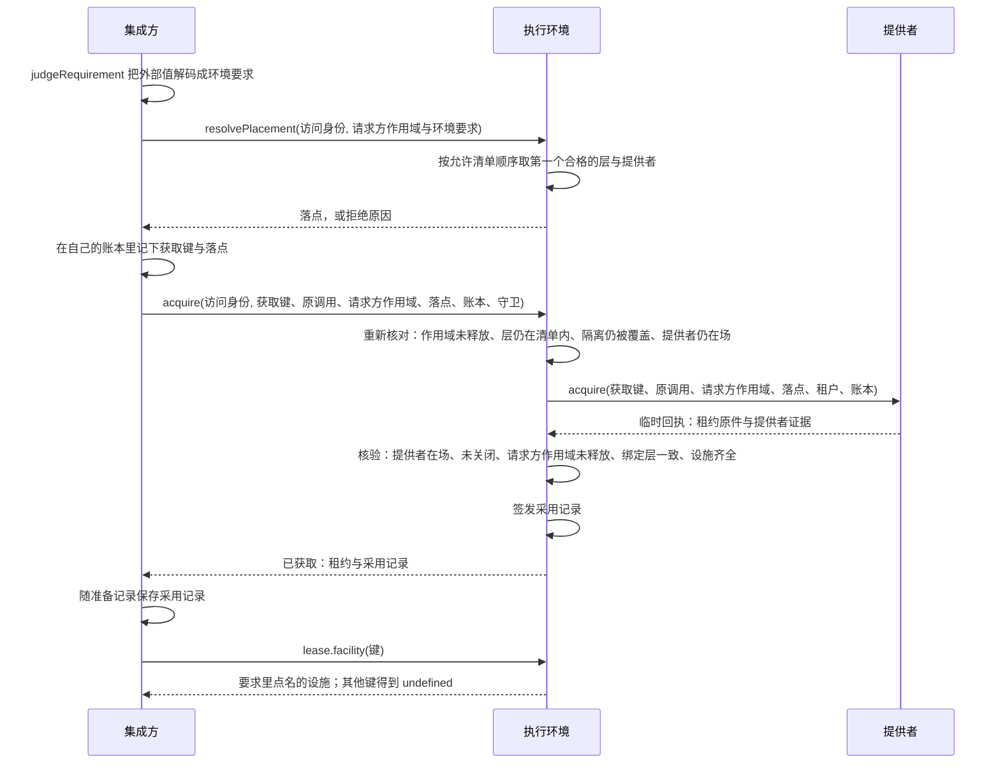
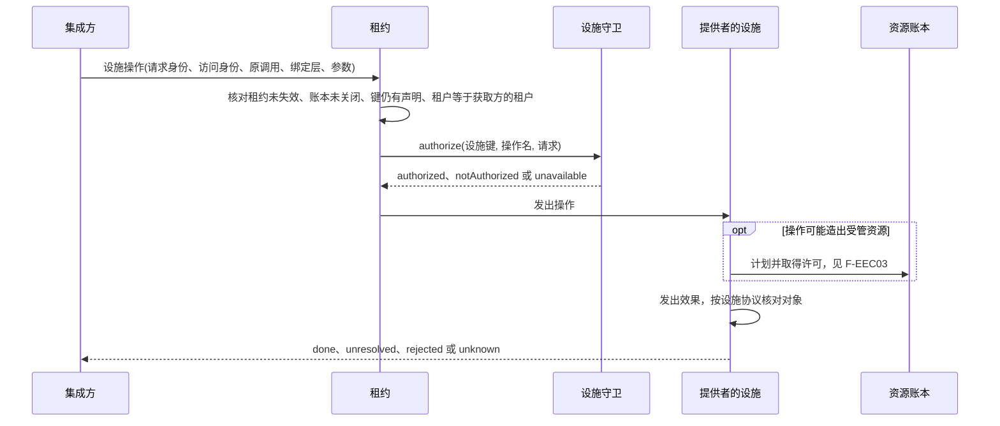
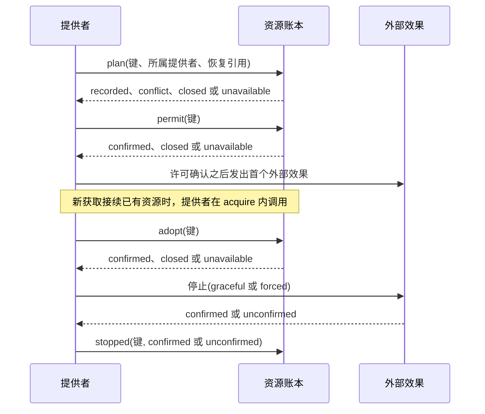
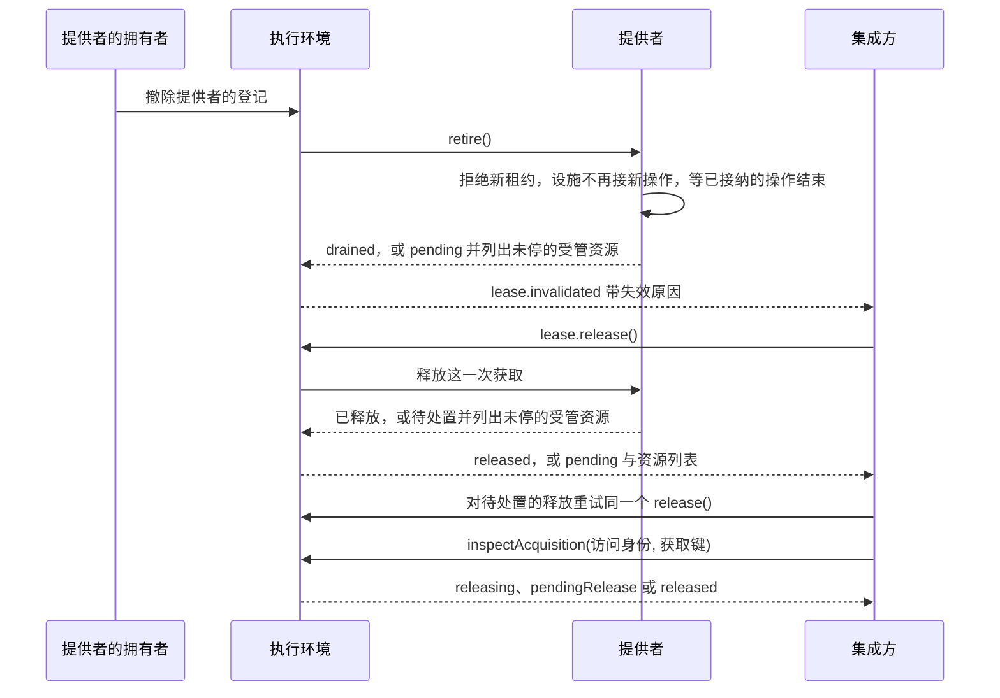
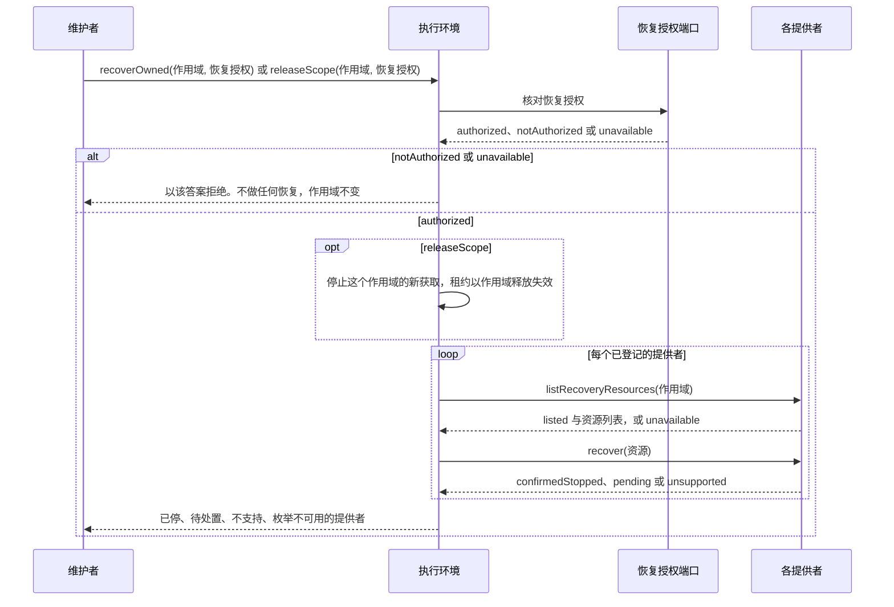
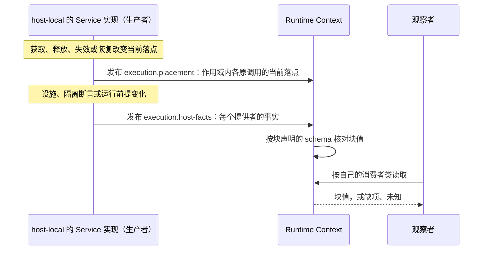
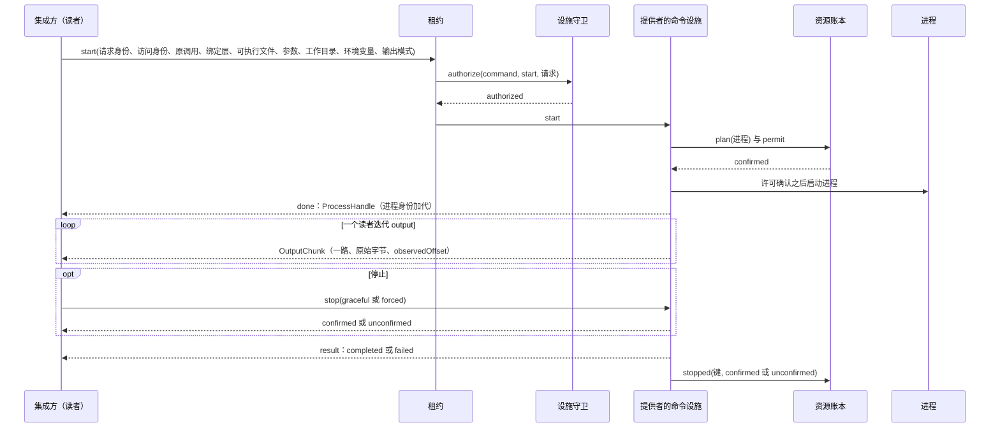
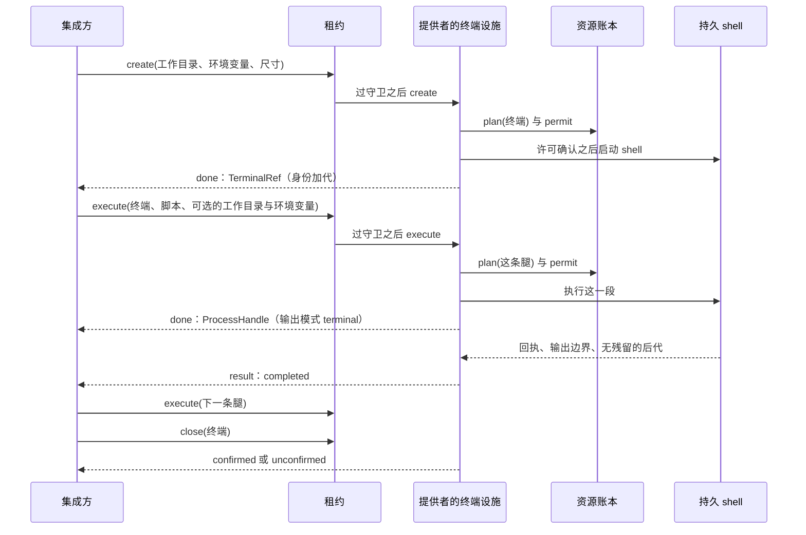
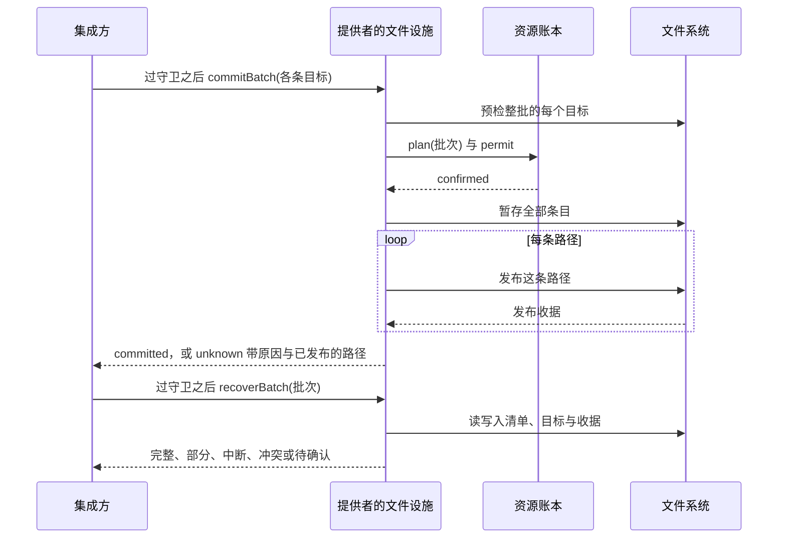

# 执行环境契约的协议流程

本页给出本成员的九条协议级流程。每条流程有一张时序图和一张「失败与责任交接」表，并标出对应的 [SPEC](../SPEC.md) 条款。行为以 SPEC 为准，图只投影条款，不表示运行实现已经存在。F-EEC07 与 F-EEC08 是设计，当前没有提供者实现 `command` 与 `terminal`。

图中的「执行环境」是 `ExecutionEnvironment` 的实现。不含 Cordis 的登记表机制归 [execution-environment](../../execution-environment/README.md)，它的机制级流程见该成员的 `docs/flows.md`。跨成员流程 F-EX01 至 F-EX04 归组的[协作入口](../../docs/key-flows.md)。本页各条注明对应的组流程 F-EX。对象的状态与转移见[对象模型](object-model.md#生命周期)。设施协议的规则见 SPEC [设施协议](../SPEC.md#设施协议)，逐设施的展开见[内部架构](architecture.md#设施协议)。

图中只出现通用角色：集成方、执行环境、提供者、设施拥有者、设施守卫、资源账本、维护者、恢复授权端口与观察者。设施守卫、资源账本与恢复授权端口都由集成方实现。

## 流程

### F-EEC01 解析落点、获取、核验、签发采用记录、交付租约

条款：[INV-EE02](../SPEC.md#inv-ee02-策略在域外求值环境只在允许清单内匹配)、[INV-EE03](../SPEC.md#inv-ee03-必需设施和隔离不得降低满足)、[INV-EE05](../SPEC.md#inv-ee05-实际执行捕获原落点与版本)、[获取与租约](../SPEC.md#获取与租约)。组的 F-EX01 从这里开始。

前提：集成方已经在域外把策略与工具的环境声明翻译成环境要求。集成方有自己的耐久账本，并为这次获取给出幂等键。

| 环节 | 结果 | 失败与责任交接 |
| --- | --- | --- |
| 解码环境要求 | 得到冻结的 `EnvironmentRequirement` | 不合形状或带额外字段时，`judgeRequirement` 返回 `invalidInput` 与逐项原因。集成方修正后重新提交 |
| 解析落点 | 按清单顺序取第一个有在场提供者、设施都已登记并由它提供、隔离断言都能由它确认的层 | 没有合格的层时拒绝，原因取最接近的一项：无匹配环境、缺设施或隔离未确认。同一层里多个提供者同时合格时以 `ambiguousEnvironment` 拒绝，不取先登记者。本成员不选清单外的层。请求方作用域已释放时以 `referenceExpired` 拒绝；选中的层带作用域但不等于请求方作用域时以 `invalidInput` 拒绝 |
| 重新核对 | 落点的条件在获取时仍成立 | 任一条件失败即拒绝，不换落点，不退回宿主机或较弱的隔离 |
| 同键重复获取 | 返回同一状态，不重新分配。已获取返回同一租约，已拒绝返回同一原因，其余状态返回待定并带当前状态 | 同键配不同落点或不同请求方作用域按参数冲突拒绝。跨租户查询同一键按无记录处理，不泄露键的存在 |
| 提供者回执 | 回执只是临时的 | 提供者拒绝时，原因原样交给集成方 |
| 核验与签发 | 核验通过才签发采用记录并交付租约。采用记录不由提供者自签 | 核验失败时执行环境尝试释放这份临时资源：释放成功记为已拒绝；释放待处置时，资源保留在原提供者的登记上，状态为待处置释放 |
| 保存采用记录 | 集成方随准备记录耐久保存采用记录 | 执行环境不保存耐久事实。实现重启后 `inspectAcquisition` 对同一键答复 `unrecorded`，集成方据账本走恢复，不再对该键调用 `acquire` |
| 按键取设施 | 租约只暴露环境要求里的设施键 | 没有点名的键取不到设施。设施操作见 F-EEC02 |

### F-EEC02 一次设施操作

条款：[设施协议](../SPEC.md#设施协议)、[INV-EE04](../SPEC.md#inv-ee04-原主体在实际边界继续受约束)、[INV-EE09](../SPEC.md#inv-ee09-资源和秘密以最小必要条件提供)、[INV-EE14](../SPEC.md#inv-ee14-未知保持原身份不盲目重放效果)。组的 F-EX01 在这里结束，F-EX02 从这里开始。

前提：集成方持有一份有效的租约，并为这次操作给出新的请求身份。

| 环节 | 结果 | 失败与责任交接 |
| --- | --- | --- |
| 核对请求方 | 请求里的租户等于获取方的租户。租约只绑定租户，主体由设施守卫判断 | 不相等时以 `notAuthorized` 拒绝 |
| 核对租约 | 租约未失效或释放 | 失效或释放后的新操作以 `closed` 拒绝 |
| 核对账本 | 这次获取的账本没有关闭 | 账本关闭后的新操作以 `closed` 拒绝，不发出操作。门是所有设施操作的唯一入口，所以这项核对只在门里做 |
| 核对声明 | 设施键的声明仍有效 | 声明已撤除时以 `unsupported` 拒绝 |
| 设施守卫 | 只有答 `authorized` 时操作才发出。执行环境不知道守卫的依据 | 答不允许时拒绝。守卫不可用时操作不发出，结果按对象模型的[设施请求](object-model.md#设施请求)记录。撤权在下一次操作时生效 |
| 发出效果 | 按[设施协议](architecture.md#设施协议)执行 | 文件对象被换掉或核对不了时拒绝，不改按路径字符串放行，也不改落宿主机 |
| 确认 | 一个请求身份只有一种确认。`done` 只确认这次请求点名的那一项。`command` 的 `start` 只在进程实际启动后返回 `done`，带进程身份 | 效果不可确认时结果为 `unknown`，保留请求身份，不自动重试有副作用的操作。后一次操作是另一个请求。`start` 被接纳但进程映像没有启动时返回 `rejected`，原因 `unavailable`；启动与否不可确认时返回 `unknown` |

### F-EEC03 受管资源的计划、许可、运行、停止与接续

条款：[INV-EE13](../SPEC.md#inv-ee13-控制请求与实际停止释放分别确认)、[INV-EE15](../SPEC.md#inv-ee15-准备持有回收与确认保持一致)。组的 F-EX02 在这里结束。

前提：受管资源是可能跨进程寿命存活的进程、终端或文件批次。资源账本由集成方实现，耐久，每次获取一份。本条只写三种资源共用的账本协议。命令、终端与文件批次各自的流程见 [F-EEC07](#f-eec07-命令的增量输出与终局)、[F-EEC08](#f-eec08-终端腿)、[F-EEC09](#f-eec09-文件批次的提交与认回)。

| 环节 | 结果 | 失败与责任交接 |
| --- | --- | --- |
| 计划 | 资源在账本里有记录 | 许可冲突或账本已关闭时不启动资源，操作返回拒绝 |
| 许可 | 许可确认之后才发出首个外部效果 | 许可未确认时不发出效果。原调用结束后到达的许可请求由账本拒绝。账本关闭后不再发新许可，也不再开始新的设施操作：经租约的操作由执行环境的门查 `ledger.closed`，提供者在门之外自己发起的效果由提供者在发出前查。已经发生的效果不因关闭而撤销 |
| 运行 | 资源的恢复引用是 JSON，不是活句柄或裸进程号 | 原调用的终局与资源许可写在集成方账本的同一耐久顺序里 |
| 接续 | 提供者在 `acquire` 内调用 `adopt(键)`。账本核对通过后，资源记入这次获取，不重新启动 | 账本核对记录是否存在、资源是否仍在运行、访问身份与作用域是否和记录一致。不一致时账本答 `unavailable`，提供者以 `unavailable` 拒绝这次获取。执行环境不另核 |
| 停止 | 控制请求、实际停止与账本记录分别确认 | 确认不了停止的资源记为未确认，保留处置责任与查询入口，不写成已停。超时或没有返回不写成进程已退出 |
| 文件批次的终态 | 已提交与未知是终态 | 释放时它们不算未停的受管资源。提交与认回见 [F-EEC09](#f-eec09-文件批次的提交与认回) |

### F-EEC04 租约失效、提供者退役与释放

条款：[获取与租约](../SPEC.md#获取与租约)、[INV-EE06](../SPEC.md#inv-ee06-逻辑工作实例资源和数据不共用寿命)、[INV-EE07](../SPEC.md#inv-ee07-临时状态边界与实际回收明确)、[INV-EE18](../SPEC.md#inv-ee18-提供者换代和-cordis-集成保留原责任)。组的 F-EX03 从这里开始。

前提：租约可能因为提供者退役、作用域释放、执行环境关闭、寿命到期回收、实例丢失或换代而失效。释放只针对一次获取。

| 环节 | 结果 | 失败与责任交接 |
| --- | --- | --- |
| 提供者退役 | 先拒新租约，再排空。结果是已排空，或待处置并列出未停的受管资源 | 清理未完或耐久责任无人承接时不报已排空。撤除登记不丢弃已有的工作与资源 |
| 租约失效 | 失效对集成方可见，带原因 | 失效后的新设施操作以 `closed` 拒绝。已经在途的输出、终局与停止仍由原提供者处理 |
| 释放 | 已释放，或待处置并列出未停的受管资源 | 待处置可以用同一个释放操作重试。共享的环境不因一次释放而销毁。丢掉引用不是释放 |
| 查询 | `inspectAcquisition` 返回这次获取的当前状态 | 查询不重做释放。查询不可用不等于资源不存在 |
| 寿命到期 | 停止依赖旧环境的新准入，要求回收并报告实际结果 | 回收失败或不可观察时保持待处置与未知，不假报销毁。新实例使用新身份，不复活旧终端 |

### F-EEC05 恢复授权收场与作用域释放

条款：[恢复](../SPEC.md#恢复)、[INV-EE06](../SPEC.md#inv-ee06-逻辑工作实例资源和数据不共用寿命)、[INV-EE14](../SPEC.md#inv-ee14-未知保持原身份不盲目重放效果)、[INV-EE16](../SPEC.md#inv-ee16-恢复数据计算与原执行分别验证)。组的 F-EX03 在这里结束。

前提：集成方的维护拥有者签发了恢复授权。作用域级释放由维护者凭恢复授权发起。执行环境不从任何上层逻辑状态推断作用域已经结束。

| 环节 | 结果 | 失败与责任交接 |
| --- | --- | --- |
| 核对恢复授权 | 恢复授权只能用于停止、认回与结算一个作用域的受管资源。两个操作都先核授权 | 答不允许或不可用时，以该答案拒绝，不做任何恢复。`releaseScope` 被拒时作用域不变，该作用域的获取照常进行。恢复授权不能用于获取或新执行。用户撤权或退出不阻断系统凭它回收 |
| 停止新获取 | 只在 `releaseScope` 里发生，在授权通过之后、资源处理之前 | 这个作用域的租约随之失效，原因是作用域释放 |
| 枚举 | 提供者只列出它的拥有者索引能证明属于这个作用域的资源 | 枚举失败的提供者记为不可用，它的资源是未知，不当成空集。没有恢复能力的提供者记为不支持 |
| 认回与停止 | 每项结果是已确认停止、待处置或不支持 | 提供者的 `recover` 不重授旧许可，不重跑原作用，不重建 shell |
| 汇总 | 一次恢复驱动的结果分组列出 | 某一组失败不抹掉已经处理的部分。恢复本身中断后沿原进度继续 |

### F-EEC06 落点与宿主事实经 Runtime Context 到达观察者

条款：[INV-EE17](../SPEC.md#inv-ee17-真实落点痕迹与诊断可定位且守住披露)、Runtime Context 的 [RC-02](../../../context/runtime-context-contract/SPEC.md#rc-02-块声明注册与参数)。对应组的 F-EX04。

前提：两条块声明由本成员导出。生产者是 host-local 的 Service 实现。当前还没有发布。块的注册、读取与恢复规则归 Runtime Context。

| 环节 | 结果 | 失败与责任交接 |
| --- | --- | --- |
| 发布落点块 | 按获取记录的请求方作用域分组，宿主机与租户级沙箱的获取也在内。每项带原调用、绑定层、实例身份与代、连续性、设施键与观察时间 | 无法确认时明确未知，不从通知送达推定物理完成 |
| 发布宿主事实块 | 每个已登记提供者一项：名称、代、版本、平台（操作系统类型与版本）、设施键、隔离断言，以及满足、不满足或未知的运行前提 | 提供者事实是观察，不是控制。前提探测被接受之前报未知 |
| 核对块值 | 块值按本成员的解码函数核对 | 不合 schema 的值不作为合法当前值交给读者，处理方式归 Runtime Context |
| 读取 | 消费者类 `model`、`tool`、`extension` 可以读两条块 | 读者看到落点变化，不能据此认定原进程已停、数据已迁移或原工具已收场。凭据不进入块 |
| 恢复 | 两条块的恢复方式都是重算 | 生产者不在场时读取得到缺项，不得到旧值 |

### F-EEC07 命令的增量输出与终局

状态：设计，提供者未实现。当前没有成员提供 `command` 设施。宿主机上的机制设计见 host-local 的[宿主命令与终端机制](../../execution-environment-host-local/docs/architecture.md#宿主命令与终端机制设计未实现)。

条款：[设施协议](../SPEC.md#设施协议)、[INV-EE09](../SPEC.md#inv-ee09-资源和秘密以最小必要条件提供)、[INV-EE13](../SPEC.md#inv-ee13-控制请求与实际停止释放分别确认)、[INV-EE15](../SPEC.md#inv-ee15-准备持有回收与确认保持一致)。展开组的 F-EX02 里的一种设施操作。逐设施的规则见内部架构的 [`command`](architecture.md#command命令)。

前提：租约暴露 `command`。集成方为这次启动给出新的请求身份，以及按允许名单组成的显式环境变量。

| 环节 | 结果 | 失败与责任交接 |
| --- | --- | --- |
| 启动前 | 先过设施守卫，再在账本里计划并取得许可，许可确认之后才启动进程 | 守卫答不允许或不可用时不启动。许可冲突或账本已关闭时不启动 |
| 启动 | `done` 交出 `ProcessHandle`，表示进程实际已启动。进程身份是提供者给的身份加代，不是裸进程号 | 被接纳但进程映像没有启动时为 `rejected`，原因 `unavailable`。启动与否不可确认时为 `unknown` |
| 增量输出 | `output` 是唯一的输出主体，只允许一个读者。每块是原始字节，不按行或字符切分，大小不超过单块上限 | 不承诺逐字节、逐行或实时送达。读者调用 `return()` 只放弃读取权，不停止进程，之后的字节都计入丢弃 |
| 有界缓冲 | 缓冲不超过缓冲上限 | 无人读、慢读或读者离开时，新字节被丢弃并计数，不阻塞终局与停止。`observedOffset` 的空隙标出丢弃的位置 |
| 终局 | `completed` 只用于进程完成已确认，带退出码、信号或未知退出，以及时长与输出计数 | 完成不可确认时为 `failed`（`unavailable` 或 `effectUnknown`），仍交出截至失联的时长与输出计数。`result` 不会永不结算。重复或并发等待不再启动任何东西 |
| 停止 | `stop` 在有界时间内返回 `confirmed` 或 `unconfirmed` | 未确认的停止保留处置责任，不写成已停。进程已退出只认对该进程身份记录的回收状态，不认父进程退出、完成通知或一次查不到 |
| 四件事分开 | 输出结束、进程终局、停止请求与资源已停分别判断 | 失败或未知的回执不伪造退出码 |

### F-EEC08 终端腿

状态：设计，提供者未实现。当前没有成员提供 `terminal` 设施。宿主机上的机制设计见 host-local 的[宿主命令与终端机制](../../execution-environment-host-local/docs/architecture.md#宿主命令与终端机制设计未实现)。

条款：[设施协议](../SPEC.md#设施协议)、[INV-EE07](../SPEC.md#inv-ee07-临时状态边界与实际回收明确)、[INV-EE13](../SPEC.md#inv-ee13-控制请求与实际停止释放分别确认)、[INV-EE15](../SPEC.md#inv-ee15-准备持有回收与确认保持一致)。展开组的 F-EX02 里的一种设施操作。逐设施的规则见内部架构的 [`terminal`](architecture.md#terminal终端)。

前提：租约暴露 `terminal`。终端是一个受管资源，每条腿是另一个受管资源。

| 环节 | 结果 | 失败与责任交接 |
| --- | --- | --- |
| 创建 | 交出新的 `TerminalRef`。终端归原实例的代 | 新实例使用新身份，不复活旧终端的状态。只提供命令而不提供终端的环境拒绝终端请求，不降成一次性执行 |
| 一条腿 | 同一终端同一时刻只有一条在途的腿。每条腿是独立的请求，各自过守卫、各自计划与许可，各自有 `ProcessHandle` | 已有在途的腿时以 `busy` 拒绝，不排队 |
| 状态持续 | 工作目录、变量、函数与 shell 选项跨腿持续 | 带显式工作目录或环境变量的腿在子 shell 里运行，不改写终端的基态 |
| 完成 | 有效回执、观察到的输出边界与无残留的后代三者都成立时，这条腿才完成。回执不是输出字节 | 已发布的完成不改写。完成未知时不接纳后继的腿 |
| 失效 | 控制损坏、超时、`exit` 或 `exec`、重复回执、完成后仍有数据、空闲时出现数据、确认不了后代已停，终端都失效 | 失效不换新 shell 假装继续。在途的腿以 `failed`（`effectUnknown`）结算。无效的终端引用由终端设施明确失败 |
| 停止与关闭 | `stop` 可能停止整个终端；`close` 的结果是 `confirmed` 或 `unconfirmed` | 旧腿确认完成后，不误停新腿。未确认的关闭保留处置责任 |

### F-EEC09 文件批次的提交与认回

条款：[设施协议](../SPEC.md#设施协议)、[INV-EE14](../SPEC.md#inv-ee14-未知保持原身份不盲目重放效果)、[INV-EE15](../SPEC.md#inv-ee15-准备持有回收与确认保持一致)。展开组的 F-EX02 里的一种设施操作。逐设施的规则见内部架构的[文件设施](architecture.md#files文件)。当前的宿主文件设施只实现读取、查看、写入与关闭，批次的两项操作返回 `unsupported`。

前提：租约暴露 `files`。每条目标带路径、点名对象、字节与期望版本。

| 环节 | 结果 | 失败与责任交接 |
| --- | --- | --- |
| 预检 | 整批每个目标都通过 | 任何一条不通过，整批都不改动 |
| 计划与许可 | 批次作为受管资源先计划并取得许可 | 许可冲突或账本已关闭时不暂存，不发布 |
| 逐条发布 | 每条路径有自己的发布收据。系统不承诺多条路径同时生效 | 某条路径的收据丢失时，后续路径停止发布，结果为 `unknown`，原因取 `effectUnknown`、`conflict`、`closed` 或 `unavailable` |
| 终态 | 已提交与未知都是批次的终态 | 释放时它们不算未停的受管资源 |
| 认回 | `recoverBatch` 把这一批认成五种之一。`published` 只含有耐久发布收据的路径 | 认回不续发布，不回滚，不覆盖外部的新写入。当前字节与暂存一致不等于有收据 |

## 失败与生命周期

下表汇总各条流程共用的失败、取消与生命周期规则。每条规则的正文在所列条款里，本页只做定位。

| 情形 | 结果 | 责任方 | 条款 |
| --- | --- | --- | --- |
| 拒绝 | 获取的拒绝带 `RejectReason`，设施操作的拒绝带 `FacilityReason`。不改落点，不降低隔离 | 集成方按原因处置 | [INV-EE03](../SPEC.md#inv-ee03-必需设施和隔离不得降低满足)、[设施协议](../SPEC.md#设施协议) |
| 未知 | 保留原获取、原请求、原资源的身份与下一次查询的责任。不当成失败，也不当成没有发生 | 原操作的拥有者查询或对账 | [INV-EE14](../SPEC.md#inv-ee14-未知保持原身份不盲目重放效果) |
| 答复丢失 | 用同一个获取键或同一个释放操作再问，得到原来的状态 | 集成方据自己的账本 | [获取与租约](../SPEC.md#获取与租约) |
| 执行环境的实现重启 | `inspectAcquisition` 对已知的键答复 `unrecorded`，不重建租约。对同一个键再调用 `acquire` 会被当作新获取 | 集成方先查自己的账本，对已有记录的键走恢复，不再调用 `acquire`。处置视图由提供者的枚举重建 | [所有权、失败与生命周期](../SPEC.md#所有权失败与生命周期) |
| 取消或停止 | 控制受理、实际停止与资源关闭分别确认 | 原提供者与资源账本 | [INV-EE13](../SPEC.md#inv-ee13-控制请求与实际停止释放分别确认) |
| 释放资源或运行 disposer | 不撤回已经提交的外部效果 | 外部效果按原工具报告 | [INV-EE13](../SPEC.md#inv-ee13-控制请求与实际停止释放分别确认) |
| 作用域结束 | 执行环境不从逻辑状态推断。维护者凭恢复授权发起作用域释放 | 维护者 | [INV-EE06](../SPEC.md#inv-ee06-逻辑工作实例资源和数据不共用寿命)、[恢复](../SPEC.md#恢复) |
| 提供者撤除 | 退役开始，在途工作与资源不丢。退役在提供者自己配置的上界内结束，超界为待处置 | 原提供者结清，账本保留未停的资源 | [INV-EE18](../SPEC.md#inv-ee18-提供者换代和-cordis-集成保留原责任) |

各对象的创建、变化与结束见对象模型的[生命周期](object-model.md#生命周期)。
