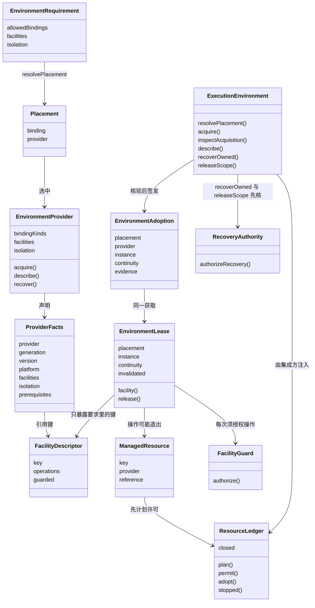
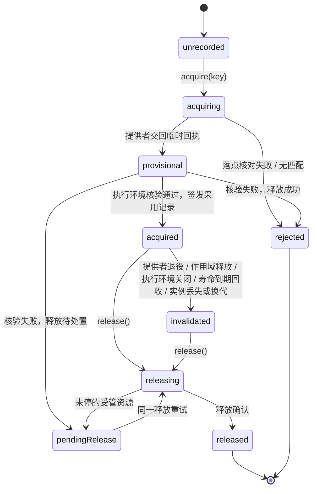
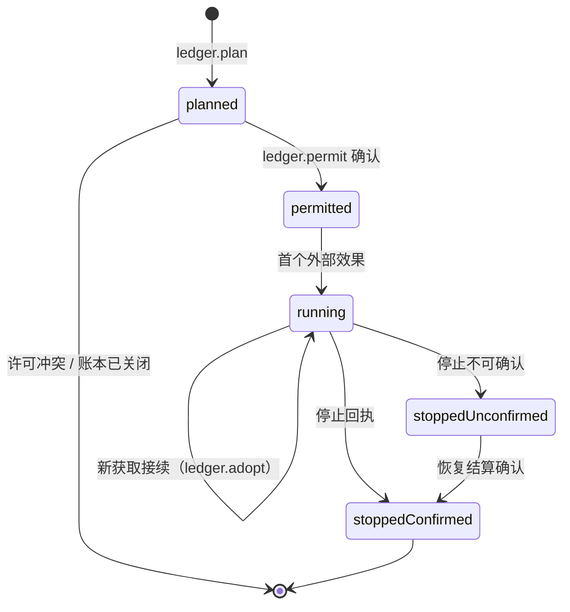
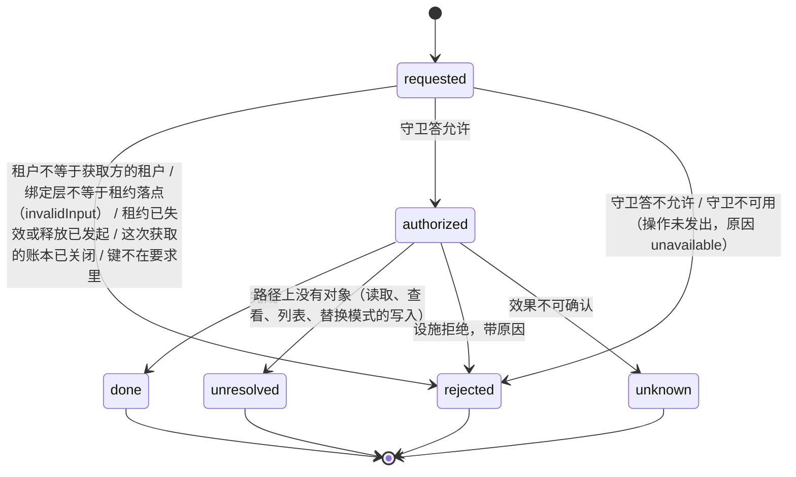
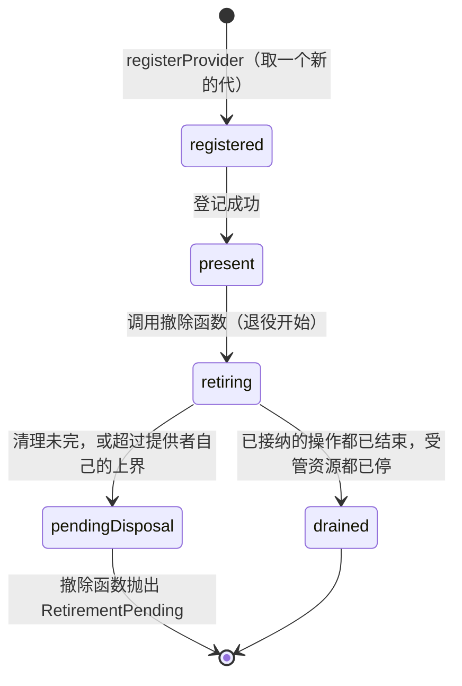

# 对象模型

本页说明 `@omne-harness/execution-environment-contract` 公开类型之间的身份、关系与生灭。行为条款归 [SPEC](../SPEC.md)，导出导航归 [public-api](public-api.md)，产品含义归产品正文[环境、落点与资源的概念](../../../../.meta_harness/design/product/execution-environments/design.md#环境落点与资源的概念)，领域对象的跨 topic 骨架归[领域对象清单](../../../../.meta_harness/design/domain_objects/objects.md)。本页只写本成员视角。

## 接受范围与修订依据

本页的「对象与关系」与「生命周期」承接 #278 已接受的「环境抽象」一节，见[技术设计接受](https://github.com/nemori-ai/omne-harness-lite/issues/278#issuecomment-6197369869)。下列设计沿用该接受，原文义不变：

- 一次调用先形成落点，再按设施取得租约。工具拿到的是设施，不是资源登记的写接口。
- 落点选定之后，获取时再核一次当前条件。这次核对不改选落点。
- 绑定层是闭集，每一层带自己的归属。连续性说这一刻还能不能接着用，不重写寿命。
- 设施按名登记，与寿命正交。提供者声明自己提供哪些设施，以及自己的连续性。
- 文件设施的读取、查看、写入、关闭各有自己的结果。文件对象是不透明的 `ObjectToken`，契约不把宿主 inode 写成所有落点的身份。
- 没有匹配的提供者时拒绝，不改绑定层，也不改用宿主机。

下列部分按新的领域边界改写，未经技术接受。各项的依据是产品正文执行环境第 2 版的对应小节：

| 改写 | 依据 |
| --- | --- |
| 绑定层的归属由不透明的作用域引用与原调用引用表示；获取另带请求方作用域 | [绑定层说寿命，连续性说此刻](../../../../.meta_harness/design/product/execution-environments/design.md#绑定层说寿命连续性说此刻) |
| 落点在集成方给的允许清单内匹配；同一层多个提供者同时满足时按歧义拒绝 | [环境要求与落点](../../../../.meta_harness/design/product/execution-environments/design.md#环境要求与落点) |
| 提供者声明隔离断言；提供者身份带代与版本 | [提供者与隔离断言](../../../../.meta_harness/design/product/execution-environments/design.md#提供者与隔离断言) |
| 设施由设施声明给出操作名单与须授权的操作；须授权的操作逐次问设施守卫 | [设施的声明、请求与守卫](../../../../.meta_harness/design/product/execution-environments/design.md#设施的声明请求与守卫) |
| 获取带幂等键；采用记录由执行环境核验提供者回执后签发；租约可失效 | [获取、采用记录与租约](../../../../.meta_harness/design/product/execution-environments/design.md#获取采用记录与租约) |
| 受管资源先经资源账本许可，再发出效果 | [受管资源与资源账本：先许可，后效果](../../../../.meta_harness/design/product/execution-environments/design.md#受管资源与资源账本先许可后效果) |
| 恢复授权独立于访问身份 | [恢复授权与作用域收场](../../../../.meta_harness/design/product/execution-environments/design.md#恢复授权与作用域收场) |

本页其余各节依据同一版产品正文写成，未经技术接受。

## 调用方怎样使用

本成员只认通用角色。每个角色是调用本成员时的一种身份，不是类型。

| 角色 | 在本成员里做什么 | 对应的输入 |
| --- | --- | --- |
| 集成方 | 交环境要求、幂等键与访问身份，接收租约；实现资源账本、设施守卫与恢复授权三个端口 | `EnvironmentRequirement`、`ResourceLedger`、`FacilityGuard`、`RecoveryAuthority` |
| 提供者 | 登记事实，造实例，交回临时回执，结清在途操作 | `EnvironmentProvider` |
| 设施拥有者 | 发布设施声明 | `describeFacility`、`EnvironmentFacilities` 增补 |
| 维护者 | 凭恢复授权收场，包括发起作用域释放。本版由应用装配层的协调者担任 | `RecoveryAccess` |
| 观察者 | 读两条块 | `execution.placement`、`execution.host-facts` |

下例是职责伪代码。每个操作都要处理成功、拒绝与未知。完整的使用方式见 [context.md](context.md)，时序见 [flows.md](flows.md)。

```text
集成方（工具宿主，或独立调用者）
    把域外求出的执行环境权限设置的有效值与工具环境声明翻译成环境要求
    resolvePlacement(访问身份, { 请求方作用域, 环境要求 }) 得到落点或拒绝
    在自己的耐久账本里记下获取键与落点
    acquire(访问身份, { 获取键, 原调用, 请求方作用域, 落点, 资源账本, 设施守卫 })
        已获取：随自己的准备记录保存采用记录，按设施键从租约取设施
        待定或答复丢失：inspectAcquisition(访问身份, 获取键)
        拒绝：按原因处理，不换落点
    每次设施操作带设施请求：新的请求身份、访问身份、原调用、绑定层
    原调用结束后 lease.release()；待处置时重试同一个释放

维护者
    recoverOwned(作用域, 恢复授权)：停止、认回、结算这个作用域的受管资源
    releaseScope(作用域, 恢复授权)：停止这个作用域的新获取，使它的租约失效，再做同样的恢复

提供者
    registerProvider(提供者)，保存返回的撤除函数；调用撤除函数即退役开始

设施拥有者
    registerFacility(设施声明)，保存返回的撤除函数

观察者
    经 Runtime Context 读两条块，或调用 describe(访问身份, 作用域)
```

## 跨域概念与内部可见范围

本成员只认识通用角色。下表按[领域语义依赖与模型边界](../../../../docs/architecture/layers-and-dependencies.md#领域语义依赖与模型边界)的进入方式标每个外域概念。

| 外域概念 | 进入方式 | 本成员里的形态 | 不进入的部分 |
| --- | --- | --- | --- |
| 作用域（上层的会话、运行或其他持有者） | 有类型的引用 | Runtime Context 契约的 `ScopeRef`，不透明，可带父引用。用于请求方作用域、带作用域的绑定层、描述与恢复 | 它是什么、它的状态机、它何时结束 |
| 租户 | 复用公共值 | legal-identity 的 `TenantId`，在访问身份、租户级沙箱与提供者获取输入里。线上形式是租户文本，由 `tenantCodec` 解码并铸造 | 租户的生命周期与成员资格 |
| 主体 | 有类型的引用 | 访问身份 `Access<P>` 里的主体，类型 `P` 由集成方给出 | 主体的含义与授权依据；由设施守卫判断 |
| JSON 值 | 复用公共值 | json-text 的 `JsonValue`，用于提供者证据、受管资源的恢复引用与块值 | 无 |
| Tool 的准备记录 | 放到外部协调者 | 不进入。集成方随准备记录保存采用记录，获取键可以取自准备记录的操作身份 | 准备记录、释放记录的形状与存储 |
| Runtime Context 块 | 消费公开契约 | 两条供给块声明 `SuppliedBlockDescriptor` 与 `ContextBlocks` 增补；块的注册与读取按 [RC-02](../../../context/runtime-context-contract/SPEC.md#rc-02-块声明注册与参数) | 块的注册表、读取资格、提醒与快照 |
| 策略与授权 | 放到外部协调者 | 策略求值的结果是允许清单；逐操作授权经集成方实现的 `FacilityGuard` | 策略词、授权依据 |
| 耐久存储 | 放到外部协调者 | 集成方实现的 `ResourceLedger` 与恢复授权端口 | 存储形状、事务 |

本成员内部可见的只有：身份与绑定层、环境要求、设施声明与设施请求、落点、采用记录、租约、获取状态、受管资源、三个端口与恢复授权。它们都是类型或纯函数。登记表、获取记录与恢复编排的机制归 [execution-environment](../../execution-environment/SPEC.md)。

## 对象与关系

### 身份

| 对象 | 身份 | 谁给 |
| --- | --- | --- |
| 访问身份 `Access` | 主体加租户 | 集成方从自己的身份系统翻译 |
| 作用域引用 `ScopeRef` | 不透明字符串，可带父引用。落点解析与获取都带请求方作用域，独立于绑定层 | 集成方；本成员不解释 |
| 原调用引用 `OriginRef` | 不透明字符串 | 集成方 |
| 设施声明 `FacilityDescriptor` | 设施键 | 设施拥有者 |
| 提供者 | 名称加代加版本 `ProviderIdentity`。代是一次登记化身，每次登记新取；版本是提供者代码的版本 | 提供者 |
| 落点 `Placement` | 绑定层加提供者身份 | `resolvePlacement` 算出 |
| 获取 | 集成方给的幂等键 `AcquisitionRef` | 集成方 |
| 采用记录 `EnvironmentAdoption` | 所属获取加实例身份与代 | 执行环境签发 |
| 实例 `InstanceIdentity` | 实例身份加代 | 提供者 |
| 租约 `EnvironmentLease` | 所属获取加实例代 | 执行环境交付 |
| 设施请求 | 请求身份 `FacilityRequest.requestId` | 集成方按请求给 |
| 受管资源 `ManagedResource` | 资源键加所属提供者 | 提供者计划时给，账本记录 |
| 恢复授权 `RecoveryAccess` | 不可序列化的原对象 | 集成方的维护拥有者 |

### 关系



几条关系的含义：

- 环境要求是输入，不是对象。它由集成方在域外翻译而成，执行环境不保存它，只在解析落点与获取时读它。
- 获取属于请求方作用域，不属于绑定层。获取记录记下请求方作用域；描述、落点块、作用域释放与恢复都按它过滤，宿主机与租户级沙箱的获取也在内。带作用域的绑定层必须与请求方作用域相同。
- 落点是算出来的值，不是租约。落点只说明选中了哪里；从落点到租约要经过获取。
- 采用记录与租约同属一次获取。采用记录是耐久事实，由集成方保存；租约是进程内的使用入口，随执行环境的登记表存在。
- 受管资源不属于租约，属于造出它的提供者；账本里的记录是它的耐久一半。租约失效不使受管资源消失。
- 恢复授权与访问身份互不替代。访问身份走获取与设施操作，恢复授权只走 `recoverOwned` 与 `releaseScope`。
- 作用域引用由作用域持有者铸造，持有者保证它跨租户唯一。执行环境不核对作用域的租户归属（[SPEC 恢复](../SPEC.md#恢复)）。

### 两条块声明

`execution.placement` 与 `execution.host-facts` 是 Runtime Context 的供给块声明，语义拥有者是本成员。生产者是 host-local 的 Service 实现。当前还没有发布。块的值是 JSON，按声明的解码函数核对。落点块按获取记录里的请求方作用域给出该作用域内各原调用的当前落点；宿主事实块给出每个已登记提供者的事实：代、版本、平台（操作系统类型与版本）、设施键、隔离断言，以及满足、不满足、未知三态之一的前提。两条块都是观察，读者不能据此推定物理完成。块的注册与读取规则归 [Runtime Context 契约](../../../context/runtime-context-contract/SPEC.md#rc-02-块声明注册与参数)。

## 生命周期

### 获取



失效原因是 `LeaseInvalidation`：来源 `registry` 的原因取自封闭集合（`providerRetired`、`scopeReleased`、`registryClosed`、`released`、`providerInvalidated`），来源 `provider` 的原因是提供者自报的文本。`invalidated` 状态带这个原因。

同一幂等键的重复请求返回当前状态，不改变状态。`unrecorded` 是执行环境对不认识的键的答复：从未见过，或执行环境的实现重启之后。集成方据自己的账本判断是哪一种。状态名与 `AcquisitionState` 一致。条款见 [SPEC 获取与租约](../SPEC.md#获取与租约)。

### 受管资源



许可之前没有外部效果；终局与许可写在集成方账本的同一耐久顺序里。文件批次的已提交与未知是终态，不进入「未停」集合。条款见 [INV-EE15](../SPEC.md#inv-ee15-准备持有回收与确认保持一致)。

### 设施请求



一个请求身份只有一种确认。后一次操作是另一个请求。可能造出受管资源的操作在 `authorized` 之后先走受管资源的计划与许可，再发出效果。条款见 [SPEC 设施协议](../SPEC.md#设施协议)。

### 提供者



- 在场的提供者参与落点、获取、描述与恢复。
- 撤除登记即退役开始。插件卸载时撤除登记，所以卸载也是退役开始。
- 退役中先拒新租约，再排空：使未释放的租约失效，结清在途操作，清理受管资源。
- 退役在提供者自己配置的上界内结束。超过上界，或清理未完，结果是待处置，并列出未停的受管资源。
- 待处置时，撤除函数抛出 `RetirementPending`，未停的受管资源仍由原提供者处置。

条款见 [INV-EE18](../SPEC.md#inv-ee18-提供者换代和-cordis-集成保留原责任)。

### 设施声明

登记（同键第二份被拒绝）→ 生效 → 撤除（新获取取不到该键；已有租约上的后续操作以 `unsupported` 拒绝）。

### 恢复授权

签发 → 一次恢复驱动中每次使用由 `RecoveryAuthority` 核对 → 驱动结束。它不序列化，不跨进程，不用于获取。

## 与领域对象清单的对应

| 领域对象 | 本成员的承载 |
| --- | --- |
| 设施声明 | `FacilityDescriptor`，由 `describeFacility` 构造 |
| 获取 | `AcquisitionRef` 加 `AcquisitionState`，经 `acquire`、`inspectAcquisition` |
| 租约 | `EnvironmentLease` |
| 受管资源 | `ManagedResource` 与 `ResourceLedger` 的记录 |
| 环境提供者 | `EnvironmentProvider` 与 `ProviderFacts` |
| 文件批次 | `FileSystemFacility` 的批次操作与它的受管资源记录 |

采用记录 `EnvironmentAdoption` 是获取的耐久一半，不单独立条目。

## 领域特有的结果与提交

本成员与执行环境都不提交任何耐久事实（[SPEC 所有权、失败与生命周期](../SPEC.md#所有权失败与生命周期)）。本成员给的是结果值与核对结果：

- 落点解析给 `Placement` 或 `Rejected`。落点是算出来的值，不是许可。
- 获取给 `Acquired`（租约与采用记录）、`Pending` 或 `Rejected`。采用记录由集成方随准备记录保存。
- 设施操作给设施结果四态：完成、未找到对象、拒绝（带原因）、未知。一个请求身份只有一种确认。
- 释放给 `LeaseRelease`：已释放，或待处置并列出未停的受管资源。
- 退役给 `Retirement`：已排空，或待处置并列出未停的受管资源。
- 恢复给 `OwnedRecovery`：已停、待处置、不支持，以及枚举不可用的提供者。不可用不是空集。

未知与待处置是一等结果，不是失败的另一种写法。资源许可与原调用的终局写在集成方账本的同一耐久顺序里（[INV-EE15](../SPEC.md#inv-ee15-准备持有回收与确认保持一致)）。

## 集成方关联与独立消费

集成方知道执行环境，执行环境不知道集成方。在工具调用路径上，集成方是工具宿主：它把工具环境声明与域外求出的执行环境权限设置翻译成环境要求，实现三个端口，并保存采用记录。作用域释放由维护者凭恢复授权发起，维护者在本版由应用装配层的协调者担任。执行环境不从任何逻辑状态推断作用域已结束（[INV-EE06](../SPEC.md#inv-ee06-逻辑工作实例资源和数据不共用寿命)）。

独立调用者不建作用域持有者，也不装配 Cordis。它自己给出访问身份、作用域引用与原调用引用，自己翻译允许清单，自己实现资源账本、设施守卫与恢复授权三个端口。账本不耐久时，重启后认不回来的资源由它自己承担。独立消费路径见 [context.md](context.md#独立消费)。

## SOLID 与扩展边界

本节讲对象层的选择。模块层的选择见 [architecture.md](architecture.md#solid-与扩展边界)。

| 原则 | 对象层的选择 | 必须防止的反例 |
| --- | --- | --- |
| 单一职责 | 落点匹配、获取核验、租约与逐操作门、资源账本协议、恢复编排与各个设施各是一件事，相互只传递值。策略、授权与持久化都不在本域 | 把策略词写进环境要求；把授权依据写进租约；执行环境自己保存获取的耐久状态 |
| 开闭 | 新设施等于新设施声明，加契约验证套件与提供者实现，本成员不改。新沙箱是新的提供者，登记到同一个登记表。新隔离种类增补 `IsolationClaims` | 本成员出现具体沙箱或上层工作流的分支 |
| 里氏替换 | 所有提供者实现同一个 `EnvironmentProvider`，登记表不按名字特判宿主机。三个端口的替身与耐久实现可以互换，调用方只感知后果 | 提供者以统一形状虚构不支持的设施或隔离断言；按提供者名字判断能力 |
| 接口隔离 | 工具宿主拿 `ExecutionEnvironment`，提供者与设施拥有者拿 `ProviderRegistrations`，维护者只用恢复两操作，观察者经 Runtime Context 读块 | 一个万能环境对象同时交给所有角色 |
| 依赖倒置 | 本成员依赖 Runtime Context 契约（`ScopeRef`、块声明类型）与 legal-identity、operation-result、json-text、schema-provider 等基础包。Tool、Session 与授权的契约依赖本成员，反方向不成立 | 本成员导入某个上层领域的类型 |

## 产品能力覆盖与验收

| 产品能力 | 本成员承接的对象 | 不在本成员 |
| --- | --- | --- |
| CAP-EE01 设施与环境声明 | 设施声明、`EnvironmentProvider` 的声明、`ProviderFacts`、隔离断言 | 提供者的真实可用性探测 |
| CAP-EE02 逐调用合法选择 | 环境要求、落点、`matchProviders`、`judgeRequirement` | 策略求值与允许清单的翻译 |
| CAP-EE03 不降级的资源准备 | 获取、采用记录、拒绝原因 | 资源的实际准备 |
| CAP-EE04 有明确寿命的状态复用 | 绑定层、连续性、租约失效 | 沙箱提供者 |
| CAP-EE05 租户数据托管与恢复 | 租户级沙箱绑定层、连续性的数据身份与修订 | 托管数据的备份、迁移与恢复机制 |
| CAP-EE06 新选择与旧调用并存 | 采用记录固定原落点与提供者版本；同键幂等 | 原调用与准备记录的保存 |
| CAP-EE07 必要资源与变量供给 | 设施请求、设施守卫、文件设施的对象身份 | 凭据与变量名单的来源 |
| CAP-EE08 同进程恶意代码设防 | 隔离断言 `restricted-js` 的位置 | 受限执行域的提供者 |
| CAP-EE09 控制与实际收场 | 设施结果四态、`CommandOutcome`、释放与退役结果 | 实际的停止与回收 |
| CAP-EE10 原身份恢复与效果对账 | 受管资源、资源账本、恢复授权、`OwnedRecovery` | 账本的耐久实现 |
| CAP-EE11 落点与痕迹可观察 | 两条块声明、`EnvironmentDescription` | 块的发布与读取 |
| CAP-EE12 提供者替换与计算回收 | 提供者身份的代与版本、`Retirement` | 装配与插件的换代 |

能力名与范围以产品正文[能力定义与实现状态记录表](../../../../.meta_harness/design/product/execution-environments/design.md#能力定义与实现状态记录表)为准，它们都是候选能力。验收以 SPEC 的[持续验证义务](../SPEC.md#持续验证义务)为准。本页不写实现已完成。
