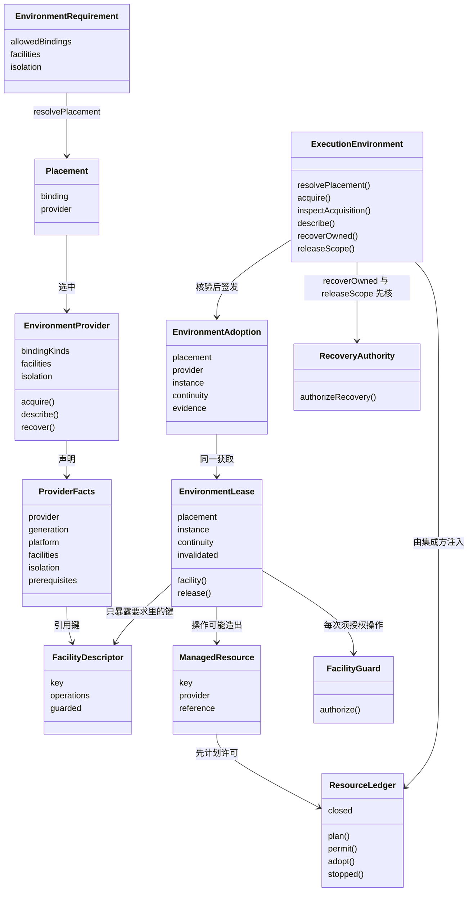
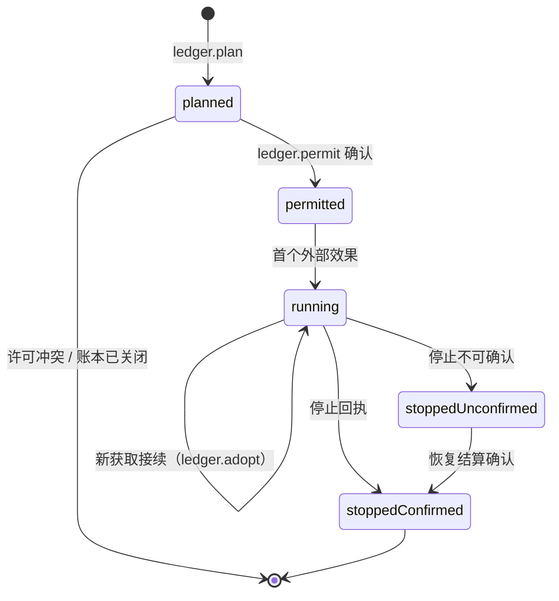
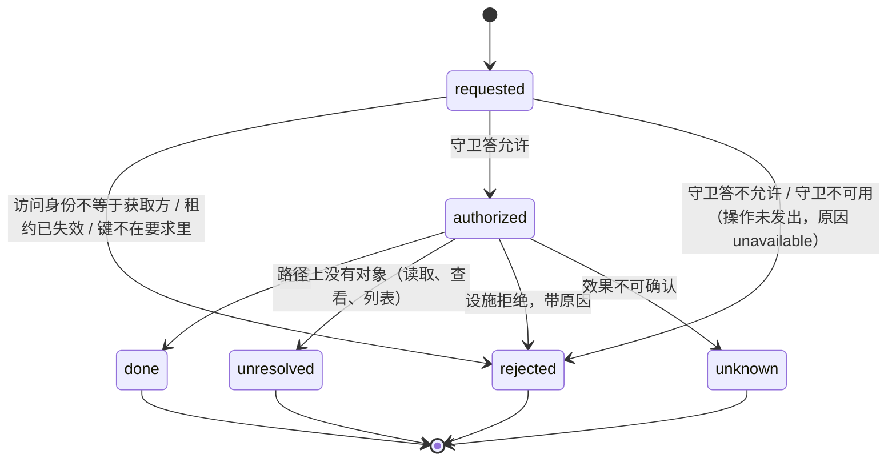

# 对象模型

本页说明 `@omne-harness/execution-environment-contract` 公开类型之间的身份、关系与生灭。行为条款归 [SPEC](../SPEC.md)，导出导航归 [public-api](public-api.md)，产品含义归产品正文[环境、落点与资源的概念](../../../../.meta_harness/design/product/execution-environments/design.md#环境落点与资源的概念)，领域对象的跨 topic 骨架归[领域对象清单](../../../../.meta_harness/design/domain_objects/objects.md)。本页只写本成员视角。

## 对象与关系

### 角色

本成员只认通用角色。每个角色是调用本成员时的一种身份，不是类型。

| 角色 | 在本成员里做什么 | 对应的输入 |
| --- | --- | --- |
| 集成方 | 交环境要求、幂等键与访问身份，接收租约；实现账本与守卫 | `EnvironmentRequirement`、`ResourceLedger`、`FacilityGuard` |
| 提供者 | 登记事实，造实例，交回临时回执，结清在途操作 | `EnvironmentProvider` |
| 设施拥有者 | 发布设施声明 | `describeFacility`、`EnvironmentFacilities` 增补 |
| 维护者 | 凭恢复授权收场 | `RecoveryAccess`、`RecoveryAuthority` |
| 观察者 | 读两条块 | `execution.placement`、`execution.host-facts` |

### 身份

| 对象 | 身份 | 谁给 |
| --- | --- | --- |
| 访问身份 `Access` | 主体加租户 | 集成方从自己的身份系统翻译 |
| 作用域引用 `ScopeRef` | 不透明字符串，可带父引用 | 集成方；本成员不解释 |
| 原调用引用 `OriginRef` | 不透明字符串 | 集成方 |
| 设施声明 `FacilityDescriptor` | 设施键 | 设施拥有者 |
| 提供者 | 名称加代 `ProviderIdentity` | 提供者 |
| 落点 `Placement` | 绑定层加提供者身份 | `resolvePlacement` 算出 |
| 获取 | 集成方给的幂等键 `AcquisitionRef` | 集成方 |
| 采用记录 `EnvironmentAdoption` | 所属获取加实例身份与代 | 本成员签发 |
| 实例 `InstanceIdentity` | 实例身份加代 | 提供者 |
| 租约 `EnvironmentLease` | 所属获取加实例代 | 本成员交付 |
| 设施请求 | 请求身份 `FacilityRequest.requestId` | 集成方按请求给 |
| 受管资源 `ManagedResource` | 资源键加所属提供者 | 提供者计划时给，账本记录 |
| 恢复授权 `RecoveryAccess` | 不可序列化的原对象 | 集成方的维护拥有者 |

### 关系

几条关系的含义：

- 环境要求是输入，不是对象。它由集成方在域外翻译而成，本成员不保存它，只在解析落点与获取时读它。
- 落点是算出来的值，不是租约。落点只说明选中了哪里；从落点到租约要经过获取。
- 采用记录与租约同属一次获取。采用记录是耐久事实，由集成方保存；租约是进程内的使用入口，随本成员的登记表存在。
- 受管资源不属于租约，属于造出它的提供者；账本里的记录是它的耐久一半。租约失效不使受管资源消失。
- 恢复授权与访问身份互不替代。访问身份走获取与设施操作，恢复授权只走 `recoverOwned` 与 `releaseScope`。

### 两条块声明

`execution.placement` 与 `execution.host-facts` 是 Runtime Context 的供给块声明，语义拥有者是本成员，生产者是提供者成员。块的值是 JSON，按声明的解码函数核对。落点块按作用域给出该作用域内各原调用的当前落点；宿主事实块给出每个已登记提供者的事实。两条块都是观察，读者不能据此推定物理完成。块的注册与读取规则归 [Runtime Context 契约](../../../context/runtime-context-contract/SPEC.md#rc-02-块声明注册与参数)。

## 生命周期

### 获取

同一幂等键的重复请求返回当前状态，不改变状态。`unrecorded` 是本成员对不认识的键的答复：从未见过，或本成员重启之后。集成方据自己的账本判断是哪一种。状态名与 `AcquisitionState` 一致。条款见 [SPEC 获取与租约](../SPEC.md#获取与租约)。

### 受管资源

许可之前没有外部效果；终局与许可写在集成方账本的同一耐久顺序里。文件批次的已提交与未知是终态，不进入「未停」集合。条款见 [INV-EE15](../SPEC.md#inv-ee15-准备持有回收与确认保持一致)。

### 设施请求

一个请求身份只有一种确认。后一次操作是另一个请求。可能造出受管资源的操作在 `authorized` 之后先走受管资源的计划与许可，再发出效果。条款见 [SPEC 设施协议](../SPEC.md#设施协议)。

### 提供者

登记 → 在场（参与落点、获取、描述、恢复）→ 退役中（拒绝新租约，结清在途操作，清理受管资源）→ 已排空，或待处置并列出未停的受管资源。插件卸载即撤除登记，撤除等于退役开始。条款见 [INV-EE18](../SPEC.md#inv-ee18-提供者换代和-cordis-集成保留原责任)。

### 设施声明

登记（同键第二份被拒绝）→ 生效 → 撤除（新获取取不到该键；已有租约上的后续操作以 `unsupported` 拒绝）。

### 恢复授权

签发 → 一次恢复驱动中每次使用由 `RecoveryAuthority` 核对 → 驱动结束。它不序列化，不跨进程，不用于获取。

## 与领域对象清单的对应

| 领域对象 | 本成员的承载 |
| --- | --- |
| 设施声明 | `FacilityDescriptor`，由 `describeFacility` 构造 |
| 获取 | `AcquisitionRef` 加 `AcquisitionState`，经 `acquire`、`inspectAcquisition` |
| 租约 | `EnvironmentLease` |
| 受管资源 | `ManagedResource` 与 `ResourceLedger` 的记录 |
| 环境提供者 | `EnvironmentProvider` 与 `ProviderFacts` |
| 文件批次 | `FileSystemFacility` 的批次操作与它的受管资源记录 |

采用记录 `EnvironmentAdoption` 是获取的耐久一半，不单独立条目。
